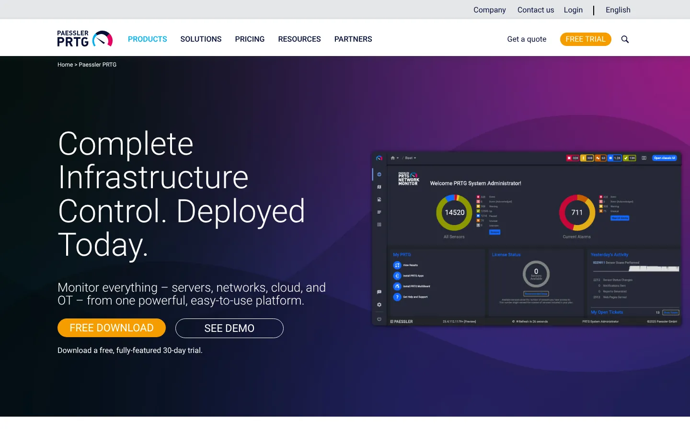
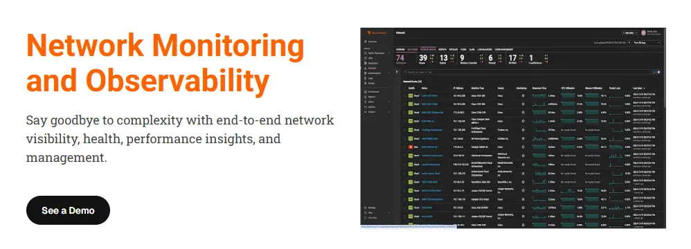
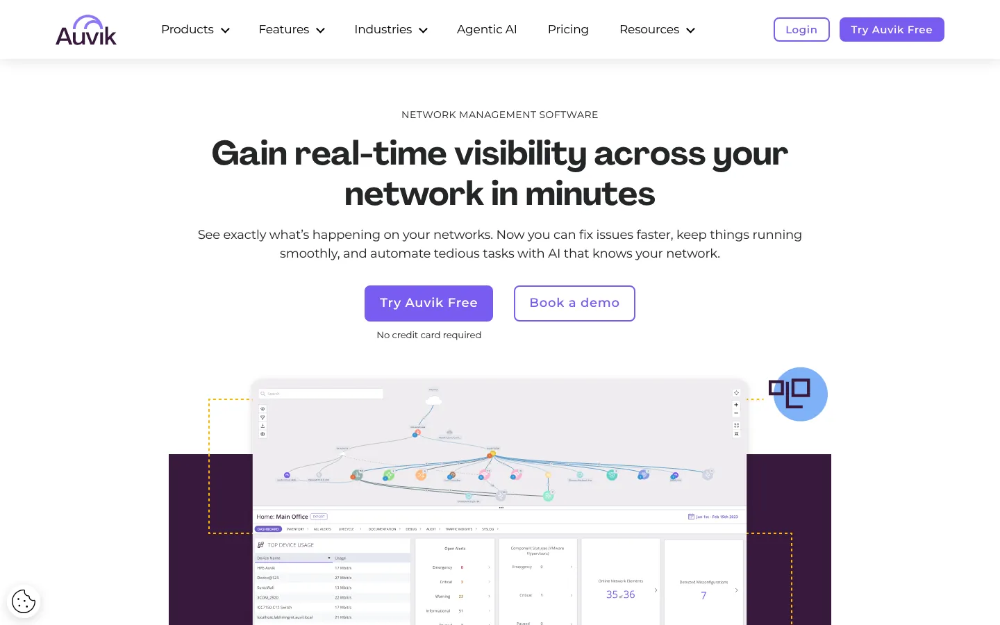
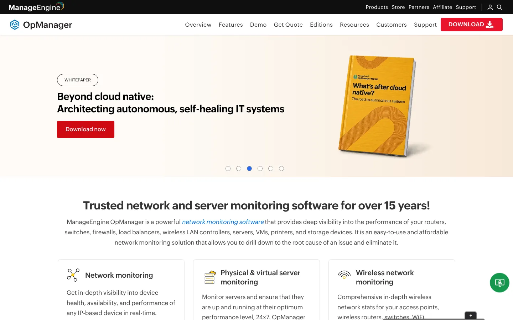
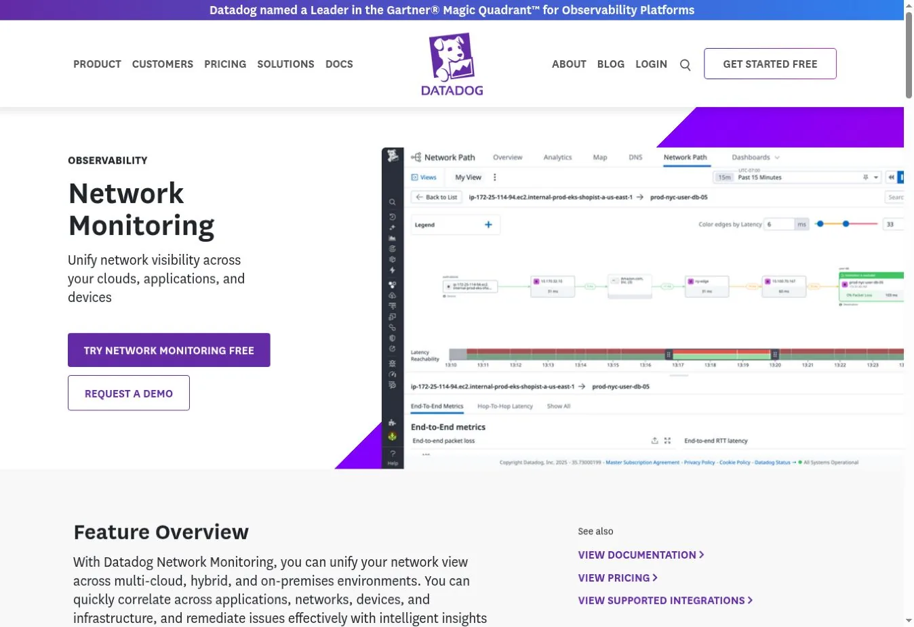
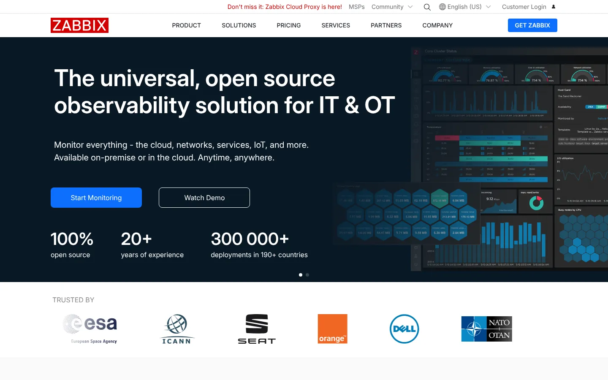
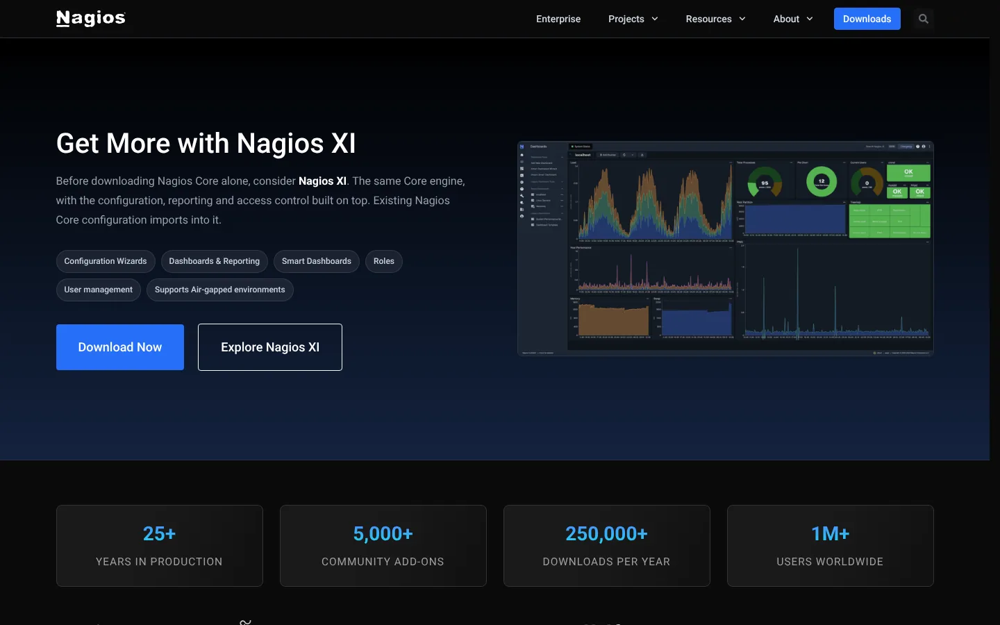
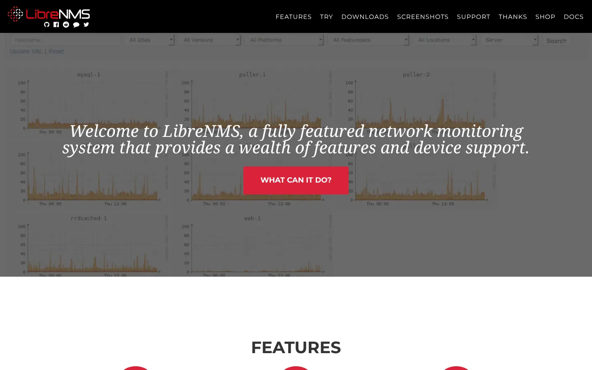
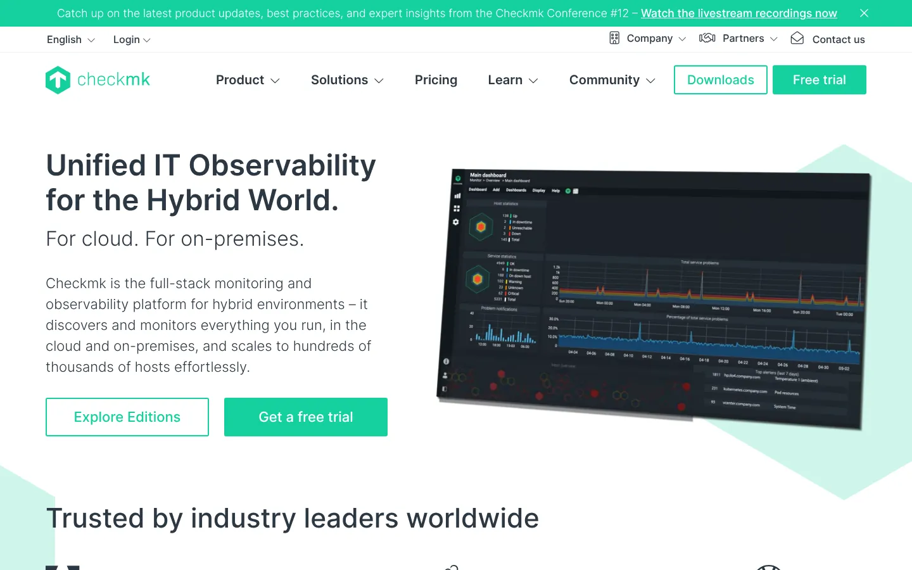
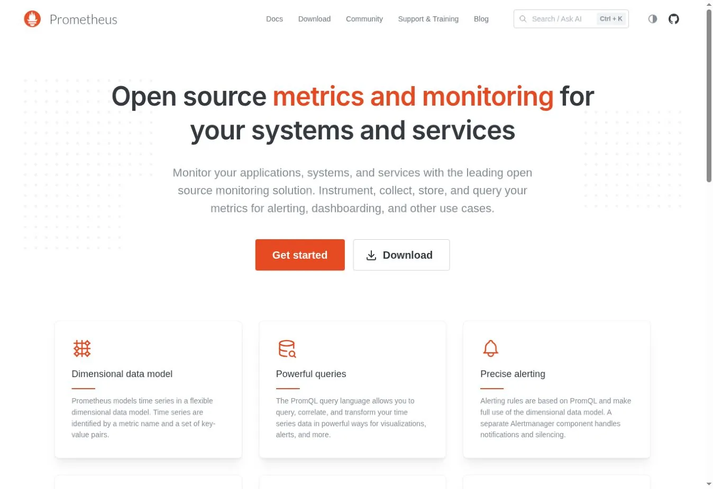

# 11 Network Monitoring Tools Compared for Small Teams and Enterprise Networks

The best network monitoring tools match what you need to watch. PRTG is easy to start for mixed devices. Auvik suits managed networks and automatic topology. Datadog links network data to cloud and app telemetry. Zabbix, LibreNMS, Nagios Core, and Checkmk give self-hosted teams more control.

SNMP polling, flow records, packet capture, path tests, and full-stack observability answer different questions. A tool that shows device health may not name the app behind a traffic spike. A flow tool can find top talkers without keeping packet contents.

## Key Takeaways

- **PRTG fits small and midsize networks** that want broad sensors and simple setup.
- **Auvik fits service providers and multi-site networks** that value automatic discovery and topology.
- **Datadog fits cloud and app teams** that need network data next to infrastructure and services.
- **Zabbix, LibreNMS, Nagios Core, and Checkmk cut license costs**, but your team owns hosting and upkeep.
- **Prometheus and Grafana can chart network metrics**, but they need exporters and are not a packaged network product.

## How We Evaluated Network Monitoring Tools

We compared each tool against a mixed network of switches, routers, firewalls, wireless access points, servers, virtual hosts, and cloud networks. We scored nine points.

1. Automatic discovery and inventory
2. SNMP polling and traps
3. NetFlow, sFlow, or IPFIX support
4. Topology and dependency maps
5. Alerting, suppression, and escalation
6. Cloud, virtual, and wireless visibility
7. Collector and deployment design
8. License unit and free option
9. Upkeep after launch

Most ranking pages cover lists and generic benefits. Few explain collector design, even though it shapes firewall rules, site resilience, and credentials. We put those choices in view.

## Network Monitoring Tools at a Glance

| Tool | Best for | Core method | Deployment | Free option | Pricing signal (checked Nov. 1, 2026) |
|---|---|---|---|---|---|
| Paessler PRTG | Small and midsize mixed networks | Sensors using SNMP, flow, WMI, and APIs | Self-hosted; hosted options | 100 sensors | From $200 per month, annual, for 500 sensors |
| SolarWinds | Mature enterprise network ops | SNMP, flow, topology, and path | SaaS or self-hosted | Trial | From $8 per node per month |
| Auvik | MSPs and multi-site networks | Collector-led discovery and topology | Vendor cloud plus local collector | Trial | Custom, per billable device |
| ManageEngine OpManager | Value device monitoring | SNMP, WMI, and flow add-ons | Self-hosted | Limited free edition | Standard from $95 per year for 10 devices |
| Datadog Network Monitoring | Cloud and app correlation | Cloud flow, SNMP, NetFlow, and paths | SaaS plus agents | Trial | $5 per host CNM; $7 per device NDM, annual |
| LogicMonitor | Hybrid enterprise estates | Collector-based device and cloud monitoring | SaaS plus collectors | Trial | Custom Hybrid Units |
| Zabbix | Flexible open-source monitoring | Agents, SNMP, IPMI, traps, proxies | Self-hosted or managed cloud | Full software | No license fee; support from €245 per month |
| Nagios Core | Plugin-driven checks | Active and passive checks | Self-hosted Linux | Full software | Free GPL software |
| LibreNMS | Open-source SNMP networks | SNMP discovery and polling | Self-hosted | Full software | Free; you pay to run it |
| Checkmk | Self-hosted infrastructure and network monitoring | Agents and SNMP services | Self-hosted; managed options | Community edition | Pro from about €240 per month in the calculator |
| Prometheus with Grafana | Metrics-focused engineering teams | Exporters, scraping, dashboards | Self-managed or managed | Open source | Software free; hosting varies |

## Decide What Kind of Network Evidence You Need

**Device health** uses SNMP or vendor APIs to track interfaces, CPU, memory, temperature, and hardware. **Flow data** shows who talked, through which interface, and how much. **Packet capture** keeps packet-level detail. **Path monitoring** measures latency and loss across hops. **Observability platforms** tie network signals to hosts, services, traces, and logs.

Wireshark is great for packet analysis, but it is not a continuous monitoring platform. The same goes for `tcpdump`, `ping`, and `traceroute`.

## The 11 Network Monitoring Tools Compared

### 1. Paessler PRTG: Best for Easy Sensor-Based Monitoring

PRTG organizes monitoring around sensors. One device can use several sensors for uptime, traffic, CPU, temperature, or app checks. It covers network protocols, flow data, operating systems, cloud services, and custom sensors.

The free edition allows 100 sensors, which Paessler puts at about ten devices. Paid plans started at $200 per month on annual billing for 500 sensors, or about 50 devices. Count real sensors, because a core switch needs far more than a printer.

**Choose PRTG when** a small IT team wants broad coverage and clear license tiers.
**Check first** sensors per device, probe placement, failover, and server sizing.

### 2. SolarWinds: Best for Mature Enterprise Network Operations

SolarWinds offers network performance, traffic analysis, configuration, topology, and path tools across several products. It suits teams that need full network operations, not just an uptime dashboard.

The public pricing page listed monitoring and observability from $8 per node per month. Final cost depends on products, nodes, flow analysis, databases, and support. Map each need to a specific license.

**Choose SolarWinds when** a network team needs established enterprise workflows.
**Check first** module boundaries, node definitions, database needs, and renewal cost.

### 3. Auvik: Best for MSPs and Multi-Site Networks

Auvik uses local collectors to discover devices and send data to its cloud. Automatic topology, inventory, config backups, alerts, and traffic views help teams that run many customer or branch networks.

Pricing is custom and based on billable devices. Auvik's [billing explanation](https://support.auvik.com/hc/en-us/articles/201515670-How-much-does-Auvik-cost) says core gear like firewalls, routers, switches, and controllers is generally billable. Access points, printers, cameras, and end-user devices may not add the same fee.

**Choose Auvik when** topology automation and multi-network work save technician time.
**Check first** billable-device rules, collector resilience, and tenant separation.

### 4. ManageEngine OpManager: Best Value for Device Monitoring

OpManager covers discovery, SNMP and WMI monitoring, maps, alerts, and virtualization, with distributed enterprise options. It is a familiar self-hosted choice for teams that want commercial software without a big observability platform.

Annual prices started at $95 for Standard and $145 for Professional, each for ten devices. Enterprise started at $4,595 for 250 devices. Flow analysis and config management may need add-ons.

**Choose OpManager when** device monitoring and low entry pricing come first.
**Check first** add-ons, device counting, remote pollers, and upgrade costs.

### 5. Datadog Network Monitoring: Best for Cloud and App Correlation

Datadog splits network coverage into Cloud Network Monitoring, Network Device Monitoring, NetFlow, wireless, and Network Path. Its value is linking those signals to traces, hosts, containers, and logs.

Datadog's [network monitoring pricing](https://www.datadoghq.com/pricing/?product=network-monitoring) listed $5 per host for Cloud Network Monitoring and $7 per polled device, on annual terms. NetFlow started at $0.65 per million records. Our breakdown of a [Datadog observability bill](/cloud-infrastructure/datadog-observability-costs/) shows how these lines add up.

**Choose Datadog when** network fixes must connect to cloud and app behavior.
**Check first** prerequisite products, record volume, retention, and annual commitments.

### 6. LogicMonitor: Best for Hybrid Enterprise Estates

LogicMonitor uses collectors for on-premises devices while its SaaS platform handles dashboards, alerts, topology, and admin. It also covers cloud services, apps, wireless gear, and OpenTelemetry data.

Pricing uses Hybrid Units. One unit equals one collector-monitored device, one cloud IaaS resource, seven PaaS resources, five access points, or 100 GB of OpenTelemetry metrics. Prices need a quote.

**Choose LogicMonitor when** one ops team runs a broad hybrid estate.
**Check first** Hybrid Unit conversion, collector pairs, add-ons, and contract minimums.

### 7. Zabbix: Best Open-Source Platform for Custom Monitoring

Zabbix monitors networks, servers, apps, and services through agents, SNMP, IPMI, traps, proxies, and templates. It handles distributed setups with no license fee per host or metric.

Your team owns the server, database, proxies, upgrades, and templates unless you buy managed services. Paid subscriptions sell support, not software. Silver started at €245 per month on annual billing.

**Choose Zabbix when** customization and scale without per-device fees justify self-hosting.
**Check first** database tuning, proxy design, high availability, and support needs.

### 8. Nagios Core: Best for Plugin-Driven Checks

Nagios Core runs active and passive checks for hosts, services, websites, network devices, and custom metrics. Its plugin model lets experienced admins monitor almost anything that returns a status.

Core is free under GPLv2 and runs on Linux. Setup, upgrades, dashboards, and reports are more manual than in Nagios XI, the paid edition promoted on the same site. That trade works when your team already has plugins and know-how.

**Choose Nagios Core when** existing checks, scripts, and skills have value.
**Check first** config automation, plugin upkeep, and staff continuity.

### 9. LibreNMS: Best Open-Source Choice for SNMP Networks

LibreNMS focuses on SNMP discovery and monitoring. It supports alerts, dashboards, distributed polling, routing and switching data, service checks, and syslog.

The software is open source. [LibreNMS auto-discovery](https://docs.librenms.org/Extensions/Auto-Discovery/) still needs a seed device and valid credentials. Treat SNMP communities and v3 accounts as secrets and rotate them.

**Choose LibreNMS when** switches, routers, and firewalls sit at the center of your network.
**Check first** poller scale, credential design, backups, and upgrades.

### 10. Checkmk: Best Self-Hosted Monitoring With Broad Discovery

Checkmk monitors servers, networks, apps, containers, and cloud services through agents, SNMP, and automatic service discovery. The Community edition is open, and paid editions add scale and support.

The public calculator showed a Pro example of about €240 per month for roughly 1,000 services. Count services, not just physical boxes, when you budget.

**Choose Checkmk when** automatic discovery and self-hosted control matter most.
**Check first** service counts, distributed sites, edition gaps, and support.

### 11. Prometheus With Grafana: Best for Engineering-Owned Metrics

Prometheus scrapes metrics from exporters, and Grafana shows dashboards and alerts. Network teams often use SNMP Exporter, Blackbox Exporter, or vendor exporters.

Both are open source, but together they form an assembly, not a packaged network product. You manage discovery, exporter config, cardinality, retention, and upgrades. If you plan to move off Datadog, our [Datadog alternatives guide](/cloud-infrastructure/datadog-alternatives/) compares Grafana Cloud and other options.

**Choose this pair when** platform engineers already run metrics infrastructure.
**Check first** exporter coverage, SNMP config generation, retention, and staffing.

## How to Choose by Network Size and Team

| Environment | Shortlist |
|---|---|
| Small internal network | PRTG, OpManager, Checkmk |
| MSP or many branches | Auvik, LogicMonitor |
| Cloud-native apps | Datadog, Prometheus with Grafana |
| Traditional enterprise network ops | SolarWinds, LogicMonitor, OpManager |
| Self-hosted open-source program | Zabbix, LibreNMS, Checkmk, Nagios Core |
| SNMP-centered switching and routing | LibreNMS, PRTG, Zabbix |

## Network Monitoring Trial Checklist

Test discovery on a controlled subnet first. Confirm how credentials are stored and which collectors reach each management network. Then simulate a failed interface, high use, a flapping link, a collector outage, and an unreachable site.

Measure discovery accuracy, time to a useful alert, duplicate alerts, topology accuracy, and storage growth. Price the same inventory across vendors. Keep deployment claims consistent with the definitions in our [cloud computing statistics](/cloud-infrastructure/cloud-computing-statistics/). Network outages also feed security risk, which our [cybersecurity statistics](/cybersecurity/cybersecurity-statistics/) put in context.

## FAQs

### What Are Network Monitoring Tools?

Network monitoring tools discover devices, poll health data, collect traffic summaries, map connections, and alert on failures or thresholds. Products differ in protocol coverage, flow analysis, packet detail, cloud visibility, deployment model, and licensing. Pick based on the evidence you need, such as device health, traffic flows, or full-stack context.

### What Is the Best Free Network Monitoring Tool?

Zabbix, LibreNMS, Nagios Core, Checkmk Community, Prometheus, and Grafana are open-source options. PRTG also offers 100 free sensors. Free software still needs servers, upgrades, security work, backups, and staff time, so compare the full running cost rather than the license price alone.

### What Is SNMP Network Monitoring?

SNMP monitoring polls network devices for standard and vendor-specific management data. It can report interface status, traffic counters, CPU, memory, temperature, power, and hardware health. SNMPv3 adds authentication and encryption, so use it instead of older community strings wherever your devices support it.

### How Are Network Monitoring Tools Priced?

Common units include devices, nodes, sensors, interfaces, access points, flow records, paths, services, collectors, or platform capacity. Because vendors count differently, compare the same network inventory and retention period across every quote. A cheap per-device price can still cost more if your gear counts as many units.

## Resources

- [PRTG pricing](https://www.paessler.com/pricing)
- [SolarWinds pricing](https://www.solarwinds.com/pricing)
- [OpManager editions](https://www.manageengine.com/network-monitoring/opmanager-editions.html)
- [LogicMonitor pricing](https://www.logicmonitor.com/pricing)
- [Zabbix subscriptions](https://www.zabbix.com/subscriptions)
- [Nagios Core](https://www.nagios.org/projects/nagios-core/)
- [LibreNMS features](https://docs.librenms.org/Support/Features/)
- [Checkmk pricing](https://checkmk.com/pricing)
- [Prometheus](https://prometheus.io/)
- [Grafana](https://grafana.com/)
