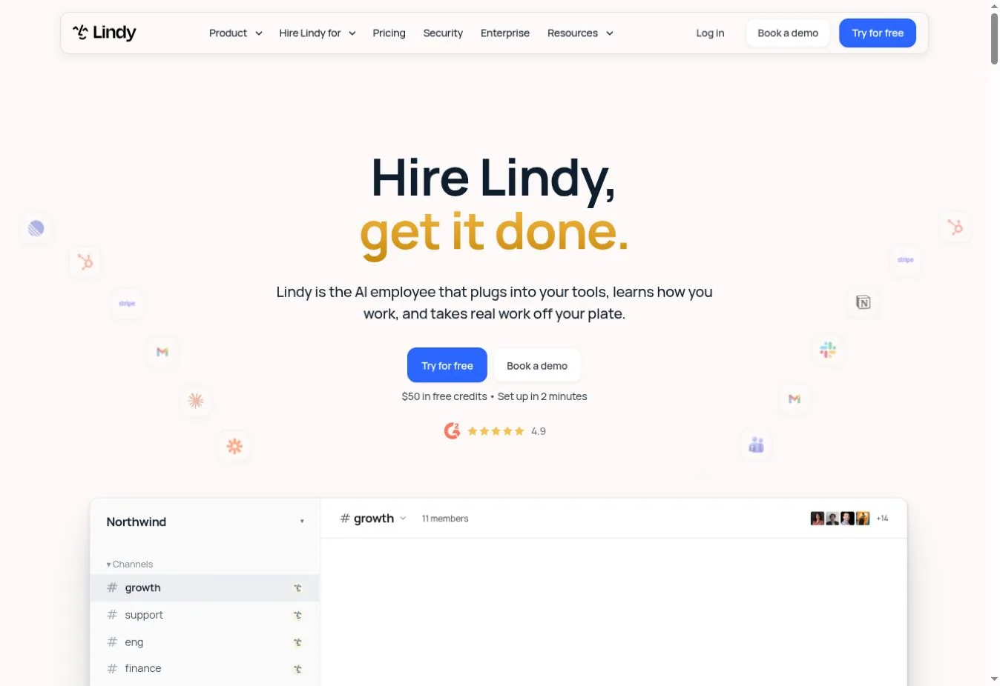
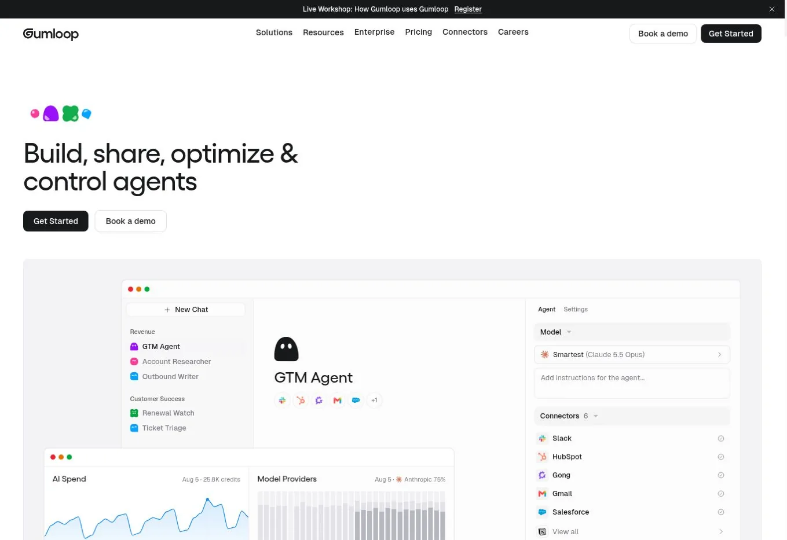
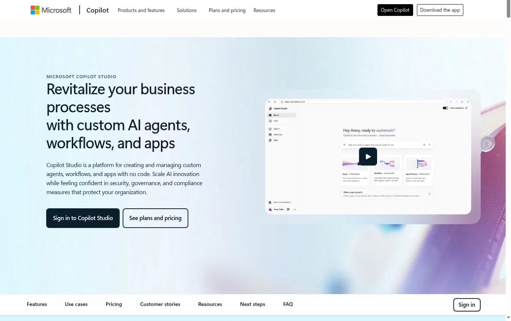
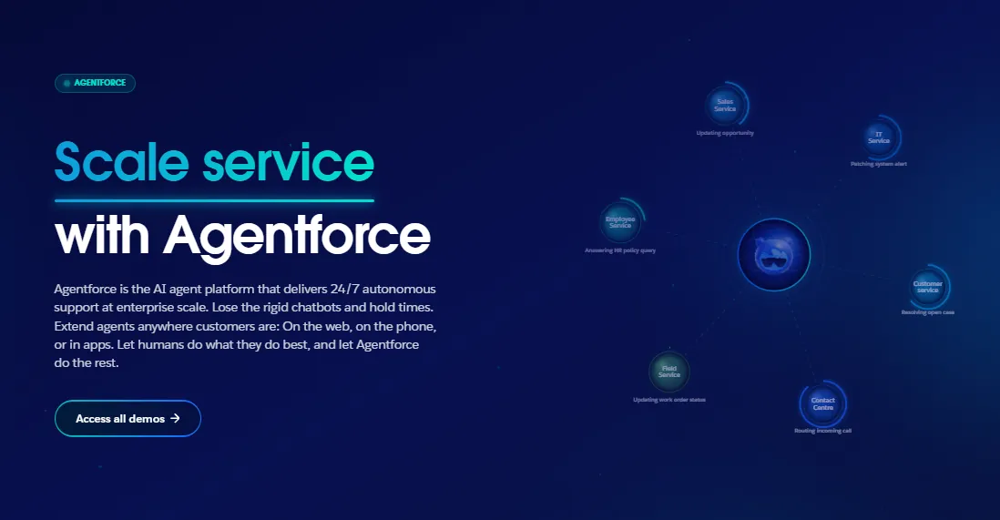
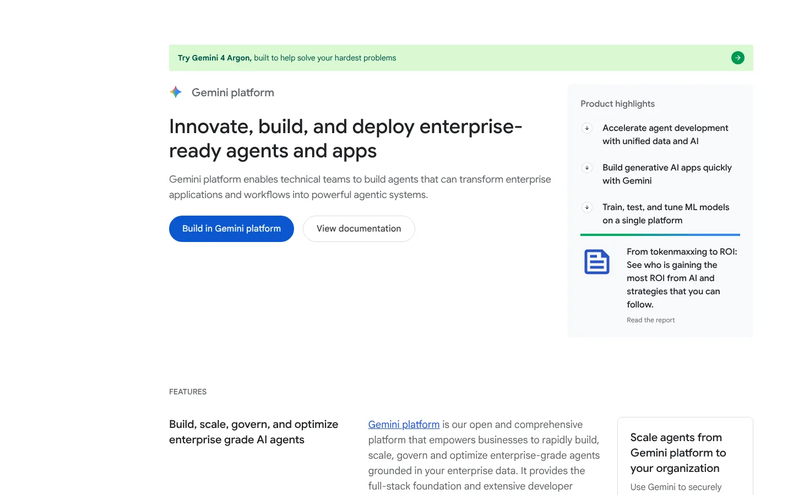
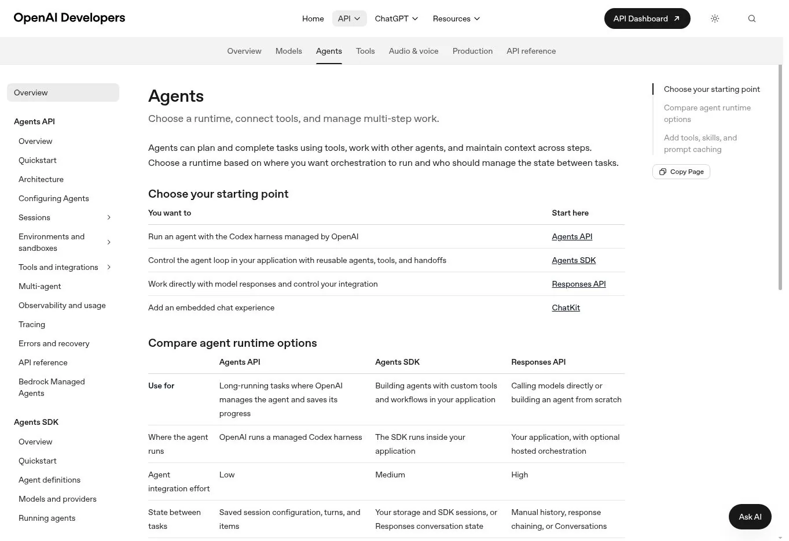
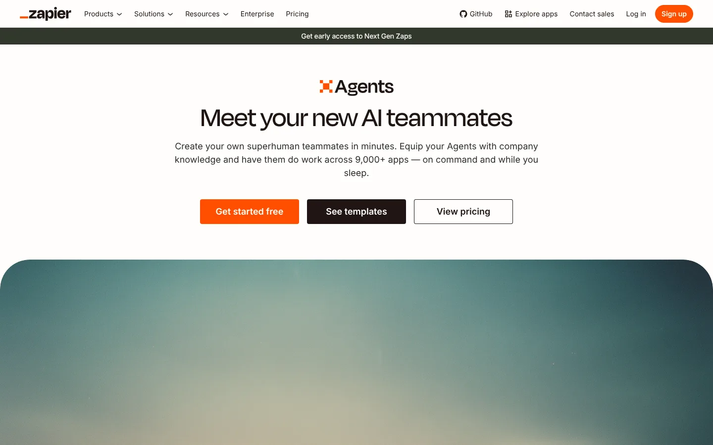
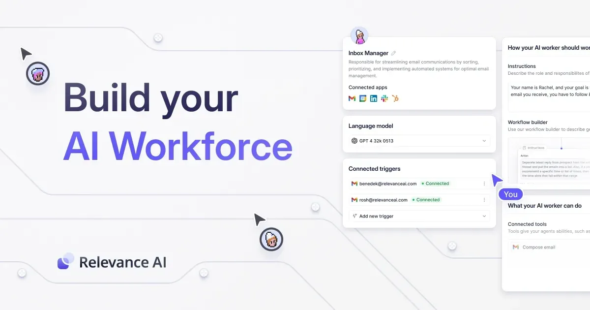
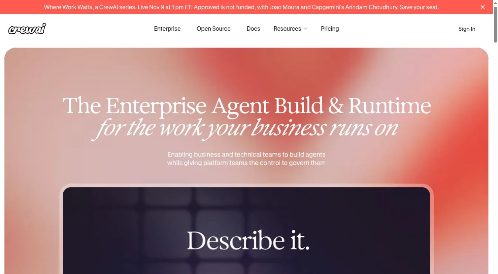
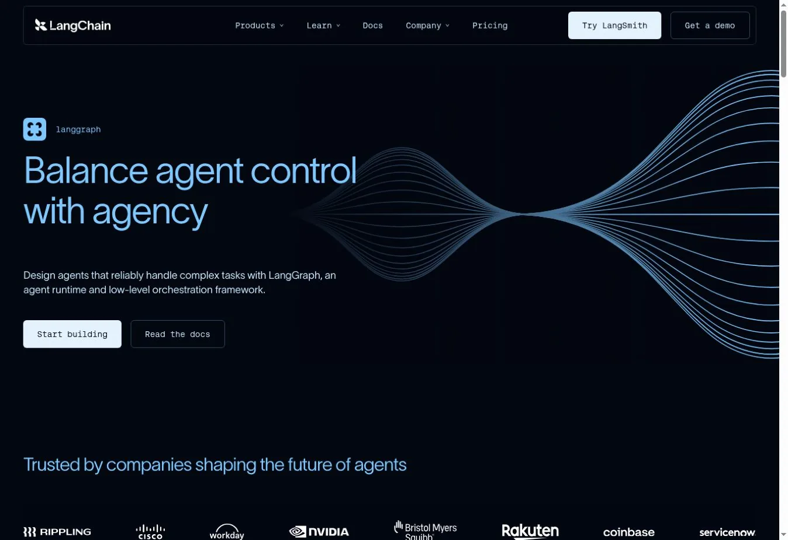

# 10 Best AI Agents for Research, Operations, and Developer Work

The best AI agents fit the work they can reach, the actions they can take, and the controls around them. Lindy and Gumloop suit no-code business workflows. Copilot Studio and Agentforce fit Microsoft and Salesforce shops. CrewAI, LangGraph, and the OpenAI Agents SDK give developers the most control.

An agent that drafts a report carries less risk than one that edits a customer record. So start with the task, the approval point, the data access, and the cost of a mistake. Then compare products.

## Key Takeaways

- **Lindy is the strongest general no-code pick** for teams that want a person to approve outside actions.
- **Gumloop is a capable visual builder** for multi-step flows across models, data, and apps.
- **Copilot Studio and Agentforce work best inside their own ecosystems.** Their value depends on existing data, permissions, and licenses.
- **The OpenAI Agents SDK, CrewAI, and LangGraph are developer tools.** Your team owns testing, hosting, and monitoring.
- **List price rarely predicts the bill.** Credits, actions, tokens, traces, and compute all measure different things.

## How We Picked the Best AI Agents

We asked one question of every product. Can a team let this agent finish useful work without losing control?

We scored each one on seven points.

1. **Tool and data access.** Which apps, APIs, files, and databases can it use?
2. **Approval controls.** Can a person review a high-impact action first?
3. **Reliability.** Can builders test, trace, and retry a failed run?
4. **Deployment.** Is it hosted, self-hosted, or code you run yourself?
5. **Governance.** Does it offer roles, audit logs, and identity controls?
6. **Cost unit.** Does the vendor bill by seat, action, credit, token, or compute?
7. **Builder experience.** Can an operations team set it up, or does it need engineers?

Long integration lists say little about who can approve a refund or stop a runaway flow. Our explainer on [what AI agents are](/ai/what-are-ai-agents/) covers the basic model behind these tools. Our [AI statistics on investment and production use](/ai/ai-statistics-investment-production-use/) show how few pilots reach production.

## Best AI Agents at a Glance

| AI agent platform | Best for | Builder type | Human approval | Deployment | Pricing signal (checked Nov. 1, 2026) |
|---|---|---|---|---|---|
| Lindy | No-code business workflows | Visual | Yes, for outside actions | Vendor cloud | Trial credits; Team from $29.99 per user per month |
| Gumloop | Visual multi-app automation | Visual | Configurable steps | Vendor cloud; enterprise options | Pro from $37 per month plus usage |
| Microsoft Copilot Studio | Microsoft 365 and Power Platform teams | Low-code | Configurable | Microsoft cloud | $0.01 per Copilot Credit or prepaid packs |
| Salesforce Agentforce | CRM, service, and sales work | Low-code | Flow and policy controls | Salesforce cloud | Flex Credits, conversations, or user licenses |
| Gemini Enterprise Agent Platform | Google Cloud agent infrastructure | Low-code and code | App dependent | Google Cloud | Compute, memory, and operations usage |
| OpenAI Agents SDK and API | Custom production agents | Code | App controlled | Your stack | Model, tool, and container usage |
| Zapier Agents | Cross-app task automation | No-code | Workflow dependent | Vendor cloud | Free activity allowance; paid plans |
| Relevance AI | No-code agent teams | Visual | Workflow dependent | Vendor cloud | Free allowance; Pro from $29 per month |
| CrewAI | Multi-agent developer work | Code plus visual | Supported | Cloud, VPC, or your infrastructure | Free tier; enterprise custom |
| LangGraph with LangSmith | Stateful, long-running agents | Code | Built-in interrupts | Cloud, hybrid, or self-hosted | LangSmith free; Plus $39 per seat per month plus usage |

Prices change often and vary by region and term. Treat them as signals and model your own volume.

## The 10 Best AI Agents Compared

### 1. Lindy: Best No-Code Agent for Controlled Business Work

Lindy is the easiest start for a business team that wants agents without building an app. It connects to email, calendars, calls, files, and common business software. The key control is how it treats outside actions. An agent can pause before it sends a message or changes another system.

That pattern suits sales follow-up, meeting prep, inbox triage, and lead research. It also makes a pilot easier to supervise. Enterprise plans add SSO, SCIM, and audit logs.

Test the credit model with real work. A multi-step task can use more than one credit, and active users affect billing. The Team plan started at $29.99 per user per month when we checked. The free offer gave $50 in credits for seven days.

**Choose Lindy when** an operations team needs a hosted agent with clear approval points.
**Skip it when** you need to control the runtime or model routing in code.

### 2. Gumloop: Best Visual Builder for Complex Workflows

Gumloop joins models, files, web data, and app actions on a node-based canvas. It helps when a flow branches, loops, or transforms data several times before the final step. Teams build research pipelines, document processors, and CRM flows without writing the orchestration layer.

Its 2026 pricing separates model and compute use from the orchestration fee. Gumloop passes tokens and compute through at cost, then adds an 8% fee. Pro started at $37 per month with credits and unlimited seats. Enterprise adds policies, audit logs, and private deployment options.

That model is clearer than one opaque credit pool. Still, a flow that browses many pages will cost more than a short classification step.

**Choose Gumloop when** visual branching and multi-app data work are central.
**Skip it when** you need a code-first runtime or strict on-premises deployment.

### 3. Microsoft Copilot Studio: Best for Microsoft-Centered Companies

Copilot Studio is a no-code and low-code space for agents, workflows, and apps. It can use standard, premium, and custom Power Platform connectors. It pays off most when your data and permissions already live in Microsoft 365, Dynamics 365, or Azure.

Agents can run on triggers and publish to internal or external channels. Governance follows Microsoft's admin model, which cuts the work of aligning identities and data policies.

Pricing uses Copilot Credits. Pay-as-you-go was $0.01 per credit when we checked. A prepaid pack cost $200 per month for 25,000 credits on an annual term. External agents need an Azure subscription. Internal agents can involve separate Microsoft 365 Copilot licenses.

**Choose Copilot Studio when** Microsoft is already your system of work and identity.
**Skip it when** most of the workflow lives outside Microsoft.

### 4. Salesforce Agentforce: Best for CRM and Service Workflows

Agentforce is strongest when the work starts and ends in Salesforce. Agents can use CRM records, Flow automation, Data Cloud context, and Salesforce permissions. A service agent can find a customer, pull approved knowledge, update a case, and escalate in one place.

Salesforce offers several billing paths. Flex Credits cost $500 per 100,000 credits when we checked, and a standard action used 20 credits. Conversation pricing was $2 per conversation. User licenses create another structure. Compare them by cost per finished task.

The case is weaker when your data sits elsewhere. Our review of [Salesforce AI data access](/ai/salesforce-ai-data-access/) explains why record permissions need a check before launch.

**Choose Agentforce when** CRM data, Flow, and service work are central.
**Skip it when** the agent must work across a neutral stack.

### 5. Gemini Enterprise Agent Platform: Best for Google Cloud Builders

Google folded Agentspace into Gemini Enterprise in October 2025. It now separates the Gemini Enterprise app from the Gemini Enterprise Agent Platform used to build and run agents. A workplace search tool and an agent runtime solve different problems.

The Agent Platform fits teams already building on Google Cloud. It supplies managed compute and services for production agents. Google listed the first 50 agent compute hours each month as free, then $0.085 per vCPU-hour. Memory, storage, and operations can add charges.

This is infrastructure, not a ready-made no-code assistant. Your team still designs tools, permissions, tests, and the user experience.

**Choose it when** your engineers already build and govern workloads on Google Cloud.
**Skip it when** an operations team needs a finished builder with quick SaaS links.

### 6. OpenAI Agents SDK and Agents API: Best for Custom Applications

The OpenAI Agents SDK is a code-first base for agents. They can use tools, hand off work, apply guardrails, and record traces. The Agents API adds managed execution. Together they suit teams building a product, not configuring a packaged tool.

Your application still owns deployment, business data, and permissions. You can design human review into the flow, but no single switch protects every action.

Costs follow the models and tools you call. Web search, containers, and long model calls change the price per task. OpenAI shuts down its visual Agent Builder on November 30, 2026. Start new work on the SDK and API.

**Choose it when** you want a custom app and have engineers to build it.
**Skip it when** business users must own workflow design without code.

### 7. Zapier Agents: Best for Broad SaaS Reach

Zapier Agents builds on Zapier's large app catalog. It works well when an agent must find information, prepare a result, and act across common SaaS tools. Marketing, recruiting, and sales operations are natural fits.

Watch the activity unit. The free plan included 400 activities per month. A paid annual plan cost $400 per year, or $33.33 per month, for 1,500 activities. Complex work can use several activities, so count the steps in one good run.

Zapier is folding Agents into its wider AI product line. Confirm current names and entitlements before a long rollout.

**Choose Zapier Agents when** app reach and quick setup beat runtime control.
**Skip it when** you need private infrastructure or detailed orchestration.

### 8. Relevance AI: Best for No-Code Teams of Agents

Relevance AI groups agents into workforces. Each agent gets a role, tools, and triggers. That helps a team split a process into research, qualification, enrichment, and follow-up. The interface targets business builders, and custom actions allow technical extension.

The free tier listed 200 actions per month. Pro started at $29 per month with 2,500 actions. Team pricing rose sharply with a larger pool. Enterprise adds identity controls, audit logs, and evaluations.

More agents mean more handoffs and more places to fail. A short single-agent flow is often easier to test.

**Choose Relevance AI when** a business team wants visual agents grouped around one process.
**Skip it when** you need code-level state control or cheap high-volume runs.

### 9. CrewAI: Best Developer Platform for Role-Based Agents

CrewAI is built around agents with roles, tasks, tools, and processes. Developers can use the open-source framework. The commercial platform adds visual authoring, deployment, monitoring, and enterprise controls.

The free plan included 50 workflow runs per month, a visual editor, and GitHub integration. Enterprise deployments can run in CrewAI's cloud, a customer VPC, or customer infrastructure. The vendor lists SSO, role controls, guardrails, and human review.

Role labels do not guarantee good specialization. Teams still need test cases, shared-state rules, and clear stop conditions.

**Choose CrewAI when** developers want an opinionated multi-agent framework with hosting options.
**Skip it when** one predictable workflow can do the job.

### 10. LangGraph with LangSmith: Best for Stateful, Long-Running Agents

LangGraph gives developers direct control over state, branches, loops, and interrupts. A flow can pause before a sensitive action, keep its state, take a human decision, and resume. That suits long processes that cannot run as one prompt and reply.

LangSmith adds tracing, evaluation, and deployment tools. Its Developer plan was free for one seat with 5,000 base traces per month. Plus cost $39 per seat per month with 10,000 base traces. Enterprise plans offer self-hosted and hybrid options.

LangGraph is a framework, not a finished business agent. Expect to build the interface, permissions, and safeguards yourself.

**Choose it when** durable state, human interrupts, and trace-level debugging are required.
**Skip it when** a nontechnical team needs a ready-made tool.

## Which AI Agent Should You Choose?

Pick by operating model before you compare feature counts.

| Your situation | Shortlist |
|---|---|
| Business team needs no-code flows and approvals | Lindy, Gumloop |
| Company runs on Microsoft | Copilot Studio |
| Customer work lives in Salesforce | Agentforce |
| Team wants broad SaaS reach | Zapier Agents, Relevance AI |
| Engineers need a custom agent app | OpenAI Agents SDK, LangGraph |
| Developers want explicit multi-agent roles | CrewAI |
| Platform team builds on Google Cloud | Gemini Enterprise Agent Platform |

Run a trial on one real process. Include routine cases, missing data, permission failures, and a request the agent should refuse. Measure completion rate, review time, wrong actions, and cost per accepted result.

## How to Work Out the Real Cost of an AI Agent

The real cost is the total cost of work you accept, not the smallest billing unit.

**Cost per accepted task = (platform fees + model and tool use + integration + review time + rework) ÷ accepted tasks**

Track failed and repeated runs too. Picture an agent at $0.20 per try that needs three tries and five minutes of review. It can cost more than a $1.00 flow that works once. Snowflake-style usage billing shows the same pattern, as our look at [Snowflake AI compute costs](/ai/snowflake-ai-compute-costs/) explains.

## AI Agent Governance Checklist

Before an agent gets production access, write down these points.

- The systems and records it may read
- The actions it may take without review
- The actions that always need approval
- The person who owns each workflow
- The log kept after each run
- The response to a failed, duplicate, or unauthorized action
- How to switch off tools, keys, or the whole agent
- The test set run before every material update

The [NIST AI Risk Management Framework](https://www.nist.gov/itl/ai-risk-management-framework) gives a useful structure. Each product control still needs a named owner and a specific process.

## FAQs

### What Are the Best AI Agents for Business?

Lindy and Gumloop are strong general picks for no-code business workflows. Copilot Studio suits Microsoft-heavy companies, and Agentforce suits Salesforce-centered sales and service teams. The right choice depends on data access, approval rules, integrations, and cost per finished task. Test one real process before you commit.

### What Is the Best AI Agent Platform for a Small Business?

Start with a hosted no-code product that connects to the tools you already use. Lindy, Gumloop, Zapier Agents, and Relevance AI cut engineering work. Test one frequent task first and keep approval on anything that leaves your systems. Avoid buying enterprise capacity until you have measured real usage for a few weeks.

### Are AI Agents Free?

Several products offer free plans or trial allowances, including Lindy, Zapier Agents, Relevance AI, CrewAI, and LangSmith. Free limits usually cap credits, actions, runs, traces, or time. Model calls, compute, premium connectors, and production controls often need a paid plan. Check which limit your workflow will hit first.

### What Can AI Agents Do?

Common uses include research, inbox triage, lead enrichment, meeting prep, support routing, document processing, data entry, and software tasks. Start with tasks that have clear inputs, few tools, a measurable result, and a defined escalation path. Avoid tasks where a single wrong action is costly.

## Resources

- [Lindy pricing](https://www.lindy.ai/pricing)
- [Gumloop pricing](https://www.gumloop.com/pricing)
- [Microsoft Copilot Studio](https://www.microsoft.com/en-us/microsoft-copilot/microsoft-copilot-studio)
- [Salesforce Agentforce pricing](https://www.salesforce.com/agentforce/pricing/)
- [Gemini Enterprise Agent Platform pricing](https://cloud.google.com/products/gemini-enterprise-agent-platform/pricing)
- [OpenAI Agents SDK](https://developers.openai.com/api/docs/guides/agents/sdk)
- [OpenAI deprecations](https://developers.openai.com/api/docs/deprecations)
- [Zapier pricing](https://zapier.com/pricing)
- [Relevance AI pricing](https://relevanceai.com/pricing)
- [CrewAI pricing](https://crewai.com/pricing)
- [LangSmith pricing](https://www.langchain.com/pricing)
