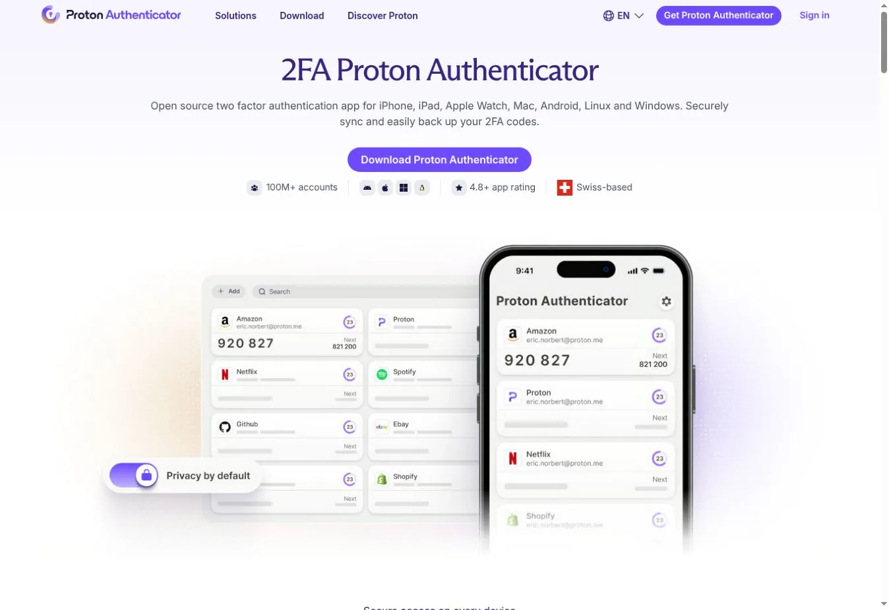
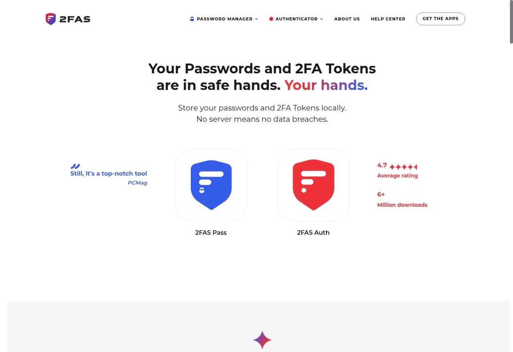
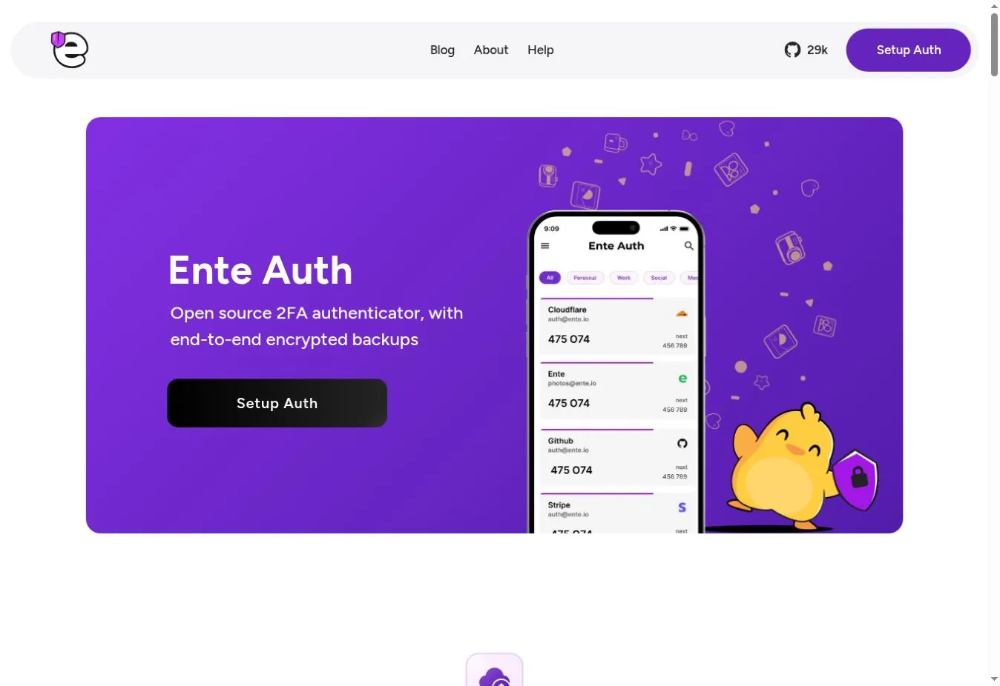
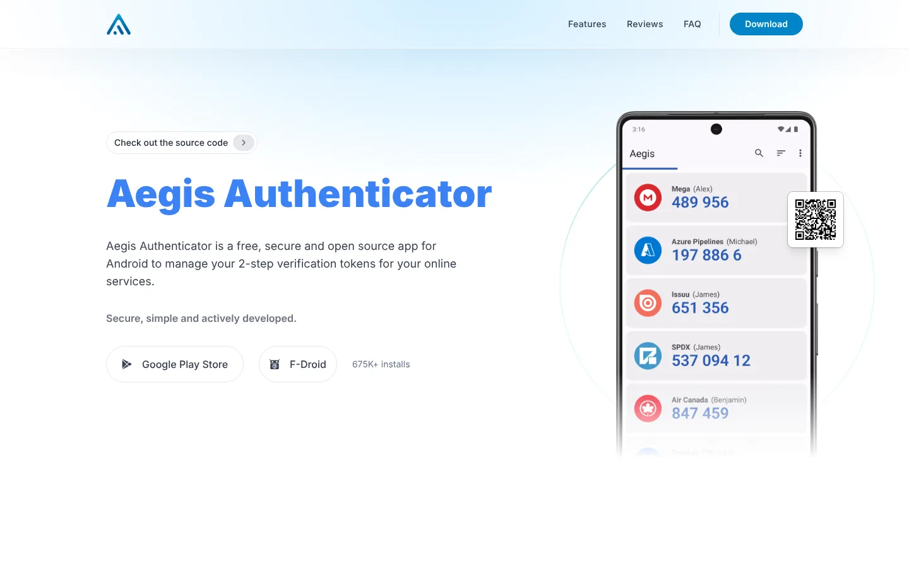
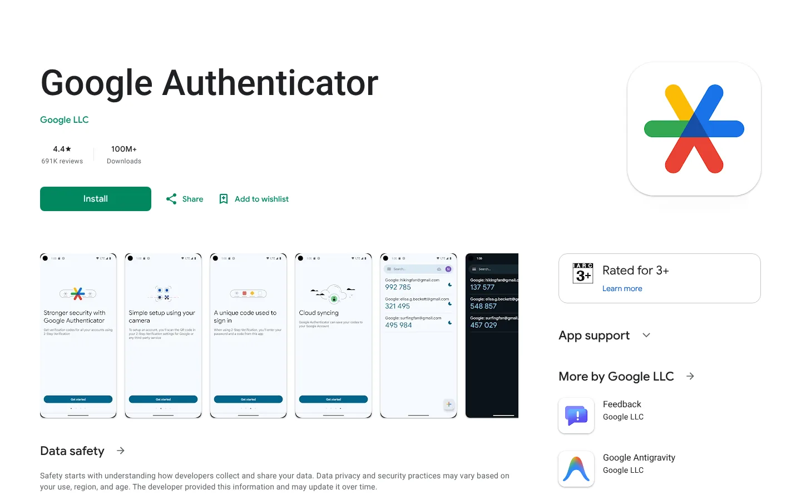
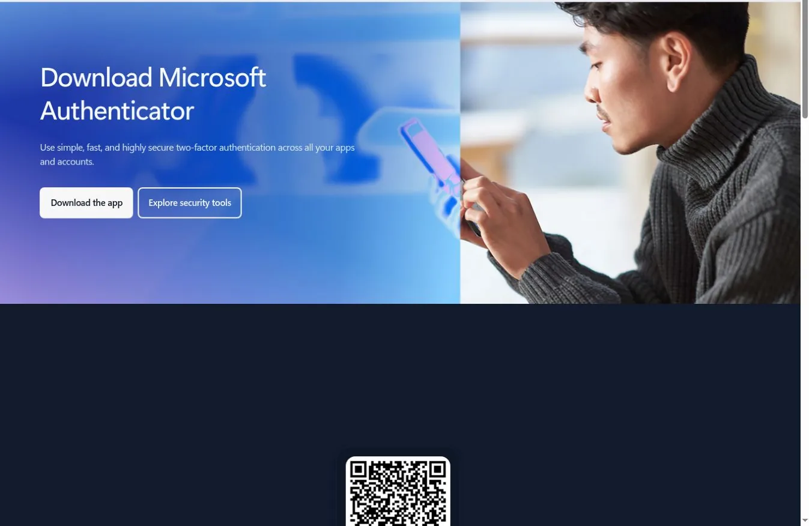
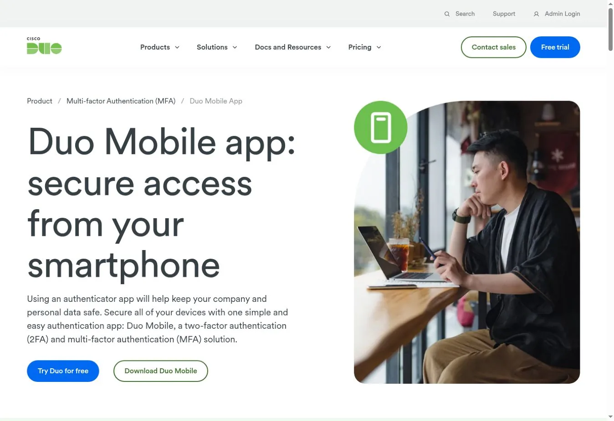
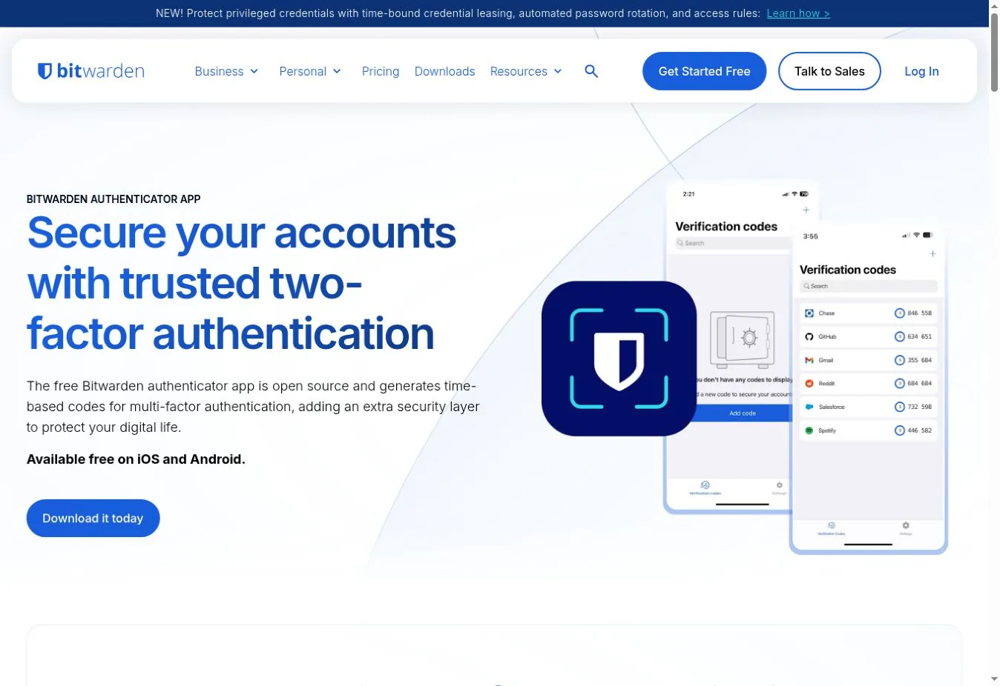
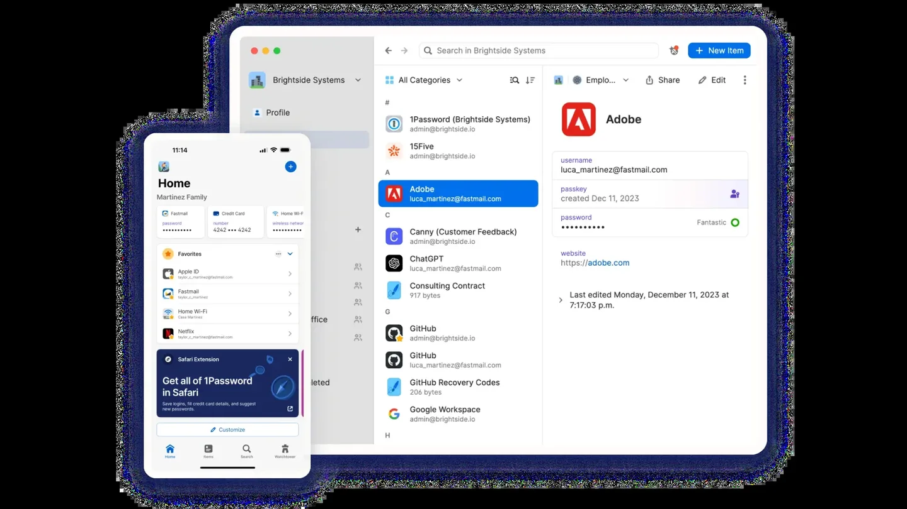

# Best Authenticator App: 9 Options Compared for Backup and Recovery

The best authenticator app for most people is Proton Authenticator. It offers optional encrypted sync, import and export, and open-source apps. You can also use it locally with no account. 2FAS is a simple mobile pick. Ente Auth suits encrypted sync across devices, and Aegis gives Android users full vault control. Google and Microsoft Authenticator are convenient inside their ecosystems.

The right app is the one you can recover without weakening the account. Generating a six-digit code is easy. Backup design, export, device transfer, and recovery decide what happens when a phone is lost.

## Key Takeaways

- **Proton Authenticator offers the best mix of portability and optional sync.**
- **2FAS is a strong mobile-first option** with iCloud or Google Drive backup and a cross-platform export file.
- **Ente Auth is a good pick for encrypted sync across devices.**
- **Aegis is the strongest Android-only choice for local control.**
- **Google Authenticator is simple**, with optional Google Account sync or QR transfer.
- **Microsoft Authenticator fits Microsoft sign-in**, but backup does not restore every credential the same way.
- **Duo Mobile is most useful when your employer or school uses Duo.**
- **Bitwarden Authenticator supports local codes, imports, and exports.**
- **1Password can store and autofill codes**, but one vault for both factors changes the risk.

## What an Authenticator App Does

Most apps here store a shared secret and create a time-based one-time password, or TOTP, every 30 seconds. The site and the app work out the same code from that secret and the current time.

TOTP beats a password alone, but it does not stop phishing. A fake sign-in page can ask for the password and code and use both at once. Passkeys and hardware keys resist that attack better. Our guide to [multi-factor authentication](/cybersecurity/what-is-mfa/) explains how the factor types differ. Our [cybersecurity statistics](/cybersecurity/cybersecurity-statistics/) show how often stolen credentials drive incidents.

## How We Evaluated the Apps

We compared the recovery process, as well as the setup screen. We scored nine points.

1. Supported systems and devices
2. Encrypted cloud sync, platform backup, or local-only storage
3. Manual export and import
4. Biometric or PIN lock
5. Open-source status and documented security design
6. Account requirement
7. Cross-platform transfer
8. Work-account and passkey behavior
9. What you need after losing the original phone

We checked features against official documentation on November 1, 2026. A backup counted only if the docs explained how it restores codes. Phone backup alone did not count as a tested in-app export.

## Authenticator Apps Compared

| App | Platforms | Backup or sync | Manual export | Open source | Account required | Best fit |
|---|---|---|---|---|---|---|
| Proton Authenticator | iOS, Android, desktop | Optional encrypted Proton sync; platform backup | Yes | Yes | No, for local use | Best overall portability |
| 2FAS | iOS, Android | iCloud on iOS; Google Drive on Android | Yes, `.2fas` file | Yes | No | Simple mobile use |
| Ente Auth | Mobile, desktop, web | Encrypted account sync | Yes, encrypted | Yes | Yes, for sync | Encrypted sync everywhere |
| Aegis | Android | Encrypted local vault; auto backups | Yes, encrypted or plain | Yes | No | Android local control |
| Google Authenticator | iOS, Android | Optional Google Account sync | QR transfer | No | Optional | Google ecosystem |
| Microsoft Authenticator | iOS, Android | iCloud or Microsoft recovery by platform | No general export | No | Yes, for backup | Microsoft and work sign-in |
| Duo Mobile | iOS, Android | Instant Restore; admin settings apply | Limited | No | Depends on account | Employer or school Duo |
| Bitwarden Authenticator | iOS, Android | Device backup; optional Bitwarden sync | Yes, JSON or CSV | Yes | No, for local codes | Bitwarden users |
| 1Password TOTP | Desktop, mobile, browser | 1Password vault sync | Within vault export | No | Yes | Autofill and shared vaults |

## The 9 Authenticator Apps Compared

### 1. Proton Authenticator: Best Overall for Portability and Optional Sync

Proton Authenticator is free, open source, and runs without ads or tracking. You can store codes locally with no Proton account, or sign in to sync them across devices with end-to-end encryption.

It imports from Google Authenticator, 2FAS, Aegis, Bitwarden Authenticator, Ente Auth, and others. It also exports, so you can leave later. The [Proton Authenticator support page](https://proton.me/support/authenticator) clearly separates local use, sync, import, and export.

**Choose it when** you want optional encrypted sync without giving up local use or export.
**Recovery needs** access to the Proton account or a protected export.

### 2. 2FAS: Best Simple Mobile Authenticator With Export

2FAS stores tokens locally and backs them up through iCloud on iOS or Google Drive on Android. Sync stays inside one platform family. Moving between iOS and Android uses an exported `.2fas` file.

You can protect the export with a password. 2FAS warns that an export without one is readable. Treat that file like a set of account keys.

**Choose it when** you want a simple mobile app with a clear cross-platform transfer path.
**Recovery needs** the platform backup or a current password-protected export.

### 3. Ente Auth: Best for Encrypted Sync Across Devices

Ente Auth is a free authenticator built around end-to-end encrypted sync. It suits people who want codes on more than one device without relying on an Apple or Google backup.

Ente documents an encrypted export using Argon2id for key derivation and XChaCha20-Poly1305 for encryption. Its CLI can automate backups too.

Cross-device access lowers the risk that one lost phone locks you out. It also makes your Ente account a key dependency.

**Choose it when** encrypted sync across mobile, desktop, or web is the main need.
**Recovery needs** your Ente login and recovery material.

### 4. Aegis: Best Android App for Local Vault Control

Aegis is a free, open-source Android app. It encrypts its vault with AES-256-GCM and opens with a password or biometrics. You can export the vault and schedule automatic backups to storage you choose.

Aegis has no cloud account. That gives you control, but recovery is your job. A forgotten vault password cannot be reset by a vendor. The [Aegis project documentation](https://github.com/beemdevelopment/Aegis) publishes its vault design.

**Choose it when** you use Android and want an encrypted local vault with your own backups.
**Recovery needs** the vault password and at least one current encrypted backup.

### 5. Google Authenticator: Best for a Familiar Google Account Path

Google Authenticator generates codes offline and can sync them across devices through a Google Account. Without signing in, you can move codes to a new phone by scanning export QR codes from the old one.

Google says synced codes are encrypted in transit and at rest. Sync makes replacement easy, but your Google Account security becomes central.

QR transfer only works while you still have the old phone. It is a migration path, not a recovery plan.

**Choose it when** simplicity and Google sync matter more than a portable backup file.
**Recovery needs** your Google Account, or a transfer done before the old phone is gone.

### 6. Microsoft Authenticator: Best for Microsoft Passwordless and Work Accounts

Microsoft Authenticator supports codes, push approvals, passwordless sign-in, work and school accounts, and passkeys. Backup and restore work differently on iOS and Android.

Microsoft says third-party codes are normally restored. Personal passwordless accounts may need a fresh sign-in, and work accounts need re-registration. Passkeys follow a separate path.

There is no general export file, so moving to another app is harder.

**Choose it when** Microsoft accounts or employer sign-in drive the decision.
**Recovery needs** backup turned on and the old phone kept until key sign-ins work.

### 7. Duo Mobile: Best When Your Organization Uses Duo

Duo Mobile handles Duo Push and protected accounts as well as third-party codes. It is most useful when an employer or university runs Duo.

Duo Instant Restore can recover protected accounts, but admin settings shape the process. Some Android restores need the old device. Third-party accounts use a separate recovery password.

Follow your help desk's device-replacement steps before you wipe the old phone.

**Choose it when** your employer uses Duo and you want other codes in the same app.
**Recovery needs** admin-enabled restore and any required recovery password.

### 8. Bitwarden Authenticator: Best for Flexible Local Codes and Exports

Bitwarden Authenticator is a standalone app that works without a Bitwarden account. It imports from several apps and exports local codes as JSON or CSV.

You can keep codes local or sync chosen ones through a Bitwarden vault. Local data uses your phone's backup, while vault-synced codes export from the vault.

Storing a password and its code in one vault is convenient but weakens factor separation if that vault leaks. Our [password manager comparison](/cybersecurity/best-password-manager/) covers vault security in more depth.

**Choose it when** you want an exportable app with an optional Bitwarden link.
**Recovery needs** a protected export, device backup, or vault access.

### 9. 1Password: Best Built-In Code Autofill for Subscribers

1Password can store a site's TOTP secret inside the same login item as the password. It then fills the code in supported browsers and apps. Shared vaults can share those logins.

That is handy for families and teams. It is not a separate authenticator like Aegis or 2FAS. Full vault access would expose both factors together.

1Password itself recommends a separate authenticator for the code that protects your 1Password account.

**Choose it when** you already use 1Password and value autofill or sharing.
**Recovery needs** your Emergency Kit, password, Secret Key, and any separate factor.

## Which Authenticator App Should You Choose?

| Priority | Start with |
|---|---|
| Optional encrypted sync plus export | Proton Authenticator |
| Simple iOS or Android use | 2FAS |
| Encrypted sync across platforms | Ente Auth |
| Android local vault and own backups | Aegis |
| Google Account convenience | Google Authenticator |
| Microsoft work or passwordless sign-in | Microsoft Authenticator |
| Employer or school uses Duo | Duo Mobile |
| Bitwarden ecosystem and exports | Bitwarden Authenticator |
| Code autofill inside a password manager | 1Password |

For company identity, the app is one piece. Enrollment policy, device trust, help-desk recovery, and phishing-resistant methods matter just as much. Our review of [Okta identity security](/cybersecurity/okta-identity-security/) shows how those controls fit together.

## Set Up Recovery Before You Add More Accounts

1. Save each service's recovery codes off the phone and outside the account they protect.
2. Turn on backup or sync and know which account protects it.
3. Create a current encrypted export if the app supports one.
4. Store the backup password apart from the backup file.
5. Secure the Apple, Google, Microsoft, Proton, Ente, Bitwarden, or 1Password account that becomes your recovery anchor.
6. Add a second phishing-resistant method where the service allows it.
7. Test a restore on a second device before you wipe the old phone.
8. Remove the old device only after the new sign-in works.

## FAQs

### What Is the Best Authenticator App Overall?

Proton Authenticator offers the strongest overall mix. You get optional encrypted sync, import, export, open-source code, and local use with no account. The best choice still depends on your devices and recovery plan. Check that the app supports both of your platforms before you move codes.

### Which Authenticator App Is Best If I Lose My Phone?

Pick an app with a recovery method you have turned on and tested. Ente and Proton offer account-based encrypted sync. 2FAS supports platform backups and exports, and Aegis supports encrypted local backups. Whatever you choose, keep each service's recovery codes somewhere other than the phone itself.

### Are Authenticator Apps Safer Than SMS Codes?

Yes, in most cases. TOTP apps avoid SIM-swap attacks and SMS delivery problems. They can still be phished in real time by a fake sign-in page that relays your code. Passkeys and hardware security keys protect better where a service supports them. Use them for your most important accounts.

### Should Passwords and Codes Live in the Same Password Manager?

It improves convenience and recovery but weakens factor separation if the vault is breached. High-risk users often keep the authenticator separate. Never store the code that protects your password manager inside that same vault. You could lock yourself out when you need it most.

## Resources

- [2FAS backup and sync](https://2fas.com/support/2fas-auth-mobile-app/how-to-use-sync-more-devices-with-2fas/)
- [Ente Auth encrypted exports](https://help.ente.io/auth/migration/export)
- [Google Authenticator sync and transfer](https://support.google.com/accounts/answer/1066447)
- [Microsoft Authenticator phone transfer](https://learn.microsoft.com/en-us/entra/identity/authentication/how-to-transfer-authenticator-new-phone)
- [Duo Restore guide](https://help.duo.com/s/article/duo-restore)
- [Bitwarden Authenticator import and export](https://bitwarden.com/help/authenticator-import-export/)
- [1Password one-time passwords](https://support.1password.com/one-time-passwords/)
