# 12 Business Intelligence Tools Compared by Data Source, Modeling, and Reporting

The best business intelligence tools connect to your data, keep metric definitions consistent, and deliver reports where people already work. Power BI suits Microsoft shops. Tableau stays strong for visual analysis. Looker centers on governed metrics. Sigma brings a spreadsheet feel to cloud data, and Metabase offers an easy open-source path.

Start with your data setup and governance, not the chart gallery. A polished dashboard cannot fix conflicting definitions or a warehouse that is not ready for analysis.

## Key Takeaways

- **Power BI is the broadest default for Microsoft organizations.** Sharing licenses and capacity still need planning.
- **Tableau leads on visual exploration, and Looker leads on governed metrics** through LookML.
- **Sigma runs directly on cloud warehouse data** with a familiar spreadsheet interface.
- **Metabase and Apache Superset are practical open-source options.** Self-hosting moves security and upgrades to your team.
- **Embedded analytics buyers should look at Sisense, Sigma, Looker, Metabase, and ThoughtSpot.** Tenant isolation counts as much as chart design.
- **AI features depend on the semantic and permission layers beneath them.** Vague metrics still produce vague answers.

## How We Compared These Business Intelligence Tools

We followed the path from source data to a decision and scored eight points.

1. **Data access.** Live query, extract, import, and connector options
2. **Modeling.** Semantic layers, reusable metrics, and transformation support
3. **Reporting.** Dashboards, ad hoc exploration, schedules, and fixed-layout output
4. **Governance.** Permissions, row-level controls, lineage, audit, and identity
5. **Embedded analytics.** Customer-facing delivery, tenancy, branding, and APIs
6. **Deployment.** SaaS, dedicated cloud, or self-hosted
7. **Pricing.** User, capacity, credit, platform, or custom contracts
8. **AI help.** How natural-language features use governed data

We weighed metric consistency and running cost above chart counts. Our [B2B technology statistics guide](/business-technology/b2b-tech-statistics/) shows why definitions and data methods shape business conclusions. For a shorter shortlist of four platforms, see our [business intelligence software comparison](/developer-data/business-intelligence-software/).

## Business Intelligence Tools at a Glance

| Tool | Best for | Data pattern | Modeling approach | Deployment | Pricing signal (checked Nov. 1, 2026) |
|---|---|---|---|---|---|
| Microsoft Power BI | Microsoft and Fabric teams | Import, DirectQuery, Fabric | Semantic models and DAX | Cloud; Report Server | Pro $14 per user per month, annual |
| Tableau | Visual exploration | Live connections and extracts | Data sources and Tableau semantics | Cloud or Server | Creator from $75 per user per month, annual |
| Looker | Governed enterprise metrics | Warehouse queries | LookML semantic layer | Google Cloud | Custom platform plus users |
| Qlik Cloud Analytics | Associative exploration | Cloud connectors and managed data | Associative model | Qlik Cloud | Premium from $2,750 per month, annual |
| ThoughtSpot | Search and AI-led analytics | Cloud data platforms | Governed models plus search | SaaS and embedded | Essentials from $25 per user per month, annual |
| Sigma | Spreadsheet-style cloud analytics | Live cloud warehouse | Data models and workbook logic | SaaS | Custom licenses plus usage |
| Metabase | Easy BI and open source | Direct queries and uploads | Metadata and models | Cloud or self-hosted | Open source free; Starter from $100 per month |
| Apache Superset | Technical self-hosted teams | SQL engines | Light semantic layer | Self-hosted | Software free; hosting and labor extra |
| Zoho Analytics | Small and midsize teams | Imports and connectors | Data prep and models | Cloud or on-premises | From about $25 per month |
| Domo | Cloud analytics plus workflows | Connectors, ETL, storage | Platform data layer | SaaS | Custom credit-based use |
| Sisense | Embedded analytics | Cloud and app data | Elasticube and semantic models | SaaS, dedicated cloud, or on-premises | Custom |
| Google Data Studio | Free marketing reports | Connectors and blends | Report-level fields | Google cloud service | Free; Pro $9 per user per project per month |

## What Are Business Intelligence Tools?

Business intelligence tools turn operational data into models, reports, dashboards, and answers. They connect to databases, warehouses, files, or apps. Then they apply shared definitions and permissions before showing results.

A BI tool is not a data warehouse. The warehouse stores and processes data. ETL or ELT tools move and reshape it. A semantic layer defines terms like active customer or gross margin. Some BI products include parts of each layer, and the lines differ by vendor.

## The 12 Business Intelligence Tools Compared

### 1. Microsoft Power BI: Best Overall for Microsoft Organizations

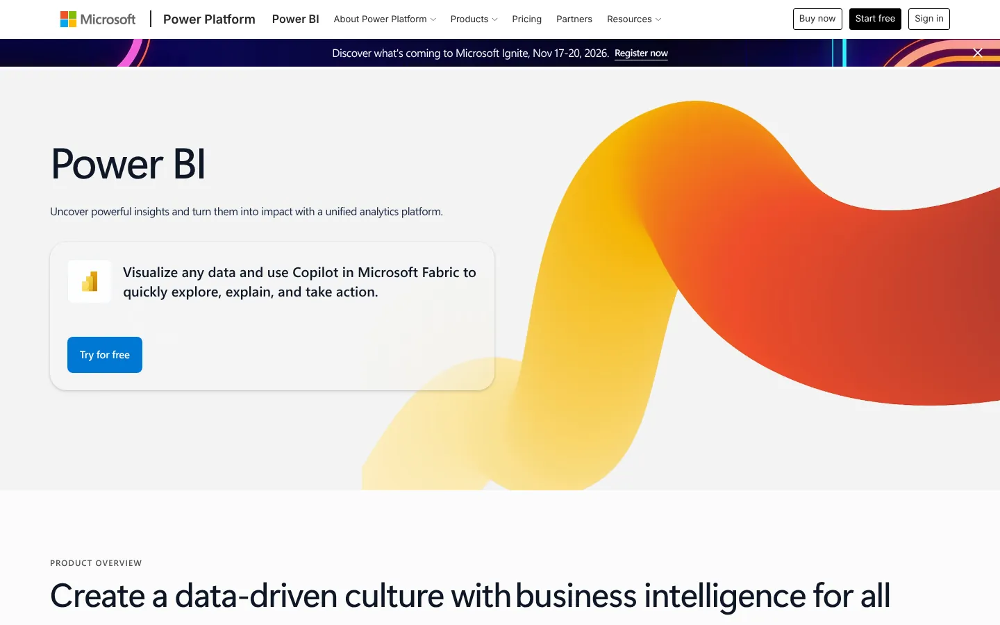

Power BI combines desktop authoring, cloud sharing, semantic models, and Microsoft Fabric. It supports imported data and DirectQuery, and DAX handles complex calculations. Teams on Microsoft 365 and Azure get a familiar identity and admin path.

Power BI Pro cost $14 per user per month on annual billing when we checked. Premium Per User cost $24. A free account covers personal work, but sharing usually needs paid licenses or Fabric capacity. That rule can move the budget more than the authoring license.

Breadth brings complexity. Set standards for workspaces, models, gateways, and certified datasets early, or departments will publish different versions of the same metric.

**Choose Power BI when** Microsoft is your default platform and you need broad self-service reporting.
**Check first** sharing licenses, Fabric capacity, gateway design, and DAX skills.

### 2. Tableau: Best for Visual Exploration

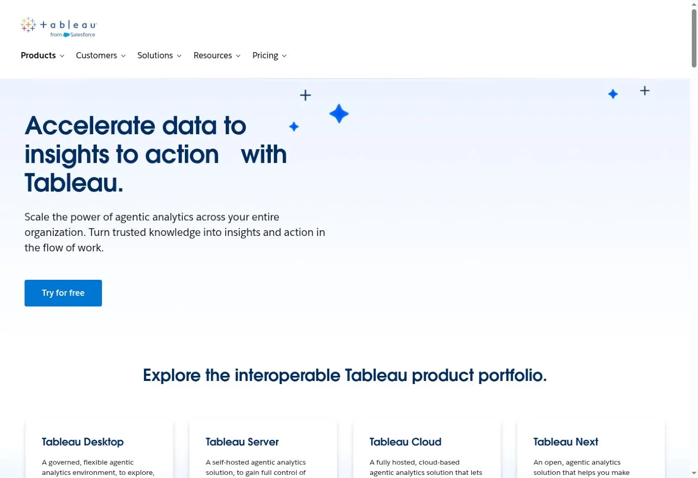

Tableau stays a strong pick for analysts who explore data visually and build interactive stories. It supports live connections and extracts, with cloud and server options. A large community helps with varied questions.

Tableau prices by role. Standard annual pricing was $75 per Creator, $42 per Explorer, and $15 per Viewer each month. Every deployment needs at least one Creator. Enterprise editions cost more and add management features.

Role pricing works when a few authors serve many viewers. It gets expensive when many people need exploration rights. Confirm which AI features sit in your edition.

**Choose Tableau when** visual analysis and analyst freedom come first.
**Check first** your Creator-to-Viewer ratio, Server upkeep, and edition-specific AI.

### 3. Looker: Best for Governed Metrics in a Cloud Warehouse

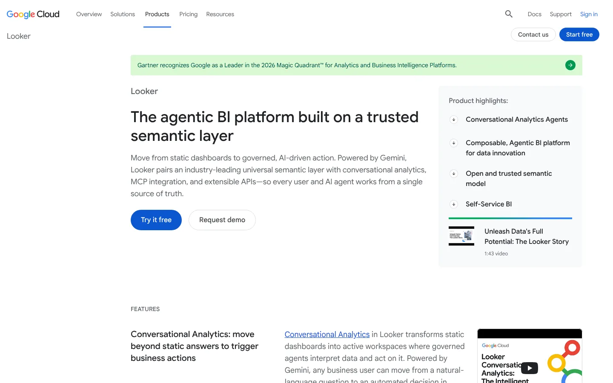

Looker is built around a governed model written in LookML. Developers define reusable dimensions, measures, joins, and access rules. Business users then explore inside those definitions. That keeps revenue and retention metrics consistent across reports.

Looker queries your warehouse. It does not replace it. Speed and cost depend on model design, caching, and warehouse setup.

Pricing has two parts, the platform and named users. Google uses custom annual terms. Standard includes a production instance and a base set of users. Enterprise and Embed are quoted separately.

**Choose Looker when** a data team can own a governed semantic layer.
**Check first** LookML skills, the platform commitment, query cost, and embed terms.

### 4. Qlik Cloud Analytics: Best for Associative Exploration

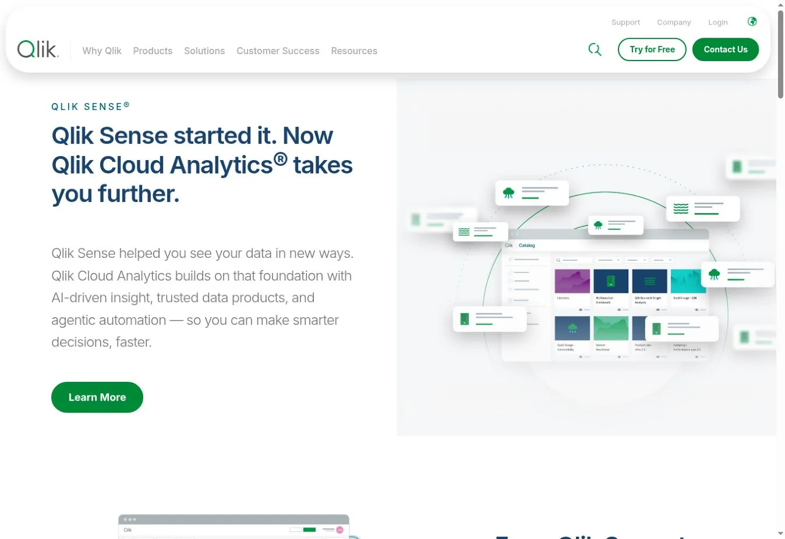

Qlik's associative engine shows related and unrelated values as users click through data. That can surface patterns a fixed drill path hides. Qlik Sense is now Qlik Cloud Analytics, which adds data prep, alerts, embedding, and AI features.

Plans use capacity measured as Data for Analysis rather than only named users. Premium started at $2,750 per month for 50 GB on annual billing. It included AutoML, generative AI capacity, SAP extraction, and lineage.

Capacity pricing can support broad access. Define what counts toward the data measure, and estimate the work to move older Qlik apps.

**Choose Qlik when** associative exploration and broad enterprise analytics matter most.
**Check first** capacity definitions, app migration, and data prep design.

### 5. ThoughtSpot: Best for Search-Led Analytics

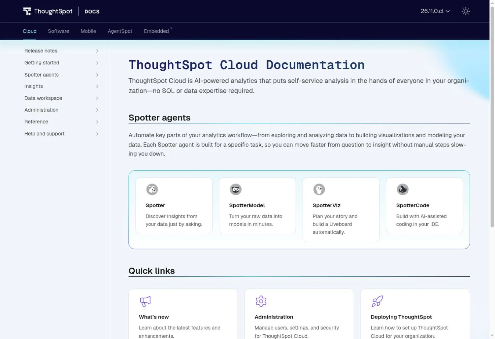

ThoughtSpot centers on search and natural-language questions. Users ask a question, refine the answer, and save the insight. The Spotter agents extend this to modeling, visualization, and code.

It works best when fields, joins, and business terms are well prepared. Natural language does not remove the need for governed metrics. It only changes how people reach them.

Essentials started at $25 per user per month on annual billing. Pro started at $0.10 per credit or $50 per user per month. Enterprise terms are custom.

**Choose ThoughtSpot when** nontechnical users need search-led analysis on governed cloud data.
**Check first** model prep, credit use, and embedded terms.

### 6. Sigma: Best Spreadsheet-Style BI on Live Cloud Data

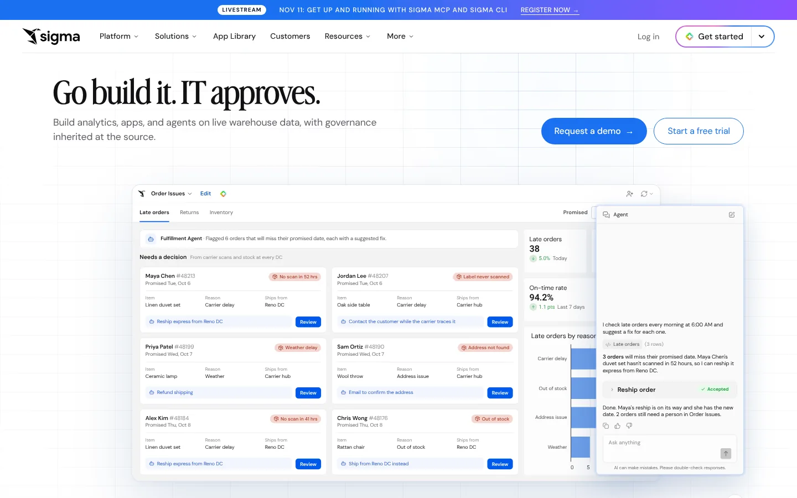

Sigma gives users a spreadsheet interface on top of live warehouse data. Analysts work with rows, formulas, pivots, and charts without exporting the dataset. It also supports data apps, embedding, and writeback.

Live access keeps warehouse governance and cuts copied extracts. It also means warehouse speed and compute cost become part of the BI bill. Test real workbooks against production-sized data.

Sigma does not publish a list price. Contracts mix license tiers with usage events that use credits. Ask for a cost model that covers viewers, builders, embeds, schedules, and warehouse use.

**Choose Sigma when** users love spreadsheets and your data lives in a modern warehouse.
**Check first** warehouse cost, workbook speed, credit events, and writeback controls.

### 7. Metabase: Best Easy Open-Source BI Tool

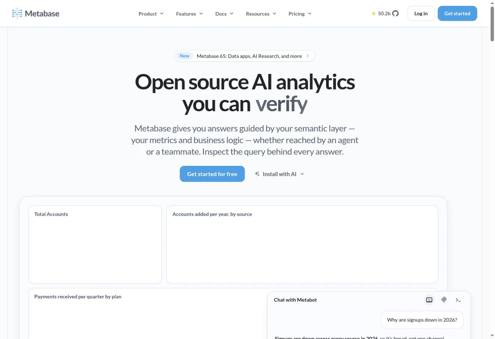

Metabase pairs a friendly no-code query builder with SQL, dashboards, alerts, and embedding. The open-source edition is free under the AGPL with unlimited users and dashboards. Teams can self-host or use Metabase Cloud.

Starter cloud began at $100 per month, or $90 on annual billing, for five users. Pro began at $575 per month, or $517.50 annual, for ten users. Pro adds row and column permissions, SSO, and audit logs.

Free software still needs backups, upgrades, monitoring, and security work when you self-host.

**Choose Metabase when** you want easy BI, SQL access, and an open-source option.
**Check first** permission needs, hosting ownership, and user growth.

### 8. Apache Superset: Best for Technical Self-Hosted Teams

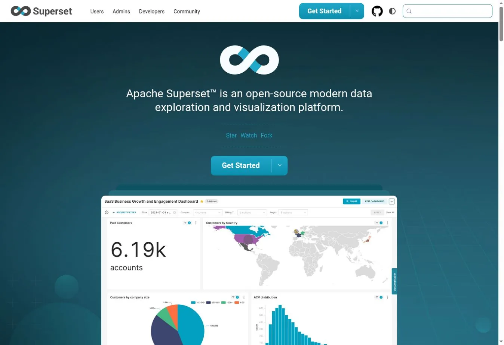

Apache Superset is an open-source BI app for SQL data engines. It offers no-code charts, dashboards, SQL Lab, a light semantic layer, and APIs. Technical teams can adapt it inside their own infrastructure.

There is no license fee. The running cost covers hosting, upgrades, login integration, patches, and engineering time. Some companies pay a managed provider to carry part of that load.

Superset suits teams with platform skills and a clear reason to self-host. It fits poorly when a small team expects turnkey support.

**Choose Superset when** engineers can run an open-source analytics service.
**Check first** ownership, upgrade cadence, identity setup, and support.

### 9. Zoho Analytics: Best Value for Small and Midsize Teams

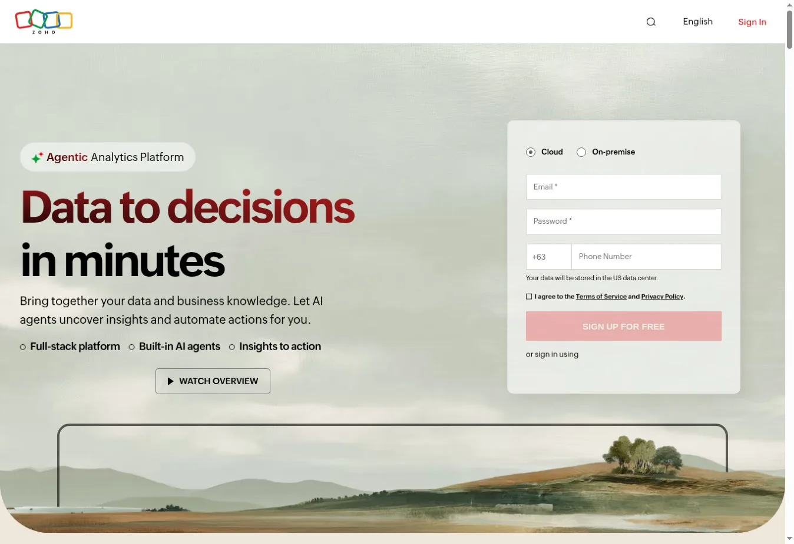

Zoho Analytics packages connectors, data prep, dashboards, scheduled reports, and AI agents at a low entry price. It fits smaller teams that need more structure than a free report tool.

Zoho pages showed a start of about $24 to $25 per month, depending on page and billing term. The basic paid plan covered two users and 500,000 rows. The free plan covered two users, five workspaces, and 10,000 rows.

Those limits make the first price easy to read. Model your growth, refresh schedules, and AI credit allowance before you commit.

**Choose Zoho Analytics when** a small team wants broad BI features at a modest price.
**Check first** row limits, user growth, refresh frequency, and needed connectors.

### 10. Domo: Best for an All-in-One Cloud Data Platform

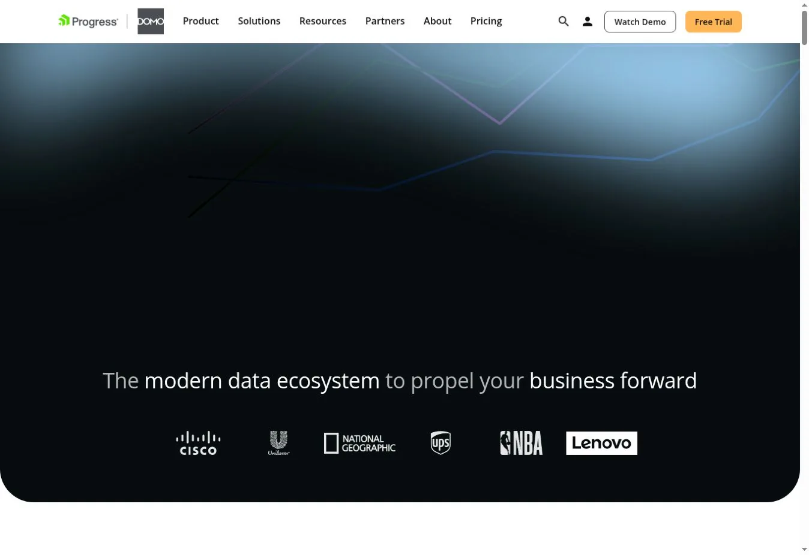

Domo combines connectors, cloud storage, ETL, dashboards, alerts, apps, and workflows in one SaaS platform. It can replace several separate services for a department.

Ownership changed in 2026. Progress Software agreed in July 2026 to buy Domo's AI and data platform business. The site now carries Progress branding. Progress says it will keep serving Domo customers, so ask about roadmap and contract terms during renewal.

Pricing is custom and consumption-based. Credits can be used by storage, table updates, workflows, and model inference. Ask Domo to map each activity to credits and show you budget controls.

**Choose Domo when** you want an all-in-one SaaS data, BI, and workflow platform.
**Check first** credit use, data egress, ownership changes, and contract protections.

### 11. Sisense: Best for Embedded Analytics in Regulated Products

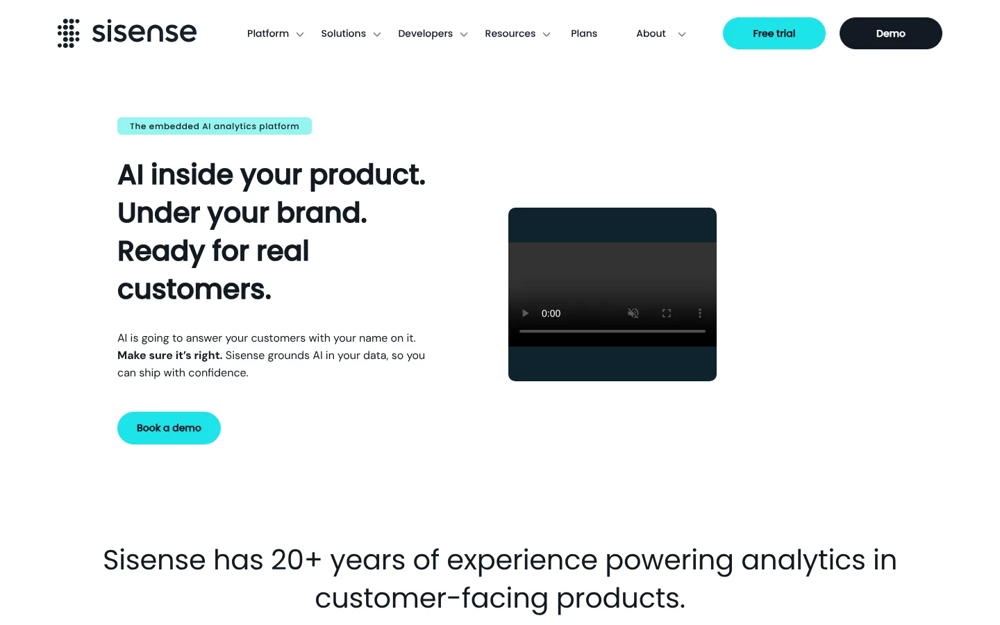

Sisense focuses on analytics inside software products. It supports multi-tenant setups, white labeling, column-level security, SSO, and APIs. You can run it as SaaS, in a dedicated cloud, or on-premises.

That range suits software firms and regulated industries that need control over tenancy and infrastructure. Sisense also lets you bring your own language model into governed AI features.

Pricing is custom. Ask for separate costs for capacity, builders, viewers, embedded users, environments, and support. Test tenant isolation with realistic customer roles.

**Choose Sisense when** embedded, multi-tenant analytics is a product requirement.
**Check first** tenancy design, hosting duties, API limits, and contract scope.

### 12. Google Data Studio: Best Free Reporting Tool for Google Data

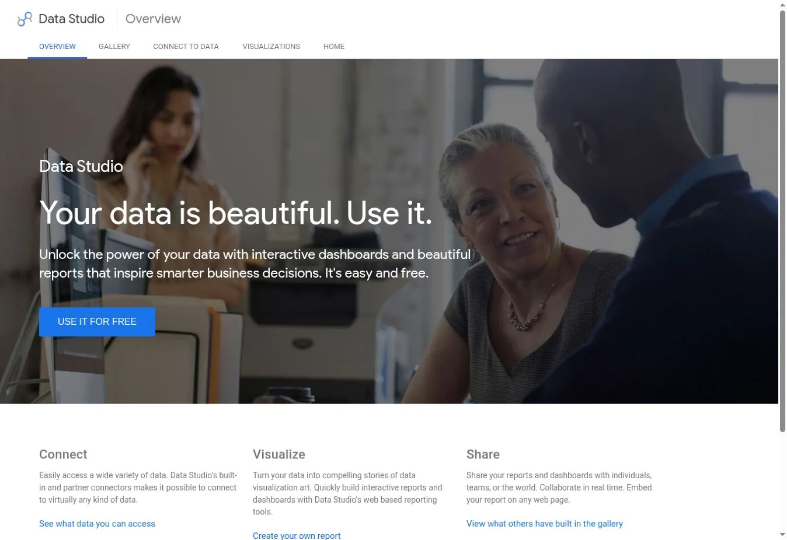

Google Data Studio, the name Google now uses again for Looker Studio, is a free reporting service. It connects to Google Sheets, Google Ads, BigQuery, Google Analytics, and many partner sources. It supports interactive reports, filters, calculated fields, and blends.

The free version handles marketing reports and small dashboards well. Data Studio Pro cost $9 per user per project per month. Pro adds team workspaces, admin controls, and support.

Report-level modeling is looser than a central semantic layer. Use warehouse models when a metric must match across many reports.

**Choose Data Studio when** you need low-cost reports on Google and marketing data.
**Check first** partner connector fees, quotas, report speed, and metric governance.

## How to Choose a BI Tool

Pick the product that fits the setup you can run.

### Start With the Source of Truth

List each key metric and its trusted source. Decide whether the BI tool will query live data, use extracts, or both. If the warehouse is still being built, include that work in the plan. Our [cloud computing statistics review](/cloud-infrastructure/cloud-computing-statistics/) helps when you weigh cloud deployment claims.

### Define Metrics Before Adding AI

Natural-language features need governed names, joins, and formulas. If gross margin has three definitions, an AI assistant cannot pick the right one every time. Test AI questions against a reviewed answer set.

### Model the Full Cost

Include licenses, platform fees, capacity, warehouse compute, connectors, setup, training, and support. For embedded analytics, add customer scale, tenant environments, and API use.

### Test Governance With Real Roles

Create test users for an analyst, executive, manager, contractor, and customer tenant. Check row and column access, exports, shared links, AI answers, and cached results.

## FAQs

### What Are the Most Popular Business Intelligence Tools?

Widely used BI products include Microsoft Power BI, Tableau, Looker, Qlik, ThoughtSpot, Sigma, Domo, and Zoho Analytics. Metabase and Apache Superset are the best-known open-source choices. Popularity should not replace a fit test. Base it on your data setup, governance needs, user roles, and three-year cost.

### What Is the Best Free BI Tool?

Google Data Studio is a strong free choice for light reports on Google data. Metabase and Apache Superset are free open-source products when you host them yourself. The software costs nothing. Hosting, upkeep, security, and support still cost money, so budget for them from the start.

### What Is the Difference Between a BI Tool and a Data Warehouse?

A data warehouse stores and processes analytical data. A BI tool queries that data and turns it into models, reports, dashboards, and interactive analysis. Some BI platforms include storage or transformation features. Storing data and presenting it are still separate jobs.

### Which BI Tools Are Best for Small Businesses?

Zoho Analytics, Metabase Cloud, Power BI Pro, and Google Data Studio are practical starting points. The right one depends on your source systems and how many people build and view reports. Refresh needs matter too, as does whether anyone can manage models and permissions.

## Resources

- [Microsoft Power BI pricing](https://www.microsoft.com/en-us/power-platform/products/power-bi/pricing)
- [Tableau pricing](https://www.tableau.com/pricing/cloud)
- [Looker pricing](https://cloud.google.com/looker/pricing)
- [Qlik Cloud Analytics pricing](https://www.qlik.com/us/pricing)
- [ThoughtSpot pricing](https://www.thoughtspot.com/pricing)
- [Metabase pricing](https://www.metabase.com/pricing)
- [Apache Superset documentation](https://superset.apache.org/docs/)
- [Zoho Analytics pricing](https://www.zoho.com/analytics/pricing.html)
- [Progress announcement on Domo](https://www.progress.com/blogs/progress-software-to-acquire-domo-to-strengthen-its-ai-data-platform)
- [Sisense plans](https://www.sisense.com/plans/)
- [Google Data Studio](https://cloud.google.com/data-studio)
