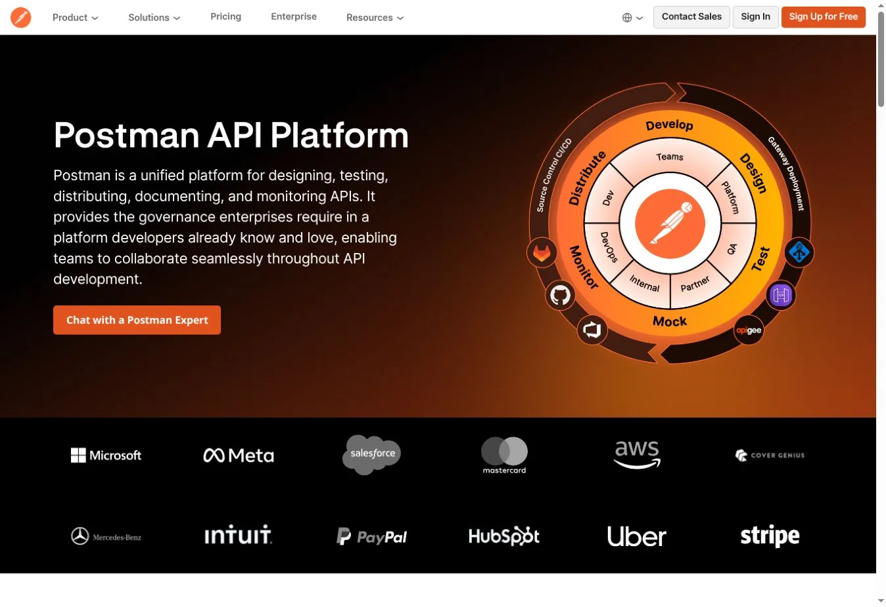
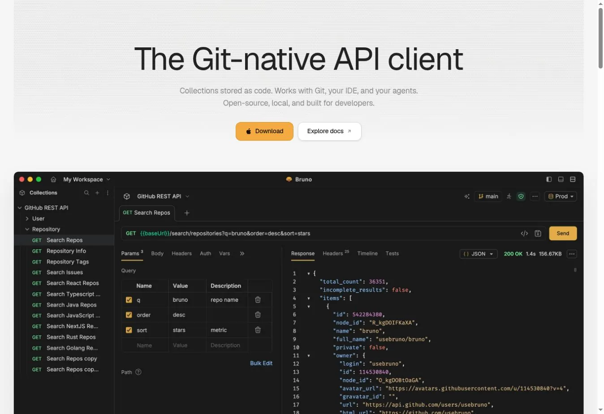
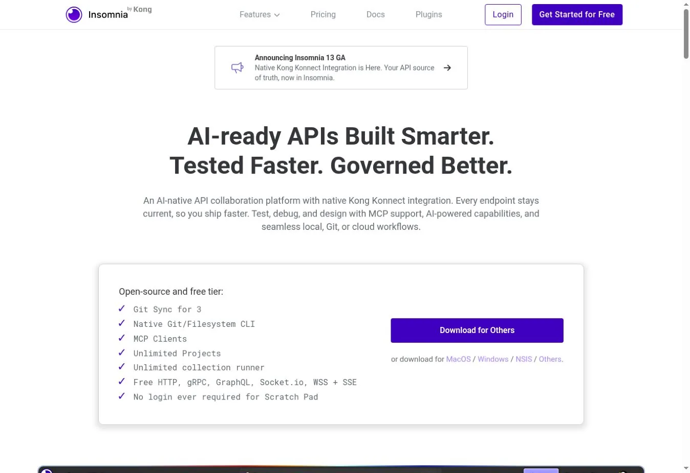
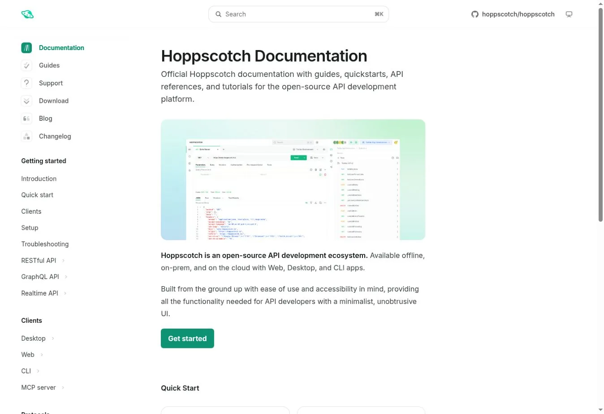
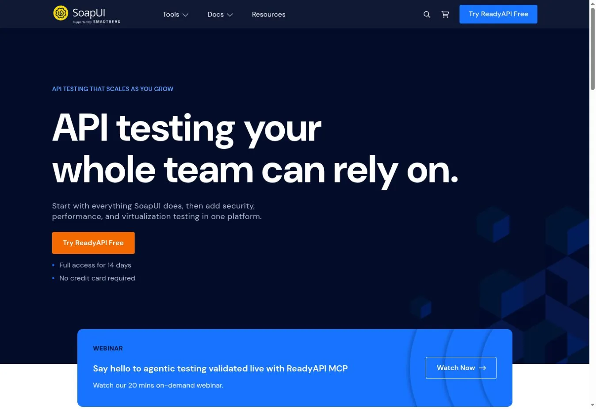
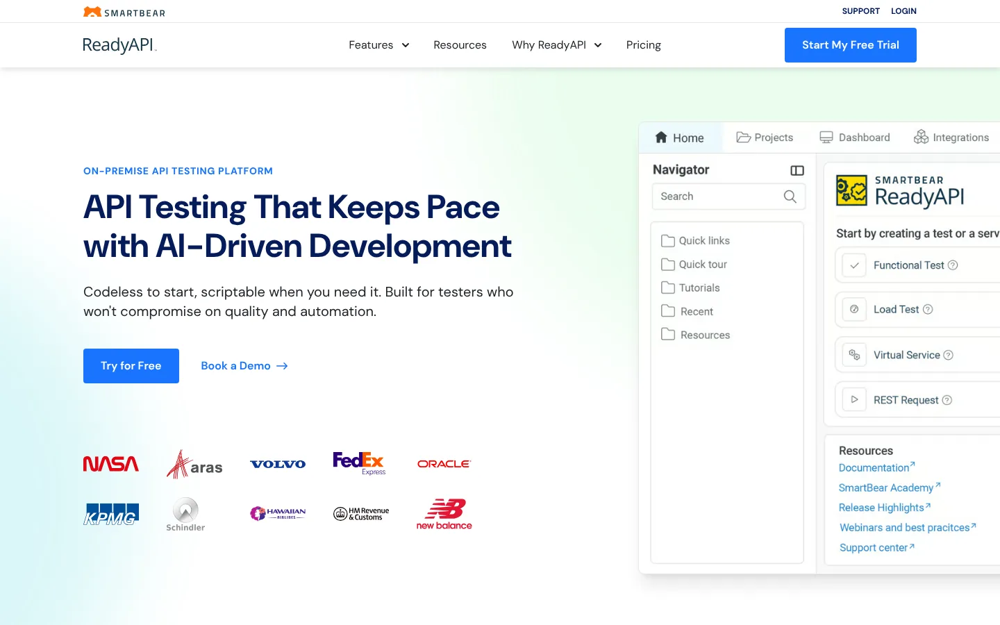
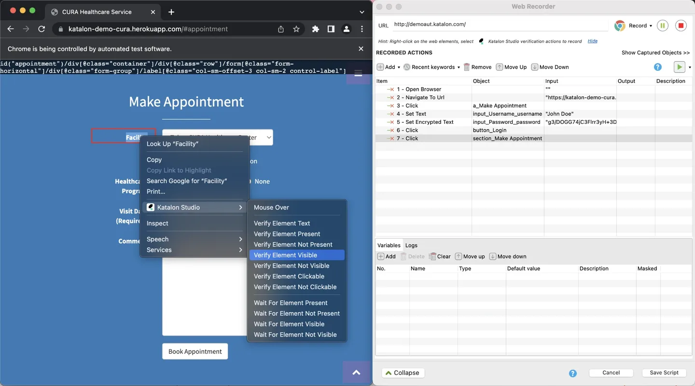
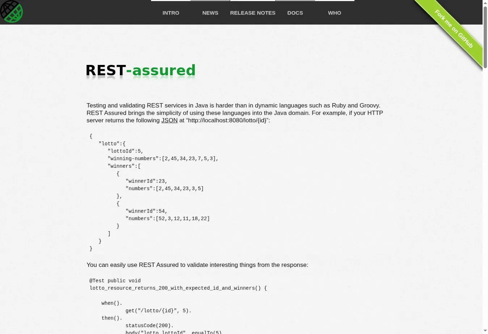
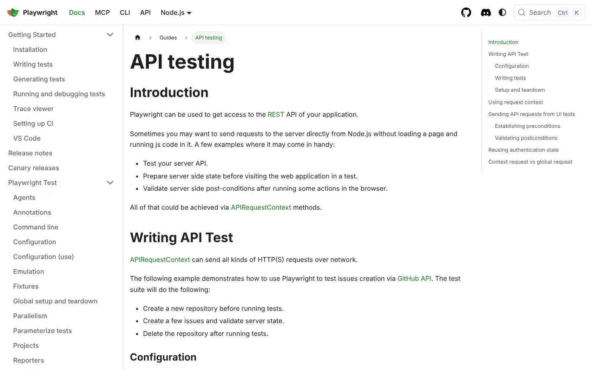
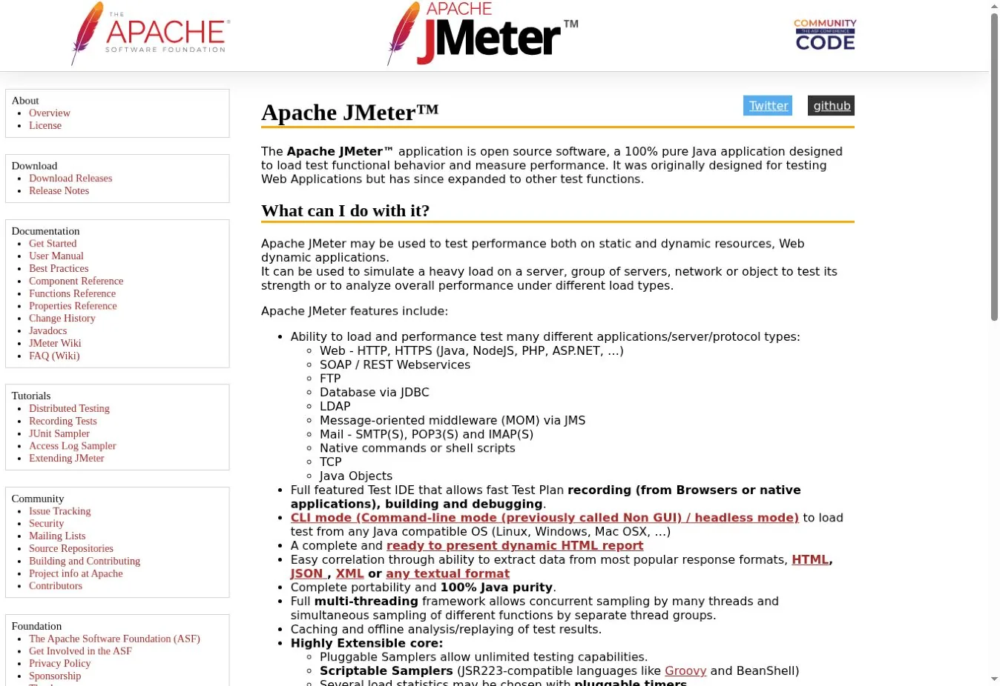

# 10 API Testing Tools for Manual Checks, Automation, and CI/CD

The best API testing tools serve different stages of delivery. Postman offers the broadest shared workspace. Bruno and Insomnia give developers local or Git-based storage. REST Assured and Playwright fit code-owned test suites. Apache JMeter is built for load testing, not quick exploratory requests.

No single product wins every job. A team may explore with a visual client and guard regressions in code. It may also mock an unfinished backend and load test before release.

## Key Takeaways

- **Postman is the broadest shared API workspace** for requests, collections, mocks, monitors, and pipeline runs.
- **Bruno is a strong local-first choice** when collections should live as plain files beside your code.
- **Insomnia balances a polished client with local, Git, and cloud storage.**
- **SoapUI and ReadyAPI still matter for SOAP-heavy systems** and complex service testing.
- **REST Assured suits Java teams, and Playwright suits teams already using it** for browser tests.
- **JMeter is a performance tool.** It sends traffic at scale but does not replace a shared API client.

## How We Evaluated the Tools

We ran each product through one API workflow. Create a request, save variables and auth, and check the response. Then share the test, run it without the desktop app, and read the result in CI.

We compared eight points.

1. Supported protocols and request formats
2. Visual and code-based test authoring
3. Collection or project storage
4. Mocking and service simulation
5. Command-line and CI runs
6. Collaboration and access controls
7. Open-source status and local operation
8. Pricing basis and key limits

Many lists mix functional testers, security scanners, load tools, and API management platforms. We label the job each tool does and flag what it does not replace. Our guide to [API gateways](/developer-data/api-gateways/) covers the traffic layer these tests often sit behind.

## API Testing Tools Compared

| Tool | Best for | Interface | Project storage | CI runs | Mocking | Price signal (checked Nov. 1, 2026) |
|---|---|---|---|---|---|---|
| Postman | Shared API lifecycle work | Desktop, web, CLI | Cloud workspaces and Git features | Postman CLI | Yes | Free; Solo $9 per month, annual; Team $19 per user per month, annual |
| Bruno | Local-first collections | Desktop and CLI | Plain-text files in a folder or Git | Bruno CLI | Limited | Open source; paid editions |
| Insomnia | Local, Git, or cloud projects | Desktop and CLI | Local Vault, Git Sync, or cloud | Inso CLI | Yes | Essentials free; Pro $12 per user per month |
| Hoppscotch | Fast browser requests and self-hosting | Web, desktop, CLI | Local, cloud, or self-hosted | CLI | Yes | Community open source |
| SoapUI Open Source | SOAP and REST functional tests | Desktop and CLI | XML projects | Command-line runners | Yes | Free and open source |
| ReadyAPI | Enterprise functional, load, and virtualization | Desktop and CLI | ReadyAPI projects | Command line and integrations | Yes | Commercial quote |
| Katalon Studio | Low-code testing across API, web, and mobile | Desktop and runtime engine | Katalon projects | Runtime Engine add-on | Platform features | Paid license; confirm current offer |
| REST Assured | Java API regression suites | Code | Java test project | Any Java CI runner | No | Free and open source |
| Playwright | API plus browser end-to-end tests | Code | JS, TS, Java, Python, or .NET project | Playwright runner | No | Free and open source |
| Apache JMeter | API load and performance tests | Desktop authoring and CLI | JMX test plans | Non-GUI command line | No | Free and open source |

## The 10 API Testing Tools Compared

### 1. Postman: Best Shared API Testing Workspace

Postman brings requests, collections, environments, tests, mock servers, docs, monitors, and CLI runs into one platform. That breadth lets a team move one collection from exploration into repeatable checks without switching tools.

The [official Postman CLI](https://learning.postman.com/docs/postman-cli/postman-cli-overview/) runs collections and lints specs from a terminal or pipeline. The free plan includes the core client, mock servers, and the Collection Runner. Solo was $9 per month on annual billing. Team was $19 per user per month.

The tradeoff is platform lock-in. Review cloud workspaces, seat pricing, and AI credits once a collection becomes a shared production asset. Teams with strict local-storage rules should check where secrets and project data live.

**Choose Postman when** designers, developers, and QA need one shared workspace.
**Look elsewhere when** plain-file Git review and fully local storage come first.

### 2. Bruno: Best Local-First Alternative to Cloud Workspaces

Bruno stores collections as plain-text files in a folder, so Git becomes the collaboration layer. Developers review test changes next to code, use normal branches, and keep projects on local disk.

That suits teams that dislike opaque collection databases or forced cloud sync. Bruno supports scripting, variables, environments, and command-line runs. The open-source client covers a solid core, and paid editions add commercial features.

Local-first does not solve secrets. Your repository still needs ignore rules, separate environments, and a safe path for CI credentials.

**Choose Bruno when** your test collection should behave like source code.
**Look elsewhere when** nontechnical collaboration and hosted mocks matter more.

### 3. Insomnia: Best Balance of Local, Git, and Cloud Storage

Insomnia supports REST, GraphQL, gRPC, SOAP, WebSocket, and Server-Sent Events. Projects can live in Local Vault, Git Sync, or the cloud. An individual can stay local while a larger team adopts shared governance.

The free Essentials plan included unlimited local and cloud projects and Git Sync for three users. It also had the Inso CLI and 1,000 mock requests a month. Pro cost $12 per user per month. Enterprise was $45 per user per month for self-service buyers, with SSO, SCIM, and vault integrations.

Insomnia fits best when protocol coverage and storage choice matter more than a big API marketplace.

**Choose Insomnia when** developers want a polished client without forced cloud storage.
**Look elsewhere when** the company already standardized on Postman collections.

### 4. Hoppscotch: Best Lightweight Browser and Self-Hosted Client

Hoppscotch gives you a fast web interface for REST, GraphQL, real-time protocols, environments, and history. It is open source, with desktop and self-hosted options. That makes it a lighter alternative to a large API platform.

Storage depends on how you run it. Standalone desktop mode keeps collections, history, and credentials local. Cloud or self-hosted modes sync project data to that backend, while secret variables stay local.

It shines for quick requests and controlled self-hosting. Test CLI coverage, mock needs, and identity integration before making it your only platform.

**Choose Hoppscotch when** speed, browser access, and self-hosting matter.
**Look elsewhere when** you need advanced enterprise test management.

### 5. SoapUI Open Source: Best Free Option for SOAP Services

SoapUI Open Source handles SOAP and REST functional testing in a mature desktop app. It builds assertions, chained test cases, mock services, and command-line runs.

SOAP support is its edge. A WSDL can generate requests and mock structures. That helps in enterprise systems where SOAP, JMS, and older integration patterns still run. The software is free and open source.

The interface and XML project files can feel heavy next to newer clients. Trial it with a real project to check merge conflicts and upkeep.

**Choose SoapUI when** SOAP testing and free local runs come first.
**Look elsewhere when** you mostly test modern REST APIs and prefer plain-text projects.

### 6. ReadyAPI: Best Commercial Suite for Complex Service Testing

ReadyAPI is SmartBear's commercial layer over SoapUI. It adds data-driven tests, performance testing, reporting, and service virtualization. Collaboration and enterprise controls come with it.

It fits regulated or integration-heavy shops where a dedicated QA team owns large reusable suites. It is more product than many small teams need. Public pricing may not reflect the full mix of modules, users, and runners.

**Choose ReadyAPI when** dedicated testers need commercial support and richer service testing.
**Look elsewhere when** developers maintain tests mainly in code.

### 7. Katalon Studio: Best Low-Code Cross-Channel Testing Platform

Katalon Studio covers API, web, mobile, and desktop automation in one IDE. Record-and-playback, keyword-driven steps, scripting, data binding, and reports help teams that want less code than a framework demands.

The free edition supports local authoring and runs. Headless and CI runs need commercial add-ons such as Runtime Engine. Katalon ran a limited $1,000 offer that ended October 31, 2026. Confirm the current license and runner price before you buy.

**Choose Katalon when** one QA team covers both API and UI automation.
**Look elsewhere when** developers want tests in a standard language and runner.

### 8. REST Assured: Best Java Framework for API Regression Tests

REST Assured is a Java library for testing REST services. Tests live in your repository, use familiar Java build tools, and run through JUnit or TestNG in any CI system.

It suits regression suites that need code review, reusable helpers, typed data, and direct ties to a Java stack. It does not offer an exploratory interface, hosted collaboration, or a built-in mock platform.

**Choose REST Assured when** Java developers own API test automation.
**Look elsewhere when** QA authors need a visual client or you work in another language.

### 9. Playwright: Best When API and Browser Tests Share a Runner

[Playwright API testing](https://playwright.dev/docs/api-testing) sends requests through `APIRequestContext`. You can create test data before a browser flow or check server state after it. You can also test an endpoint with no browser.

The Playwright runner adds parallel runs, fixtures, traces, and reports. It works in JavaScript, TypeScript, Python, Java, and .NET, and it is open source.

It is not an API design workspace. Exploratory requests, shared collections, and mocks may still need another product.

**Choose Playwright when** API checks support browser journeys or the same team owns both.
**Look elsewhere when** you need a shared catalog and a visual request client.

### 10. Apache JMeter: Best for API Load Testing

[Apache JMeter](https://jmeter.apache.org/) builds repeatable performance tests with thread groups, HTTP samplers, assertions, timers, and data files. Run serious load in non-GUI mode and send results to a reporting system.

JMeter is free and open source. It is strong for protocol-level load but awkward for daily exploratory work. Large distributed runs also need careful sizing of load generators.

**Choose JMeter when** your main question is how an API behaves under concurrent traffic.
**Look elsewhere when** you need quick manual requests, mocks, and shared collections.

## Which API Testing Tool Should You Choose?

| Situation | Shortlist |
|---|---|
| Shared API lifecycle and collaboration | Postman, Insomnia |
| Local-first, Git-reviewed collections | Bruno, Insomnia |
| Browser-based or self-hosted light client | Hoppscotch |
| SOAP and enterprise service testing | SoapUI, ReadyAPI |
| Low-code QA across API and UI | Katalon |
| Java-owned regression tests | REST Assured |
| API plus browser end-to-end tests | Playwright |
| Load and performance testing | Apache JMeter |

## A Practical Evaluation Test

Pick one real API flow with auth, chained variables, a negative case, a schema check, and a CI run. Add a secret that must never show up in source control or logs. Then measure authoring time, review quality, failure output, and runner setup.

Include a deliberately changed response contract. A good tool shows which assertion failed and keeps the response context. Run it in your [CI/CD tools](/developer-data/ci-cd-tools/) and inside the same container setup your team uses. Our [Podman and Docker comparison](/developer-data/podman-vs-docker/) covers the runtime differences that can change test results.

## FAQs

### What Are API Testing Tools?

API testing tools send requests to an application interface and check status codes, headers, payloads, schemas, timing, and auth. Some add collections, mocking, collaboration, load generation, monitoring, or pipeline runs. Most teams combine a visual client for exploration with a code framework or CLI runner for automated checks.

### Which Tool Is Used for REST API Testing?

Postman, Bruno, Insomnia, and Hoppscotch work well for manual REST requests. REST Assured and Playwright suit code-based automated tests. JMeter helps when the main goal is REST API load testing. Many teams pair one exploratory client with one automation tool rather than forcing a single product to do everything.

### What Is the Best Open-source API Testing Tool?

Bruno is a strong local-first client, while Insomnia and Hoppscotch offer wider protocol or deployment choices. REST Assured suits Java automation, Playwright covers code-based API and browser tests, and SoapUI remains useful for SOAP services. Pick based on who writes the tests and where they should be stored.

### Can API Tests Run in CI/CD?

Yes. Postman, Bruno, Insomnia, SoapUI, ReadyAPI, Katalon, REST Assured, Playwright, and JMeter all offer command-line or runner paths. The pipeline still needs test data, environment settings, secure credentials, and clear failure thresholds. Without them, a green build can hide real problems.

## Resources

- [Postman pricing](https://www.postman.com/pricing/)
- [Bruno documentation](https://docs.usebruno.com/)
- [Insomnia pricing](https://insomnia.rest/pricing)
- [Hoppscotch documentation](https://docs.hoppscotch.io/)
- [SoapUI Open Source](https://www.soapui.org/docs/open-source/)
- [ReadyAPI](https://smartbear.com/product/ready-api/overview/)
- [Katalon pricing](https://katalon.com/pricing)
- [REST Assured](https://rest-assured.io/)
