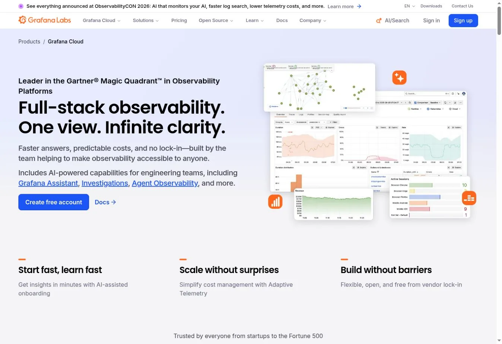
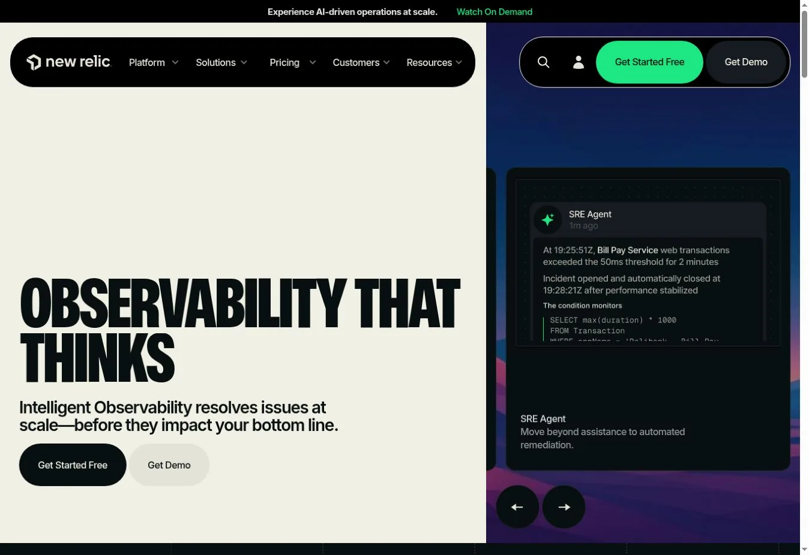
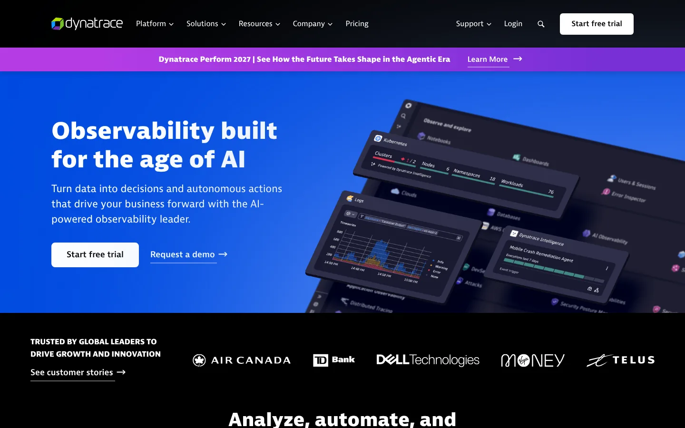
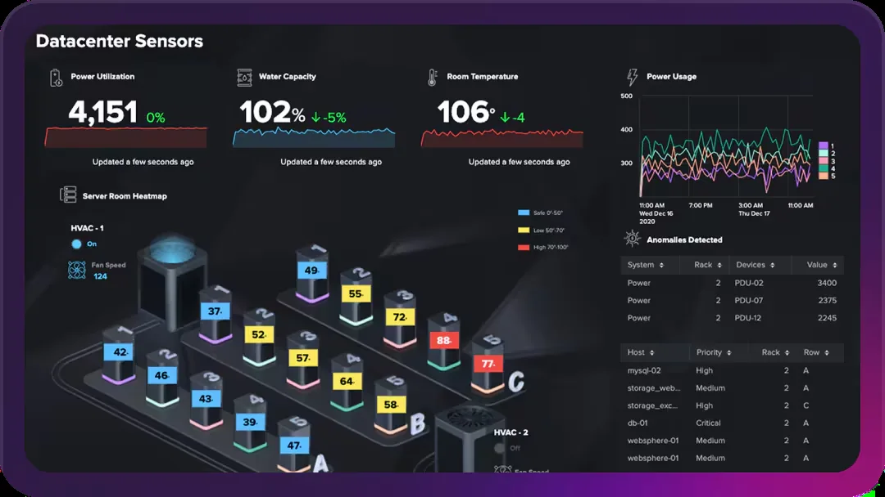
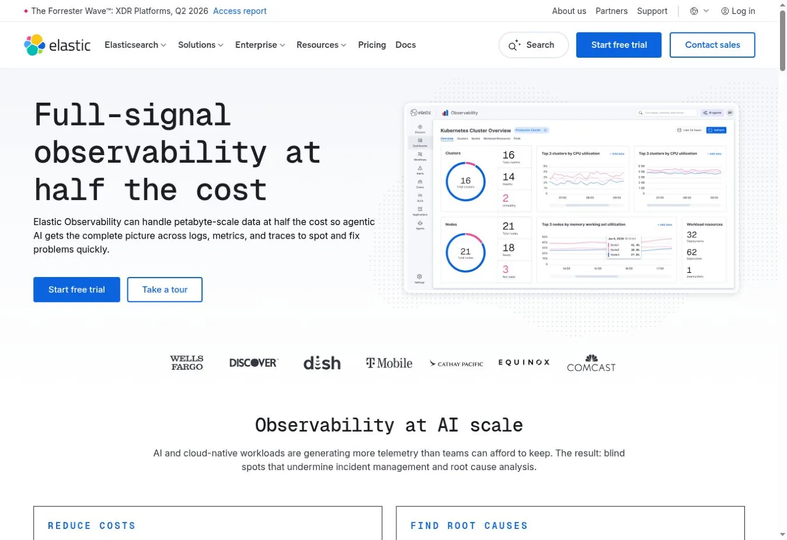
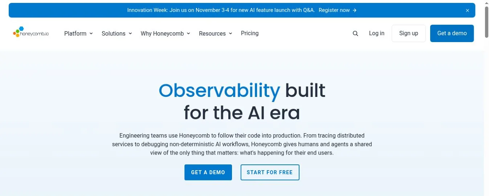
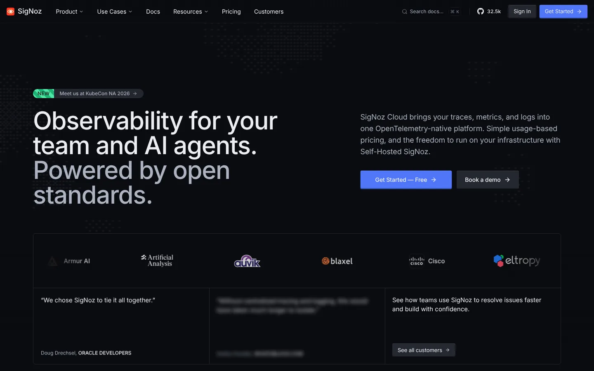
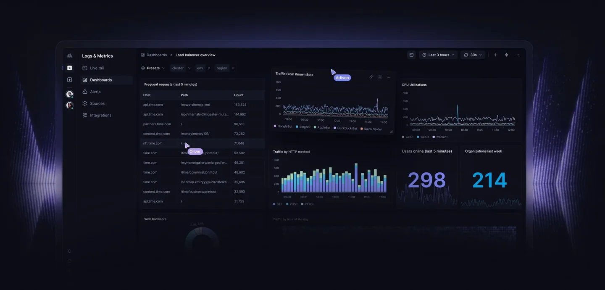

# 9 Datadog Alternatives for Metrics, Logs, Traces, and Cost Control

The best Datadog alternatives depend on why you want to switch. Grafana Cloud suits teams that like open telemetry backends and Grafana dashboards. New Relic offers broad coverage with ingest and user pricing. Dynatrace stands out for automatic topology. SigNoz fits OpenTelemetry-first teams that want a self-hosted path.

Replacing Datadog is rarely a simple price swap. Dashboards, monitors, agents, tags, synthetic tests, logs, traces, and retention all move with it. Compare the same telemetry volume before you pick a vendor.

## Key Takeaways

- **Grafana Cloud is the closest fit for teams that value open-source telemetry parts** and flexible dashboards.
- **New Relic is easy to model when ingest and users drive cost**, though full-platform seats add up.
- **Dynatrace fits large estates that want automatic topology** and root-cause workflows.
- **Honeycomb is strongest for high-cardinality event analysis** in distributed systems.
- **SigNoz offers a clear OpenTelemetry-first route** with cloud and self-hosted options.
- **Chronosphere is now Cortex XCOR by Palo Alto Networks.** It focuses on cutting telemetry volume before storage.

## How We Evaluated the Alternatives

We mapped a typical Datadog setup across infrastructure metrics, traces, logs, browser sessions, synthetic checks, custom metrics, dashboards, alerts, and retention. Then we scored each alternative on eight points.

1. Metrics, logs, traces, profiles, and user monitoring
2. OpenTelemetry support and collector portability
3. Hosted, self-hosted, or bring-your-own-cloud deployment
4. Pricing unit and included allowance
5. Retention and query charges
6. Dashboards, alerts, service maps, and investigation flow
7. Migration tools and expected manual work
8. Controls for dropping low-value telemetry

Most ranking pages list features and headline prices. Few explain how to move monitors, dashboards, tags, and retention rules. We include those steps because they decide whether a switch saves money.

## Datadog Alternatives Compared

| Alternative | Best reason to switch | Hosted | Self-hosted path | Pricing basis | Entry signal (checked Nov. 1, 2026) |
|---|---|---|---|---|---|
| Grafana Cloud | Open backends and Grafana workflow | Yes | Grafana, Loki, Mimir, and Tempo can run yourself | Series, GB, host hours, users, tests | Free; Pro from $19 per month plus usage |
| New Relic | Broad platform with ingest pricing | Yes | No full self-hosted option | Data ingest, users, compute | 100 GB free; $0.40 per GB after |
| Dynatrace | Automatic topology and enterprise ops | Yes | Managed options vary | Annual commitment drawn down by rate card | Infrastructure from $29 per host per month |
| Splunk Observability Cloud | Metrics and APM beside Splunk | Yes | Varies by product | Host-based packages | Infrastructure from $15 per host per month, annual |
| Elastic Observability | Search-centric logs and deployment choice | Yes | Yes | Hosted resources, serverless use, or self-managed | Calculator or custom |
| Honeycomb | High-cardinality event and trace analysis | Yes | Collector portable; platform hosted | Events and metric points | Free; Pro from $150 per month |
| SigNoz | OpenTelemetry-first cloud or self-hosting | Yes | Yes | GB of logs and traces, metric samples | Cloud minimum $49 per month |
| Better Stack | Telemetry plus uptime and on-call | Yes | Customer-bucket options | GB ingest, retention, monitors | Free; responder from about $29 per month, annual |
| Cortex XCOR (Chronosphere) | Large-scale telemetry cost control | Yes | Enterprise options | Retained useful data | Custom |

## Set a Datadog Baseline Before You Compare

Export one month of usage for hosts, containers, custom metrics, indexed and ingested logs, spans, browser sessions, synthetic tests, and users. Separate committed rates from on-demand rates.

Our breakdown of a [Datadog observability bill](/cloud-infrastructure/datadog-observability-costs/) shows why the host price is only one line. Price every replacement against the same workload, sampling, and retention. Our [cloud computing statistics](/cloud-infrastructure/cloud-computing-statistics/) explain the deployment terms these vendors use.

## The 9 Datadog Alternatives Compared

### 1. Grafana Cloud: Best for Open Backends and Dashboard Freedom

Grafana Cloud combines managed Grafana with metrics, logs, traces, profiles, load tests, and incident features. Underneath sit Prometheus-compatible metrics, Loki logs, Tempo traces, and OpenTelemetry integrations.

The free plan included 10,000 active metric series, 50 GB each of logs and traces, and 14-day retention. Pro started at $19 per month plus usage. Metrics began at $6.50 per 1,000 billable series, according to [Grafana Cloud pricing](https://grafana.com/pricing/).

This model can be cheap when you control cardinality and drop noisy logs. It also has several separate meters, so model each one.

**Best fit** teams that already use Grafana and want managed open backends.
**Migration work** convert queries and monitors, map tags to labels, and deploy collectors.

### 2. New Relic: Best Broad Platform With Ingest Pricing

New Relic covers APM, infrastructure, logs, traces, browser monitoring, synthetics, errors, and dashboards. It charges for data ingest plus user access rather than per host.

The original data option included 100 GB a month and $0.40 per GB beyond that. Basic users were free. Core users were $49 per month, and Pro full-platform users were $349 per month on annual terms.

Unlimited hosts help autoscaling setups. Heavy ingest and many full-platform users can cancel that advantage.

**Best fit** teams that want broad coverage without host counting.
**Migration work** instrument services, rebuild NRQL dashboards and alerts, and sort users by access level.

### 3. Dynatrace: Best for Automatic Topology and Enterprise Investigation

Dynatrace focuses on automatic discovery, topology, causal analysis, APM, infrastructure, logs, real-user monitoring, and security. It suits large estates where links between processes, services, and hosts drive operations.

Dynatrace uses an annual platform commitment that draws down against a public rate card. Infrastructure Monitoring was $29 per host per month. Full-Stack started at $58 per month for an 8 GiB host. Logs, retention, and sessions use separate rates.

The commitment gives flexibility, but you need a forecast and usage controls.

**Best fit** enterprises that value automatic dependency context.
**Migration work** compare entity mapping with your tags, rebuild SLOs, and test commitment burn.

### 4. Splunk Observability Cloud: Best for Teams Already on Splunk

Splunk Observability Cloud combines infrastructure monitoring, APM, real-user monitoring, synthetics, and incident response. It makes the most sense when your ops and security teams already use Splunk.

Annual starting prices were $15 per host per month for Infrastructure, $60 for App and Infra, and $75 for End-to-End. Logs and wider Splunk data use bring separate pricing and retention choices.

**Best fit** enterprises that want observability beside Splunk security data.
**Migration work** normalize host counts, trace ingest, logs, and cross-product licenses.

### 5. Elastic Observability: Best for Log Search and Deployment Choice

Elastic Observability uses Elasticsearch and Kibana for logs, metrics, traces, user monitoring, and search-driven investigation. You can use Elastic Cloud Serverless, a hosted cluster, or self-managed software.

That range is its biggest difference. Hosted pricing follows allocated resources, and serverless follows usage. Self-managing moves scaling, upgrades, and reliability to your team.

Elastic is strong when logs and search sit at the center. Cluster design and data tiers still need technical owners.

**Best fit** teams already on Elastic, or teams that need flexible hosting and strong log search.
**Migration work** map pipelines, index templates, fields, retention tiers, and alert rules.

### 6. Honeycomb: Best for High-Cardinality Distributed Systems

Honeycomb centers on high-cardinality events and traces. Engineers group and filter by detailed fields and use BubbleUp to compare odd behavior. You can investigate requests without building every dashboard first.

The free plan allowed 20 million events and 100 million metric data points a month. Pro started at $150 per month and scaled with volume. Honeycomb supports [OpenTelemetry](https://opentelemetry.io/docs/), which keeps your collectors portable.

**Best fit** engineering teams debugging complex distributed systems.
**Migration work** redesign investigations around events instead of copying every dashboard.

### 7. SigNoz: Best OpenTelemetry-First Cloud and Self-Hosted Option

SigNoz provides logs, metrics, traces, dashboards, alerts, and service views built on OpenTelemetry. Teams can use SigNoz Cloud or run the community edition themselves.

The cloud Teams plan had a $49 monthly minimum that included $49 of usage. Logs and traces cost $0.30 per GB, and metrics cost $0.10 per million samples. There was no user or host charge.

**Best fit** teams standardizing on OpenTelemetry that want a hosting choice.
**Migration work** use the vendor's dashboard migration tools, then check queries and monitors by hand.

### 8. Better Stack: Best for Telemetry Plus Uptime and On-Call

Better Stack combines logs, traces, metrics, error tracking, uptime checks, status pages, and on-call response. The single workflow suits small and midsize teams that want fewer tools.

The free plan included 3 GB each of logs and traces with three-day retention, 30 GB of metrics, and ten monitors. Paid log and trace ingest cost $0.10 per GB plus retention. The responder platform started near $29 per month on annual billing.

**Best fit** teams that want observability, uptime checks, and incident response in one place.
**Migration work** price storage by region, rebuild monitors, and test query depth.

### 9. Cortex XCOR (Formerly Chronosphere): Best for Telemetry Control at Scale

 product image, captured November 2026")

Palo Alto Networks bought Chronosphere, and the product now carries the Cortex XCOR name. It targets cloud-native companies with fast telemetry growth. The control plane lets teams aggregate, drop, or reshape low-value signals before storage while keeping what dashboards and alerts need.

Pricing is custom and based on retained useful data, not hosts or raw ingest. It accepts Prometheus, OpenTelemetry, and other common inputs. Ask how the move into Palo Alto's Cortex line affects your contract and roadmap.

**Best fit** large Kubernetes estates where telemetry growth is the main cost problem.
**Migration work** list current queries and alerts before dropping data, then prove the shaping rules keep them working.

## Which Datadog Alternative Fits Your Reason for Switching?

| Reason for leaving | Shortlist |
|---|---|
| Prefer Grafana and open backends | Grafana Cloud |
| Avoid host-based pricing | New Relic, Honeycomb, SigNoz, Better Stack |
| Need enterprise topology and causal analysis | Dynatrace |
| Already use Splunk heavily | Splunk Observability Cloud |
| Want self-hosting or deployment choice | Elastic Observability, SigNoz |
| Need high-cardinality event analysis | Honeycomb |
| Need hard telemetry volume control | Cortex XCOR, Grafana Cloud |
| Want uptime and on-call in the same tool | Better Stack |

## How to Run a Fair Cost Comparison

Use the same month of production telemetry. Hold ingest, sampling, index rules, retention, queries, users, and support constant. Include the cost of running both tools during migration and the time to rebuild dashboards.

Work out both the first-year total and the steady-state total. A low ingest price can vanish under user licenses, query scans, or self-hosting labor. Keep network signals in scope too, using our [network monitoring tools comparison](/cloud-infrastructure/network-monitoring-tools/).

## Migration Checklist

1. Export dashboards, monitors, SLOs, integrations, and user roles.
2. List agents, collectors, custom checks, and instrumentation libraries.
3. Map Datadog tags to the new tool's resource model.
4. Mark logs, metrics, and spans you can sample or drop.
5. Rebuild one service and compare incidents in both tools.
6. Run both through a real release and one failure drill.
7. Confirm retention, export, and access after the Datadog contract ends.

## FAQs

### What Is the Best Datadog Alternative?

Grafana Cloud is a strong general alternative for open telemetry workflows. New Relic suits ingest-based pricing, and Dynatrace fits enterprise automation. Honeycomb leads on distributed-system analysis, and SigNoz offers cloud or self-hosted OpenTelemetry. The best pick depends on why you are leaving Datadog in the first place.

### Is There an Open-source Alternative to Datadog?

SigNoz offers an integrated open-source observability platform. Teams can also combine Grafana with Prometheus or Mimir, Loki, and Tempo. Elastic offers self-managed options too. Open-source software moves hosting, scaling, security, upgrades, and support onto your team, so budget for that work.

### Which Datadog Alternative Is Cheaper?

No product is cheaper for every workload. Cost depends on hosts, active series, log and trace volume, retention, users, sessions, tests, queries, and commitments. Price the same production month in each model and include migration labor before you decide that a switch will save money.

### Can OpenTelemetry Make Migration Easier?

OpenTelemetry makes collection and instrumentation more portable across compatible backends. Vendor-specific dashboards, queries, monitors, service definitions, user roles, and incident workflows still need to be rebuilt and checked. It lowers the cost of a future switch but does not remove the current one.

## Resources

- [New Relic pricing](https://newrelic.com/pricing)
- [Dynatrace pricing](https://www.dynatrace.com/pricing/)
- [Splunk Observability pricing](https://www.splunk.com/en_us/products/pricing/observability.html)
- [Elastic pricing](https://www.elastic.co/pricing/)
- [Honeycomb pricing](https://www.honeycomb.io/pricing)
- [SigNoz pricing](https://signoz.io/pricing/)
- [Better Stack pricing](https://betterstack.com/pricing)
- [Chronosphere, now Cortex XCOR](https://chronosphere.io/)
