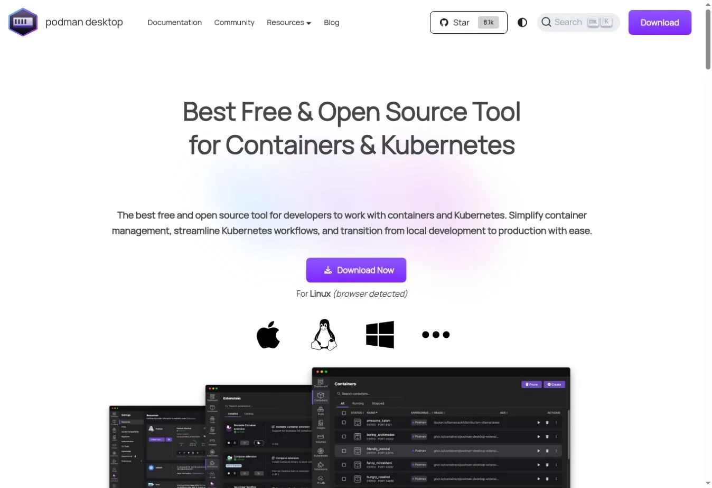
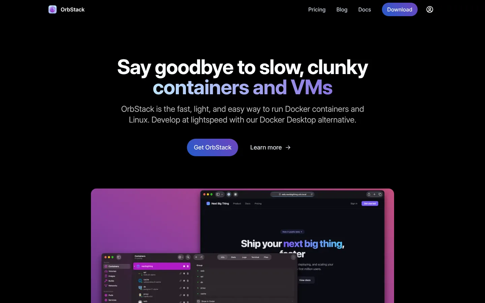
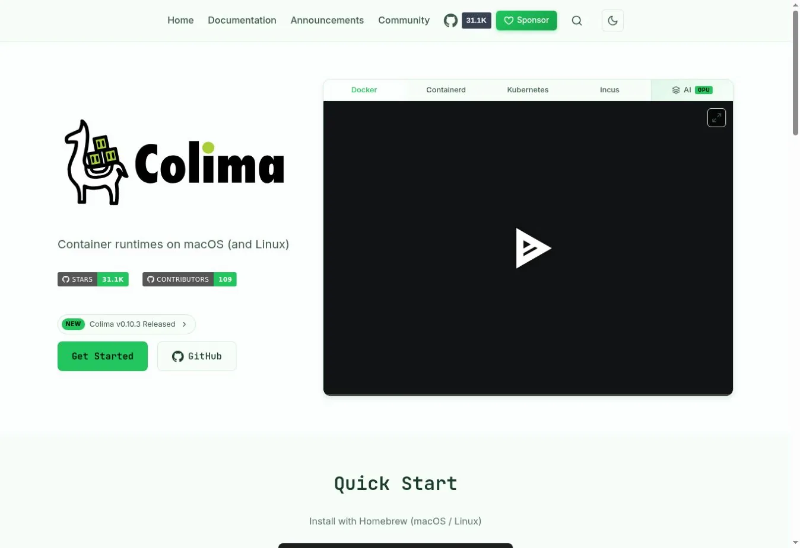
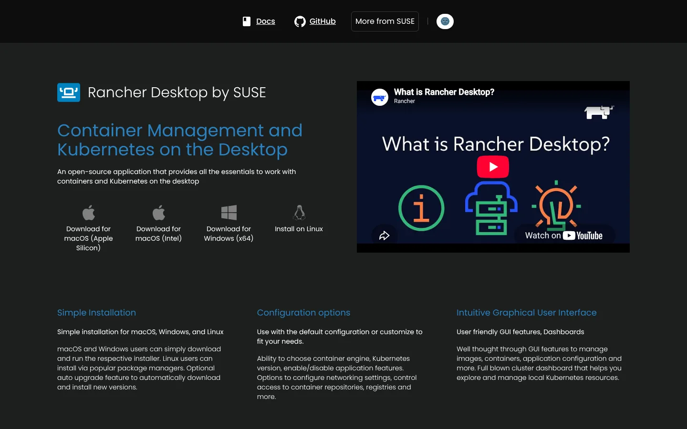
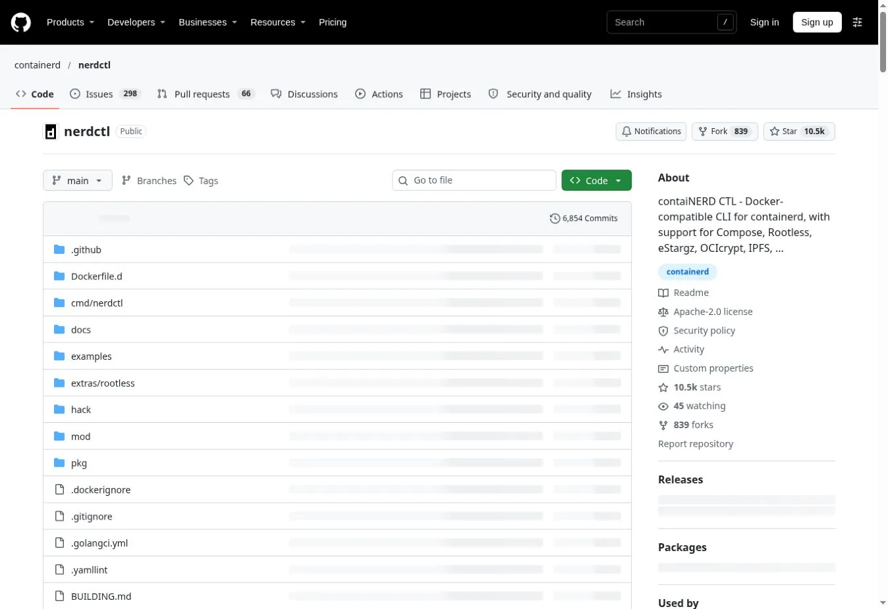
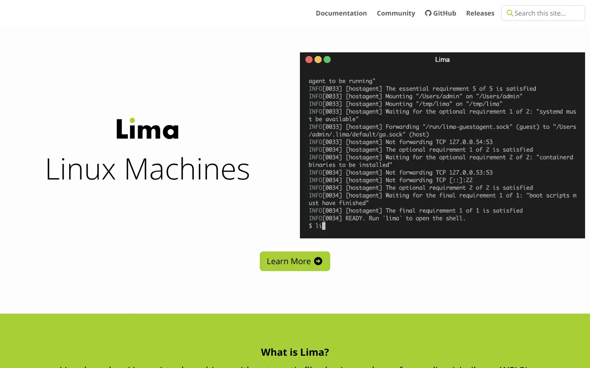
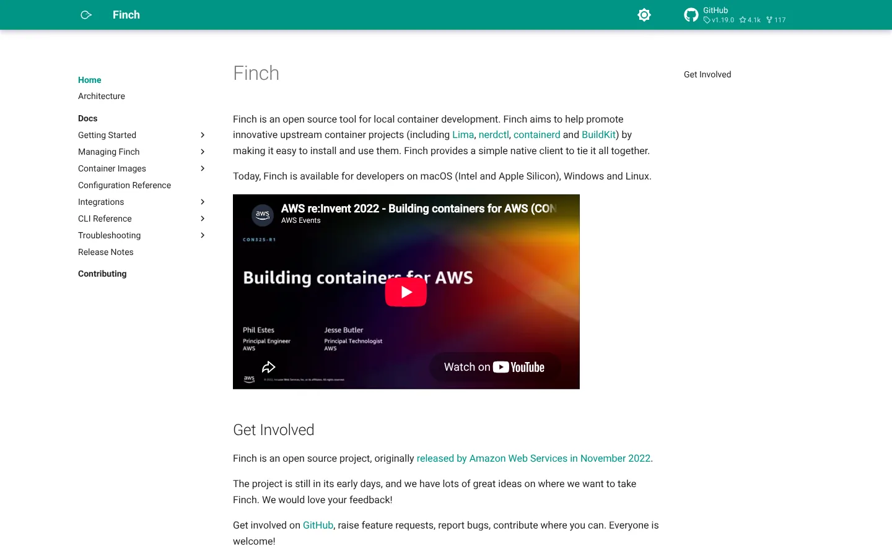
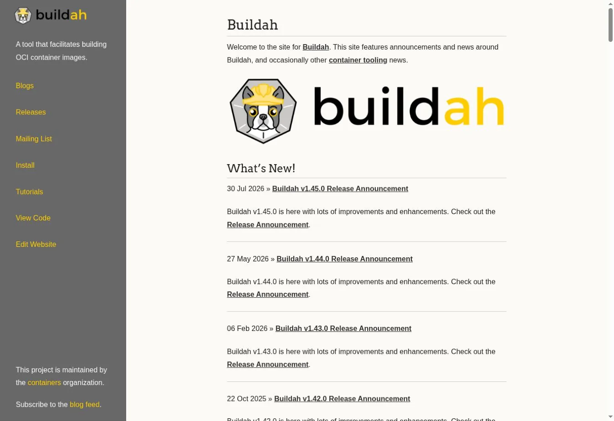
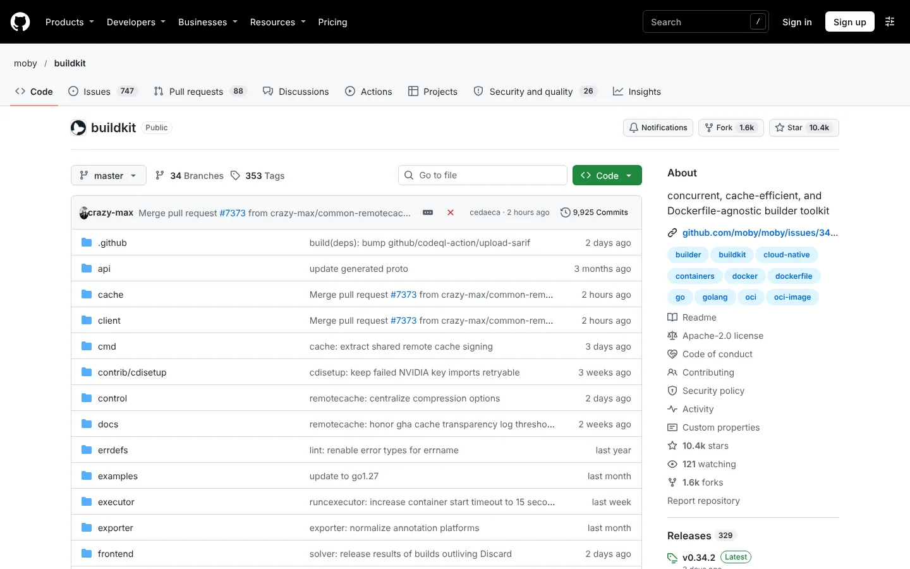

# 9 Docker Alternatives for Local Development and Container Workflows

The best Docker alternative depends on which part of Docker you want to replace. Podman Desktop and Rancher Desktop are full desktop choices. OrbStack and Colima are strong on macOS. nerdctl works directly with containerd. Buildah and BuildKit replace image builds, not the desktop experience.

Many lists mix desktop apps, engines, runtimes, builders, and orchestrators. Those products are not interchangeable. Start by naming the need, whether it is a Linux VM, Docker CLI compatibility, Kubernetes, rootless runs, or image builds.

## Key Takeaways

- **Podman Desktop is the broadest open-source desktop option** across Windows, macOS, and Linux.
- **OrbStack is a polished commercial choice for Mac**, free for personal use and paid for business.
- **Colima is a lightweight command-line option for Mac and Linux.**
- **Rancher Desktop suits developers who want Kubernetes built in.**
- **nerdctl is a Docker-like CLI for containerd**, not a full desktop platform.
- **Buildah and BuildKit focus on image builds.** They do not replace a local container environment.
- **We left Kaniko out because its official repository is archived** and no longer maintained.

## How We Evaluated the Alternatives

We tested each option against one local workflow. Build an OCI image, run a multi-container app, and mount source code. Then forward a port, pull from a private registry, and use Kubernetes where offered.

We compared nine points.

1. Supported host operating systems
2. Container engine and daemon model
3. Docker CLI and Compose compatibility
4. Rootless operation
5. Local Kubernetes support
6. Image build method
7. VM and resource controls
8. License and commercial-use terms
9. Migration effort and gaps

The biggest gap in current results is category clarity. Some pages call Kubernetes a Docker Desktop replacement or list a builder as if it runs a full stack. We label each product by the layer it replaces.

## Docker Alternatives Compared

| Tool | Category | Hosts | Docker-style CLI | Local Kubernetes | License or price signal |
|---|---|---|---|---|---|
| Podman Desktop | Desktop plus Podman engine | Windows, macOS, Linux | Podman CLI; Docker API support varies | Connects and deploys; extensions add clusters | Open source, free |
| OrbStack | Commercial desktop runtime | macOS | Yes | Optional | Free personal use; Pro $8 per user per month, annual |
| Colima | Light VM and runtime manager | macOS, Linux | Yes, with Docker runtime | Optional | Open source, free |
| Rancher Desktop | Desktop containers plus Kubernetes | Windows, macOS, Linux | Docker-compatible or nerdctl | Built in | Open source, free |
| nerdctl with containerd | CLI plus runtime | Linux; VM or WSL paths elsewhere | Docker-like nerdctl | Fits Kubernetes setups | Open source, free |
| Lima | Linux VM layer | macOS and other hosts | Through templates | Through templates | Open source, free |
| Finch | Packaged container bundle | macOS, Windows, Linux | nerdctl-style commands | Not its focus | Open source, free |
| Buildah | OCI image builder | Linux; VM paths elsewhere | Containerfile builds only | Builds images for clusters | Open source, free |
| BuildKit | Advanced build engine | Linux and desktop integrations | `buildctl` or Docker Buildx | Builds for any OCI workflow | Open source, free |

## First, Identify the Layer You Are Replacing

Docker Desktop bundles a desktop app and a Linux VM on macOS and Windows. It adds the Docker Engine, CLI, Compose, BuildKit, networking, volumes, credentials, and optional Kubernetes.

A runtime such as containerd replaces only part of that stack. A VM project such as Lima supplies Linux but needs a runtime and client. A builder such as Buildah makes images but not the full developer experience. Our [Podman vs. Docker comparison](/developer-data/podman-vs-docker/) covers the daemon and rootless differences in depth. Our [cloud computing statistics](/cloud-infrastructure/cloud-computing-statistics/) give the wider deployment picture.

## The 9 Docker Alternatives Compared

### 1. Podman Desktop: Best Open-Source Desktop Across Operating Systems

[Podman Desktop](https://podman-desktop.io/) manages containers, images, pods, volumes, registries, and Kubernetes connections in a graphical app. It runs on Windows, macOS, and Linux. Podman runs natively on Linux and uses a managed Linux VM elsewhere.

Podman supports rootless and rootful containers, pods, Compose workflows, and Docker API clients in supported setups. Its daemonless design differs from Docker's central daemon. Test socket behavior, networking, file permissions, and Compose details before you switch.

**Choose Podman Desktop when** open-source tooling, rootless containers, and cross-platform support come first.
**Check first** Compose features, volume permissions, socket integrations, and test-container libraries.

### 2. OrbStack: Best Polished Docker Desktop Alternative for Mac

OrbStack offers containers, Linux machines, file sharing, networking, and optional Kubernetes in a macOS-native app. It aims for fast startup and low resource use while keeping Docker commands and Compose.

[OrbStack pricing](https://orbstack.dev/pricing) makes personal, non-commercial use free. Business use costs $8 per user per month on annual billing. Enterprise adds SAML SSO and purchasing options.

The limit is platform scope. OrbStack is macOS only, so mixed teams need another standard for Windows and Linux.

**Choose OrbStack when** a Mac team wants a polished runtime with Docker compatibility.
**Check first** business licensing, Kubernetes needs, corporate controls, and parity with CI.

### 3. Colima: Best Lightweight Command-Line Option

Colima manages a Linux VM and supports Docker, containerd, Kubernetes, and Incus runtimes. It uses a simple command-line interface with port forwarding, volume mounts, multiple instances, and resource settings.

The default Docker runtime works with the Docker CLI after `colima start`. A containerd setup pairs with nerdctl, and you can switch on Kubernetes when needed. Colima is open source and suits developers who do not need a dashboard.

**Choose Colima when** your team uses macOS or Linux and prefers a small CLI tool.
**Check first** mount speed, architecture emulation, DNS, VPN behavior, and GUI needs.

### 4. Rancher Desktop: Best for Local Kubernetes Development

Rancher Desktop provides a graphical container environment for Windows, macOS, and Linux with Kubernetes built in. Developers choose containerd with nerdctl or a Docker-compatible engine.

It is open source and fits teams already using Rancher or Kubernetes. Running Kubernetes adds CPU and memory load, so container-only users may prefer a lighter tool.

**Choose Rancher Desktop when** local Kubernetes is part of daily work.
**Check first** the selected runtime, Compose behavior, Kubernetes versions, and network settings.

### 5. Nerdctl With Containerd: Best Containerd-Native CLI

nerdctl provides Docker-like commands for containerd, including run, pull, logs, build, and Compose. It also exposes containerd features such as lazy image pulling and image encryption.

This pair sits close to the runtime many Kubernetes clusters use. It is not a turnkey desktop. Networking, namespaces, snapshotters, and BuildKit need more hands-on ownership. macOS uses a VM such as Lima, and Windows usually uses WSL2.

**Choose nerdctl when** platform engineers want direct control of a containerd stack.
**Check first** namespaces, Compose support, build setup, and credential helpers.

### 6. Lima: Best Flexible Linux VM Layer for Mac

Lima launches Linux VMs with automatic file sharing and port forwarding. Templates can set up containerd with nerdctl, Docker, Podman, Kubernetes, or a general Linux dev machine.

Lima sits underneath several higher-level tools. That flexibility helps with custom environments, but it asks for more decisions than a polished desktop app.

**Choose Lima when** you want to build a controlled Linux dev environment on a Mac.
**Check first** template upkeep, mounts, virtualization backend, and runtime updates.

### 7. Finch: Best Packaged Open-Source Container Bundle

Finch packages an open-source container stack behind a small native client. It uses nerdctl for commands, containerd for runtime, BuildKit for builds, and Lima for the VM. The project now lists macOS, Windows, and Linux support.

The bundle removes assembly work while keeping each part visible. AWS sponsors Finch, but it is not tied to AWS services.

**Choose Finch when** developers want a packaged stack without picking every component.
**Check first** host support in the current release, Compose coverage, mounts, and support options.

### 8. Buildah: Best Daemonless OCI Image Builder

Buildah builds OCI images from Containerfiles or scripted steps. It shares the containers ecosystem with Podman and supports daemonless, rootless builds on Linux.

Buildah replaces `docker build` more than it replaces Docker Desktop. You still need a runtime such as Podman or containerd to run the finished image.

**Choose Buildah when** Linux builds need daemonless or rootless operation.
**Check first** build cache, multi-architecture output, CI privileges, and Dockerfile support.

### 9. BuildKit: Best Advanced Image Build Engine

BuildKit is a build engine with parallel steps, caching, secrets, SSH forwarding, multiple output formats, and pluggable frontends. Docker Buildx already uses it, but it also runs standalone or inside CI.

BuildKit is the right pick when build speed or build security is the pain point. It does not supply a desktop, Compose, networking, or container management.

**Choose BuildKit when** you need fast, repeatable, cached image builds.
**Check first** builder hosting, cache storage, provenance, secrets, and multi-platform workers.

## Why Kaniko Is Not Included

Kaniko built images inside Kubernetes without a Docker daemon. Its [official GoogleContainerTools repository](https://github.com/GoogleContainerTools/kaniko) was archived in June 2025 and is now read-only. New evaluations should favor maintained builders such as BuildKit or Buildah.

## Which Docker Alternative Should You Choose?

| Need | Shortlist |
|---|---|
| Open-source desktop on all major systems | Podman Desktop, Rancher Desktop |
| Fast, polished macOS experience | OrbStack |
| Light CLI on macOS or Linux | Colima |
| Local Kubernetes | Rancher Desktop, Colima, OrbStack |
| Direct containerd workflow | nerdctl with containerd |
| Custom Linux VMs on macOS | Lima |
| Packaged open-source stack | Finch |
| Daemonless image builds | Buildah |
| Advanced cached and multi-platform builds | BuildKit |

## Migration Checklist

Test your real repository, not `hello-world`. Run Compose services, bind mounts, named volumes, private registries, multi-architecture builds, dev containers, and CI scripts.

Watch for code that assumes `/var/run/docker.sock`, Docker network names, privileged daemon access, or a specific Compose behavior. Compare speed with warm caches and after a clean restart. Document the supported standard for every operating system on the team. Then run your [API testing tools](/developer-data/api-testing-tools/) and [CI/CD tools](/developer-data/ci-cd-tools/) inside the new setup. If your team also runs Linux VMs on Macs, our guide to [virtual machines for Mac](/cloud-infrastructure/virtual-machine-for-mac/) covers that layer.

## FAQs

### What Is the Best Docker Alternative?

Podman Desktop is the broadest open-source desktop option. OrbStack is strong for commercial Mac teams, Colima suits command-line users, and Rancher Desktop fits local Kubernetes. The right choice depends on which layer of Docker you want to replace, so name that need before you compare tools.

### Is Podman a Direct Replacement for Docker?

Podman supports many familiar container and image commands, plus Docker API compatibility in supported setups. Its daemonless and rootless design creates differences in sockets, networking, permissions, Compose behavior, and integrations. Most teams can switch, but they should test their real projects and CI scripts first.

### What Is the Best Free Docker Desktop Alternative?

Podman Desktop, Rancher Desktop, and Colima are free open-source choices. OrbStack is free for personal, non-commercial use but needs a paid license for business work. Lima and Finch are also free, though they suit developers who are comfortable assembling more of the stack themselves.

### What Should Replace Kaniko?

BuildKit and Buildah are maintained image builders. The best replacement depends on Dockerfile compatibility, rootless needs, caching, multi-platform output, Kubernetes runs, and CI security boundaries. Test both against your current Kaniko pipeline before you migrate production builds.

## Resources

- [Podman features](https://podman.io/features)
- [Colima documentation](https://colima.run/docs/getting-started/)
- [Rancher Desktop documentation](https://docs.rancherdesktop.io/)
- [nerdctl](https://github.com/containerd/nerdctl)
- [Lima](https://github.com/lima-vm/lima)
- [Finch](https://github.com/runfinch/finch)
- [Buildah](https://buildah.io/)
- [BuildKit](https://github.com/moby/buildkit)
