# 15 Free AI Tools Compared by Task, Limits, and Data Use

The best free AI tool depends on the job. ChatGPT, Gemini, Claude, and Microsoft Copilot are useful general assistants. Perplexity and Gemini Notebook are better when sources matter. GitHub Copilot and Cursor work inside code. Ollama and LM Studio run models locally, while Firefly, Canva AI, and Otter cover creative and meeting work.

"Free" means different things across these products. Some offer a permanent plan with shifting limits. Others give a monthly allowance, daily points, or a few imports. Local tools charge nothing per message, but your hardware and the model license become part of the cost.

## Key Takeaways

- **ChatGPT is the broadest free general option**, with search, files, data analysis, and images under separate limits.
- **Gemini fits people already in Google's ecosystem**, though its limits change with demand.
- **Perplexity is the simplest free pick for questions that need sources.**
- **Gemini Notebook beats a general chatbot for work from a defined set of sources.**
- **GitHub Copilot and Cursor offer useful free coding paths**, with heavier agent use on paid plans.
- **Ollama and LM Studio run local models without per-message charges.** Hardware and licenses still matter.
- **Firefly, Canva AI, and Otter each finish a full free task**, but their allowances set clear upgrade points.

## How We Picked and Checked the Tools

A product qualified only if someone could finish a useful task with no payment details and no time-limited trial. We checked each free path against one job. Our [AI statistics on investment and production use](/ai/ai-statistics-investment-production-use/) give wider context on adoption.

1. Answer a current question and show sources.
2. Summarize a supplied document.
3. Write or explain a short code change.
4. Create a usable image or design draft.
5. Transcribe and summarize a short meeting.
6. Export or keep the result without upgrading.

We also noted whether each provider publishes a fixed allowance, a flexible limit, or no number at all. A vague "limited use" plan can shift with capacity, model choice, and prompt length. We checked every plan on November 1, 2026. Free allowances change without notice, so confirm the current terms before you build a routine around one.

## Free AI Tools Compared

| Tool | Best free use | Published free limit | Account needed | Main upgrade trigger |
|---|---|---|---|---|
| ChatGPT | General chat, files, web, light data work | Everyday chat open; tools have separate limits | Yes, to save work | More tool use and higher limits |
| Gemini | General help in Google's ecosystem | Compute-based limits that refresh | Yes | Higher model and feature limits |
| Claude | Writing and document analysis | Limited; varies with length and demand | Yes | Daily long-document or coding work |
| Microsoft Copilot | Web-grounded questions | Limited, subject to capacity | Optional for basic chat | Microsoft 365 integration |
| Perplexity | Source-backed web research | Basic searches; 3 Pro Searches a day; 1 Research query a month | Yes, for history | Deeper research |
| Gemini Notebook | Research from your own sources | 100 notebooks, 50 sources each, 50 chats a day | Yes | Bigger source sets |
| Mistral Vibe | Chat, search, light coding | Limited messages, searches, and sessions | Yes | Long agent and coding work |
| Poe | Trying many model providers | Daily points that reset every 24 hours | Yes | More points and premium models |
| GitHub Copilot | Code completions and light chat | 2,000 completions a month plus limited chat | GitHub account | More agent work |
| Cursor | AI-assisted editing in a codebase | Limited agent and chat requests | Yes | Sustained repository work |
| Ollama | Local model tests and private prompts | Local models free; hardware sets the limit | No, for local use | Hosted models or bigger hardware |
| LM Studio | Local desktop chat and model testing | Free for home and work | No, for local use | Team governance |
| Adobe Firefly | Image generation and editing | Limited daily generations | Adobe account | More daily output |
| Canva AI | Fast design drafts | Up to 200 Standard or 20 Premium AI uses a month | Canva account | More AI use and premium features |
| Otter.ai | Short meeting transcripts | 300 minutes a month, 30 minutes each, 3 lifetime imports | Yes | Longer meetings and more imports |

## General Assistants

### 1. ChatGPT: Best Broad Free AI Workspace

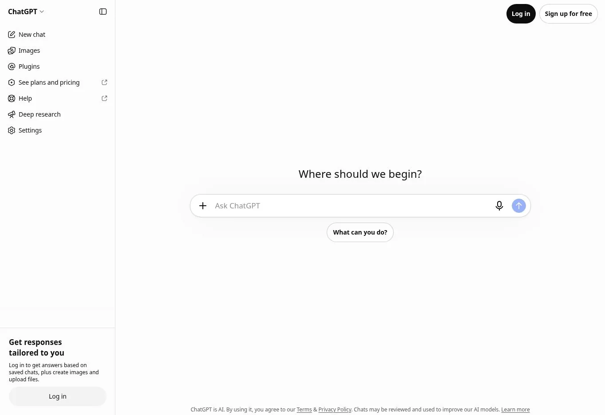

ChatGPT Free combines chat with web search, file and image uploads, data analysis, image creation, and existing GPTs. [OpenAI says everyday text chat is open on the free tier](https://help.openai.com/en/articles/9275245-chatgpt-free-tier-faq), while uploads, analysis, images, and voice have separate limits.

That makes it handy for varied one-off jobs. You can research a question, inspect a spreadsheet, and draft copy in one place. It is less predictable for routines that lean on one tool. OpenAI does not publish a fixed quota for each feature.

If the work involves repeatable multi-step automation, decide first whether a chatbot is enough. Our explainer on [what AI agents are](/ai/what-are-ai-agents/) covers when you need approvals and audit controls. When you need a full platform, compare the [best AI agents](/ai/best-ai-agents/).

**Best free task** mixed writing, research, file, and light analysis work.
**Main limit** separate tool caps can interrupt an active chat.

### 2. Gemini: Best General Assistant for Google Users

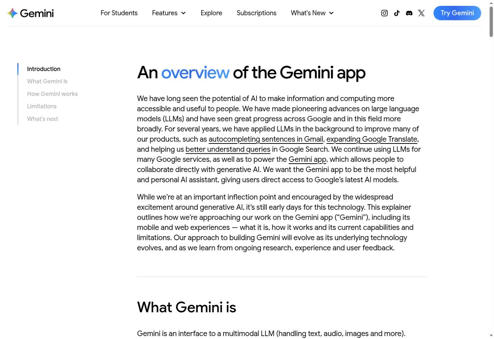

Gemini handles web questions, files, images, writing, coding, and Google-connected tasks. [Google describes the free tier through standard limits](https://support.google.com/gemini/answer/16275805), not a fixed message count. Usage depends on prompt complexity, feature choice, chat length, and demand.

That flexibility works for casual use but makes planning hard. Google says limits can tighten first for free users during busy periods.

Gemini is a sensible first pick for people already in Google products. It is not automatically right for private business files, so review the data terms for your account type.

**Best free task** questions and documents tied to Google work.
**Main limit** compute-based limits are not a stable number of prompts.

### 3. Claude: Best for Occasional Writing and Document Work

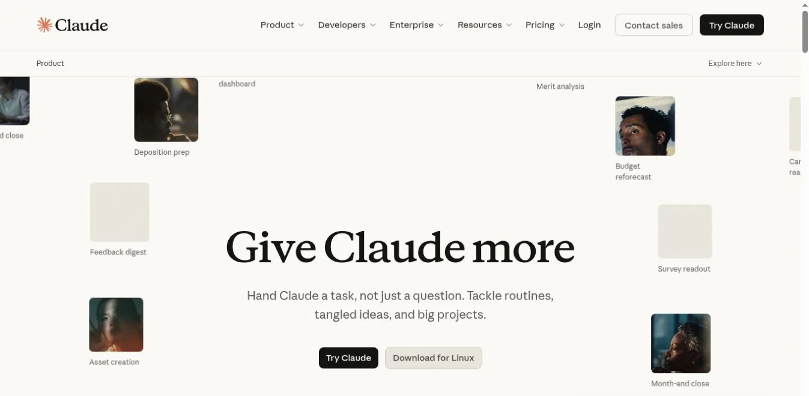

Claude's free plan suits rewriting, analysis, structured thinking, and working through a document. Anthropic describes it as limited capacity for occasional use. Long chats, large files, and busy periods use up capacity faster than short prompts.

Claude fits people who want a focused writing or analysis session rather than a toolbox of media features. The free plan gets tight when you keep several long projects going all day.

**Best free task** improving a hard draft or analyzing one document.
**Main limit** usage is capacity-based, not a monthly message count.

### 4. Microsoft Copilot: Best Free Assistant for Microsoft Users

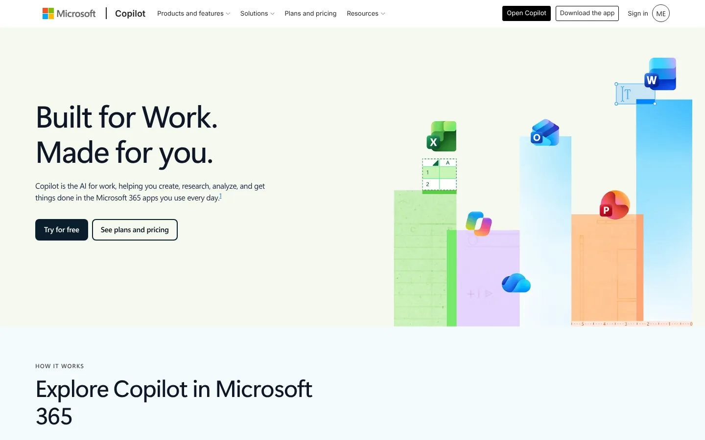

Microsoft Copilot offers free web-grounded chat for writing, summaries, research, and images. You can start without signing in. A personal Microsoft account adds history and longer chats.

The free assistant is different from Microsoft 365 Copilot. The paid workplace product can use permitted work files, email, and meetings. Do not assume the free version has the same access or governance.

**Best free task** current web questions for people already using Microsoft products.
**Main limit** deeper Microsoft 365 grounding needs an eligible plan.

## Research and Source-Grounded Work

### 5. Perplexity: Best for Quick Research With Visible Sources

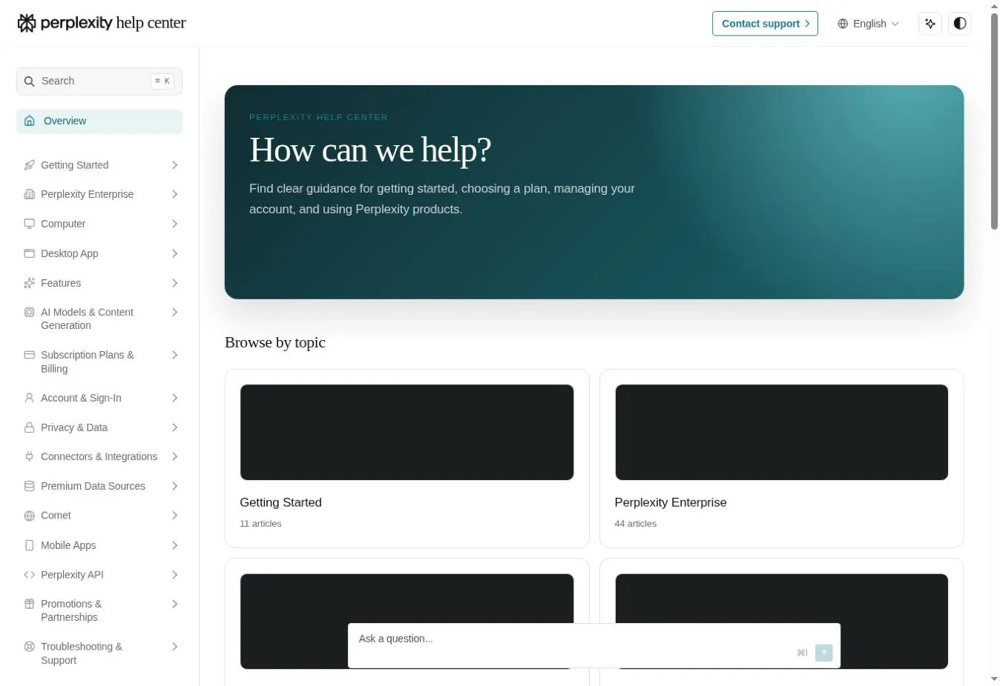

Perplexity builds each answer around web search and source links. Its free Standard plan includes basic searches, limited uploads, three Pro Searches a day, and one Research query a month.

That beats a general chatbot when you need to see where a claim came from. Citations still need checking. A link may support only part of a sentence.

**Best free task** a current question that needs a source trail.
**Main limit** deeper research and advanced models are tightly capped.

### 6. Gemini Notebook: Best for Answers From Your Own Sources

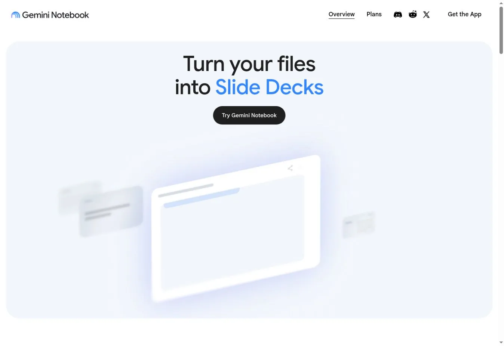

Gemini Notebook, formerly NotebookLM, builds notebooks from sources you supply and answers questions across them. It can also produce audio and video overviews, reports, flashcards, and slide decks.

The free plan lists 100 notebooks, 50 sources each, 50 chats a day, and three audio overviews a day. That covers a research brief, course pack, or policy collection.

Its advantage is scope. It works from the sources in the notebook, which makes answers easier to audit.

**Best free task** summarizing and comparing a set of documents.
**Main limit** 50 sources per notebook and separate output caps.

### 7. Mistral Vibe: Best Free European Assistant With Light Coding

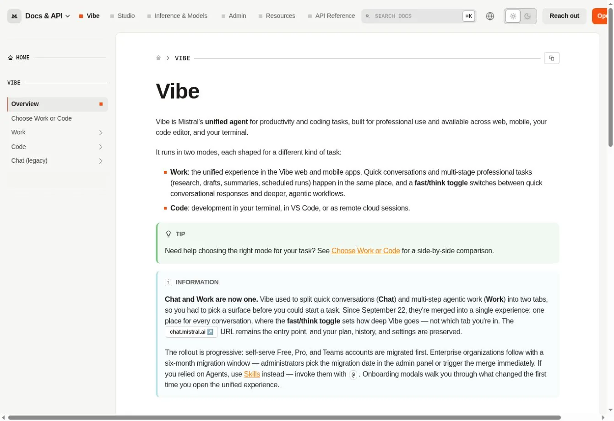

Mistral renamed Le Chat to Vibe. In September 2026 it merged chat and multi-step work into one Work mode. A separate Code mode runs in the terminal and VS Code. The free plan includes limited messages, searches, coding sessions, and basic images.

Vibe is useful for testing Mistral's assistant without paying. Mistral does not publish a fixed message count, so treat the free plan as a trial of quality.

**Best free task** general chat, web questions, or a short coding session.
**Main limit** limits are described as limited, not fixed.

### 8. Poe: Best for Trying Several Model Families

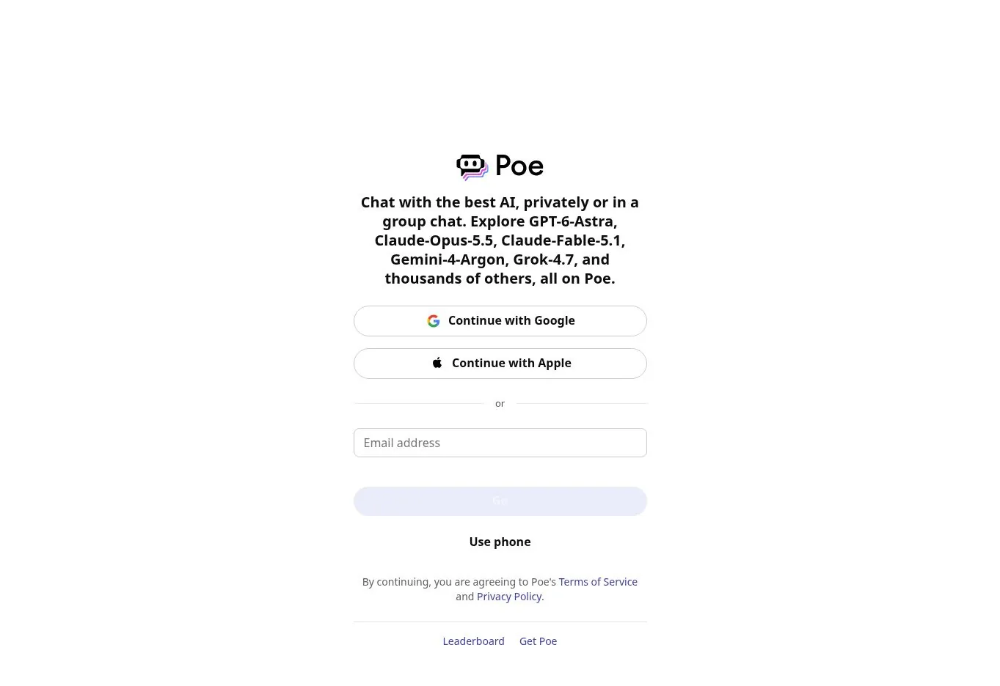

Poe gives access to many first-party and community bots through a points system. Free users get points each day that expire after 24 hours. Each bot shows its estimated cost.

That helps when you want to compare how different models answer the same prompt. It is less predictable than a direct plan, because bots differ in models, context, and cost.

**Best free task** comparing short answers from several providers.
**Main limit** daily points do not roll over.

## Coding and Local AI

### 9. GitHub Copilot Free: Best for Light Coding Help in an IDE

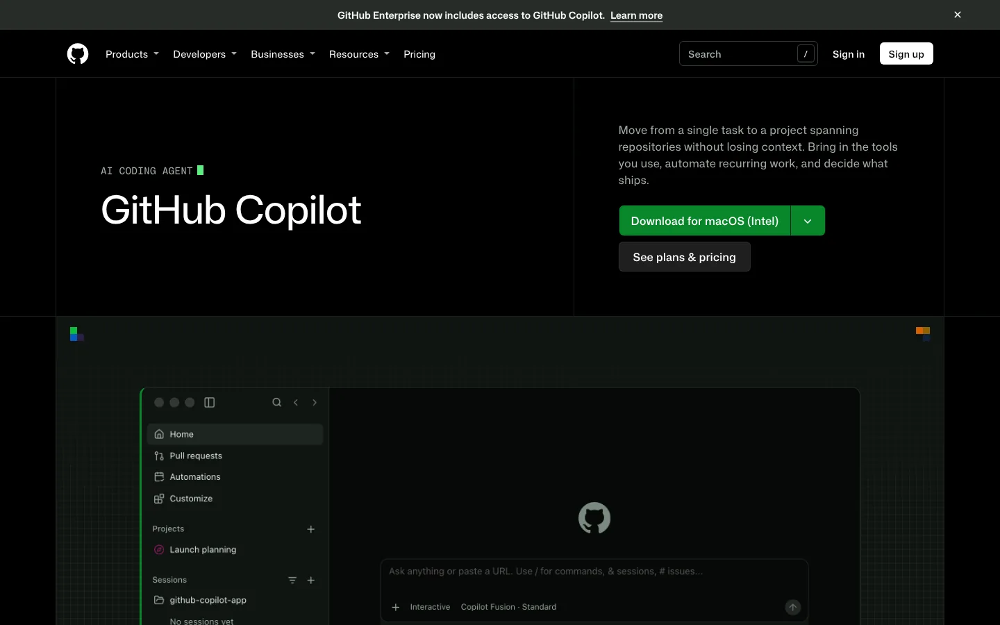

GitHub Copilot Free includes 2,000 code completions a month plus limited chat and agent use. Free users get automatic model selection rather than the paid model choice.

Its value is location. Suggestions appear in your editor, so you do not copy code between a browser and an IDE. It suits learning and side projects.

**Best free task** completions and occasional questions in an existing codebase.
**Main limit** 2,000 monthly completions and limited agent capacity.

### 10. Cursor Free: Best for Testing an AI-First Code Editor

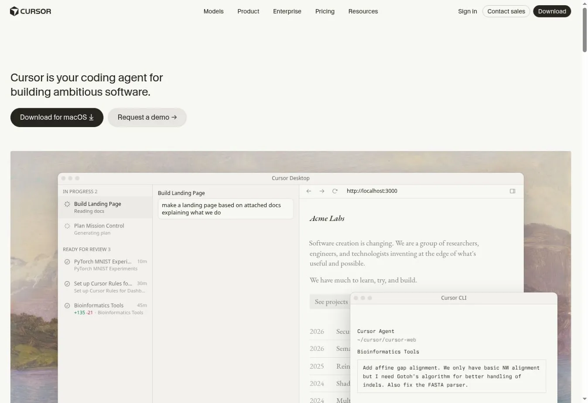

Cursor's free plan includes limited agent and chat requests. That gives a developer room to test repository-aware edits and see whether an AI-first editor fits.

It is not built for daily agent use. Teams should also review extension support, code indexing, and privacy mode.

**Best free task** a small edit or explanation in a small repository.
**Main limit** Cursor publishes "limited" use, not a request count.

### 11. Ollama: Best for Running Open Models Locally

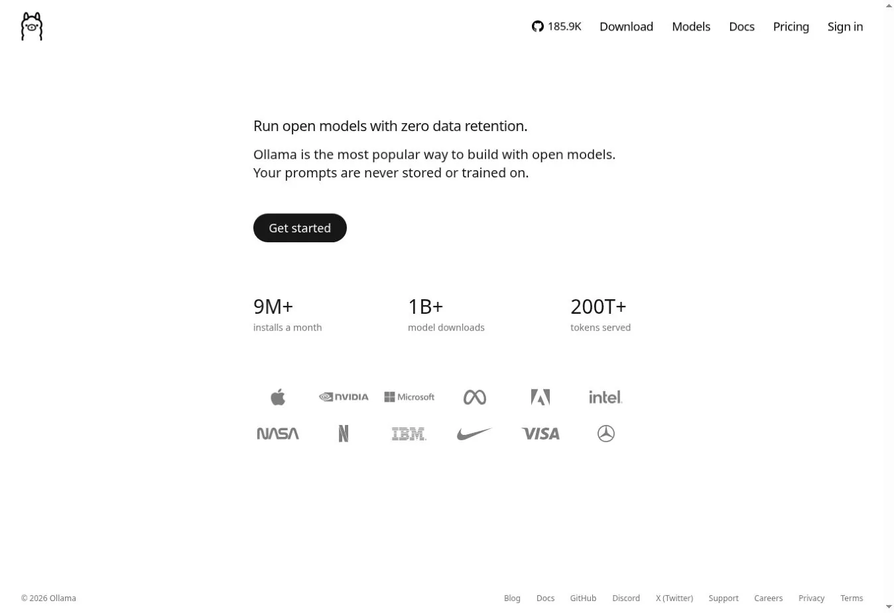

Ollama downloads and runs supported models on your own computer. Local use stays free. Ollama now also sells hosted models, so check which mode you are in before sending private data.

Local inference has no per-message bill, but it is not costless. Memory, storage, model size, speed, and power decide whether a model is usable. Open weights do not always allow commercial use. Our [AI token calculator](/tools/ai-token-calculator/) helps estimate what a hosted model would cost instead.

**Best free task** private experiments, offline prompts, and developer integrations.
**Main limit** your hardware and the model's ability.

### 12. LM Studio: Best Local Desktop App for Model Testing

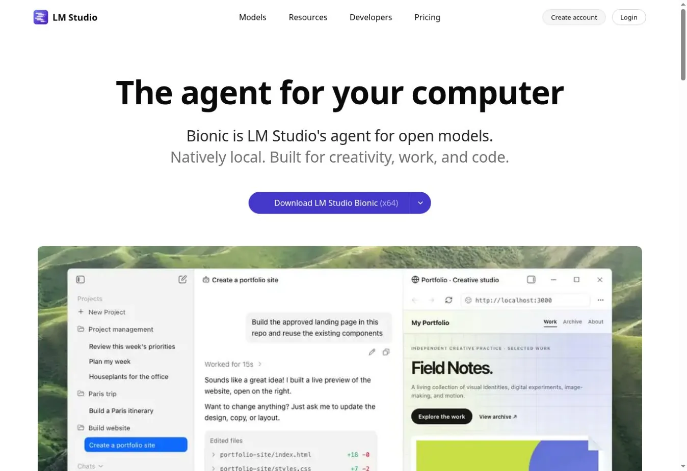

LM Studio gives you a desktop app for downloading, running, and comparing local models. The company says it is free for home and work. Chats and documents stay on the device by default.

It is easier than a command-line setup for people who want to inspect model size, load a model, and chat locally. Central team controls are a separate matter.

**Best free task** private local chat and model comparison.
**Main limit** hardware, model quality, and no central controls.

## Images, Design, and Meetings

### 13. Adobe Firefly: Best for Occasional Image Work

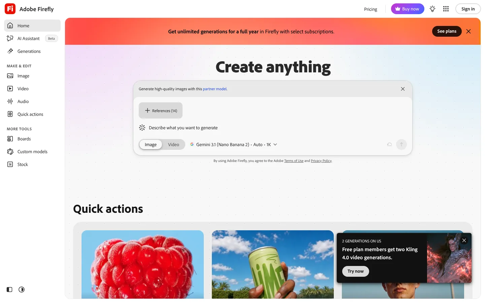

Adobe Firefly Free provides limited daily generations across selected image, video, and audio features. Adobe describes the free plan through daily generations, not one fixed monthly credit number.

It fits people who want image generation inside Adobe's creative tools. The free tier is enough to test prompts or make a concept image.

**Best free task** a few image concepts or edits.
**Main limit** daily generation capacity.

### 14. Canva AI: Best for Turning an AI Draft Into a Real Design

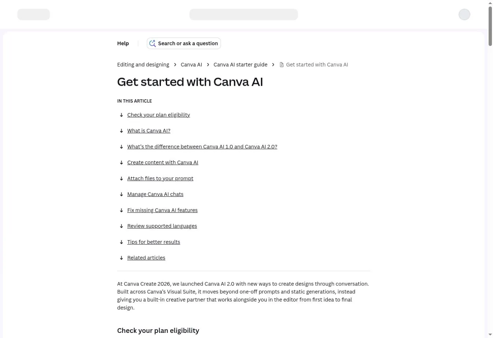

Canva's free plan includes up to 200 Standard or 20 Premium AI uses a month. The allowance resets on the first of each month. Canva AI 2.0, launched at Canva Create 2026, is aimed at paid plans and uses more of the allowance.

Canva's strength is what happens after generation. You can drop the result into a slide, post, or template and keep editing. For more marketing-focused picks, see our review of [AI tools for marketing](/ai/ai-tools-for-marketing/).

**Best free task** a design draft that needs manual layout.
**Main limit** a shared monthly AI allowance.

### 15. Otter.ai: Best for Short Meeting Transcripts

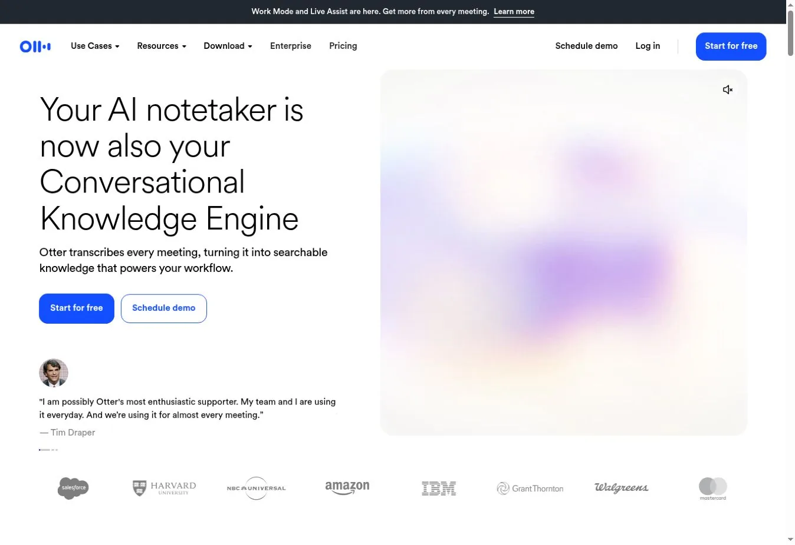

Otter Basic includes 300 transcription minutes a month, with up to 30 minutes per conversation. It also allows three lifetime file imports and keeps your 25 most recent conversations.

That suits short meetings, interviews, and voice notes. It is a poor fit for hour-long calls, because only the first 30 minutes are kept on the free plan.

**Best free task** transcribing and summarizing a short call.
**Main limit** 30 minutes per conversation and three lifetime imports.

## How to Choose Without Collecting 15 Accounts

Start with the recurring job, not the longest feature list.

| If you mainly need to | Start with | Add only if |
|---|---|---|
| Ask mixed everyday questions | ChatGPT, Gemini, Claude, or Copilot | Another tool fixes a clear weakness |
| Research current information | Perplexity | You need a fixed source set in Gemini Notebook |
| Work from your own documents | Gemini Notebook or Claude | Files fit the plan and data policy |
| Write code in an editor | GitHub Copilot or Cursor | Agent work justifies paying |
| Keep prompts on your machine | Ollama or LM Studio | Your hardware can run a good model |
| Make occasional visuals | Firefly or Canva | You need volume or brand controls |
| Capture short meetings | Otter | Consent and retention are settled |

Using one tool well usually beats spreading files and history across many free accounts. If you are replacing ChatGPT for a specific job, see our [ChatGPT alternatives](/ai/chatgpt-alternatives/).

## FAQs

### What Is the Best Free AI Tool for Most People?

ChatGPT, Gemini, Claude, and Microsoft Copilot are the strongest general starting points. The best one depends on your files, research needs, and Google or Microsoft tools. It also depends on how predictable the limits must be. Try two with the same task and keep the one that fits.

### Are Any Free AI Tools Unlimited?

Local tools such as Ollama and LM Studio avoid per-message charges, but your hardware and the model license still set limits. Cloud tools use rate limits, capacity rules, credits, or feature caps. No cloud AI product offers truly unlimited free use, so plan around the limit you will hit first.

### Can Free AI Tools Be Used for Business Work?

Sometimes. Check the product terms, model license, data controls, commercial-use rules, and your company policy. A free consumer account may lack the retention, access, and audit controls that company data needs. For anything sensitive, a business plan or a local model is usually the safer route.

### When Is It Worth Paying for an AI Tool?

Pay when a repeated task keeps hitting a limit or the plan saves more time than it costs. Also pay when your business needs stronger privacy, admin, or support. Track how often you hit the free ceiling for two weeks before deciding, so the upgrade matches real use.

## Resources

- [Claude pricing](https://claude.com/pricing)
- [Perplexity plan comparison](https://www.perplexity.ai/help-center/en/articles/11187416-which-perplexity-subscription-plan-is-right-for-you)
- [Gemini Notebook limits](https://support.google.com/gemininotebook/answer/16213268)
- [Mistral Vibe documentation](https://docs.mistral.ai/vibe)
- [GitHub Copilot plans](https://github.com/features/copilot/plans)
- [Cursor pricing](https://cursor.com/pricing)
- [LM Studio privacy](https://lmstudio.ai/app-privacy)
- [Adobe Firefly plans](https://www.adobe.com/products/firefly/plans.html)
- [Canva AI allowance](https://www.canva.com/help/ai-access/)
- [Otter pricing](https://otter.ai/pricing)
