# 10 ChatGPT Alternatives for Research, Coding, and Private Use

Claude is the strongest of the ChatGPT alternatives for writing and careful document work. Gemini fits Google users, Perplexity is built for cited research, and Microsoft Copilot suits Microsoft shops. GitHub Copilot replaces ChatGPT for coding in an editor. For private local use, Ollama and LM Studio keep prompts on your own computer.

No single replacement wins every category. A good switch starts with the reason ChatGPT no longer fits. That might be weak sources, long-document limits, coding friction, workspace integration, model choice, or a need to keep prompts local.

## Quick Recommendations

- **Choose Claude** for writing, revision, and long-document discussion.
- **Choose Gemini** when Google products and mixed media inputs matter most.
- **Choose Perplexity** when current research and citations come first.
- **Choose Microsoft Copilot** for web chat and Microsoft 365 work.
- **Choose Mistral Vibe** to try Mistral's chat and coding in one product.
- **Choose Poe** to reach several model providers in one app.
- **Choose Grok** for real-time web and X search.
- **Choose GitHub Copilot** when the real need is coding in an IDE.
- **Choose Gemini Notebook** for answers grounded in your own sources.
- **Choose Ollama or LM Studio** when local processing beats convenience.

## How We Compared the Alternatives

We used six repeatable tasks rather than feature pages alone.

1. Answer a current question and show the sources.
2. Summarize a long document without inventing details.
3. Revise a hard paragraph while keeping its meaning and voice.
4. Explain and change code with enough context to review it.
5. Work across files, connectors, or a fixed knowledge set.
6. Show where prompts, files, and history are processed.

For the size of that audience, see [how many people use AI](/ai/how-many-people-use-ai/). We also checked free access, the first paid plan, model choice, file support, workspace integration, and local options. We verified plans on November 1, 2026. Our [AI statistics on investment and production use](/ai/ai-statistics-investment-production-use/) put assistant adoption in context.

## ChatGPT Alternatives Compared

| Alternative | Best reason to switch | Web sources | Files | Coding fit | Local option | Free access |
|---|---|---|---|---|---|---|
| Claude | Writing and document reasoning | By feature and plan | Yes | Strong | No | Yes, limited |
| Gemini | Google ecosystem and mixed media | Yes | Yes | Strong | No | Yes |
| Perplexity | Current research with citations | Core workflow | Limited on free | Moderate | No | Yes |
| Microsoft Copilot | Microsoft and web work | Yes | Yes, varies | Moderate | No | Yes |
| Mistral Vibe | Mistral chat and coding | Yes | Yes | Strong | Enterprise options | Yes, limited |
| Poe | Many models in one app | Depends on bot | Depends on bot | Depends on model | No | Daily points |
| Grok | Real-time web and X context | Yes | Yes | Moderate | No | Yes, limited |
| GitHub Copilot | IDE and repository work | Limited | Repository context | Purpose-built | No | Yes, limited |
| Gemini Notebook | Source-grounded notebooks | Your sources | Yes | Low | No | Yes |
| Ollama or LM Studio | Local models and prompt control | Only if set up | Local files | Model-dependent | Yes | Yes |

## The 10 ChatGPT Alternatives Compared

### 1. Claude: Best ChatGPT Alternative for Writing and Documents

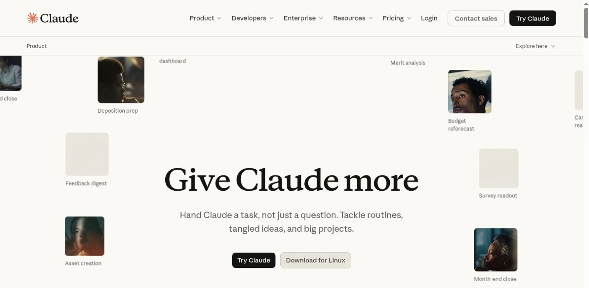

Claude is a focused assistant with strong writing, analysis, file, and coding skills. It is a good replacement for working through a document or revising a draft. The interface stays focused instead of branching into many tools.

Anthropic lists a free plan for occasional use, Pro at $20 per month, and higher-capacity Max plans. Free capacity shifts with chat length, files, and demand. It suits bounded sessions better than all-day use.

Claude's edge is the quality of the back-and-forth when you give it context and push on details. Current web research still needs source and date checks.

**Best fit** writers, analysts, and developers working through a lot of context.
**Tradeoff** usage tightens in long or file-heavy sessions.

### 2. Gemini: Best for Google-Centered Work

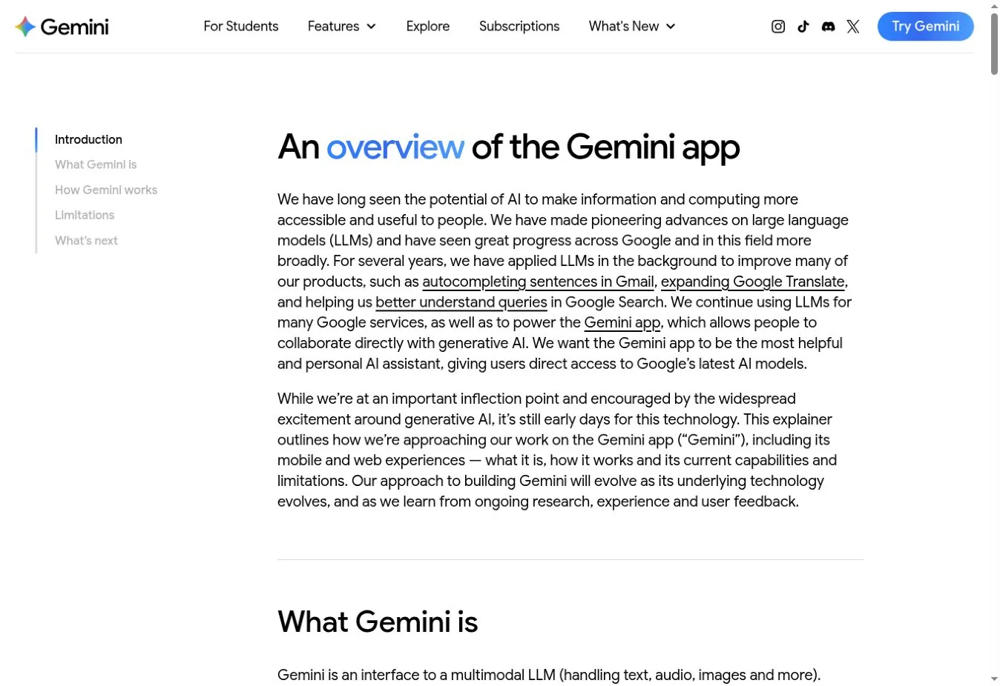

Gemini combines chat, web answers, files, images, voice, and Google-connected features. It is the natural pick for people whose work already lives in Google accounts.

Google does not promise a fixed number of free prompts. Its [Gemini usage documentation](https://support.google.com/gemini/answer/16275805) describes limits that change with prompt complexity, model, chat length, and demand.

The ecosystem is the reason to switch, and it is also the main governance question. Personal Gemini and Workspace Gemini do not share the same controls.

**Best fit** Google users who mix chat, search, documents, and mobile.
**Tradeoff** free limits are flexible, not predictable.

### 3. Perplexity: Best for Current Research With Citations

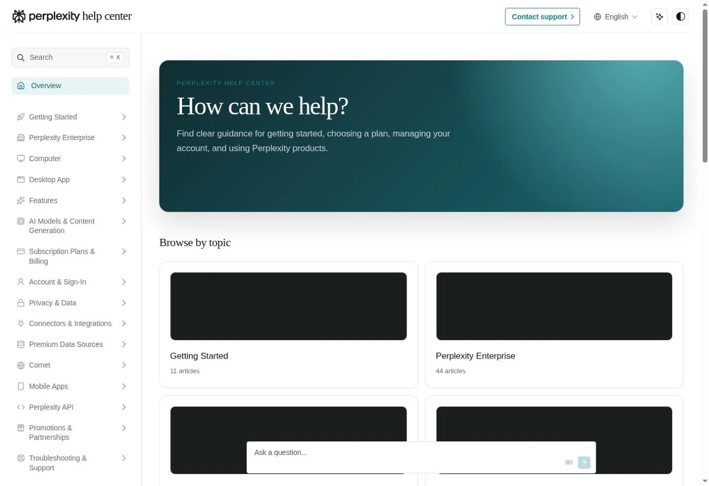

Perplexity puts web search and visible sources at the center. It beats ChatGPT when your question starts with "What do current sources say?"

The free Standard plan includes basic searches, limited uploads, three Pro Searches a day, and one Research query a month. Paid plans add advanced models and more research.

Citations make checking possible but do not finish the job. Open the source, find the exact claim, and check its date.

**Best fit** market scans, product research, and questions that need a source trail.
**Tradeoff** deeper free research is tightly rationed.

### 4. Microsoft Copilot: Best for Microsoft Workflows

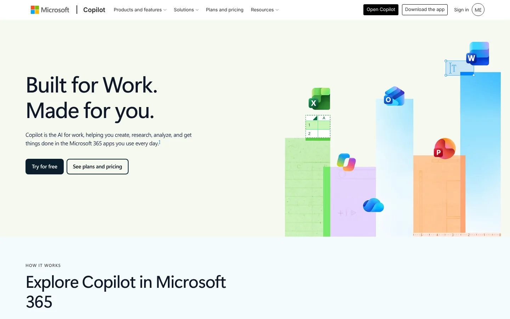

Microsoft Copilot offers free web chat for research, writing, summaries, and images. Signing in with a Microsoft account adds history and other features.

The key difference is between free Copilot and licensed Microsoft 365 Copilot. Microsoft explains that [the two serve different data contexts](https://support.microsoft.com/en-gb/microsoft-365-copilot/what-s-the-difference-between-microsoft-copilot-free-and-copilot-in-microsoft-365). Only the paid version reaches your work files, email, and meetings.

**Best fit** people and companies already committed to Microsoft.
**Tradeoff** the most useful workplace grounding needs a paid license.

### 5. Mistral Vibe: Best for Mistral Chat and Coding

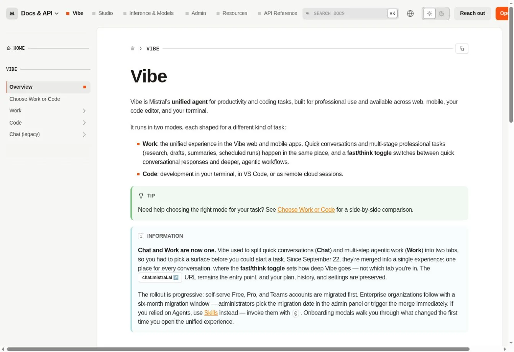

Mistral renamed Le Chat to Vibe and, in September 2026, merged chat and multi-step work into one Work mode. A separate Code mode runs in the terminal and VS Code. The free plan supports limited messages, searches, coding sessions, and images.

Vibe is worth testing if you want a different model provider or one place for chat and code. Mistral does not publish a fixed free limit.

**Best fit** people evaluating Mistral for general work and coding.
**Tradeoff** unpredictable free capacity and a product still settling after the rename.

### 6. Poe: Best for Comparing Many Models

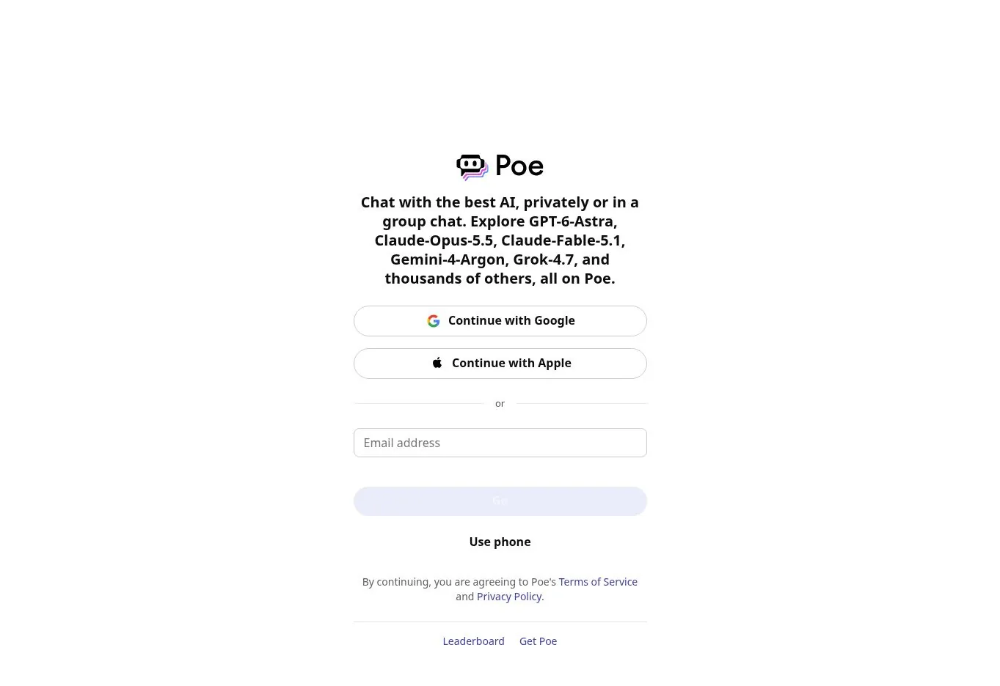

Poe puts many models and community bots behind one interface. Free users get points that renew daily, and each bot shows its point cost.

It is practical for variety without several subscriptions. It is less consistent than going to one provider, because bots differ in instructions, context, and data handling.

**Best fit** people who want to compare model families or use specialty bots.
**Tradeoff** daily points and an extra layer between you and the model provider.

### 7. Grok: Best for Real-Time Web and X Context

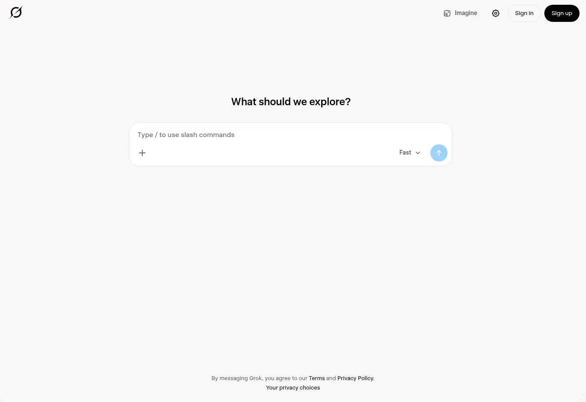

Grok's free plan includes limited real-time web and X search, voice, and connectors. Paid SuperGrok tiers raise limits and add image, video, and agent features.

Grok helps when fast-moving public talk on X is part of your research. Social posts are not authoritative, so trace claims to an official statement or filing.

**Best fit** people who want current web and X context with general chat.
**Tradeoff** noisy social data and limited free use.

### 8. GitHub Copilot: Best Replacement for Coding in the Repository

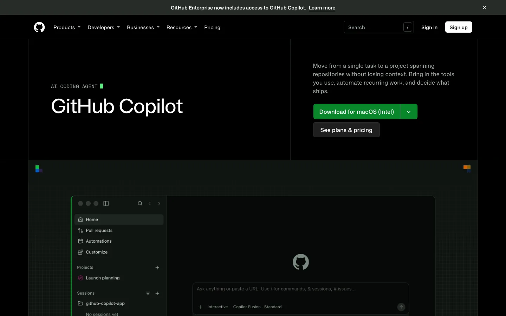

GitHub Copilot is not a broad chatbot replacement. It is the better answer when your real complaint is moving code between ChatGPT and your editor. It offers completions, chat, agent features, and repository-aware help.

Copilot Free includes 2,000 completions a month and limited chat and agent use. Generated code still needs review, tests, and secret scanning. Our [Podman and Docker comparison](/developer-data/podman-vs-docker/) shows the kind of environment detail an assistant must keep when it edits build files.

**Best fit** developers who want AI help where code is written.
**Tradeoff** narrow non-coding skills.

### 9. Gemini Notebook: Best for a Controlled Knowledge Set

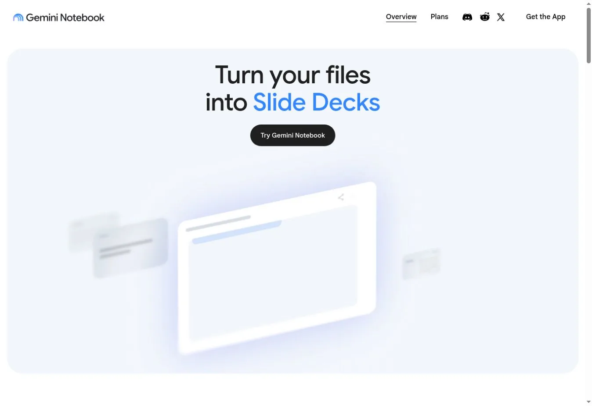

Gemini Notebook works from the sources you add to a notebook. You can chat with the collection and create overviews, reports, and slide decks. The free plan lists 100 notebooks and 50 sources each.

It beats ChatGPT when answers must stay tied to a contract set, research folder, or product manual. The notebook can still miss contradictions, so curate the sources. Our analysis of [AI knowledge permissions](/ai/atlassian-ai-knowledge-permissions/) explains why access boundaries matter as much as retrieval quality.

**Best fit** research and synthesis from a defined body of material.
**Tradeoff** weaker open-ended chat outside the source set.

### 10. Ollama or LM Studio: Best for Private Local Use

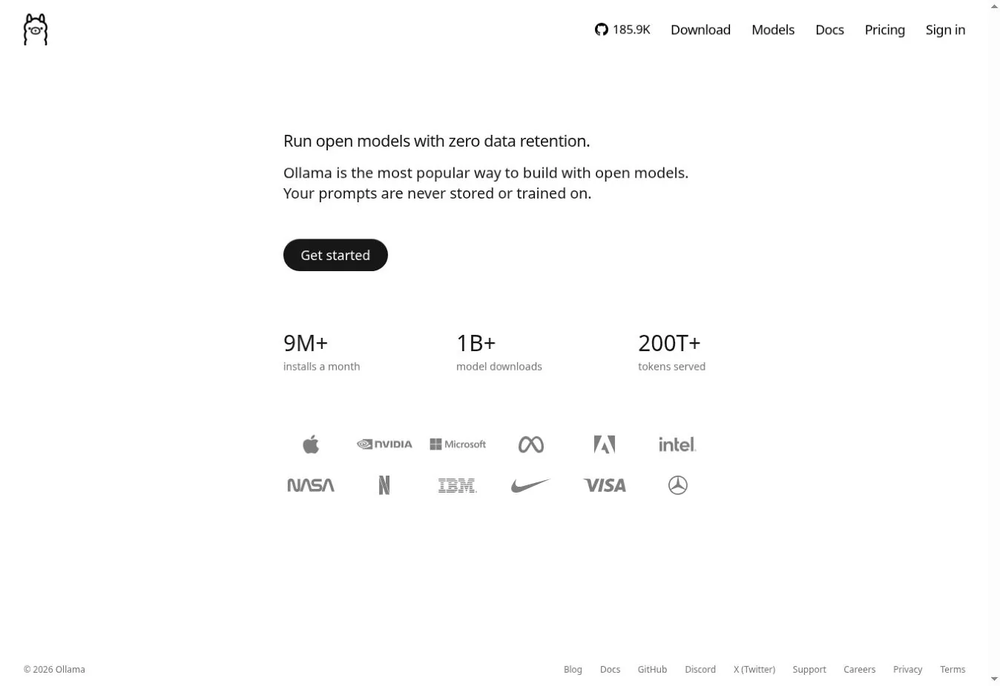

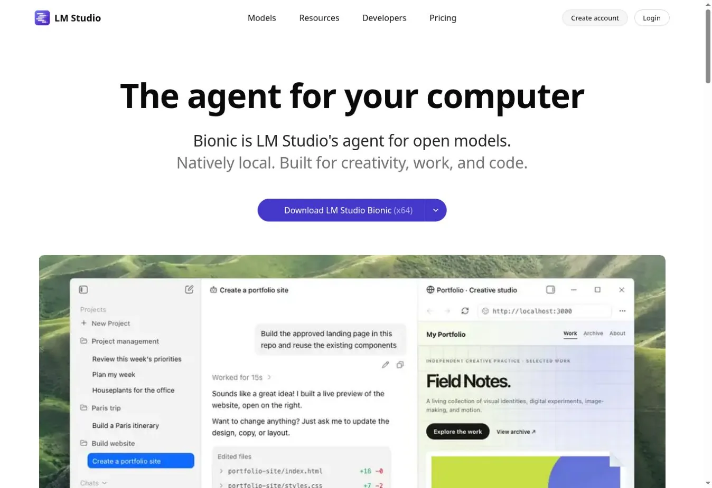

Ollama and LM Studio run models on your own machine. Ollama favors the command line and developers. LM Studio offers a desktop app for browsing, loading, and serving models.

Local processing can keep prompts and documents on your device. It also moves the work to you. You pick the model, check its license, secure the device, and decide whether your hardware is fast enough.

LM Studio keeps chats and documents on the device by default. Ollama keeps local prompts local, but it now also sells hosted models with a different data path.

**Best fit** sensitive drafts, offline work, and developer integrations.
**Tradeoff** hardware cost, setup work, and no built-in web knowledge.

## Which Alternative Fits Your Reason for Leaving ChatGPT?

| Reason for switching | First choice | Why |
|---|---|---|
| Better long-form writing | Claude | Focused drafting and document discussion |
| Google integration | Gemini | Google account and product ecosystem |
| Microsoft work context | Microsoft Copilot | Microsoft 365 path and tenant controls |
| Research with citations | Perplexity | Search-first answers |
| Answers from chosen files | Gemini Notebook | Source-bound notebooks |
| Coding in an IDE | GitHub Copilot | Editor and repository workflow |
| Several models in one app | Poe | Point-based access to many bots |
| Real-time X context | Grok | Web and X search |
| Mistral ecosystem | Mistral Vibe | Mistral chat and coding |
| Local or offline work | Ollama or LM Studio | Your models, your hardware |

GitHub Copilot is not the only option for editor work. Stack Row's guide to [GitHub Copilot alternatives](/ai/github-copilot-alternatives/) compares Claude Code, Cursor, Codex, and six other coding assistants.

## A Safe Switching Process

Do not move by pasting your whole chat history into a new service. For no-cost options by task, see our list of [free AI tools](/ai/free-ai-tools/).

1. **Name the failed need.** Write down the exact task ChatGPT handles poorly.
2. **Build a test pack.** Use the same prompt, document, code task, and scoring rubric for each finalist.
3. **Check the account type.** Confirm whether you test with a personal or business account.
4. **Review data controls.** Check training, retention, deletion, connectors, and admin policy.
5. **Time the corrections.** Measure how long a person spends fixing each result.
6. **Run a two-week pilot.** Compare accepted work, limits reached, cost, and friction.
7. **Keep an exit path.** Export prompts and documents where possible.

If the new tool can act in other systems, treat it as an agent rollout. The approval questions in our [AI agent explainer](/ai/what-are-ai-agents/) then apply.

## FAQs

### What Is the Best Overall ChatGPT Alternative?

Claude is the strongest general alternative for writing and document analysis. Gemini is better for Google users, Perplexity for cited research, and Microsoft Copilot for Microsoft-centered work. The right pick depends on why you want to leave ChatGPT, so start from that reason rather than a ranking.

### Which ChatGPT Alternative Is Best for Research?

Perplexity works well for current web research with visible citations. Gemini Notebook is better when answers should stay grounded in a set of documents you supply. Both still need checking, because a citation can support only part of a claim or point to an outdated page.

### Which Alternative Is Best for Coding?

GitHub Copilot is built for coding inside editors and repositories. Claude, Gemini, and Mistral Vibe also handle code well in a chat window. Ollama and LM Studio can run coding models locally when your code cannot leave your machine. Test each with a real multi-file change.

### Is There a Private Offline Alternative to ChatGPT?

Yes. Ollama and LM Studio can run compatible models on your own computer. Privacy still depends on device security, the model source, extensions, and whether optional cloud features send data elsewhere. Check the settings before you paste anything sensitive into a local tool.

## Resources

- [Claude pricing](https://claude.com/pricing)
- [Perplexity plan comparison](https://www.perplexity.ai/help-center/en/articles/11187416-which-perplexity-subscription-plan-is-right-for-you)
- [Mistral Vibe](https://docs.mistral.ai/vibe)
- [Poe points FAQ](https://help.poe.com/hc/en-us/articles/19944206309524-Poe-FAQs)
- [Grok pricing](https://x.ai/pricing)
- [GitHub Copilot plans](https://github.com/features/copilot/plans)
- [Gemini Notebook limits](https://support.google.com/gemininotebook/answer/16213268)
- [Ollama](https://ollama.com/)
- [LM Studio privacy policy](https://lmstudio.ai/app-privacy)
