# 12 CI/CD Tools Compared for GitHub, GitLab, and Self-Hosted Pipelines

The best CI/CD tools follow where your code lives. GitHub Actions is the easy choice for GitHub repositories. GitLab CI/CD fits teams that want source, pipelines, registries, and security in one place. Jenkins stays the most flexible self-hosted server. CircleCI and Buildkite offer managed control planes. Argo CD leads Kubernetes GitOps delivery but sits beside a CI system, not in place of one.

YAML syntax is the least important choice. Ask where the control plane runs and who patches the runners. Then ask how untrusted code is isolated, and whether deploys are pushed or pulled from Git.

## Key Takeaways

- **GitHub Actions and GitLab CI/CD cut integration work** when your repositories already live there.
- **Jenkins gives the most self-hosted freedom**, but plugins, credentials, and upgrades stay with you.
- **CircleCI is a managed service with wide executor choice**, including macOS, Windows, and Arm.
- **Buildkite keeps orchestration managed while builds run on your own agents.**
- **TeamCity runs in the cloud or on-premises**, with three free agents on its on-premises Professional edition.
- **Argo CD is a Kubernetes delivery controller.** It does not compile and test code.
- **Tekton offers Kubernetes-native building blocks, and Drone offers a small container-based option.**

## How We Evaluated the Tools

We mapped one pipeline from pull-request checks and caching through tests and image builds. It continued through artifact signing, a staging deploy, production approval, and rollback evidence. Then we compared eight points.

1. Repository integration and config format
2. Hosted, self-hosted, or hybrid control plane
3. Runner isolation, operating systems, and scaling
4. Cache, artifact, container, and test-report handling
5. Secrets, identity, approvals, audit, and provenance
6. Deployment, environment, and Kubernetes support
7. Free allowance and paid pricing unit
8. Upkeep and migration effort

We checked plans on November 1, 2026. Hosted minutes are not directly comparable. Operating system, machine size, concurrency, and storage all change what one minute costs.

## CI/CD Tools Compared

| Tool | Best fit | Control plane | Execution | Config | Free entry point |
|---|---|---|---|---|---|
| GitHub Actions | GitHub repositories | GitHub-hosted | Hosted or self-hosted runners | YAML | 2,000 private-repo minutes a month; public repos free |
| GitLab CI/CD | All-in-one DevSecOps | SaaS or self-managed | GitLab or own runners | YAML | 400 compute minutes a month |
| Jenkins | Maximum self-hosted control | Self-hosted | Your agents | Jenkinsfile and plugins | Open source; you pay for infrastructure |
| CircleCI | Managed CI across executors | SaaS or server | Hosted and self-hosted | YAML | Up to 6,000 small-Docker minutes, 5 users |
| Buildkite | Managed orchestration, your agents | Managed | Hosted or self-hosted agents | YAML and dynamic pipelines | 5 users, 10 self-hosted jobs, 2,000 Linux vCPU-minutes |
| TeamCity | JetBrains and regulated teams | Cloud or on-premises | Hosted or own agents | UI, Kotlin DSL, XML | On-prem Professional: 3 agents, 100 configs |
| Azure Pipelines | Microsoft and Azure estates | Azure DevOps | Microsoft-hosted or own agents | YAML or classic UI | 1 hosted job with 1,800 minutes plus 1 self-hosted job |
| Bitbucket Pipelines | Bitbucket Cloud teams | Managed | Cloud or own runners | YAML | 5 users, 50 build minutes |
| Argo CD | Kubernetes GitOps delivery | Self-managed | Kubernetes controller | Git-tracked manifests | Open source |
| Tekton | Kubernetes-native pipeline parts | Your cluster | Pods and tasks | Kubernetes resources | Open source |
| Drone | Light container-native CI | Self-hosted | Container runners | YAML | Community Edition |
| Harness | Broader enterprise delivery | Managed with runner options | Hosted or own delegates | YAML and UI | Free plan and 2,000 cloud build minutes |

## The 12 CI/CD Tools Compared

### 1. GitHub Actions: Best for Repositories Already on GitHub

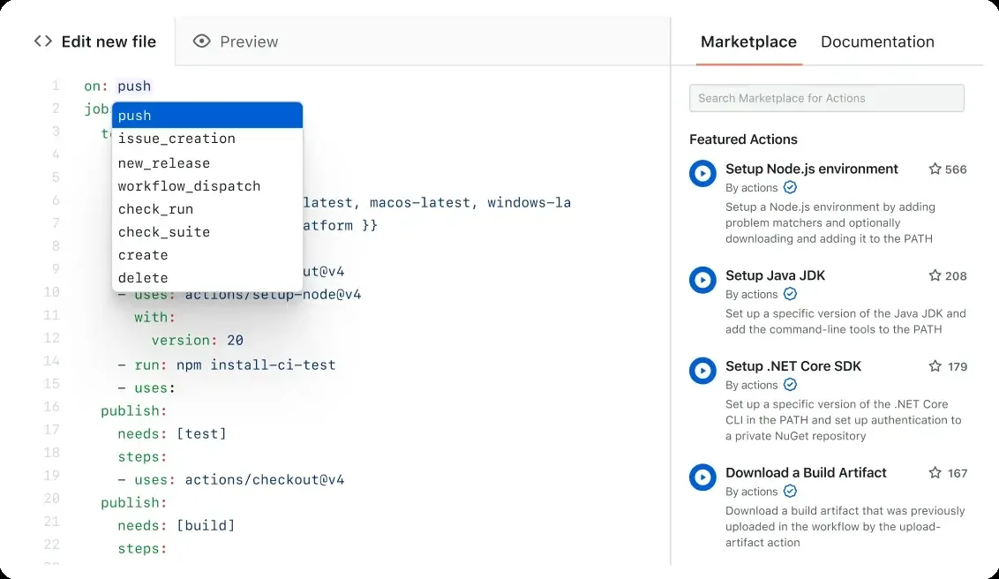

GitHub Actions keeps workflows beside your code and ties them to pull requests, branches, environments, and GitHub permissions. Reusable workflows and a large marketplace speed up setup. Third-party actions also add supply-chain risk.

GitHub Free includes 2,000 standard-runner minutes a month for private repositories, plus 500 MB of artifact storage. Standard runners are free for public repositories. The [GitHub Actions billing table](https://docs.github.com/en/billing/concepts/product-billing/github-actions) shows the quota. Larger runners are always billed.

**Choose it when** code review and identity already live on GitHub.
**Watch for** broad workflow permissions, unpinned actions, and persistent self-hosted runners.

### 2. GitLab CI/CD: Best All-in-One DevSecOps Platform

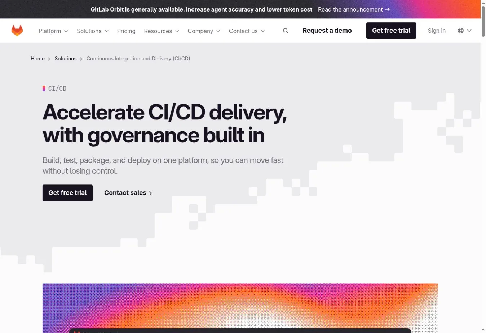

GitLab CI/CD joins repositories, merge requests, pipelines, environments, registries, security scans, and deployment controls. You can use GitLab.com or run GitLab and your runners yourself.

The free SaaS plan includes five users per group, 400 compute minutes a month, and 10 GiB of storage. Premium and Ultimate raise minutes and add governance and security features.

GitLab shines when you want fewer tools. Self-managed GitLab is a large platform to run, and runner isolation still needs design.

**Choose it when** you want source, CI, security, and delivery under one roof.
**Watch for** tier-gated features, runner autoscaling, and upgrade ownership.

### 3. Jenkins: Best for Maximum Self-Hosted Control

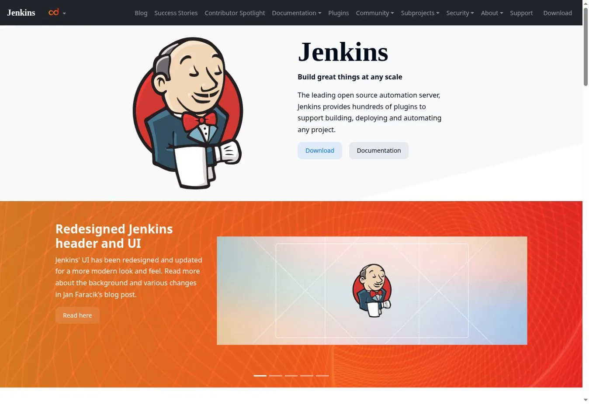

Jenkins is an open-source automation server that builds, tests, and deploys through Pipeline and a huge plugin catalog. It runs on any server or container platform you control.

There is no subscription. The real cost is the controller, agents, storage, backups, plugin updates, patching, and engineering time. That trade can pay off for private networks, legacy tools, or unusual pipelines.

Flexibility is also the main risk. A long-lived controller with many plugins and broad credentials needs disciplined owners.

**Choose it when** self-hosting and customization matter more than a managed service.
**Watch for** plugin sprawl, controller recovery, secret exposure, and agent drift.

### 4. CircleCI: Best Managed CI for Varied Environments

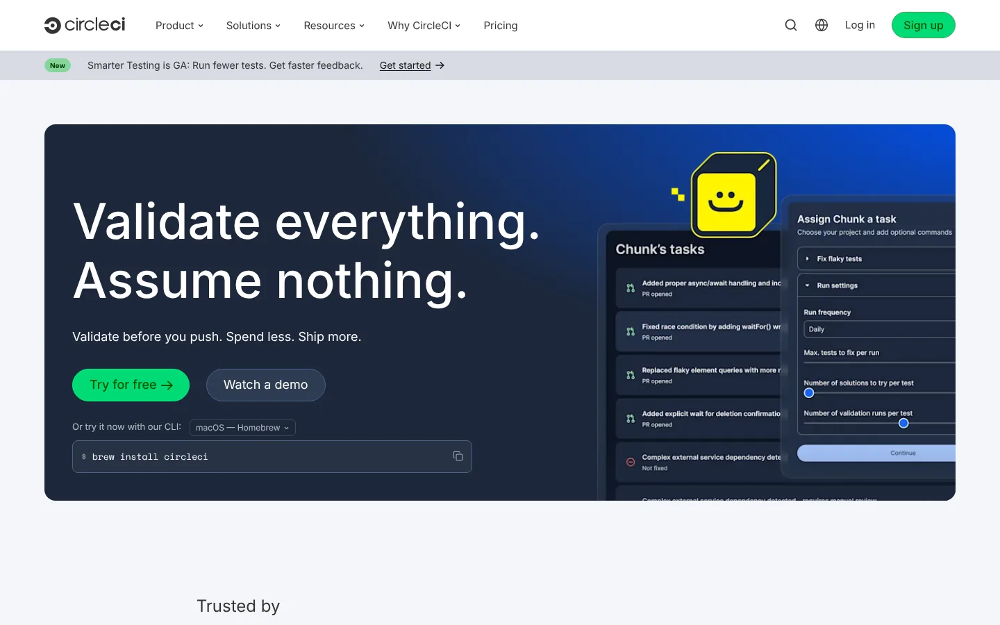

CircleCI supports Docker, Linux VMs, macOS, Windows, Arm, and self-hosted runners. The managed service adds caching, test splitting, artifacts, orbs, and concurrency controls.

The free plan offers up to 6,000 build minutes on a small Docker class, five active users, and 30x concurrency. It includes 30,000 credits, and bigger machines burn credits faster.

**Choose it when** builds need a managed platform across several executor types.
**Watch for** credit use, network transfer, storage, and macOS cost.

### 5. Buildkite: Best Managed Orchestration With Your Own Agents

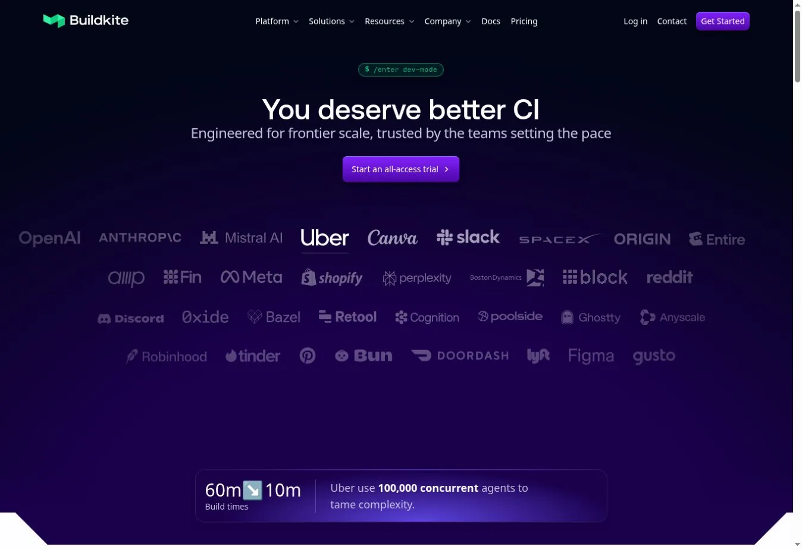

Buildkite separates its managed orchestration from agents that run in your infrastructure. You keep control of networks, machines, images, and data location without running a pipeline server.

The free plan supports five users, ten concurrent self-hosted jobs, 30-day retention, and 2,000 Linux vCPU-minutes on hosted agents. Pro costs $30 per active user per month.

You still own agent images, patching, autoscaling, and isolation for self-hosted agents.

**Choose it when** builds must run inside your network or on special hardware.
**Watch for** agent lifecycle, queue design, and active-user pricing.

### 6. TeamCity: Best for JetBrains-Heavy and On-Premises Teams

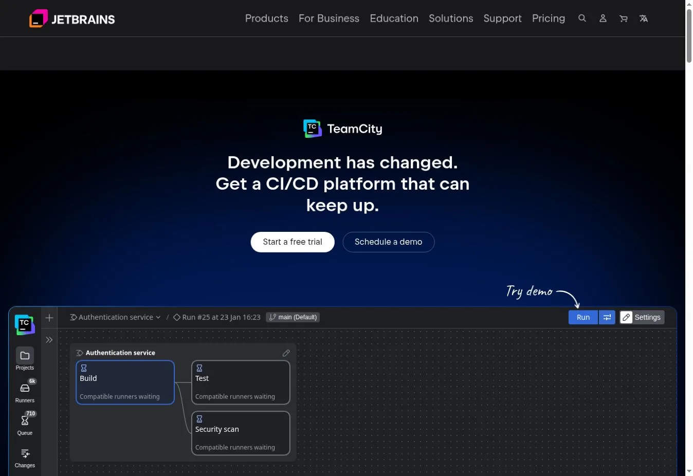

TeamCity runs in the cloud or on-premises. It supports UI-defined builds, Kotlin DSL, build chains, test reports, and JetBrains integrations.

The on-premises Professional edition is free with unlimited users, three build agents, and 100 build configurations. Extra agents cost $359 per agent per year.

It can be easier to govern than an unstructured Jenkins setup. On-premises installs still need server and agent care.

**Choose it when** you value JetBrains tooling and an on-premises option.
**Watch for** agent capacity, Kotlin DSL adoption, and server upgrades.

### 7. Azure Pipelines: Best for Microsoft and Azure Estates

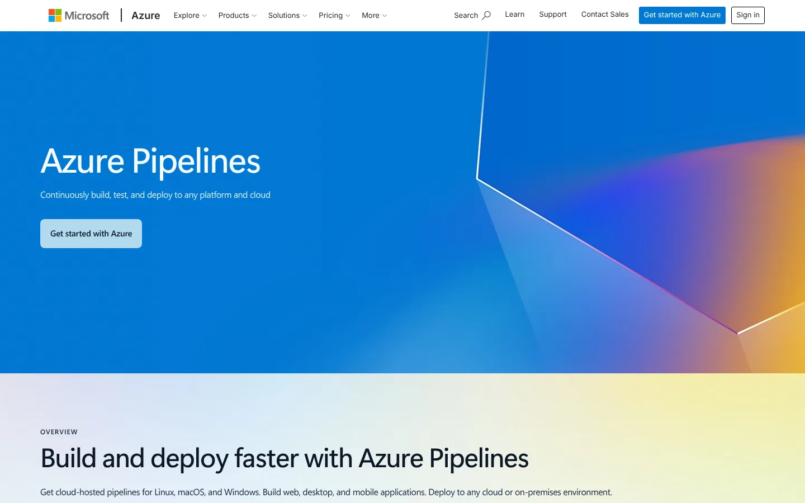

Azure Pipelines ties into Azure DevOps repositories, boards, artifacts, environments, and Microsoft identity. It can also build code from outside repositories.

Each Azure DevOps organization gets one Microsoft-hosted parallel job with 1,800 minutes a month. It also gets one self-hosted parallel job with unlimited minutes.

Teams already on GitHub should check whether GitHub Actions gives a simpler path before adding another control plane.

**Choose it when** Azure DevOps and Azure deployments already define your workflow.
**Watch for** service-connection scope, classic and YAML sprawl, and parallel-job limits.

### 8. Bitbucket Pipelines: Best for Bitbucket Cloud Teams

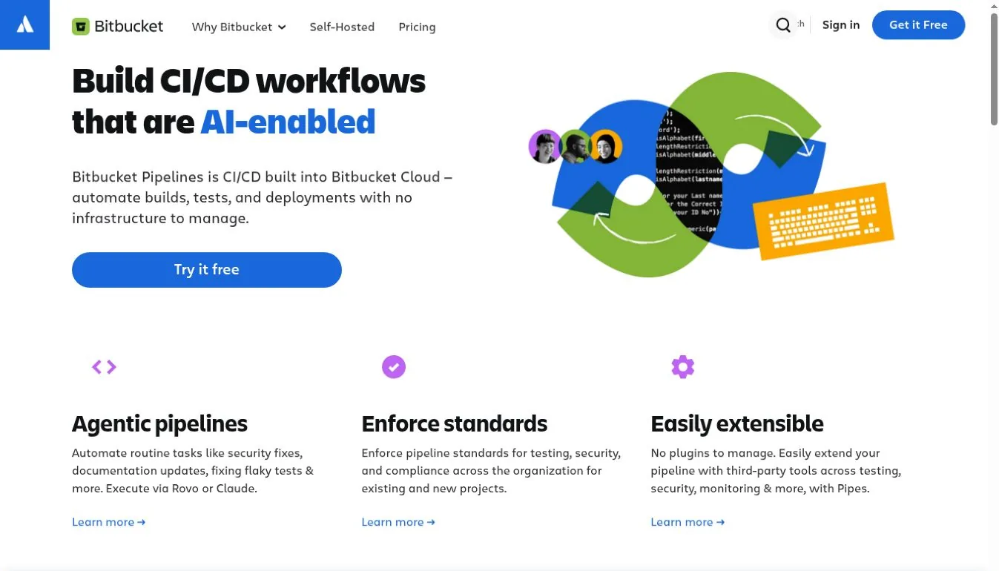

Bitbucket Pipelines runs CI/CD from a YAML file in your repository. It fits naturally with pull requests, deployments, and Jira. Self-hosted runners cover workloads that must stay in your infrastructure.

The free plan supports five users and 50 build minutes. Standard and Premium raise those limits, and extra blocks of 1,000 minutes cost more.

Fifty minutes can validate a small pipeline but will not carry an active team.

**Choose it when** your code and tickets already live in Bitbucket and Jira.
**Watch for** the small free quota and workspace-wide minute sharing.

### 9. Argo CD: Best for Kubernetes GitOps Delivery

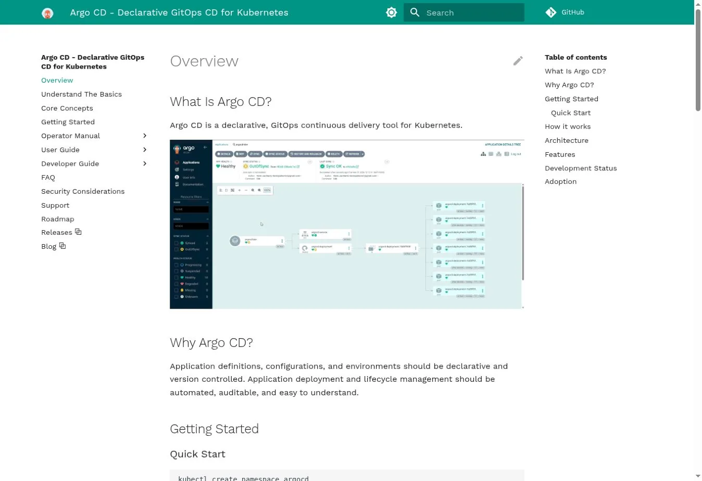

Argo CD watches Git as the desired state, compares it with live clusters, and reports or fixes drift. It supports Helm, Kustomize, Jsonnet, and plain manifests, with health checks, RBAC, SSO, and a web UI.

Argo CD does not normally compile code or run test suites. A CI tool builds the artifact, and Argo CD deploys it. The [official Argo CD overview](https://argo-cd.readthedocs.io/en/stable/) defines it as GitOps continuous delivery for Kubernetes.

**Choose it when** Kubernetes delivery should be declarative and pulled from Git.
**Watch for** repository credentials, cluster scope, and emergency changes made outside Git.

### 10. Tekton: Best Kubernetes-Native Building Blocks

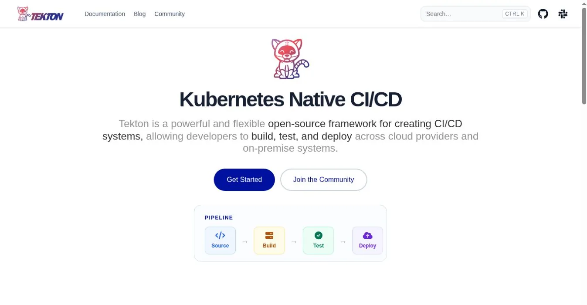

Tekton installs into Kubernetes and defines Tasks and Pipelines as custom resources. Each step runs in a container, close to the cluster's scheduling and identity model.

Tekton is open source and part of the CD Foundation. It is a framework, not a polished SaaS. Teams usually add triggers, dashboards, catalogs, and their own developer interface.

**Choose it when** a platform team wants Kubernetes-native parts and will build the experience.
**Watch for** custom-resource upgrades, pod security, and the platform work involved.

### 11. Drone: Best Light Container-Native Self-Hosted CI

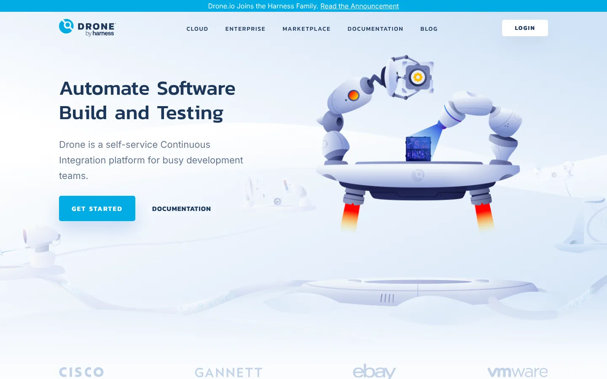

Drone runs pipeline steps in containers and connects to GitHub, GitLab, Bitbucket, and Gitea. Harness owns Drone now, and it ships Community and Enterprise editions.

The open-source edition targets simpler single-machine use. Drone's docs say it lacks Kubernetes runners, organization secrets, and autoscaling. Enterprise is free for organizations under a revenue threshold.

**Choose it when** a small team wants compact container-based CI and knows the edition limits.
**Watch for** licensing, single-machine limits, and how it fits beside Harness.

### 12. Harness: Best for Broader Enterprise Delivery Controls

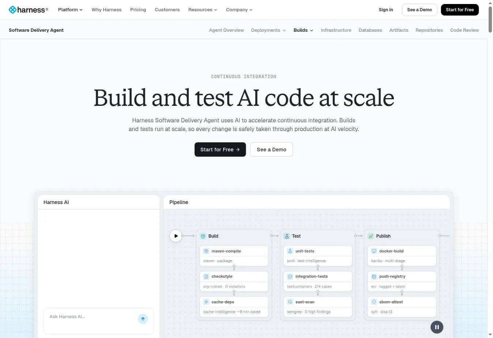

Harness combines CI with delivery, GitOps, infrastructure-as-code, security test orchestration, and feature flags. Its CI module adds AI help for builds and tests.

The free plan targets individuals and small teams with 2,000 Harness Cloud build minutes a month. Paid tiers need a sales quote tied to users, modules, and support.

**Choose it when** you want one platform for delivery governance, beyond CI.
**Watch for** module scope, quote structure, and overlap with tools you already own.

## Choose by Architecture, Not Brand

| Situation | Shortlist |
|---|---|
| Code is mainly on GitHub | GitHub Actions, CircleCI, Buildkite |
| Code and DevSecOps on GitLab | GitLab CI/CD |
| Full self-hosted control required | Jenkins, TeamCity, Drone |
| Builds need private or special machines | Buildkite, GitHub self-hosted runners, Azure agents |
| Microsoft and Azure dominate | Azure Pipelines, GitHub Actions |
| Bitbucket and Jira dominate | Bitbucket Pipelines |
| Kubernetes GitOps delivery | Argo CD plus a CI system |
| Kubernetes-native pipeline parts | Tekton |
| Broad enterprise delivery governance | Harness, GitLab, Azure DevOps |

## Security Checks Before Your First Production Pipeline

1. Use short-lived workload identity instead of static cloud keys.
2. Pin third-party actions, plugins, and images to reviewed versions.
3. Keep untrusted pull requests away from secrets and persistent runners.
4. Separate build, staging, and production identities.
5. Generate provenance and a software bill of materials for releases.
6. Keep enough logs and deploy records for rollback.
7. Patch runners, controllers, and plugins on a set schedule.
8. Test runner destruction and key revocation after a bad build.

Pair the pipeline with the right [API testing tools](/developer-data/api-testing-tools/) so contract changes fail early. Container choices change pipeline behavior. Our [Podman and Docker comparison](/developer-data/podman-vs-docker/) covers daemon and rootless differences that affect builds. Once live, treat queue time, job failures, and deploy health as production signals. Handle them the way our [network monitoring tools guide](/cloud-infrastructure/network-monitoring-tools/) treats alerts.

## FAQs

### What Is the Best CI/CD Tool for GitHub?

GitHub Actions is the simplest default because workflows, permissions, pull requests, and environments share one platform. CircleCI and Buildkite are strong alternatives. Use them when you need other executors or want builds on your own agents. Start with Actions unless a clear limit pushes you elsewhere.

### What Is the Best Self-hosted CI/CD Tool?

Jenkins offers the widest customization. TeamCity provides a more integrated product with a free on-premises tier. Tekton suits Kubernetes platform teams, and Drone fits small container-based setups. Factor in who will patch, back up, and upgrade the system, because that ongoing work is the real price of self-hosting.

### Is Argo CD a CI/CD Tool?

Argo CD is a continuous delivery tool for Kubernetes that follows the GitOps model. It usually receives tested artifacts and manifest changes from a separate CI system rather than compiling and testing code itself. Most teams pair it with GitHub Actions, GitLab CI/CD, or Jenkins.

### How Should Teams Compare CI/CD Pricing?

Model the same monthly workload for every tool. Include users, jobs, duration, machine size, operating systems, concurrency, cache, artifacts, data transfer, retention, self-hosted infrastructure, and support. Headline minutes alone mislead, because one macOS minute can cost many times a small Linux minute.

## Resources

- [GitLab pricing](https://about.gitlab.com/pricing/)
- [Jenkins documentation](https://www.jenkins.io/doc/)
- [CircleCI pricing](https://circleci.com/pricing/)
- [Buildkite pricing](https://buildkite.com/pricing/)
- [TeamCity pricing](https://www.jetbrains.com/teamcity/buy/)
- [Azure DevOps pricing](https://azure.microsoft.com/en-us/pricing/details/devops/azure-devops-services/)
- [Bitbucket pricing](https://www.atlassian.com/software/bitbucket/pricing)
- [Tekton Pipelines documentation](https://tekton.dev/docs/pipelines/)
- [Drone documentation](https://docs.drone.io/)
- [Harness pricing](https://www.harness.io/pricing)
