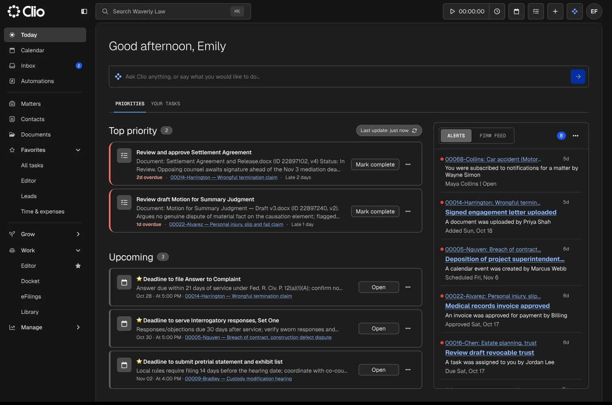
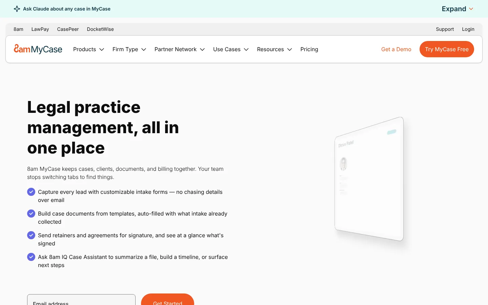
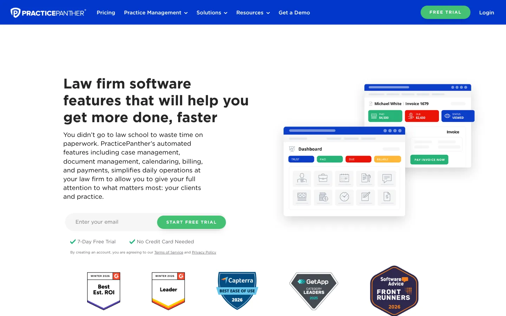
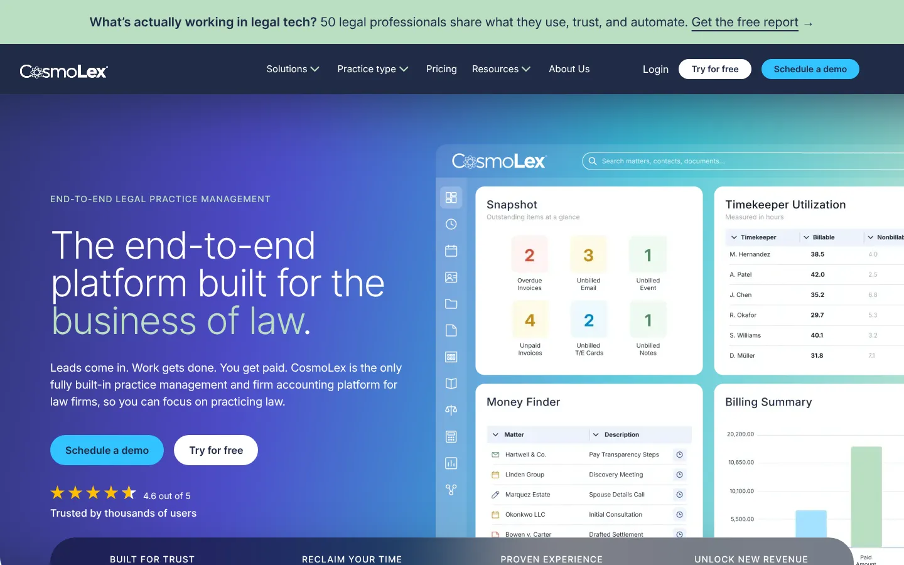
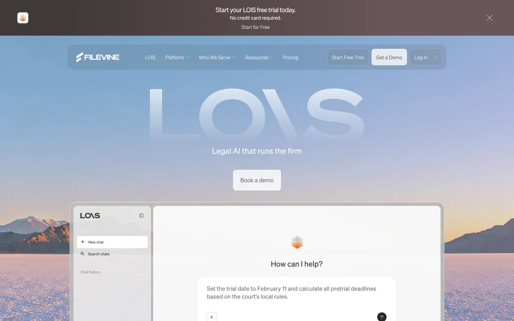
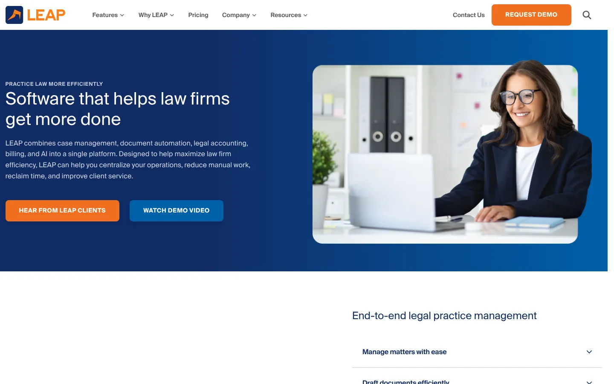
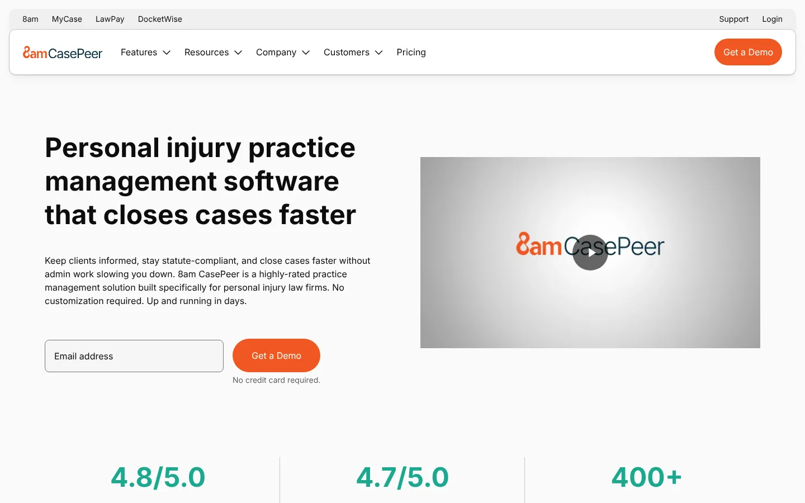

# 9 Best Legal Practice Management Software Platforms in 2026

Legal practice management software should reduce handoffs between intake, matters, documents, billing, and client communication. The best choice depends on practice area, firm size, accounting needs, and migration risk.

For most small firms, Clio and MyCase provide the broadest starting points. Smokeball suits firms that want document automation and automatic time capture. CosmoLex stands out when built-in legal accounting is a priority. Filevine and CASEpeer fit plaintiff-side practices with structured case workflows.

The software is only one part of the decision. A firm also needs to check data migration, training, contract terms, integrations, and the cost of replacing existing tools.

## Key Takeaways

- **Clio and MyCase are the broadest starting points for small firms.** MyCase publishes Basic at $50 per user monthly on annual billing.
- **Smokeball suits document-heavy firms** that lose time to repeat forms and unrecorded work.
- **CosmoLex puts legal accounting in the same product** as matters and billing.
- **Filevine and 8am CASEpeer fit plaintiff and personal injury practices** with structured case stages.
- **Price the full stack for three years.** Add-ons, payment fees, AI tiers, and migration change the real cost.

## Legal Practice Management Software at a Glance

| Platform | Best for | Published entry price | Main tradeoff |
|---|---|---:|---|
| Clio | Broad small-to-midsize firm use | From $49 per user monthly | Advanced products and tiers increase total cost |
| MyCase | Small firms wanting quick adoption | $50 per user monthly, billed annually | Advanced automation sits on higher plans |
| PracticePanther | Solos and small firms | $49 per user monthly, billed annually | Accounting depth depends on plan |
| Smokeball | Document-heavy firms | Quote-based | Pricing requires a sales conversation |
| CosmoLex | Firms wanting legal accounting included | From $49 per user monthly, billed annually | Smaller integration ecosystem than Clio |
| Filevine | Plaintiff and personal injury firms | Quote-based | Implementation can be heavier |
| Actionstep | Process-driven midsize firms | Quote-based | Configuration requires planning |
| LEAP | Firms using Microsoft 365 | Quote-based | Best fit depends on local content and jurisdiction |
| 8am CASEpeer | Personal injury firms | From $90 per user monthly | Narrower fit outside plaintiff work |

Prices were checked against vendor pages and current comparison data in November 2026. Promotions, implementation fees, payment processing, and add-ons can change the final cost.

## How We Selected These Platforms

The shortlist favors products that manage more than a contact list. Each platform had to support core legal work and publish enough information for a meaningful comparison.

We evaluated:

- Matter and contact management.
- Calendaring, tasks, and deadline controls.
- Timekeeping, billing, payments, and trust workflows.
- Document storage or automation.
- Client communication and portal functions.
- Reporting, permissions, and security information.
- Migration support and integration options.
- Verified 2026 product updates or current documentation.

The [2026 ILTA Technology Survey](https://www.iltanet.org/blogs/ilta-news1/2026/09/15/ilta-releases-2026-legal-technology-survey-results) drew responses from 508 law firms representing more than 139,000 lawyers. ILTA said AI adoption, cloud migration, cybersecurity, and practical implementation were central planning issues. That context changes software selection. Firms are now choosing an operating system for legal work, not a digital filing cabinet.

## 1. Clio

**Best for:** Firms that want a broad platform and a large integration ecosystem.

Clio Manage covers matters, contacts, documents, billing, payments, calendars, and client communication. Its current Starter plan begins at $49 per user monthly on [Clio's pricing page](https://www.clio.com/pricing/). Core and higher plans add more automation, reporting, and AI functions.

Clio’s advantage is breadth. A firm can add Clio Grow for intake and Clio Work for matter-aware legal AI. That same breadth can raise the total bill, so firms should price the full configuration instead of the base plan.

The company states that data is encrypted in transit and at rest. It also lists SOC 2 Type II certification. Buyers should still review retention, permissions, integrations, and regional requirements during procurement.

**Choose Clio when:** The firm wants one established platform that can expand across intake, practice management, and legal work.

**Check before buying:** Which functions require Core, Signature, Elite, or a separate product.

## 2. MyCase

**Best for:** Small firms that want clear public pricing and a shorter setup path.

[MyCase lists](https://www.mycase.com/pricing/) Basic at $50 per user monthly when billed annually. Pro costs $100, while Advanced costs $130. Monthly billing is also available at higher rates.

The product combines case management, calendaring, billing, payments, client communication, and document workflows. Its public pricing makes early budgeting easier than quote-only products.

MyCase is a practical fit for firms replacing email, shared drives, spreadsheets, and separate billing tools. Firms with complex reporting or highly customized processes should test those workflows during the trial.

**Choose MyCase when:** Ease of adoption and transparent pricing carry more weight than extensive customization.

**Check before buying:** Which automation, accounting, and AI functions require Pro or Advanced.

## 3. PracticePanther

**Best for:** Solo lawyers and small firms that want a familiar all-in-one interface.

PracticePanther publishes four plans. Solo begins at $49 per user monthly with annual billing. The product covers matters, timekeeping, billing, payments, tasks, documents, and client communication.

Its plan ladder lets a small firm start with daily practice management and add stronger workflow or accounting functions later. That also creates a buying risk. A low entry price can look less attractive once the required plan is identified.

**Choose PracticePanther when:** The firm needs a straightforward system without enterprise-scale administration.

**Check before buying:** Trust accounting, automation, reporting, and support entitlements by plan.

## 4. Smokeball

**Best for:** Firms with document-heavy workflows and large amounts of unrecorded time.

Smokeball combines case management with document automation and automatic activity tracking. It has a strong fit for firms that produce repeat forms, letters, and matter documents.

The company publishes product release notes throughout 2026. October releases covered its Grow and Prosper+ products. Regular release documentation is useful during procurement because it shows whether the vendor maintains the workflows a firm will depend on.

Smokeball uses quote-based pricing. Firms should request the full annual cost, implementation requirements, payment terms, and any limits on migrations or templates.

**Choose Smokeball when:** Document production and time capture create daily leakage.

**Check before buying:** Contract length, implementation services, and the exact content available for the firm’s jurisdiction.

## 5. CosmoLex

**Best for:** Firms that want practice management and legal accounting in one product.

CosmoLex combines matters, billing, business accounting, and trust accounting. That reduces the need to connect a separate bookkeeping product for daily firm operations.

The appeal is narrower than a long feature list. CosmoLex can reduce duplicate entry between practice management and accounting. The firm still needs an accountant who understands its reporting and compliance duties.

CosmoLex’s Launch plan was listed from $49 per user monthly with annual billing in November 2026. Buyers should verify which accounting, payment, and support functions sit on each plan.

**Choose CosmoLex when:** Native legal accounting is a core requirement.

**Check before buying:** Accountant access, bank reconciliation, migration of historical ledgers, and reporting exports.

## 6. Filevine

**Best for:** Plaintiff, litigation, and personal injury firms with structured case workflows.

Filevine is built around configurable projects, task flows, documents, communication, and case data. It is a stronger fit for process-heavy litigation than for a solo firm seeking basic time and billing.

September 2026 release notes documented changes across Filevine’s DataBridge, LOIS, and workflow features. LOIS gained Outlook drafting and replying, plus an embedded Filevine side panel. These are verifiable product changes, but firms should test how AI functions handle permissions and matter data.

Pricing is quote-based. Implementation work may include data mapping, project templates, permissions, integrations, and training.

**Choose Filevine when:** The firm wants repeatable case workflows and detailed case data.

**Check before buying:** Migration scope, implementation ownership, AI data terms, and reporting configuration.

## 7. Actionstep

**Best for:** Midsize firms that want to design processes around matter types.

Actionstep combines practice management, workflow automation, billing, accounting options, CRM functions, and document processes. Its value rises when a firm has defined how each matter type should progress.

That flexibility carries a cost. A poorly mapped process can become a complicated system. Firms should document current stages, exceptions, approvals, and required data before configuration begins.

**Choose Actionstep when:** The firm wants process control across intake, matters, and billing.

**Check before buying:** Implementation fees, accounting coverage by region, customization limits, and internal administration needs.

## 8. LEAP

**Best for:** Small and midsize firms that work heavily in Microsoft 365.

LEAP connects legal practice management, document production, legal forms, time recording, and billing. Its Microsoft 365 connections can reduce tool switching for firms already centered on Outlook and Word.

Product fit varies by jurisdiction and practice area. Firms should inspect the available forms, precedents, integrations, and accounting connections rather than assume every region receives the same package.

**Choose LEAP when:** Microsoft-based document work is central to the firm.

**Check before buying:** Local legal content, data migration, pricing, and integration coverage.

## 9. 8am CASEpeer

**Best for:** Personal injury firms that want case stages, settlement information, and treatment tracking.

CASEpeer focuses on plaintiff-side case management. Its workflows are designed around personal injury work rather than general legal billing.

Capterra’s 2026 review analysis listed CASEpeer from $90 per user monthly. That price needs to be weighed against specialist functions that a general platform may require firms to build themselves.

**Choose CASEpeer when:** Personal injury cases make up most of the firm’s workload.

**Check before buying:** Intake connections, medical record handling, settlement reporting, permissions, and migration.

## What Changed in Legal Software During 2026

Three changes stand out.

First, AI moved into matter workflows. Clio now places AI on plans from Core upward. Filevine placed LOIS inside Outlook and Filevine. These tools can reduce switching, but they also create new review and data-governance work.

Second, accounting moved closer to practice management. Clio now promotes legal accounting in Starter. CosmoLex continues to sell combined practice and accounting functions. Firms must still confirm that the workflow fits their jurisdiction and accountant.

Third, software selection became a stack decision. Intake, payments, research, document automation, practice management, and client communication increasingly overlap. Stack Row’s guide to [cloud-based project management software](/business-technology/cloud-based-project-management-software/) explains why buyers should map the work before comparing products.

## What Law Firms Should Watch in 2027

Most vendors do not publish a detailed 2027 roadmap. Buyers should treat undated marketing claims as current positioning, not confirmed delivery.

The strongest watch points are:

- Matter-aware AI with visible citations and human approval.
- Clear zero-retention or training terms for third-party models.
- Native trust and business accounting.
- Fewer handoffs between intake, matters, documents, and billing.
- Better permission controls for AI assistants.
- Migration tools that preserve documents, notes, billing history, and audit trails.
- Pricing that separates core seats, AI usage, payment fees, and add-ons.

A roadmap should never replace a current product test. Buy for the workflows available now.

## How to Choose Legal Practice Management Software

Start with the firm’s operating model. Avoid choosing from a demo built around another practice type.

A useful evaluation process includes these steps:

1. Map one common matter from intake through closing.
2. List every document, approval, deadline, and payment event.
3. Define trust and business accounting requirements.
4. Identify the data that must move from current systems.
5. Test permissions with lawyers, staff, contractors, and accountants.
6. Price the full stack for three years.
7. Run a pilot using real workflows and sanitized data.
8. Document export and termination procedures before signing.

The [Stack Row Business Technology section](/business-technology/) covers the wider software-buying questions behind this process. Firms comparing long-term software costs can also use the [business valuation calculator](/tools/business-valuation-calculator/) when modeling business scenarios.

## Final Recommendations by Firm Type

- **Solo or small general practice:** Start with MyCase, PracticePanther, or Clio.
- **Document-heavy small firm:** Add Smokeball to the shortlist.
- **Accounting-led firm:** Compare CosmoLex with Clio’s current accounting functions.
- **Plaintiff or personal injury firm:** Compare Filevine and CASEpeer.
- **Process-driven midsize firm:** Consider Actionstep.
- **Microsoft-centered firm:** Review LEAP.
- **Firm expecting rapid growth:** Test migration, permissions, reporting, and API coverage before choosing the cheapest entry plan.

Legal practice software rarely runs alone. Stack Row's [B2B technology statistics](/business-technology/b2b-tech-statistics/) show how buyers now run software purchases, and firms that keep separate books can compare options in the guide to the [best accounting software for small business](/business-technology/best-accounting-software-small-business/). Intake-heavy firms may also want to review [CRM software for small companies](/business-technology/crm-software-small-companies/).

## Frequently Asked Questions

### What Is Legal Practice Management Software?

Legal practice management software organizes matters, contacts, calendars, documents, time, billing, payments, and client communication. Some platforms also include accounting, intake, document automation, and legal AI.

### What Is the Best Legal Practice Management Software for a Small Firm?

Clio, MyCase, and PracticePanther are strong starting points for small firms. The better choice depends on accounting, automation, integrations, practice area, and total cost.

### Does Legal Practice Management Software Include Trust Accounting?

Some products include trust accounting, while others require a higher plan or an integration. Confirm reconciliation, ledger, reporting, and regional requirements before buying.

### How Much Does Legal Practice Management Software Cost?

Published starting prices in this comparison range from $49 to $90 per user monthly. Quote-based platforms, implementation, add-ons, payment fees, and data migration can increase the total.

### Can a Law Firm Move Data from Another Platform?

Most vendors offer import or migration help. The firm should confirm which documents, notes, contacts, custom fields, billing records, audit trails, and permissions will transfer.

### Should a Law Firm Choose Software for Its AI Features?

AI can help with drafting, summaries, billing, and matter search. The firm should first verify data terms, access controls, source visibility, human review, and the quality of the underlying practice-management workflow.

## Resources

- [ILTA 2026 Legal Technology Survey announcement](https://www.iltanet.org/blogs/ilta-news1/2026/09/15/ilta-releases-2026-legal-technology-survey-results)
- [Clio pricing](https://www.clio.com/pricing/)
- [MyCase pricing](https://www.mycase.com/pricing/)
- [PracticePanther pricing](https://www.practicepanther.com/pricing/)
- [Smokeball release notes](https://support.smokeball.com/hc/en-gb/categories/5735238630551-Release-Notes)
- [CosmoLex pricing](https://www.cosmolex.com/pricing/)
- [Filevine September 2026 release notes](https://support.filevine.com/hc/en-us/articles/55420679436059-September-2026-Release-Notes)
- [Actionstep pricing](https://www.actionstep.com/pricing/)
- [LEAP legal software](https://www.leap.us/)
- [CASEpeer](https://www.casepeer.com/)
- [Capterra 2026 legal practice-management analysis](https://www.capterra.com/resources/practice-management-software-law-firms/)
