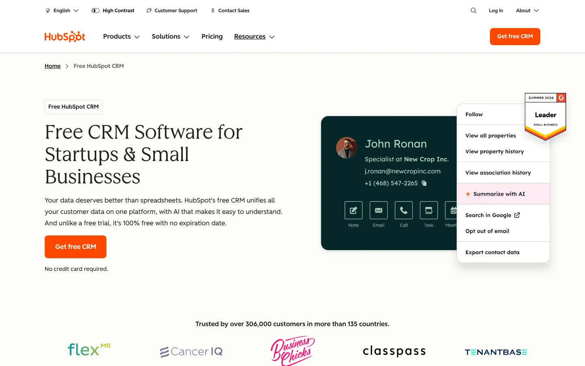
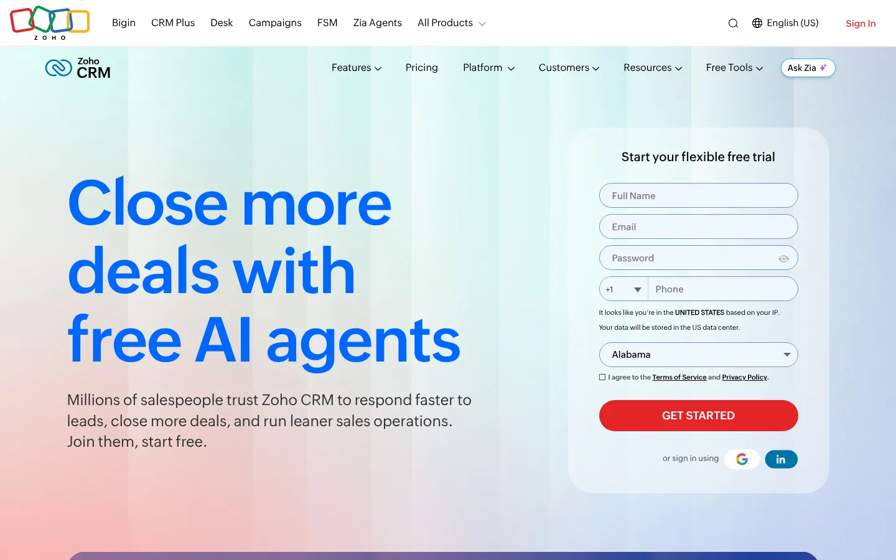
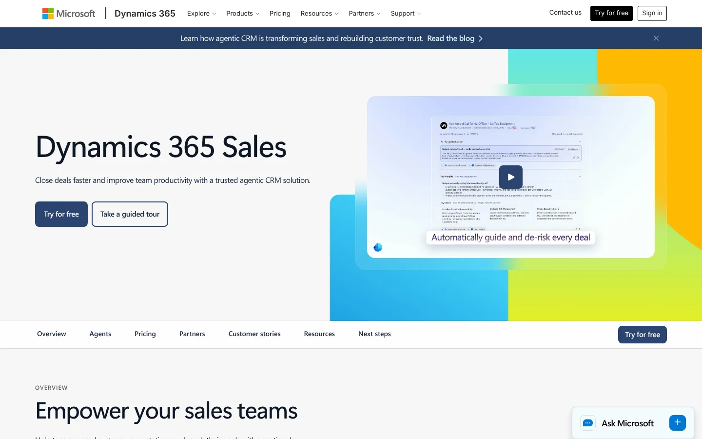
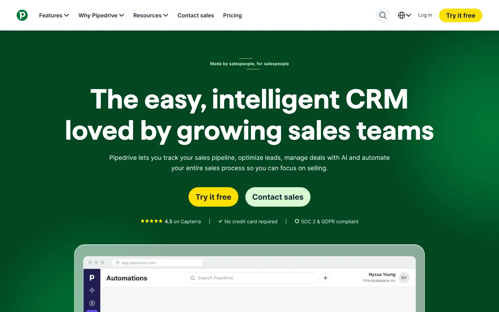
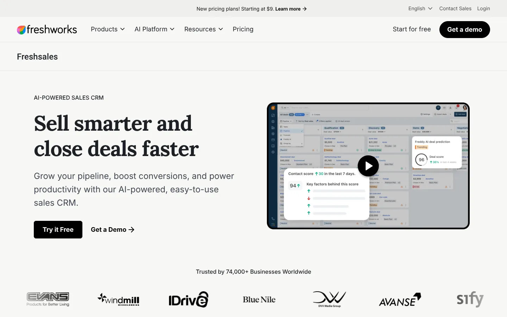
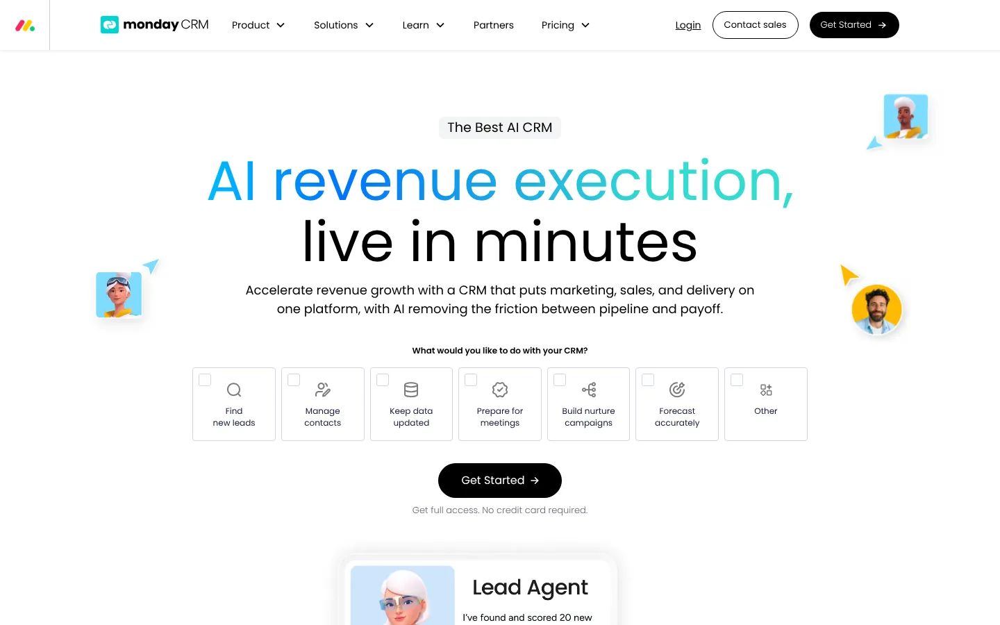
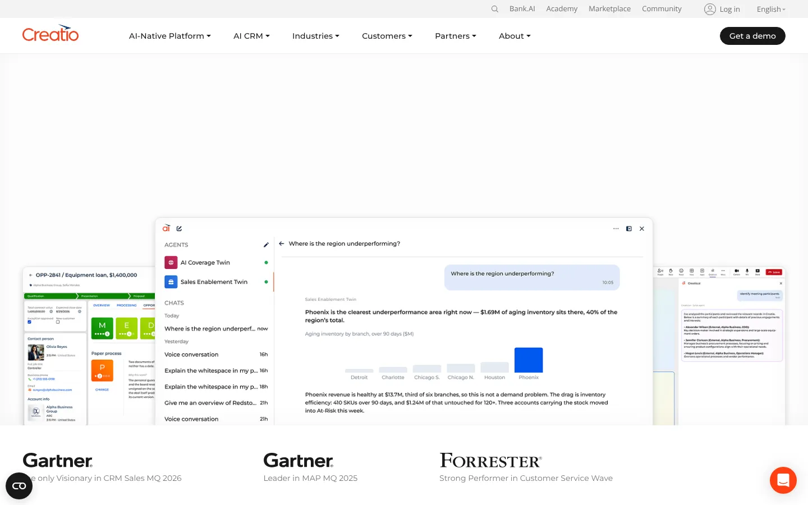
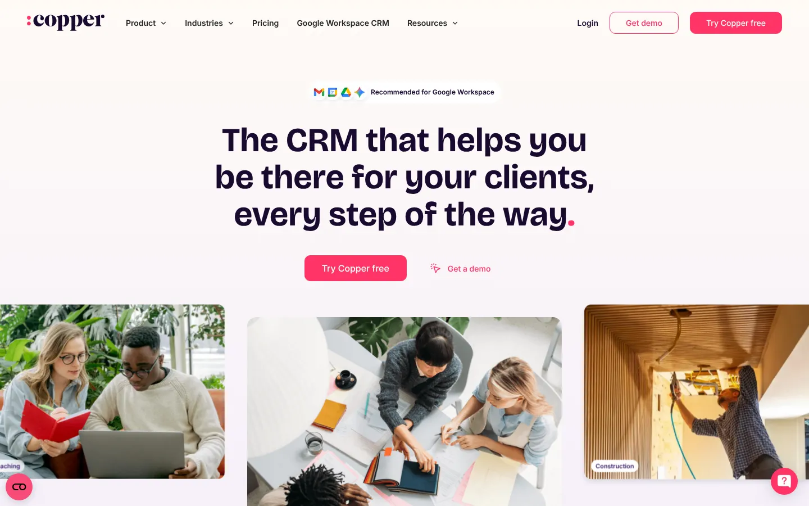
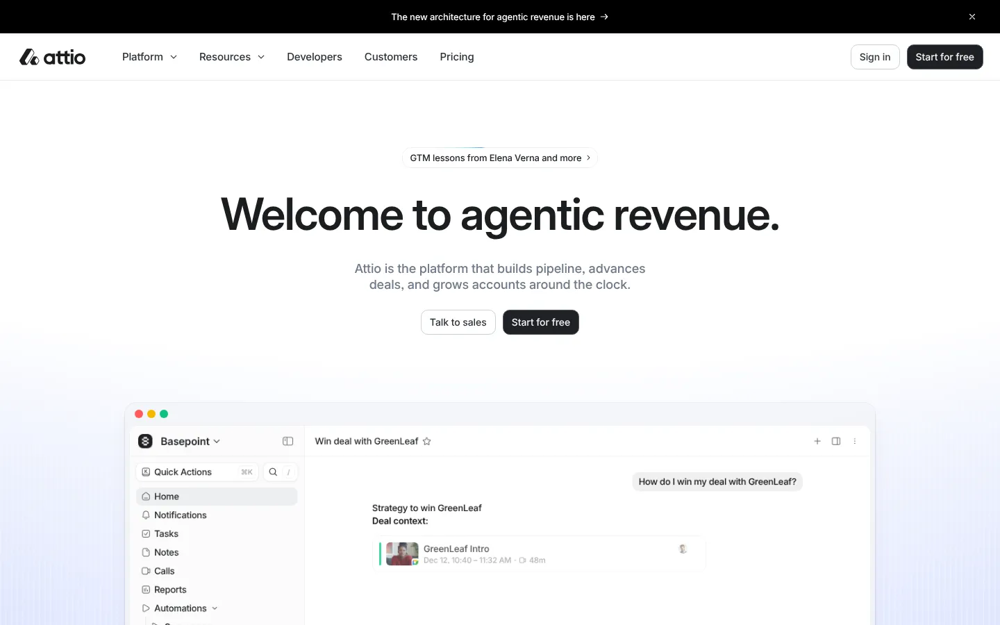

# 9 Salesforce Alternatives for 2026, Plus What to Watch in 2027

**Search intent:** Commercial investigation

HubSpot is the strongest Salesforce alternative for a growing company that wants marketing, sales, and service on one approachable platform. Zoho CRM offers broad capability at a lower entry cost. Microsoft Dynamics 365 Sales fits an organization already invested in Microsoft. Pipedrive is better for a sales team that wants a focused pipeline. Freshsales, monday CRM, Creatio, Copper, and Attio each serve a more specific operating style.

Salesforce remains the market leader. IDC data cited by Salesforce put its 2025 CRM market share at 20.0%. A market leader can still be the wrong fit when administration, implementation, adoption, or total cost exceeds what a team can support.

## Key Takeaways

- **HubSpot is the best overall Salesforce alternative for a growing company.**
- **Zoho CRM gives the most value across a wider business suite.**
- **Dynamics 365 Sales fits Microsoft-centered organizations.**
- **Pipedrive, Freshsales, Copper, and Attio suit focused sales teams** that want less administration.
- **Model total cost over three years,** including admin time, add-ons, and migration.

## The Short List

| Alternative | Best for | Main tradeoff |
| --- | --- | --- |
| HubSpot | Integrated growth teams | Costs rise with advanced hubs and seats |
| Zoho CRM | Value and broad suite coverage | Interface and configuration require care |
| Dynamics 365 Sales | Microsoft-centered enterprises | Licensing and implementation complexity |
| Pipedrive | Sales pipeline execution | Less breadth than an enterprise platform |
| Freshsales | Teams wanting sales and communications together | Smaller ecosystem than Salesforce |
| monday CRM | Visual, configurable workflows | Governance needed as boards multiply |
| Creatio | No-code process automation | Larger implementation than a simple CRM |
| Copper | Google Workspace sales teams | Narrower enterprise depth |
| Attio | Flexible data model for modern teams | Younger ecosystem and operating model |

## When an Alternative Makes Sense

Do not migrate because a sales representative dislikes a screen. A CRM replacement affects data, integrations, forecasts, permissions, automations, reporting, and revenue operations.

A change has a stronger case when the business cannot maintain the current system, adoption remains low after workflow fixes, essential work requires extensive custom development, or the total cost no longer matches the value. Establish a baseline for active use, data completeness, lead response, stage conversion, forecast variance, admin effort, and subscription cost.

## 1. HubSpot: Best Overall Alternative for a Growing Company

HubSpot combines CRM records with marketing, sales, service, content, operations, and commerce tools. Its interface and shared data model can help a smaller revenue team work without a large Salesforce administration function.

Costs need close modeling. HubSpot's November 2026 catalog lists Sales Hub Starter from $20 per seat monthly, Professional from $100, and Enterprise from $150 when billed annually. Professional and Enterprise also list required onboarding fees of $1,500 and $3,500. [HubSpot's product catalog](https://legal.hubspot.com/hubspot-product-and-services-catalog?tab=tab-crm) is more useful than a promotional price because it shows seat types and required fees.

**Choose HubSpot if:** sales, marketing, and service need a shared platform with a gentler administrative curve.

## 2. Zoho CRM: Best Value Suite

Zoho CRM covers leads, contacts, deals, automation, analytics, and customization. It connects with a broad Zoho portfolio for finance, service, marketing, projects, and collaboration.

The value proposition is strong, but buyers should trial the exact cross-product workflow. Confirm record ownership, synchronization, reporting, storage, support, and which edition contains each automation or analytics function.

**Choose Zoho CRM if:** the organization wants broad business software coverage at a lower cost than many enterprise suites.

## 3. Microsoft Dynamics 365 Sales: Best for Microsoft-centered Organizations

Dynamics 365 Sales connects CRM with Microsoft 365, Teams, Power Platform, Azure, and other Dynamics applications. It is a logical shortlist for an enterprise with Microsoft identity, data, integration, and development skills.

It is not automatically simple. Licensing, Dataverse capacity, environments, security roles, custom apps, partner work, and integrations can add cost. Map those items before comparing seat prices.

**Choose Dynamics 365 Sales if:** Microsoft architecture and enterprise process coverage outweigh the need for a lightweight deployment.

## 4. Pipedrive: Best for a Focused Sales Pipeline

Pipedrive centers the experience on deals, activities, pipelines, communications, and sales follow-up. It is easier to understand than a broad customer platform and can improve adoption for a team that mainly needs disciplined opportunity management.

[Pipedrive lists](https://www.pipedrive.com/en/pricing) annual-billing plans from $14 per seat per month, with higher tiers at $39, $59, and $79 in current search results. Verify the live plan names, feature limits, add-ons, and usage allowances before purchase.

**Choose Pipedrive if:** sellers need a clear pipeline more than the company needs a wide application platform.

## 5. Freshsales: Best for Built-in Sales Communication

Freshsales, part of Freshworks, combines contact and deal management with email, phone, chat, workflows, scoring, and reporting depending on the plan. It can suit a mid-sized team that wants communications close to the CRM record.

Test email deliverability, telephony availability, recording rules, data residency, and service integration in the countries where the team operates.

**Choose Freshsales if:** seller communication and a manageable CRM sit at the center of the requirement.

## 6. Monday CRM: Best for Visual Workflow Configuration

monday CRM applies monday.com's board and automation model to leads, contacts, deals, activities, and account workflows. It appeals to teams that want to shape a process without heavy development.

Flexibility needs governance. Define standard fields, pipeline stages, permissions, automations, and reporting ownership before every team creates its own version of the customer.

**Choose monday CRM if:** visual workflow design and rapid configuration are more important than deep enterprise CRM conventions.

## 7. Creatio: Best for No-code Process Automation

Creatio combines CRM applications with a no-code platform for process and application design. It fits organizations that want to automate sales, marketing, service, and industry workflows beyond a standard pipeline.

The platform deserves enterprise-level scoping. Review solution architecture, environments, governance, integrations, partner capability, and the cost of maintaining custom processes.

**Choose Creatio if:** no-code process design is a strategic requirement, not a side feature.

## 8. Copper: Best for Google Workspace Teams

Copper places CRM work close to Gmail, Calendar, and other Google Workspace tools. It can reduce context switching for relationship-led teams that live in Google's productivity suite.

Its narrower focus may not cover advanced territory, service, marketing, or platform requirements. Run a gap analysis against the functions used in Salesforce today.

**Choose Copper if:** Google Workspace is the work surface and the sales process is relatively straightforward.

## 9. Attio: Best for a Flexible, Modern Data Model

Attio offers a flexible workspace for companies, people, relationships, lists, workflows, and reporting. Teams can shape the CRM around their market rather than begin with a rigid pipeline template.

That flexibility is useful for venture, partnerships, community, and modern go-to-market teams. It also requires a clear model and governance. Evaluate API coverage, permissions, audit needs, support, and migration paths as the deployment grows.

**Choose Attio if:** the team needs a flexible relationship system and accepts a younger ecosystem.

## How to Compare Total Cost

Build a three-year model with:

- Required seat types and minimums
- Marketing contacts or message volume
- AI or automation credits
- Storage, sandboxes, and environments
- Implementation and data migration
- Integrations and middleware
- Administrator and developer time
- Training and support
- Overlap during migration
- Contract increases and renewal terms

Then map the current CRM's live workflows. Separate essential processes from historical customization. Rebuilding every old field is not a successful migration.

Our [business technology coverage](/business-technology/) includes adjacent sales and operations systems. The [business valuation calculator](/tools/business-valuation-calculator/) can help with high-level growth scenarios, while the CRM selection case should use real adoption, conversion, and labor baselines.

## A Migration Sequence That Protects Revenue Work

Clean data before moving it. Define duplicate rules, record ownership, field meanings, lifecycle stages, and the source of truth for account, contact, product, and revenue data.

Move one complete workflow through a pilot. Include capture, assignment, seller action, manager review, forecast, handoff, and reporting. Reconcile record counts and key totals. Keep rollback and read-only access plans for the old system.

Train teams around jobs, not menus. A seller needs to know how to prepare for the day, update an opportunity, request help, and close the loop. A manager needs a dependable forecast and a way to find stalled work.

## What Changed in 2026

CRM vendors continued to add agents, summaries, scoring, automation, and conversational interfaces. The practical question is whether the generated output is grounded in complete, permissioned customer data.

Pricing also became more layered. Seat type, usage credits, contacts, onboarding, and add-ons can sit beside the core subscription. Procurement should request a complete configuration and a renewal scenario.

## What to Watch in 2027

These are evaluation themes, not promised releases:

- Clear citations from AI output back to CRM records
- Approval boundaries for autonomous actions
- Usage-based AI pricing and budget controls
- Portable customer data and automation definitions
- Identity resolution across sales, service, marketing, and product
- Admin tools that reveal unused fields and broken workflows

Do not buy an agent demo without testing permissions, erroneous actions, and audit history.

A CRM change touches the whole revenue stack. Stack Row's comparison of [HubSpot vs Salesforce](/business-technology/hubspot-vs-salesforce/) goes deeper on that pair, and smaller teams can start with [CRM software for small companies](/business-technology/crm-software-small-companies/). The [B2B technology statistics](/business-technology/b2b-tech-statistics/) show how buyers judge these purchases, and teams moving chat tools too can compare [Slack alternatives](/business-technology/best-slack-alternatives/).

## Frequently Asked Questions

### What Is the Best Low-cost Salesforce Alternative?

Zoho CRM and Pipedrive are strong value candidates, while HubSpot offers free tools and paid tiers. The lowest seat price may exclude automation, reporting, support, or required onboarding, so compare a complete configuration.

### Is HubSpot Easier to Use Than Salesforce?

Many small and mid-sized teams find HubSpot easier to administer and adopt. Salesforce supports deeper enterprise customization and a larger platform ecosystem. The answer depends on the process and the team's ability to govern the system.

### How Hard Is It to Migrate Away from Salesforce?

Difficulty depends on data quality, custom objects, automations, integrations, files, reporting, and compliance requirements. A simple sales pipeline may move quickly, while a multi-cloud enterprise implementation can require a long program.

## Resources

- [Salesforce summary of IDC's 2026 CRM market-share ranking](https://www.salesforce.com/news/stories/idc-crm-market-share-ranking-2026/)
- [HubSpot product and services catalog](https://legal.hubspot.com/hubspot-product-and-services-catalog?tab=tab-crm)
- [Pipedrive pricing](https://www.pipedrive.com/en/pricing)
- [Zoho CRM pricing](https://www.zoho.com/crm/zohocrm-pricing.html)
