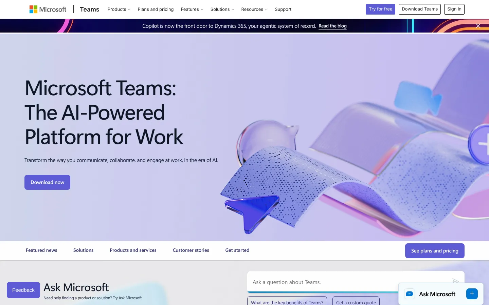
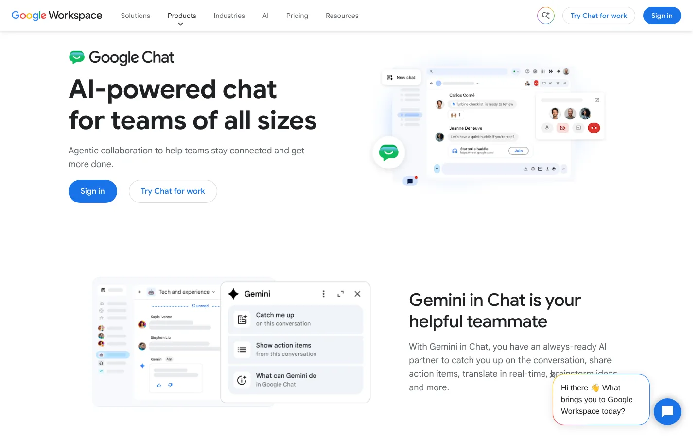
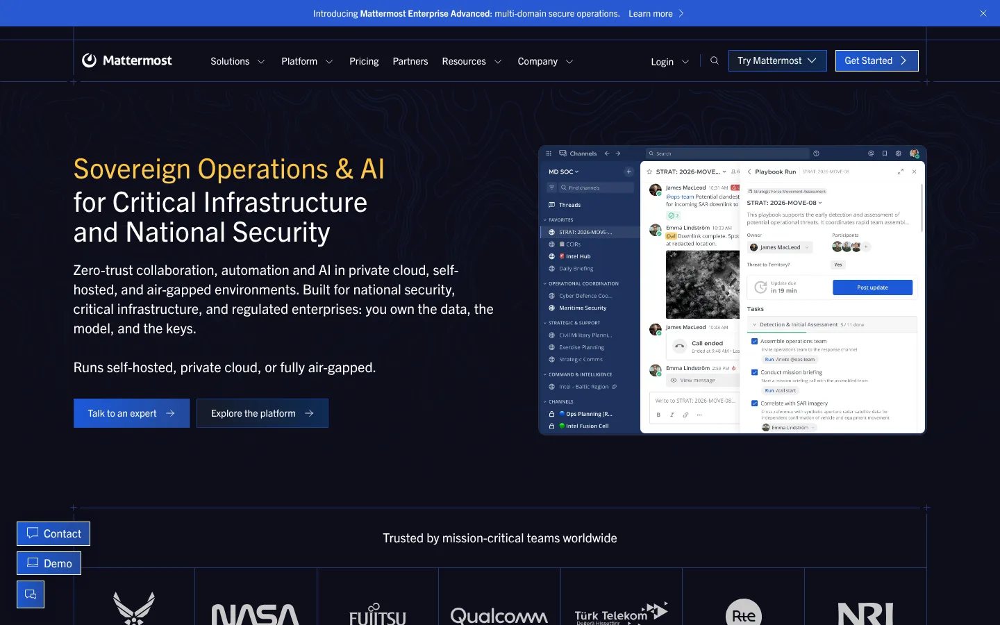
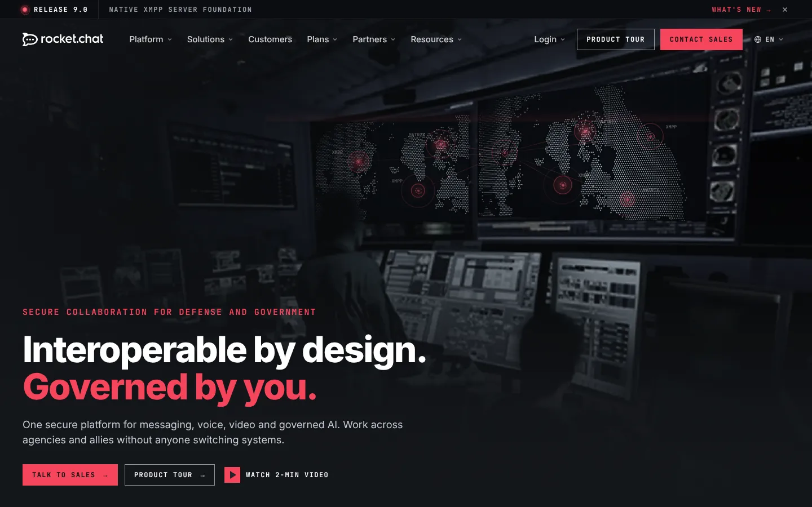
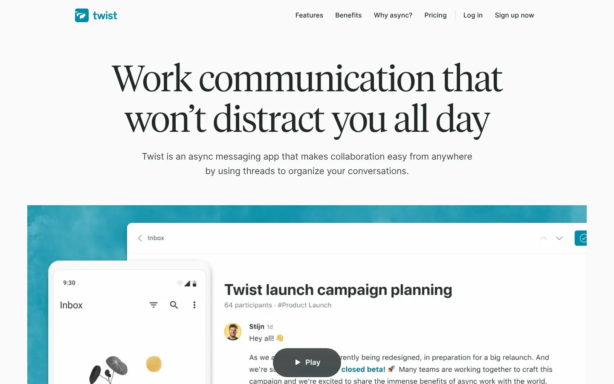
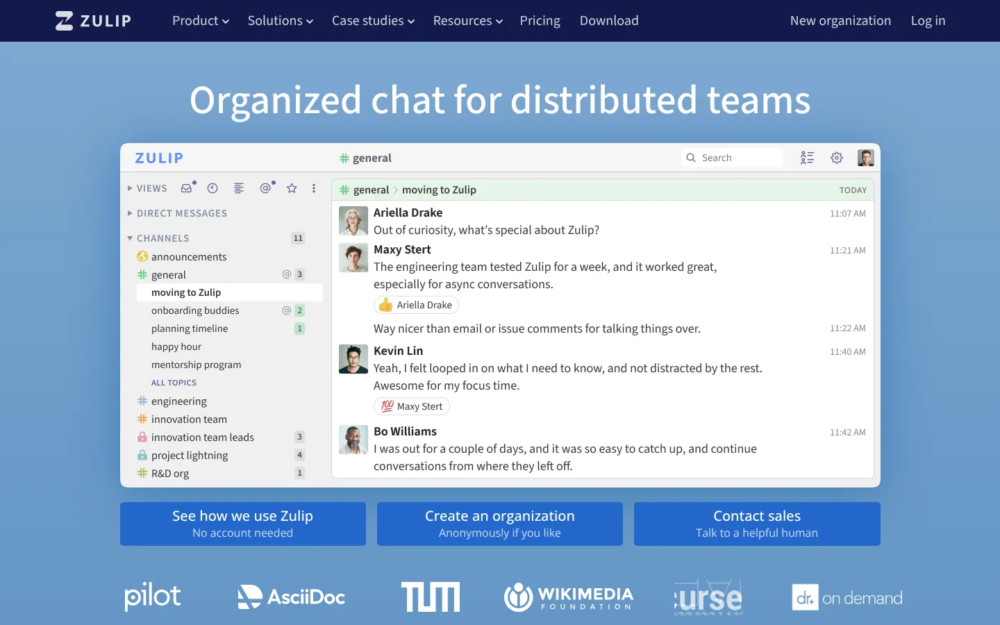
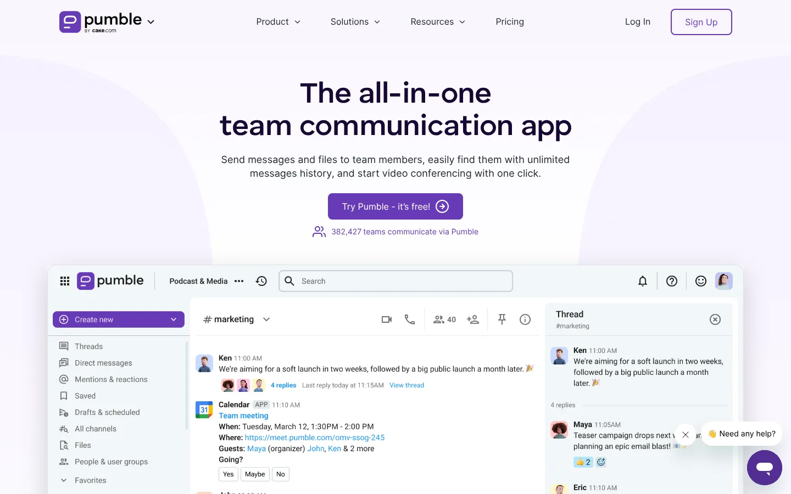
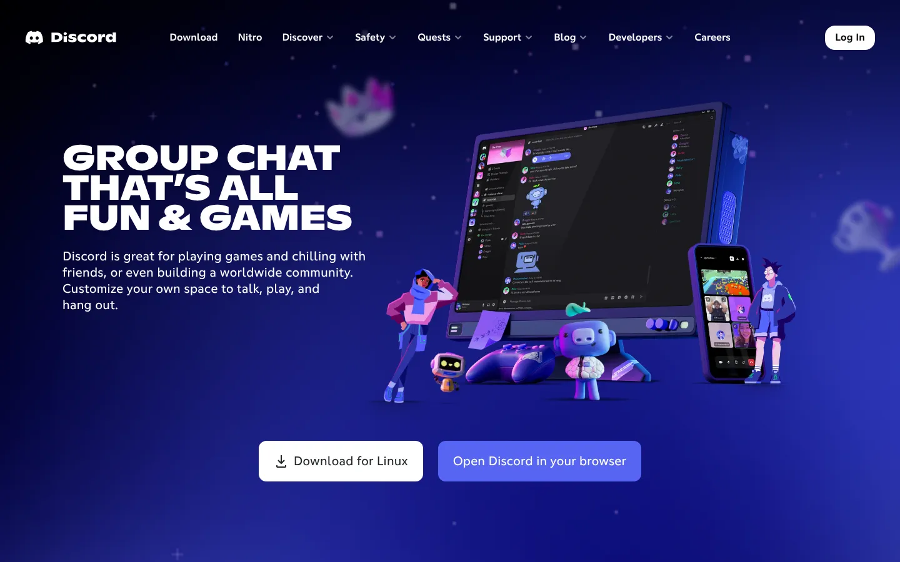
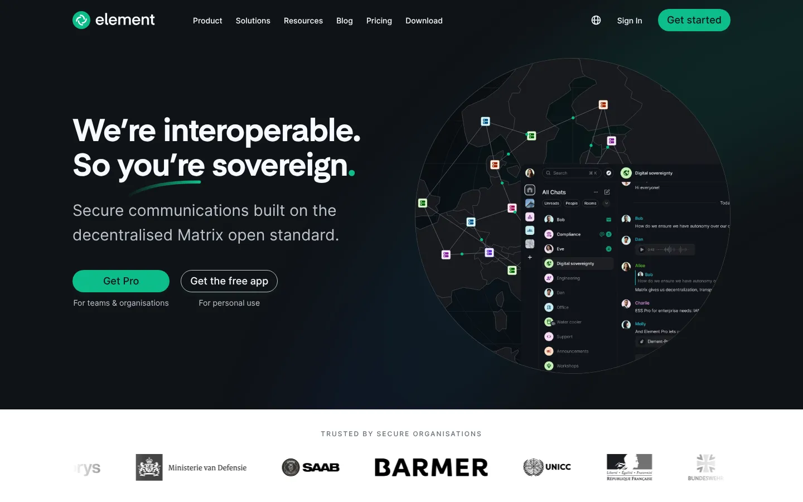

# 9 Best Slack Alternatives in 2026 for Teams That Need More Control

The best Slack alternative depends on why a team wants to leave. Microsoft Teams and Google Chat can remove a separate chat bill. Mattermost and Rocket.Chat offer more deployment control. Twist and Zulip organize conversations differently. Pumble and Discord reduce cost for teams with simpler requirements.

Slack remains a strong benchmark. Its Free plan keeps 90 days of message history, while [Slack Pro](https://slack.com/pricing) costs $7.25 per user monthly with annual billing. A replacement should solve a specific problem without creating a larger migration or administration burden.

## Key Takeaways

- **Microsoft Teams and Google Chat can remove a separate chat bill** for companies already paying for Microsoft 365 or Google Workspace.
- **Mattermost, Rocket.Chat, and Element give more deployment control.** Self-hosting moves patching, backups, and monitoring to your team.
- **Twist and Zulip change how conversations are organized,** which helps async and technical teams.
- **Pumble and Discord cost less** but trade away some governance and integrations.
- **Slack Pro costs $7.25 per user monthly on annual billing,** and its Free plan keeps 90 days of message history.

## Slack Alternatives Compared

| Platform | Best for | Starting price | Main tradeoff |
|---|---|---:|---|
| Microsoft Teams | Microsoft 365 organizations | Teams Essentials from $4 per user monthly, annual billing | Microsoft licensing can be confusing |
| Google Chat | Google Workspace organizations | Included with Workspace | Less appealing outside Google’s ecosystem |
| Mattermost | Data-controlled and regulated deployments | Quote-based enterprise plans | Requires technical ownership |
| Rocket.Chat | Self-hosted and high-governance messaging | Free Starter up to 50 users | Production features move to paid plans |
| Twist | Async-first remote teams | Free plan available | Less suited to rapid live chat |
| Zulip | Topic-based technical discussions | Free and paid cloud plans | Conversation model needs adjustment |
| Pumble | Small teams seeking low seat costs | Free plan available | Smaller app ecosystem |
| Discord | Communities and informal teams | Free core service | Governance differs from business chat |
| Element | Matrix-based and federated communication | Free and paid options | Deployment and moderation need planning |

Prices and plan terms were checked in November 2026. Teams should confirm identity, retention, guest, compliance, and support requirements before migrating.

## Why Teams Replace Slack

Price is only one reason. Slack alternatives serve several distinct needs.

A team may want:

- Chat included in an existing Microsoft or Google subscription.
- Longer free message history.
- Self-hosting or air-gapped deployment.
- Data residency and retention controls.
- Better async organization.
- Stronger federation across organizations.
- Fewer distractions and notifications.
- Simpler community access.
- More control over AI models and workplace data.

Current ranking pages often mix these needs into one list. That makes every product look interchangeable. They are not.

## 1. Microsoft Teams

**Best for:** Organizations already standardized on Microsoft 365.

Teams combines chat, channels, meetings, files, tasks, and Microsoft 365 collaboration. [Teams Essentials](https://www.microsoft.com/en-us/microsoft-teams/compare-microsoft-teams-business-options) costs $4 per user monthly with annual billing. Microsoft also sells business suites with different Teams arrangements, so buyers should check the exact package offered in their market.

Teams makes financial sense when Outlook, SharePoint, OneDrive, Word, Excel, and identity management already sit inside Microsoft. The harder part is governance. Channels, teams, sites, chats, and files can spread without naming and retention rules.

**Choose Teams when:** Microsoft 365 is already the company’s main work environment.

**Check before switching:** External access, guest policies, recording, retention, eDiscovery, phone functions, and the final license bundle.

## 2. Google Chat

**Best for:** Organizations centered on Gmail, Drive, Docs, Meet, and Google Workspace.

Google Chat is included with Workspace plans. Spaces support group work, while messages connect with Drive files and Meet calls.

The main advantage is consolidation. A company already paying for Workspace can avoid another core messaging subscription. The tradeoff is depth. Teams that depend on Slack’s app directory, advanced workflow features, or cross-company channels should test their exact replacements.

**Choose Google Chat when:** Most collaboration already happens in Google Workspace.

**Check before switching:** Guest access, bots, retention, vault policies, and migration of historical messages.

## 3. Mattermost

**Best for:** Regulated, technical, and public-sector teams that need deployment control.

Mattermost supports self-managed deployments and enterprise controls. Its current positioning emphasizes private AI, bring-your-own models, access-aware search, and Model Context Protocol connections.

The November 2026 desktop release included security fixes and stability changes. That release cadence is useful, but self-managed customers still own upgrade planning and infrastructure.

Mattermost does not publish a standard enterprise per-seat price on its main pricing page. Buyers need a quote and should model hosting, support, maintenance, backups, monitoring, and staff time.

**Choose Mattermost when:** Data control carries more weight than self-service simplicity.

**Check before switching:** Deployment responsibility, mobile push architecture, support response, upgrade process, AI data flow, and total operating cost.

## 4. Rocket.Chat

**Best for:** Teams that need self-hosting, federation, or isolated environments.

Rocket.Chat offers a Community edition and a free Starter plan for up to 50 users. Paid plans add governance, scale, support, and security functions needed for business-critical use.

Rocket.Chat 9.0 arrived on November 10, 2026. Its release notes contain breaking changes. LDAP, SAML, and custom OAuth sign-in moved to premium plans. Several legacy sign-in options were removed. That is a good example of why an open-source label does not remove upgrade and licensing work.

**Choose Rocket.Chat when:** The organization needs control over deployment and communication boundaries.

**Check before switching:** Identity features by plan, support window, federation, video, high availability, mobile notifications, and migration from Slack exports.

## 5. Twist

**Best for:** Distributed teams that want fewer live-chat interruptions.

Twist organizes work around threaded discussions. The model favors considered updates over a constant stream of channel messages.

That structure can help teams working across time zones. It can also frustrate groups that use chat as a live operations console. A trial should include both routine project discussions and urgent incidents.

**Choose Twist when:** Async communication is a deliberate working method.

**Check before switching:** Search, integrations, guest access, notification rules, and handling of urgent work.

## 6. Zulip

**Best for:** Engineering, research, and technical communities with many parallel discussions.

Zulip combines channels with topics. A single channel can contain separate topic threads, which keeps long-running technical discussions easier to find.

The topic model is different from Slack’s channel-first habit. Teams need clear naming and posting norms. Without them, users may treat every message as a new topic.

**Choose Zulip when:** Discussion structure and searchable technical history are priorities.

**Check before switching:** Hosting choice, retention, identity, integrations, mobile experience, and user training.

## 7. Pumble

**Best for:** Small businesses that want a low-cost chat product.

Pumble provides channels, direct messages, files, calls, and guest functions across free and paid plans. Its entry pricing is lower than many established workplace chat products.

Cost should not be the only test. Smaller products may have fewer integrations, compliance functions, workflow tools, and enterprise support options.

**Choose Pumble when:** The team needs basic workplace chat without a large software budget.

**Check before switching:** History limits, integrations, support, identity controls, exports, and guest permissions.

## 8. Discord

**Best for:** Communities, creator teams, and informal groups.

Discord provides text channels, voice channels, video, roles, bots, and invite-based access. Its community roots make it easy to join and organize large interest groups.

That design does not map perfectly to business governance. Companies should inspect data retention, exports, identity, support, moderation, and legal-hold requirements before treating Discord as a workplace system.

**Choose Discord when:** Community interaction is more important than formal business administration.

**Check before switching:** Ownership, role design, moderation, data controls, and acceptable-use policies.

## 9. Element

**Best for:** Organizations that want Matrix-based federation.

Element uses the Matrix open standard. Organizations can communicate across servers without placing every participant inside one vendor-controlled workspace.

Federation creates flexibility, but it also adds design decisions. The organization must decide who operates servers, how identities work, which rooms can federate, and how retention or moderation applies.

**Choose Element when:** Open federation and deployment choice are core requirements.

**Check before switching:** Hosting, encryption behavior, bridges, moderation, identity, backups, and support.

## What Changed in Team Messaging During 2026

AI is now part of the base comparison. Slack’s plans promote summaries, search, recaps, and workflow generation. Mattermost emphasizes private and multi-model AI. Microsoft and Google connect chat to their wider assistant products.

This does not make one tool automatically better. Buyers should ask five narrower questions:

1. Which workspace data can the assistant read?
2. Does it respect channel and file permissions?
3. Which model provider processes requests?
4. Is customer content retained or used for training?
5. Can administrators audit and disable the feature?

The second change is licensing. Rocket.Chat 9.0 moved several identity methods into premium plans. Slack’s Free plan limits searchable history. Microsoft bundles and separates Teams differently across products and markets. Plan names do not reveal total cost.

The third change is operational ownership. Self-hosting gives more control, but someone must secure, patch, monitor, and recover the system. Stack Row’s guide to [network monitoring tools](/cloud-infrastructure/network-monitoring-tools/) covers the monitoring layer that self-managed services need.

## What Teams Should Watch in 2027

Few vendors publish a complete 2027 roadmap. The practical watch list is clearer than the product calendar.

Teams should monitor:

- Access-aware AI search across messages and files.
- Bring-your-own-model options.
- AI usage metering and administrator controls.
- Federation between organizations.
- Data residency by workspace or team.
- Search quality across long histories.
- Pricing for guests, frontline workers, and external partners.
- Identity features moving between free and paid plans.
- Support periods for self-managed releases.

Rocket.Chat already lists support for several 2026 versions into 2027. That is a support commitment, not a promise of future features.

## How to Choose a Slack Alternative

Start with the reason for leaving. Then test the candidate against the same workload.

A sound comparison includes:

- Thirty days of real message volume.
- Internal and external channels.
- A sample incident or urgent workflow.
- Search across files and old discussions.
- Guest and contractor access.
- Identity provisioning and deprovisioning.
- Retention and export requirements.
- Mobile notification behavior.
- App and workflow replacements.
- A full three-year cost model.

The [Stack Row Business Technology section](/business-technology/) covers broader software-selection questions. Teams considering self-hosted chat should also review [cloud and infrastructure guidance](/cloud-infrastructure/) before assuming a free license means a free service.

## Best Slack Alternative by Use Case

- **Microsoft 365 company:** Microsoft Teams.
- **Google Workspace company:** Google Chat.
- **Regulated or data-controlled environment:** Mattermost.
- **Self-hosting with federation needs:** Rocket.Chat.
- **Async remote team:** Twist.
- **Technical discussions with many threads:** Zulip.
- **Budget-conscious small team:** Pumble.
- **Community-led group:** Discord.
- **Open federation:** Element.

Slack may still be the right choice for teams that depend on its integration catalog, Slack Connect, workflow tools, and familiar interface. A comparison should include the cost of change.

Chat is one layer of the wider work stack. Stack Row's [B2B technology statistics](/business-technology/b2b-tech-statistics/) cover how companies now buy and consolidate software. Engineering teams moving off Slack often review their issue tracker at the same time, and the guide to [Jira alternatives](/developer-data/best-jira-alternatives/) compares those options. Revenue teams weighing a full CRM change can read the guide to [Salesforce alternatives](/business-technology/salesforce-alternatives/).

## Frequently Asked Questions

### What Is the Best Free Slack Alternative?

Google Chat and Microsoft Teams may already be included with existing business suites. Pumble, Zulip, Rocket.Chat Starter, Discord, and several other tools also provide free options with different limits.

### What Is the Best Self-hosted Slack Alternative?

Mattermost, Rocket.Chat, Zulip, and Element support self-managed approaches. Compare identity, mobile push, upgrades, high availability, support, and the staff time required to operate them.

### Is Microsoft Teams Cheaper Than Slack?

Teams Essentials is listed at $4 per user monthly with annual billing. The real comparison depends on existing Microsoft licenses and the features each organization needs.

### Can Slack Messages Be Moved to Another Platform?

Some platforms import Slack exports, but coverage differs. Verify users, channels, threads, files, timestamps, direct messages, permissions, and links before planning the cutover.

### Which Slack Alternative Is Best for Async Work?

Twist is designed around threaded async discussions. Zulip also organizes messages by topic, which can preserve context across time zones.

### Are Open-source Slack Alternatives Free?

The software may be free, but hosting, security, backups, monitoring, upgrades, support, and staff time still cost money. Enterprise identity and compliance features may require paid plans.

## Resources

- [Slack pricing](https://slack.com/pricing)
- [Microsoft Teams pricing](https://www.microsoft.com/en-us/microsoft-teams/compare-microsoft-teams-business-options)
- [Google Workspace pricing](https://workspace.google.com/pricing.html)
- [Mattermost pricing](https://mattermost.com/pricing/)
- [Mattermost desktop changelog](https://docs.mattermost.com/product-overview/desktop-app-changelog)
- [Rocket.Chat plans](https://www.rocket.chat/plans)
- [Rocket.Chat 9.0 release notes](https://docs.rocket.chat/docs/rocketchat-release-notes)
- [Rocket.Chat support schedule](https://docs.rocket.chat/docs/version-durability)
- [Twist pricing](https://twist.com/pricing)
- [Zulip plans](https://zulip.com/plans/)
- [Pumble pricing](https://pumble.com/pricing)
- [Discord](https://discord.com/)
- [Element](https://element.io/)
