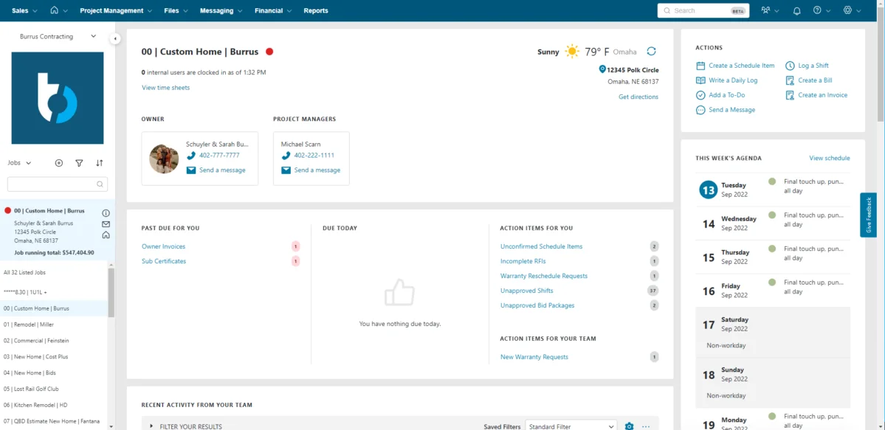
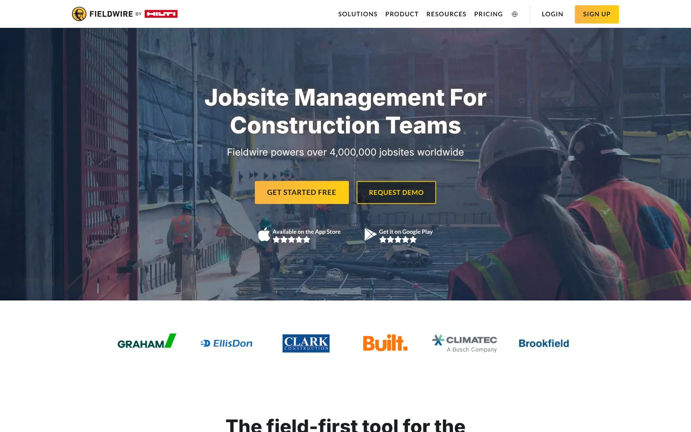
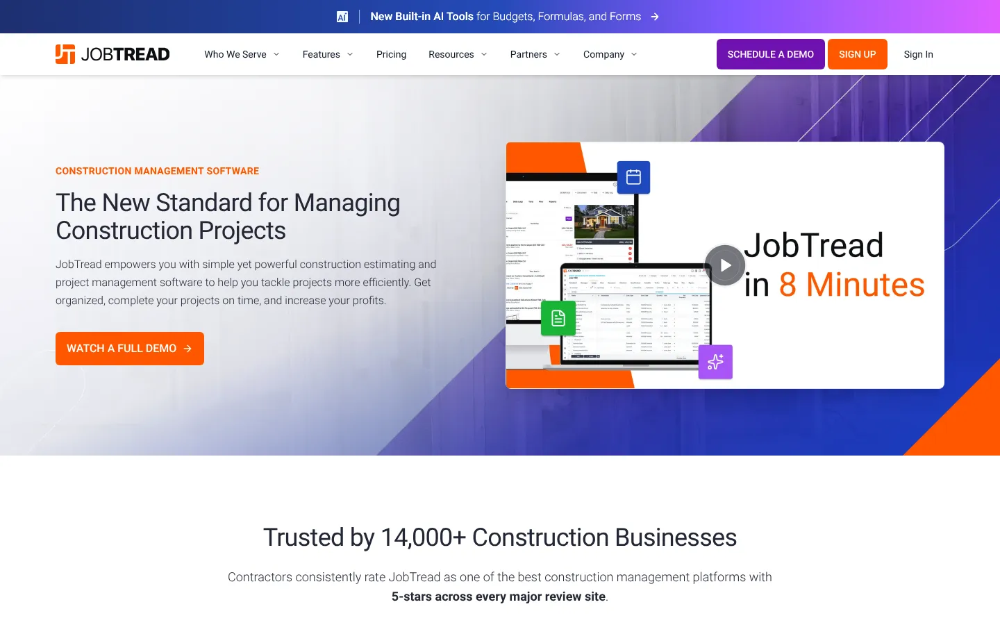
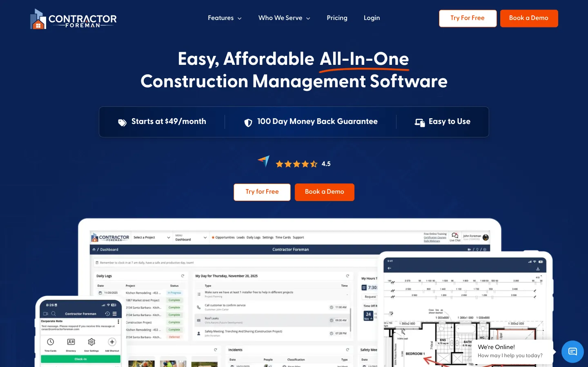
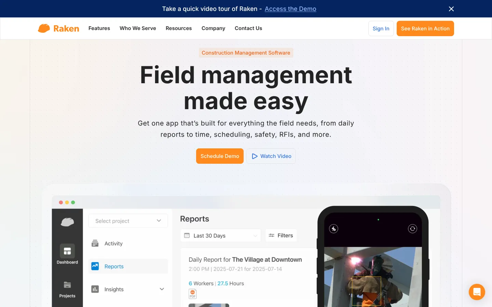
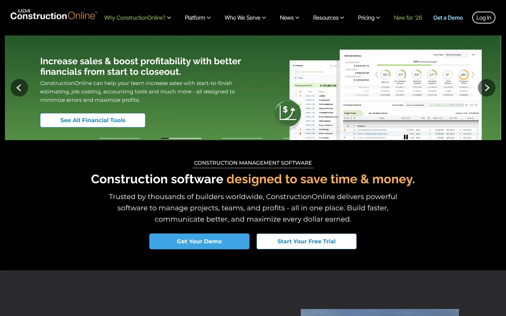

# 10 Best Construction Management Software Platforms in 2026

Construction management software should connect the field, office, documents, schedules, and costs. The best platform depends on project size, contractor type, accounting setup, and the work that must continue without reliable internet.

Procore and Autodesk Forma suit larger, connected project environments. Buildertrend and Buildxact focus on residential construction. Fieldwire works well for plan-centered field coordination. Contractor Foreman and JobTread serve smaller contractors that need broad functions without enterprise deployment.

## Key Takeaways

- **Procore and Autodesk Forma suit general contractors** that need connected documents, models, and project controls.
- **Buildertrend, JobTread, and Buildxact fit residential builders and remodelers** that sell, estimate, and manage jobs in one place.
- **Fieldwire and Raken focus on the field,** with plan markup, tasks, daily reports, and time.
- **Contractor Foreman and ConstructionOnline give smaller contractors a broad feature set** at lower entry prices.
- **Test offline use, subcontractor access, and data migration** before you sign.

## Construction Management Software Compared

| Platform | Best for | Pricing approach | Main tradeoff |
|---|---|---|---|
| Procore | Midsize and large general contractors | Quote-based | Broad system requires careful implementation |
| Autodesk Forma | BIM and design-to-field workflows | Quote-based | Best fit inside Autodesk environments |
| Buildertrend | Residential builders and remodelers | Quote-based | Less suited to complex enterprise construction |
| Fieldwire | Plan-centered field teams | Free plan; paid from $39 per user monthly, annual billing | Financial controls are not its main strength |
| JobTread | Residential and specialty contractors | Published subscription pricing | Smaller ecosystem than enterprise platforms |
| Contractor Foreman | Small and midsize contractors | From $49 monthly in current comparison data | Interface depth can require setup |
| Buildxact | Small builders and remodelers | Free entry option; paid plans from $199 monthly | Higher plans needed for full project management |
| Raken | Daily reports and field time | From $23 per user monthly, annual billing | Not a complete plan-management system |
| Houzz Pro | Design-build and client-facing firms | Published plans and trial | Construction depth varies by workflow |
| ConstructionOnline | Firms wanting an all-in-one suite | Published plan pricing | Large feature set can take time to configure |

Pricing changes. Buyers should confirm annual commitments, onboarding, payment processing, storage, users, projects, and accounting integrations.

## How We Selected the Platforms

This list separates full construction management suites from focused field tools. A daily reporting product should not be scored as if it were a complete financial platform.

We compared:

- Drawings, plans, markups, and document control.
- RFIs, submittals, punch lists, and change orders.
- Scheduling and daily reporting.
- Estimates, budgets, commitments, and job costs.
- Mobile and offline use.
- Subcontractor and client access.
- Accounting and design integrations.
- Implementation, support, and pricing clarity.
- Verified 2026 product changes.

A [2026 Deloitte survey](https://www.deloitte.com/au/en/services/economics/perspectives/state-digital-adoption-construction-industry.html) of 954 construction and engineering businesses across six Asia-Pacific markets found that 50% used construction management cloud software. Yet only 16% reached advanced digital capability. The gap helps explain why software selection alone rarely fixes disconnected processes.

## 1. Procore

**Best for:** General contractors managing many projects, participants, and financial workflows.

Procore connects project execution, financials, workforce functions, documents, RFIs, submittals, schedules, and field reporting. Its broad platform can reduce separate systems, but implementation needs process owners and clean data.

[Procore's November 2026 updates](https://www.procore.com/whats-new) added template-based submittals and schedule version comparison. These changes target repeatable project setup and schedule control.

Pricing is quote-based. Buyers should request the license model, implementation cost, storage terms, integration fees, and subcontractor access rules.

**Choose Procore when:** The company needs shared controls across projects and departments.

**Check first:** Accounting integration, data migration, reporting design, mobile use, and administrator workload.

## 2. Autodesk Forma

**Best for:** Design-build teams and contractors using Autodesk design and BIM products.

Autodesk renamed and expanded its construction environment around Forma. The platform connects design, model coordination, documents, field execution, and project information.

At Autodesk University 2026, the company announced Forma Bid, AI-powered Project Home insights, and a Daily Log Agent. Autodesk also cited an IDC MarketScape assessment that placed it in the Leaders category for worldwide construction management software.

The strongest fit is a team that already treats models and design data as part of project operations. A smaller contractor focused on estimates and client updates may find the platform heavier than needed.

**Choose Autodesk Forma when:** BIM, design coordination, and construction records must stay connected.

**Check first:** Product packaging, model workflows, field licensing, partner services, and handover requirements.

## 3. Buildertrend

**Best for:** Residential builders, remodelers, and specialty contractors.

Buildertrend covers estimates, schedules, selections, change orders, client communication, payments, and project tracking. Its client-facing tools suit residential work where homeowners need regular updates and approval steps.

Pricing is quote-based. Builders should ask whether the proposed package includes every financial, communication, and warranty function shown in the demo.

**Choose Buildertrend when:** Residential projects need one place for the builder, client, and trade partners.

**Check first:** Accounting sync, user limits, payment fees, migration, and contract term.

## 4. Fieldwire

**Best for:** Superintendents, foremen, and trades working from plans.

Fieldwire centers on drawings, markups, tasks, punch lists, forms, daily reports, RFIs, submittals, and change orders. Its mobile apps support jobsite work, including offline use.

The free plan supports small teams within project, sheet, and user limits. Annual pricing listed in its support documentation equals $39 per user monthly for Pro, $64 for Business, and $89 for Business Plus.

Fieldwire is strongest near the workface. A contractor needing deep estimating, accounting, or portfolio financials may need another system.

**Choose Fieldwire when:** Plan coordination and field adoption are the main problems.

**Check first:** Required plan, sheet volume, offline workflow, exports, and office-system integrations.

## 5. JobTread

**Best for:** Residential builders, remodelers, and specialty contractors needing job-level control.

JobTread combines estimating, budgets, schedules, job costing, documents, customer communication, and vendor management. Its strong recent review scores make it a credible shortlist option for smaller contractors.

A buying team should test its own estimate, change order, purchase order, and accounting workflow. Review scores do not prove fit for a specific construction model.

**Choose JobTread when:** The firm wants broad job management without a large-enterprise platform.

**Check first:** Accounting sync, user pricing, onboarding, mobile functions, and data exports.

## 6. Contractor Foreman

**Best for:** Small and midsize general contractors seeking many functions at a lower entry cost.

Contractor Foreman covers estimates, schedules, timecards, daily logs, safety, change orders, documents, and financial workflows. Current comparison data lists plans beginning around $49 monthly.

Its large function count is attractive. Buyers should confirm how deeply each function works for their projects. A checkbox in a feature table does not show the number of steps required on site.

**Choose Contractor Foreman when:** Budget and broad coverage are both important.

**Check first:** Plan restrictions, storage, support, mobile performance, and accounting integration.

## 7. Buildxact

**Best for:** Small residential builders and remodelers focused on estimates and takeoffs.

Buildxact combines digital takeoffs, estimating, schedules, purchasing, and project management. Its October 2026 public pricing showed a free Go option, Foundation at $199 monthly, Pro at $399, and Master at $599.

The price difference between tiers is meaningful. Buyers should map the required work before choosing a plan, especially if they need full project management or the broadest AI functions.

**Choose Buildxact when:** Estimating and preconstruction need to flow into project delivery.

**Check first:** Takeoff requirements, supplier connections, accounting, user access, and AI add-ons.

## 8. Raken

**Best for:** Contractors that need consistent daily reports and time capture.

Raken focuses on daily logs, photos, production tracking, timecards, and field records. It supports offline work and automatic synchronization.

Current published comparison information lists Basic at $23 per user monthly and Performance at $59, with annual billing and three-user minimums. Raken is a focused field product, not a substitute for every construction management function.

**Choose Raken when:** Daily reporting and field documentation are unreliable.

**Check first:** Minimum users, offline project setup, payroll exports, production tracking, and integrations.

## 9. Houzz Pro

**Best for:** Design-build, remodeling, and renovation businesses that manage client experience.

Houzz Pro combines estimates, proposals, project schedules, communication, lead management, and visualization functions. Its connection to the Houzz marketplace distinguishes it from contractor-first systems.

The platform may suit a design-led company more than a commercial general contractor. Test back-office and job-cost functions using a real project example.

**Choose Houzz Pro when:** Sales, design, and client presentation sit close to project management.

**Check first:** Lead terms, financial functions, user limits, visualization costs, and exports.

## 10. ConstructionOnline

**Best for:** Contractors wanting broad project, financial, and communication functions.

ConstructionOnline covers estimating, schedules, change orders, selections, documents, communication, and reporting. It can serve firms that prefer one broad suite.

Breadth requires setup. Teams should avoid enabling every module on day one. Start with the few workflows that cause the most rework.

**Choose ConstructionOnline when:** The company wants a configurable suite and can assign an internal owner.

**Check first:** Pricing tier, onboarding, mobile workflow, integrations, and migration.

## What Construction Software Changed in 2026

The category shifted toward connected data and task-specific AI. Procore added schedule and submittal controls. Autodesk announced AI-supported project insights and daily-log work. Buildxact added AI-oriented packages around estimating.

AGC Partners described a move from passive systems of record toward systems that can reason across project data. Its Q3 2026 update also estimated about 68 construction-technology transactions and $14.2 billion in disclosed deal value for the year. That is market analysis, not a guarantee that consolidation improves products.

The more useful buyer question is whether a new function removes a real handoff. An AI summary has little value if field records, schedules, and cost data remain incomplete.

## What to Watch in 2027

Most vendors have not published full 2027 roadmaps. Buyers should monitor:

- AI agents for RFIs, submittals, logs, schedules, and estimates.
- Stronger links between design models and field records.
- Shared project data across owners, designers, contractors, and trades.
- Offline mobile reliability.
- Open APIs and accounting connections.
- Clear records of AI-generated changes and approvals.
- Pricing based on projects, users, volume, or AI usage.
- Easier exports for handover and long-term records.

Buy for current operations. Treat future functions as optional until the vendor documents release scope and availability.

## How to Choose Construction Management Software

Use one live project as the test case. Include office and field users.

The evaluation should cover:

1. Importing current plans and revisions.
2. Creating an RFI and routing its response.
3. Publishing a submittal.
4. Recording a daily log offline.
5. Creating and approving a change order.
6. Updating the schedule.
7. Sending cost data to accounting.
8. Giving a subcontractor limited access.
9. Exporting the complete project record.
10. Measuring the steps and training required.

The [Stack Row Business Technology section](/business-technology/) covers software selection and operating systems. Teams evaluating cloud delivery should also review [cloud infrastructure guidance](/cloud-infrastructure/) and [cloud project management software](/business-technology/cloud-based-project-management-software/).

Construction software often has to connect with the back office. Stack Row's [B2B technology statistics](/business-technology/b2b-tech-statistics/) show how buyers judge vendor claims, and contractors that also fabricate parts can compare the [best manufacturing software](/business-technology/best-manufacturing-software/). Teams that only need task tracking may find enough in [cloud-based project management software](/business-technology/cloud-based-project-management-software/).

## Frequently Asked Questions

### What Is Construction Management Software?

Construction management software organizes drawings, schedules, documents, RFIs, submittals, daily reports, costs, change orders, and project communication. Products differ in field, financial, design, and client-facing depth.

### What Construction Software Is Best for a Small Contractor?

Contractor Foreman, JobTread, Buildxact, and Buildertrend are practical starting points. The right choice depends on trade, project type, accounting system, users, and required field workflows.

### Is Procore Suitable for Small Contractors?

Procore can support smaller contractors, but its breadth and quote-based pricing may exceed their needs. Compare implementation effort and total cost against focused products.

### Does Construction Software Work Offline?

Some products, including Fieldwire, Procore, and Raken, document offline mobile functions. Test the exact records users can view, create, and synchronize without connectivity.

### How Much Does Construction Management Software Cost?

Prices range from free entry plans to quote-based enterprise agreements. Include users, projects, implementation, support, storage, payments, integrations, and accounting work.

### What Should Be Migrated into Construction Software?

Common migration data includes contacts, vendors, projects, budgets, cost codes, documents, drawings, schedules, commitments, and open change orders. Historical records may need a separate archive.

## Resources

- [Deloitte 2026 construction digital adoption study](https://www.deloitte.com/au/en/services/economics/perspectives/state-digital-adoption-construction-industry.html)
- [Procore product updates](https://www.procore.com/whats-new)
- [Autodesk 2026 construction announcement](https://adsknews.autodesk.com/en/news/autodesk-named-as-a-leader-in-construction-management-software-idc/)
- [Fieldwire pricing documentation](https://help.fieldwire.com/hc/en-us/articles/202634054-Fieldwire-Pricing-and-Overages)
- [Buildertrend](https://buildertrend.com/)
- [JobTread](https://www.jobtread.com/)
- [Contractor Foreman](https://contractorforeman.com/)
- [Buildxact](https://www.buildxact.com/)
- [Raken](https://www.rakenapp.com/)
- [Houzz Pro](https://www.houzz.com/pro)
- [ConstructionOnline](https://constructiononline.com/)
- [Capterra 2026 construction software analysis](https://www.capterra.com/resources/best-construction-management-software-reviews-analysis/)
