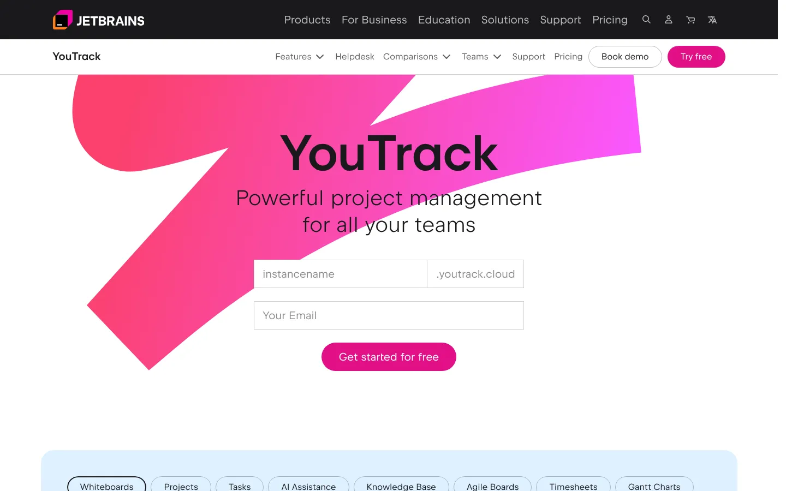
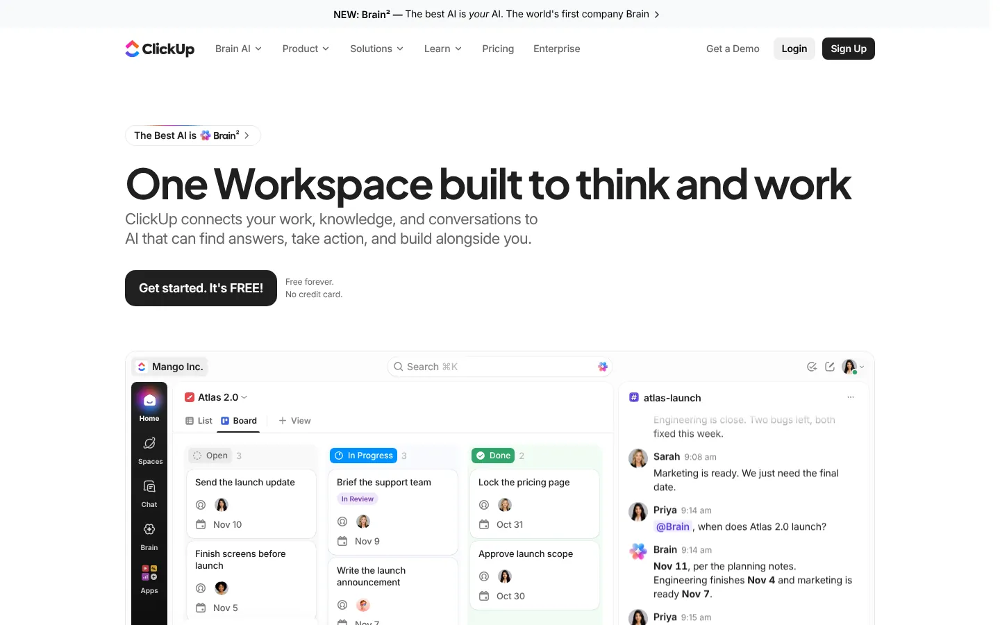
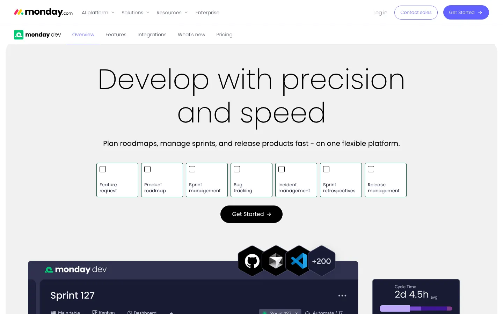
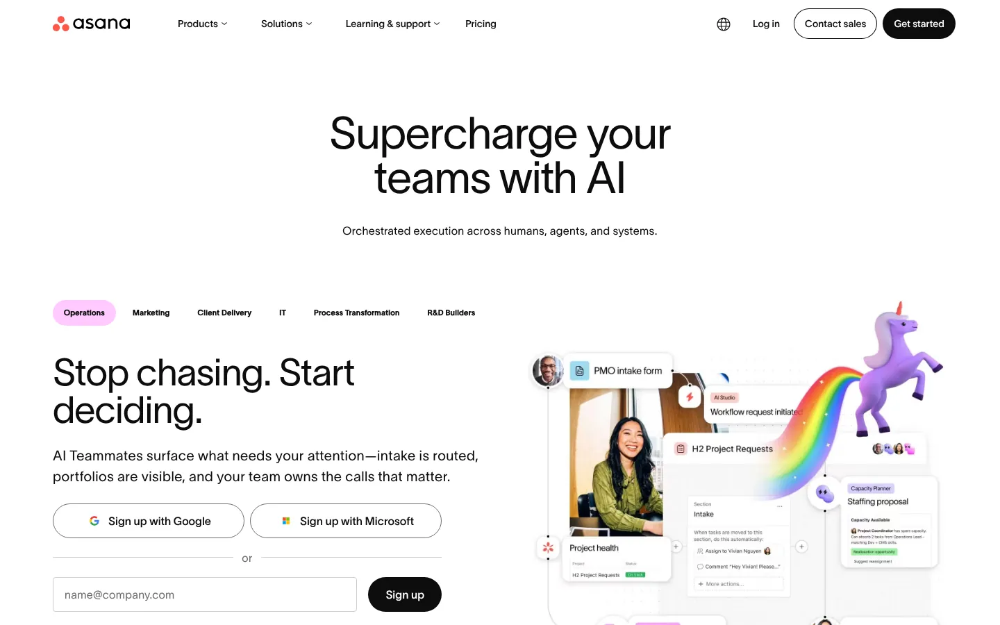
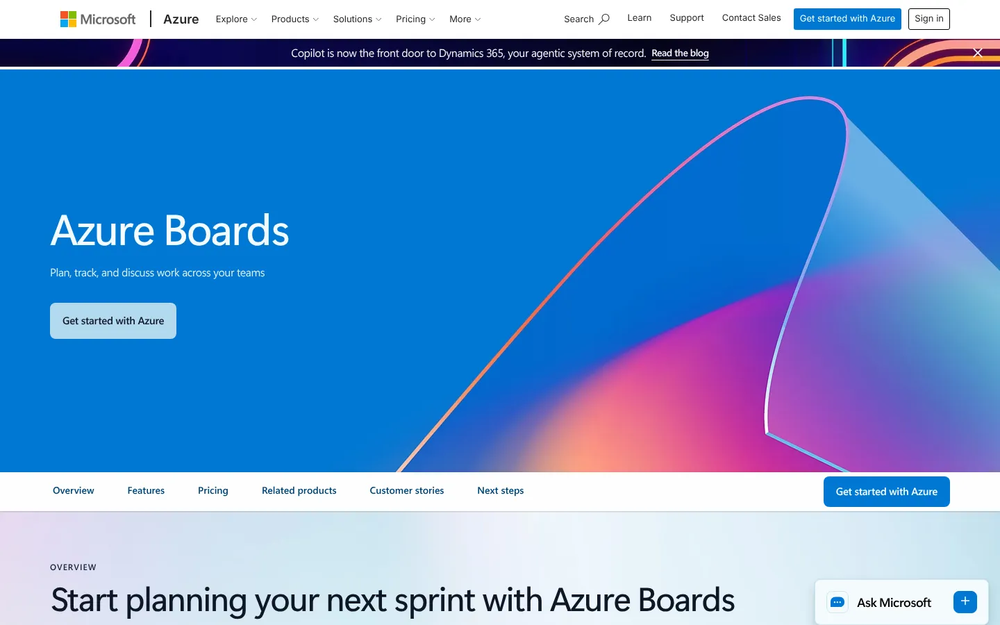
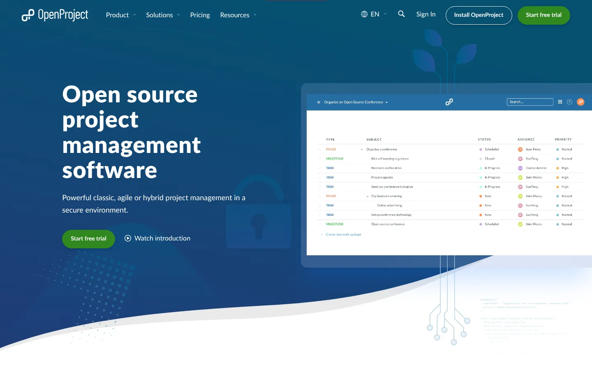
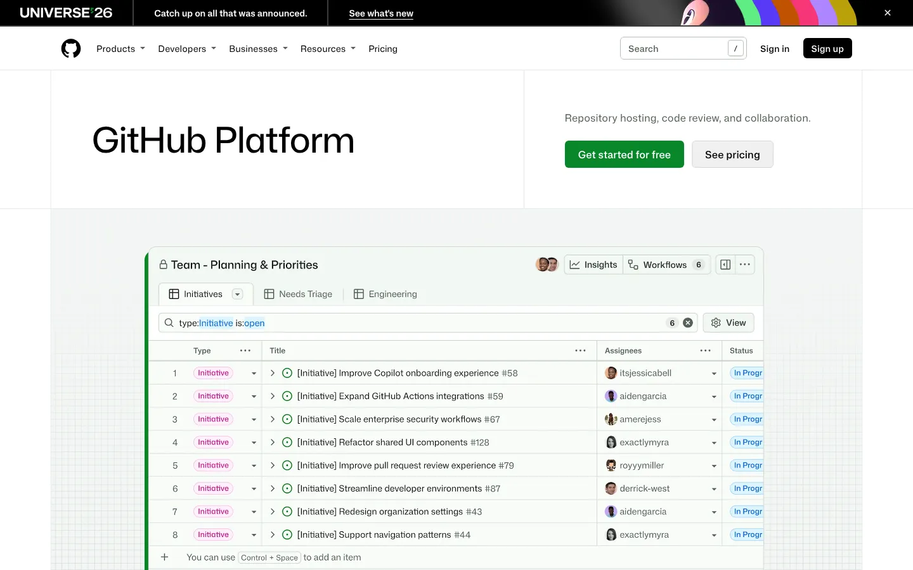
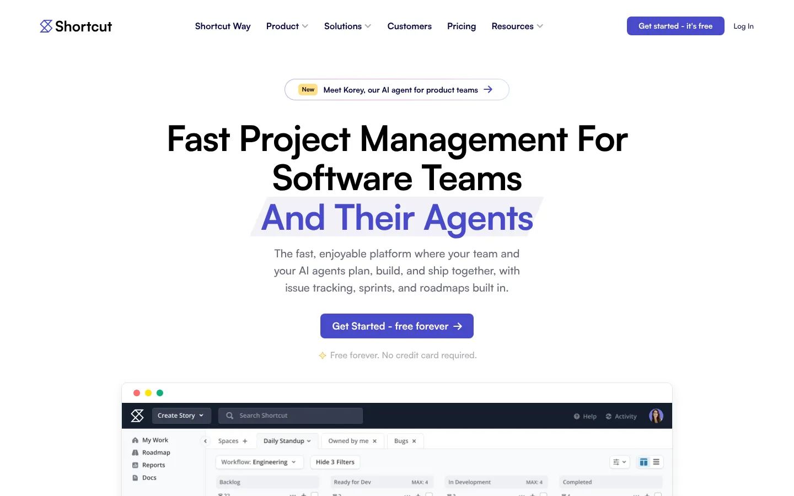

# 9 Best Jira Alternatives in 2026 for Product and Engineering Teams

The best Jira alternative depends on why Jira no longer fits. Linear and Shortcut reduce configuration for software teams. ClickUp, Asana, and monday dev connect engineering with wider business work. Azure DevOps and GitHub Projects keep planning near code. OpenProject provides a self-hosted path.

Jira remains hard to replace when a company depends on custom workflows, the Atlassian marketplace, advanced governance, or several connected Atlassian products. A lighter tool can save administration, but only if it still supports the team’s planning model.

## Key Takeaways

- **Linear is the fastest-moving choice for product and engineering teams** that accept fewer configuration options.
- **YouTrack and OpenProject suit teams that want workflow control or self-hosting.**
- **ClickUp, monday dev, and Asana fit companies where engineering shares plans with other departments.**
- **GitHub Projects and Azure Boards keep planning next to the code** for teams already on those platforms.
- **Jira Data Center reaches end of life on March 28, 2029,** so self-managed customers now face a dated decision.

## Jira Alternatives Compared

| Platform | Best for | Starting paid price | Main tradeoff |
|---|---|---:|---|
| Linear | Fast product and engineering teams | $10 per user monthly, annual billing | Less configurable than Jira by design |
| YouTrack | Technical teams wanting value and workflow control | Free up to 10 users; paid thereafter | Smaller ecosystem |
| ClickUp | Engineering plus wider company work | $9 per user monthly, annual billing | Broad product can become complex |
| monday dev | Teams already using monday.com | From published per-seat plans | Sprint depth varies by plan |
| Asana | Cross-functional planning | Paid plans from $10.99 per user monthly, annual billing | No Jira-style native sprint object |
| Azure DevOps Boards | Microsoft development organizations | First five Basic users free, then paid | Heavy for non-Microsoft teams |
| OpenProject | Self-hosted and open-source needs | Community edition; paid support available | Self-hosting requires ownership |
| GitHub Projects | Teams living in GitHub | Included with GitHub plans | Portfolio reporting is lighter |
| Shortcut | Small and midsize software teams | From $8.50 per user monthly, annual billing | Narrower enterprise administration |

Prices were checked through official pages and current comparison research in November 2026.

## What Ranking Comparisons Often Miss

Many Jira alternatives lists compare boards, tasks, and prices. That misses the migration problem.

A serious evaluation must compare:

- Issue types and custom fields.
- Backlog and sprint behavior.
- Dependencies and roadmaps.
- Release and version tracking.
- Automation and approvals.
- Code, deployment, and support integrations.
- Permissions and audit controls.
- Reporting across teams.
- Import coverage and ongoing synchronization.
- The work Jira performs outside software development.

The best replacement is the one that preserves necessary structure while removing unwanted administration.

## 1. Linear

**Best for:** Product and engineering teams that want opinionated issue tracking.

Linear provides issues, projects, cycles, initiatives, roadmaps, triage, and code connections. Its Free plan includes unlimited members, two teams, and 250 issues. [Linear lists](https://linear.app/pricing) Basic at $10 per user monthly with annual billing and Business at $16.

Linear’s advantage is focus. It limits some of the configuration that makes Jira powerful and demanding. The official Jira integration can support a staged transition with one-way or two-way synchronization.

That migration is not perfect. [Linear's Jira documentation](https://linear.app/docs/jira) states that Jira components become labels, while issue hierarchy and required fields can create mapping differences.

**Choose Linear when:** Engineering wants speed and accepts a more opinionated model.

**Check first:** Issue hierarchy, custom fields, multiple Jira sites, reporting, service workflows, and migration behavior.

## 2. YouTrack

**Best for:** Technical teams wanting agile planning and flexible workflows at a lower price.

YouTrack includes issues, boards, sprints, reports, time tracking, knowledge-base functions, and workflow automation. It is free for up to ten users, with paid pricing after that threshold.

JetBrains supports JavaScript and no-code workflow approaches. This gives technical teams control without copying Jira’s entire administration model.

**Choose YouTrack when:** The team wants a capable issue tracker with predictable small-team entry costs.

**Check first:** Marketplace needs, enterprise identity, service desk functions, migration, and reporting.

## 3. ClickUp

**Best for:** Organizations that want engineering tasks, documents, goals, and company work together.

ClickUp’s Free plan includes tasks, docs, boards, sprint management, and time tracking. Core costs $9 per user monthly when billed yearly. Business costs $17 and adds more automation and reporting functions.

The platform can replace several tools. It can also recreate the same complexity a team hoped to leave behind. Workspaces need rules for spaces, lists, custom fields, statuses, and ownership.

**Choose ClickUp when:** Engineering must share one work system with marketing, operations, or leadership.

**Check first:** Sprint functions by plan, permissions, guest pricing, automation limits, performance, and migration quality.

## 4. Monday Dev

**Best for:** Product teams already using monday.com for business work.

monday dev applies monday.com boards and automation to product and software delivery. Teams can manage backlogs, sprints, roadmaps, and releases alongside wider work.

The benefit is organizational consistency. The risk is assuming every Jira workflow maps cleanly to a flexible board. Buyers should test dependencies, sprint reporting, release records, and engineering integrations.

**Choose monday dev when:** The company already uses monday.com and wants product work in the same environment.

**Check first:** Seat minimums, sprint functions, automation, roadmap reporting, Git connections, and migration.

## 5. Asana

**Best for:** Cross-functional teams where engineering work depends on business programs.

Asana offers tasks, projects, portfolios, goals, dependencies, forms, and workflow automation. It is stronger for coordinated company work than for teams needing deep Jira-style issue administration.

Asana does not use the same native sprint model as Jira. Teams can build sprint processes, but they should test velocity, backlog grooming, release tracking, and developer integrations.

**Choose Asana when:** Program visibility across departments is more important than a specialized issue tracker.

**Check first:** Sprint reporting, custom fields, portfolios, automation limits, guests, and developer workflow.

## 6. Azure DevOps Boards

**Best for:** Development teams using Azure, Visual Studio, Microsoft identity, or Azure Repos.

Azure Boards supports backlogs, boards, work items, iterations, queries, delivery plans, and links to development pipelines. The first five Basic users are free under current Azure DevOps pricing.

The product is capable, but it brings Microsoft’s process and administration model. It makes most sense when the rest of delivery already sits in Azure DevOps.

**Choose Azure Boards when:** Planning, repositories, pipelines, testing, and Microsoft identity need tight connections.

**Check first:** GitHub integration, reporting, process templates, licensing, service hooks, and migration.

## 7. OpenProject

**Best for:** Organizations requiring open-source software or self-hosted project control.

OpenProject supports work packages, agile boards, timelines, time tracking, and project planning. The Community edition can be self-hosted, while paid editions add enterprise support and functions.

Self-hosting changes the cost structure. The license may be free, but infrastructure, upgrades, backups, security, monitoring, and support remain.

**Choose OpenProject when:** Deployment control and open-source access outweigh app-marketplace breadth.

**Check first:** Agile requirements, support tier, identity, hosting, upgrades, and Jira import coverage.

## 8. GitHub Projects

**Best for:** Teams that manage most development work inside GitHub.

GitHub Issues and Projects keep planning close to repositories, pull requests, discussions, and releases. Custom fields, views, automation, and issue relationships cover many lightweight planning needs.

The main strength is proximity to code. The main limitation is company-wide program management. Nontechnical teams may need another interface or system.

**Choose GitHub Projects when:** The repository is already the center of planning and delivery.

**Check first:** Cross-repository reporting, portfolio views, permissions, external stakeholders, and migration.

## 9. Shortcut

**Best for:** Small and midsize software teams that want stories, epics, iterations, and roadmaps.

Shortcut focuses on software work without Jira’s full configuration depth. It provides stories, epics, iterations, objectives, roadmaps, and code connections.

Current comparison research lists paid plans from $8.50 per user monthly with annual billing. Teams should confirm current terms on the vendor’s pricing page.

**Choose Shortcut when:** The team needs an agile product system without a dedicated Jira administrator.

**Check first:** Enterprise permissions, reporting, integrations, service workflows, and import completeness.

## What Changed Around Jira in 2026

[Atlassian's current Jira pricing](https://www.atlassian.com/software/jira/pricing) lists Rovo Search, Chat, Agents, and other AI-powered functions on Standard. Standard costs $7.91 per user monthly, while Premium costs $14.54 under current public pricing.

Atlassian stopped selling Data Center subscriptions to new customers on March 30, 2026. Data Center reaches end of life on March 28, 2029. Self-managed Jira customers now have a dated platform decision, even if migration does not happen during 2027.

Alternative products added their own agents. Linear’s August 2026 update described coding sessions that can set up, run, and test code. ClickUp and monday.com also package AI usage into their work products.

AI does not remove the migration question. Teams still need clean issue structures, access controls, review, and traceable changes.

## What to Watch in 2027

Teams should watch five areas:

- Agent actions tied to issues, code, and deployment systems.
- Consumption pricing for AI work.
- Migration options for Jira Data Center customers.
- Better product-to-code traceability.
- Access-aware search across projects and documentation.
- Open-source tools offering supported enterprise editions.
- Portfolio reporting without heavy administrator setup.

A product roadmap is not a migration plan. Test current exports, imports, APIs, and permissions before committing.

## How to Replace Jira Without Losing Work

A staged migration is safer than a weekend cutover.

Use this sequence:

1. Inventory projects, issue types, fields, workflows, automations, and apps.
2. Separate required structures from historical customization.
3. Map one active project into the candidate.
4. Test backlog, sprint, release, and incident workflows.
5. Import a representative sample.
6. Compare users, comments, attachments, links, and timestamps.
7. Run both systems briefly if synchronization is available.
8. Freeze configuration before final migration.
9. Keep a searchable archive.
10. Document ownership after launch.

Teams can use Stack Row’s [binary and hex calculator](/tools/binary-hex-calculator/) for development reference work. The [Business Technology section](/business-technology/) and [Cloud Infrastructure section](/cloud-infrastructure/) cover the wider operating and hosting choices around development platforms.

## Best Jira Alternative by Use Case

- **Fast product engineering:** Linear.
- **Technical team on a budget:** YouTrack.
- **One company-wide work platform:** ClickUp.
- **Existing monday.com organization:** monday dev.
- **Cross-functional programs:** Asana.
- **Microsoft development stack:** Azure DevOps Boards.
- **Self-hosted open source:** OpenProject.
- **GitHub-centered delivery:** GitHub Projects.
- **Focused agile software team:** Shortcut.

Stay with Jira if custom workflows, marketplace apps, Atlassian administration, and cross-team governance outweigh the complexity.

An issue tracker sits next to the rest of the delivery pipeline. Stack Row's comparison of [CI/CD tools](/developer-data/ci-cd-tools/) covers the build and release side. Teams changing chat tools at the same time can compare [Slack alternatives](/business-technology/best-slack-alternatives/), and non-engineering teams may prefer simpler [cloud-based project management software](/business-technology/cloud-based-project-management-software/).

## Frequently Asked Questions

### What Is the Best Jira Alternative for Software Teams?

Linear, YouTrack, Shortcut, Azure DevOps Boards, and GitHub Projects are strong options. The best choice depends on workflow depth, code hosting, reporting, and migration.

### Is There a Free Jira Alternative?

YouTrack is free for up to ten users. OpenProject has a Community edition, GitHub Projects is included with GitHub plans, and several other products offer free tiers.

### Is Linear Better Than Jira?

Linear is simpler and more opinionated. Jira provides deeper customization, governance, and marketplace coverage, so the better product depends on the team.

### Can Jira Data Be Migrated to Another Tool?

Most major alternatives offer an importer or migration service. Test fields, hierarchy, comments, attachments, links, users, timestamps, and automation before the final move.

### Which Jira Alternative Can Be Self-hosted?

OpenProject is a prominent self-hosted option. Plane and several other open-source tools may also fit, but support, security, upgrades, and migration still require ownership.

### Should Jira Data Center Users Migrate Now?

Data Center sales to new customers ended on March 30, 2026, and end of life is scheduled for March 28, 2029. Organizations should assess options early, but migration timing depends on risk, integrations, and contract plans.

## Resources

- [Jira pricing](https://www.atlassian.com/software/jira/pricing)
- [Linear pricing](https://linear.app/pricing)
- [Linear Jira integration](https://linear.app/docs/jira)
- [Linear changelog](https://linear.app/changelog)
- [YouTrack pricing](https://www.jetbrains.com/youtrack/buy/)
- [ClickUp pricing](https://clickup.com/pricing)
- [monday dev](https://monday.com/w/monday-dev)
- [Asana pricing](https://asana.com/pricing)
- [Azure DevOps pricing](https://azure.microsoft.com/pricing/details/devops/azure-devops-services/)
- [OpenProject pricing](https://www.openproject.org/pricing/)
- [GitHub Issues and Projects](https://github.com/features/issues)
- [Shortcut pricing](https://www.shortcut.com/pricing)
