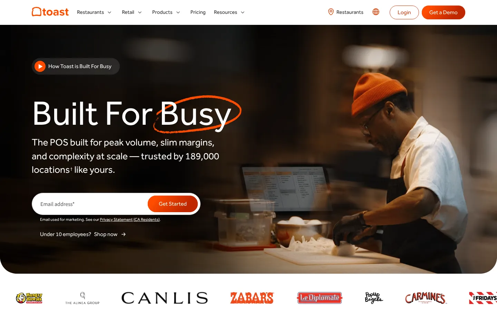
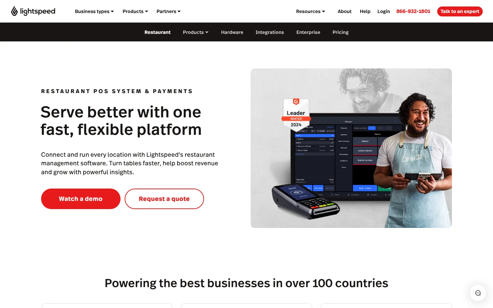
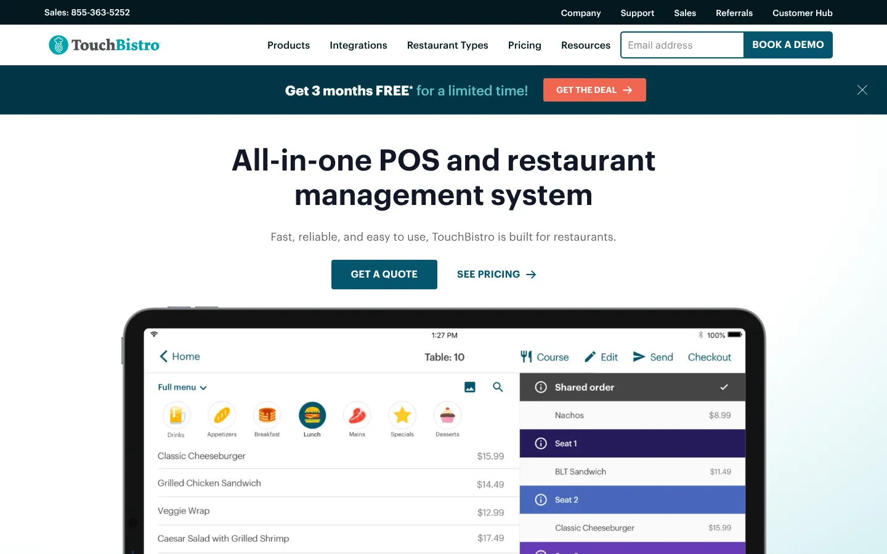
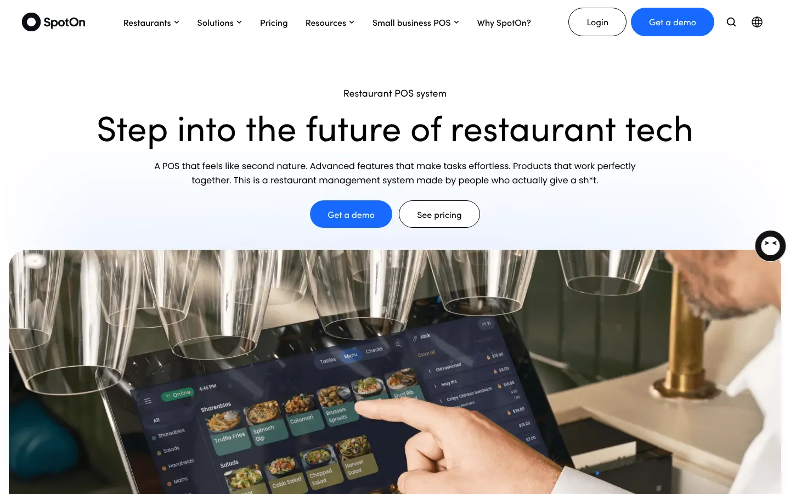
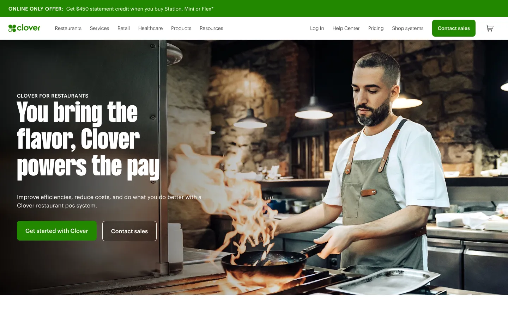
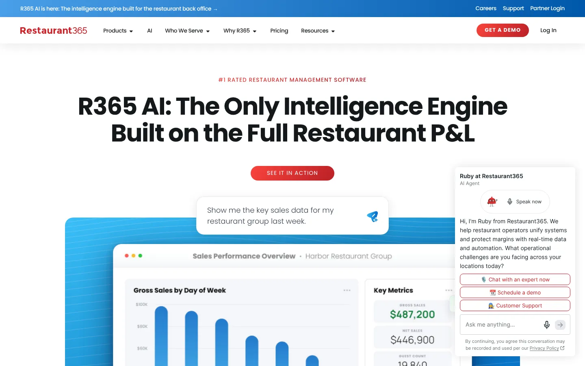
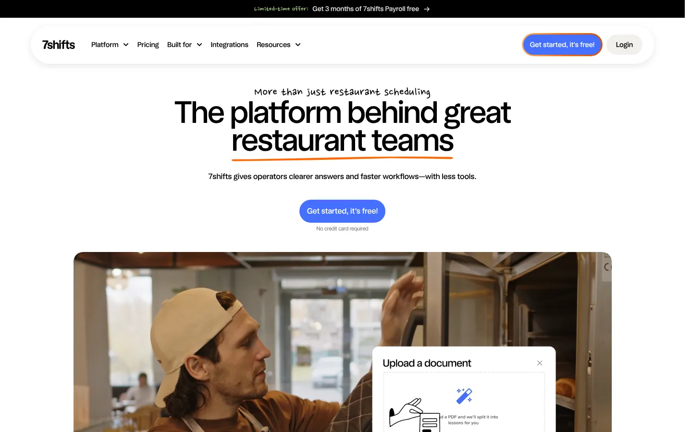
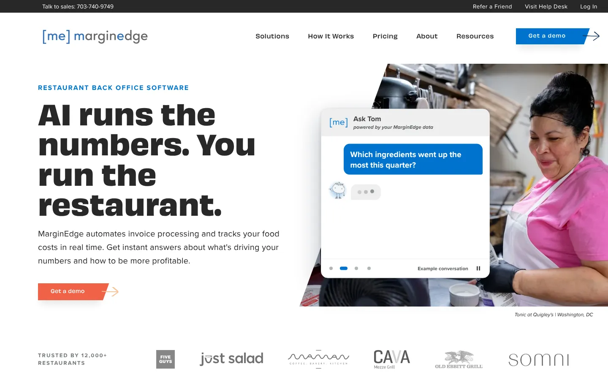

# 9 Best Restaurant Management Software Platforms for 2026, Plus What to Watch in 2027

**Search intent:** Commercial investigation

Restaurant management software should reduce handoffs between the dining room, kitchen, back office, and accounting team. The best choice depends on where those handoffs fail today.

For a new independent restaurant, Toast or Square may cover the broadest set of daily jobs. TouchBistro is a strong fit for table-service workflows. Restaurant365 is more useful when a growing group needs accounting, inventory, labor, and store-level reporting in one operating layer. 7shifts and MarginEdge solve narrower problems well, but usually sit beside a POS rather than replace one.

## Key Takeaways

- **Toast is the broadest all-in-one platform for independent restaurants.** Its POS plan starts at $69 monthly.
- **Square for Restaurants suits a fast, low-friction launch.**
- **TouchBistro and Lightspeed Restaurant fit table service and multi-location menu analysis.**
- **Restaurant365, 7shifts, and MarginEdge handle the back office:** accounting, labor, and invoices.
- **Ask for a full first-year and renewal estimate.** Hardware, processing, and add-ons move the total.

## The Short List

| Platform | Best for | Main strength | Pricing approach |
| --- | --- | --- | --- |
| Toast | Restaurants wanting one core platform | Restaurant-specific POS and add-ons | Starts at $0 for an eligible Starter Kit or $69 monthly for POS |
| Square for Restaurants | Small restaurants and quick-service teams | Fast setup and familiar payments | Free and paid plans |
| Lightspeed Restaurant | Multi-location and data-led operators | Detailed reporting and menu analysis | Tiered subscription |
| TouchBistro | Full-service restaurants | Floor plans, tables, menus, and staff tools | Starts at $69 monthly; hardware and other fees apply |
| SpotOn | Restaurants wanting service and implementation support | POS, payments, marketing, and labor options | Quote and plan based |
| Clover | Counter service and simple restaurant setups | Hardware range and app marketplace | Hardware, software, and processing costs |
| Restaurant365 | Growing groups and franchise operations | Restaurant accounting and operations | Quote based |
| 7shifts | Labor scheduling and team management | Restaurant-specific workforce tools | Free and paid plans |
| MarginEdge | Invoice, food-cost, and back-office control | Invoice processing and purchasing data | Subscription pricing |

Advertised software fees do not show the full bill. Model hardware, payment processing, implementation, add-ons, location count, and contract terms before comparing totals.

## How We Evaluated the Platforms

We looked at restaurant fit, depth of core workflows, integration options, reporting, multi-location control, implementation effort, and pricing transparency. We also separated complete platforms from specialist tools.

That distinction is important. A scheduling app may be excellent without being a restaurant operating system. Likewise, a broad POS can still require separate accounting, inventory, or labor software.

The [National Restaurant Association's 2026 operator research](https://restaurant.org/research-and-media/media/press-releases/new-research-from-the-national-restaurant-association-identifies-connected-technology-as-restaurants/) supports this integration-first view. In its survey of 212 operators, 82% said technology had benefited their business. Yet cost, business fit, workforce expertise, and integration were the four largest adoption barriers. The buying question is no longer how many tools a restaurant can add. It is whether those tools share dependable data and remove work.

## 1. Toast: Best All-around Platform for Independent Restaurants

Toast combines restaurant POS, payments, online ordering, kitchen display, payroll, scheduling, marketing, and other modules. Its restaurant focus gives it an advantage over general retail systems when modifiers, coursing, tips, tables, and kitchen routing drive the workflow.

Toast publishes a $0 monthly Starter Kit for eligible configurations and a POS plan starting at $69 monthly. The company also offers custom packages. Hardware, processing, and selected add-ons can change the total materially, so buyers should request a full first-year and renewal estimate.

**Choose Toast if:** you want a restaurant-specific core and are comfortable consolidating more functions with one vendor.

**Check before signing:** processing terms, hardware ownership, add-on costs, data export options, and the cost of adding locations or terminals.

## 2. Square for Restaurants: Best for a Fast, Low-friction Launch

Square for Restaurants is easy to shortlist for a cafe, food truck, counter-service business, or small full-service operation. It brings POS and payments together, with optional payroll, marketing, loyalty, online ordering, and team tools in the broader Square ecosystem.

Its main benefit is operational simplicity. A small team can start with fewer implementation steps than a complex enterprise platform. That same simplicity can become a constraint when a restaurant group needs deeper inventory, franchise controls, or consolidated reporting.

**Choose Square if:** speed, a familiar interface, and a modest initial setup are the priorities.

## 3. Lightspeed Restaurant: Best for Menu and Multi-location Analysis

Lightspeed Restaurant serves independent venues and multi-location hospitality groups. Its reporting, menu management, payments, and integrations suit operators who want to study product mix and location performance in detail.

Ask for a demonstration using your own menu hierarchy. A polished dashboard is less useful if modifiers, discounts, taxes, and location-level categories do not map cleanly to the way the business operates.

**Choose Lightspeed if:** your managers will use granular sales and menu data, not simply collect it.

## 4. TouchBistro: Best for Table-service Workflows

TouchBistro centers the front-of-house jobs of a full-service restaurant. Its base POS includes menu management, reporting, floor plans, tables, staff management, support, and integrations.

The company's current pricing page lists POS from $69 per month. An Essentials Bundle with hardware starts at $119 per month. [TouchBistro notes](https://www.touchbistro.com/pricing/) that hardware, payment processing, and additional fees may apply.

**Choose TouchBistro if:** floor plans, tables, servers, and guest flow shape the day.

## 5. SpotOn: Best for Operators Who Want Hands-on Support

SpotOn offers restaurant POS, payments, online ordering, labor, loyalty, and related tools. It is worth considering when implementation support and a direct vendor relationship carry as much weight as the feature list.

Pricing and packaging depend on the configuration. Request a written inventory of included hardware, support, integrations, and optional services. Also confirm what happens to pricing when an introductory period ends.

**Choose SpotOn if:** service quality and rollout help are high on the selection scorecard.

## 6. Clover: Best for Flexible Counter-service Hardware

Clover combines payment hardware with an app marketplace and restaurant-oriented configurations. It can fit a counter-service venue that wants a recognizable device family and the option to add apps.

The marketplace model creates flexibility, but it can also scatter data and support across vendors. List every required app before choosing hardware. Then test whether sales, menu, labor, and accounting data move cleanly between them.

**Choose Clover if:** hardware choice and a modular app ecosystem suit a relatively straightforward operation.

## 7. Restaurant365: Best for a Growing Restaurant Group

Restaurant365 connects restaurant accounting with inventory, purchasing, labor, scheduling, and store-level operations. Its strongest case appears when a group has outgrown spreadsheets and disconnected accounting processes.

This is a larger implementation than installing a simple POS. The finance team, operations leaders, and store managers should agree on the chart of accounts, item master, approval paths, and reporting definitions first. Our [business technology coverage](/business-technology/) explains why process ownership is often the deciding factor in cross-functional software projects.

**Choose Restaurant365 if:** consolidated financial and operational control is the central problem.

## 8. 7shifts: Best for Restaurant Labor Management

7shifts focuses on scheduling, availability, communication, time-clock workflows, and restaurant labor. It can complement an existing POS when labor planning is the most urgent gap.

Evaluate the POS integration with real job codes, overtime rules, tip practices, and multiple locations. Labor reports are only reliable when employee and sales data stay synchronized.

**Choose 7shifts if:** you like your POS but need a better restaurant-specific workforce layer.

## 9. MarginEdge: Best for Invoice and Food-cost Control

MarginEdge turns invoices and purchasing data into restaurant back-office workflows. It is designed to help teams process bills, manage recipes, review food costs, and connect operational data with accounting systems.

Test it with the invoices that cause the most trouble, including handwritten notes, credits, pack-size changes, and vendor substitutions. The useful measure is the percentage of exceptions that still need manual correction.

**Choose MarginEdge if:** invoice entry, price changes, and food-cost visibility consume too much manager time.

## A Practical Buying Sequence

Start with one operational failure. It may be slow kitchen routing, inaccurate food cost, late schedules, weak multi-store reporting, or duplicate accounting entry. Give that failure a baseline measure.

Next, map the minimum system boundary. Decide whether you need a new core platform or a focused tool beside the current POS. Review integrations with the same care as features. A claimed integration may only send daily sales totals, while your workflow requires item, discount, tax, tip, labor, and payment-detail data.

Finally, run a pilot through a real service period and a real month-end close. Use the [business valuation calculator](/tools/business-valuation-calculator/) only for broad planning scenarios, not as a substitute for a restaurant-specific cash-flow model. Your software case should include implementation time, processing, hardware, training, subscriptions, and the cost of parallel systems during migration.

## What Changed in 2026

Restaurant software is shifting from isolated applications toward connected operating data. The National Restaurant Association found that 77.9% of surveyed operators expect technology, automation, data, and AI to be at least moderately critical over the next five years. Only 3.2% said they were implementing AI projects companywide, while 20% were running small pilots.

That gap is useful. It argues for dependable integration and data quality before an ambitious AI rollout. In the same study, 65% of operators said technology had a positive effect on hospitality. Technology should give staff more time and better information for service, not simply add another screen.

## What to Watch in 2027

Treat these as evaluation themes, not promised product releases:

- Forecasts that combine sales, labor, inventory, weather, and local events
- AI controls that show which data informed a recommendation
- More portable customer, menu, and transaction data
- Clearer total-cost quotes across software, hardware, and processing
- Better exception handling between POS, inventory, payroll, and accounting

Vendors may describe many of these functions as AI. Ask for a live demonstration with restaurant data and a way to audit the result.

Restaurant software has to feed clean numbers into the books. Stack Row's [B2B technology statistics](/business-technology/b2b-tech-statistics/) explain how operators can judge vendor claims, and owners who keep their own ledger can compare the [best accounting software for small business](/business-technology/best-accounting-software-small-business/). Catering and events teams may also need [CRM software for small companies](/business-technology/crm-software-small-companies/).

## Frequently Asked Questions

### What Is the Best Restaurant Management Software for a Small Restaurant?

Toast and Square for Restaurants are practical starting points because they combine POS with a wider set of restaurant services. TouchBistro deserves a close look for table service. The best choice depends on payment costs, required hardware, and the integrations you will use.

### Do I Need an All-in-one Restaurant Platform?

No. A stable POS plus a specialist labor, inventory, or accounting tool can be the better design. What counts is whether the systems exchange the detail your managers and finance team need.

### How Should I Compare Restaurant Software Pricing?

Compare a three-year scenario with the same terminals, locations, transaction volume, add-ons, support, and implementation assumptions. Include payment processing and contract terms, because the advertised monthly subscription is only one part of the cost.

## Resources

- [National Restaurant Association: The Future of Restaurant Technology](https://restaurant.org/research-and-media/research/research-reports/research-insight-restaurant-technology/)
- [National Restaurant Association: 2026 State of the Restaurant Industry](https://restaurant.org/research-and-media/research/research-reports/state-of-the-industry)
- [Toast pricing](https://pos.toasttab.com/pricing)
- [TouchBistro pricing](https://www.touchbistro.com/pricing/)
