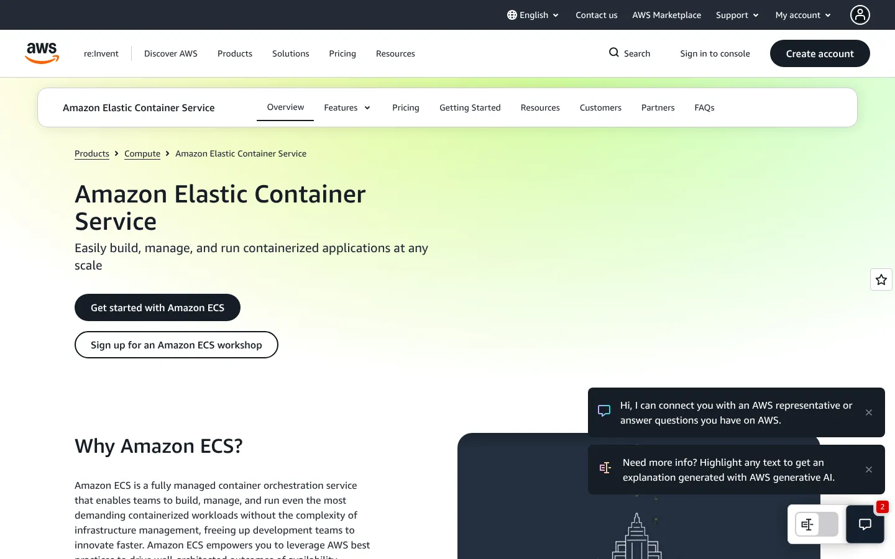
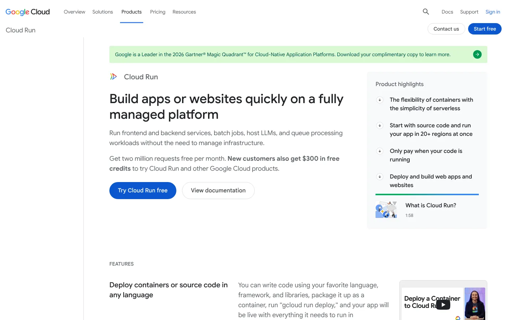
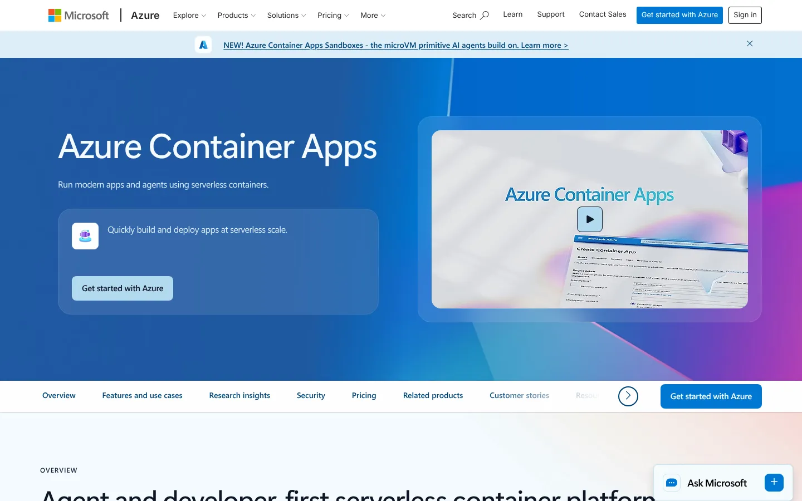
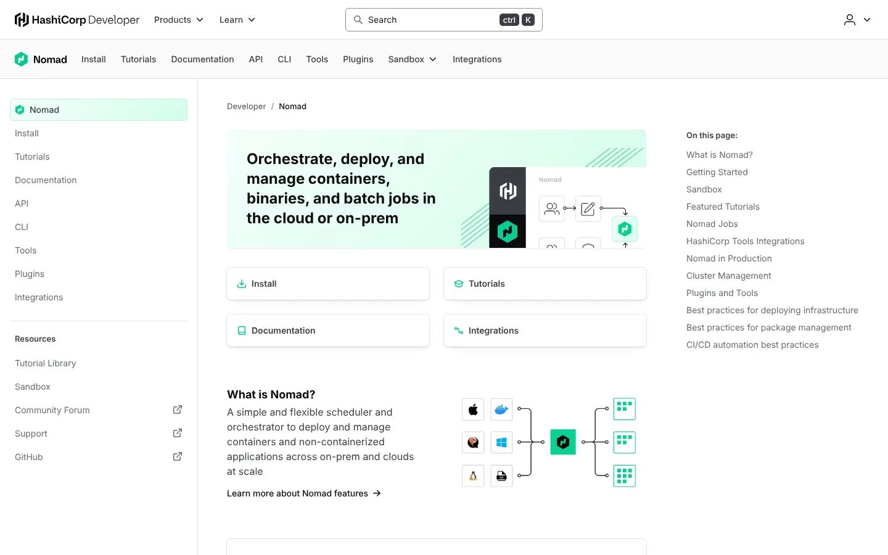
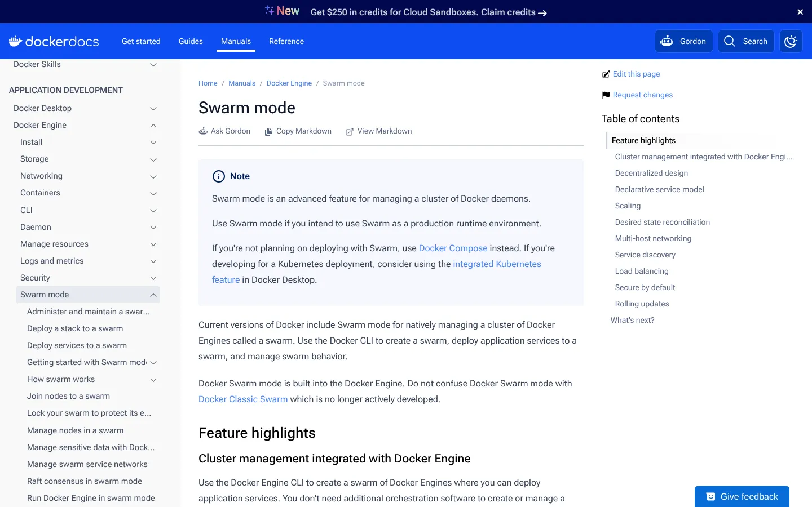
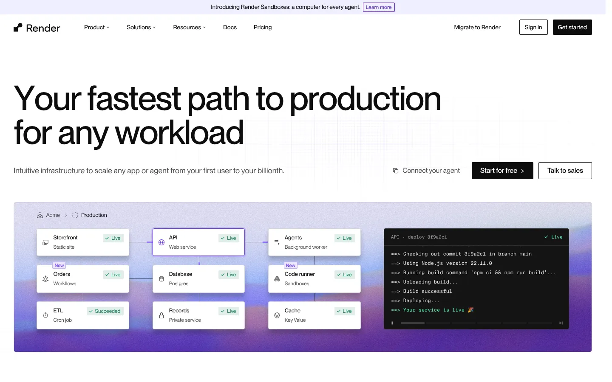
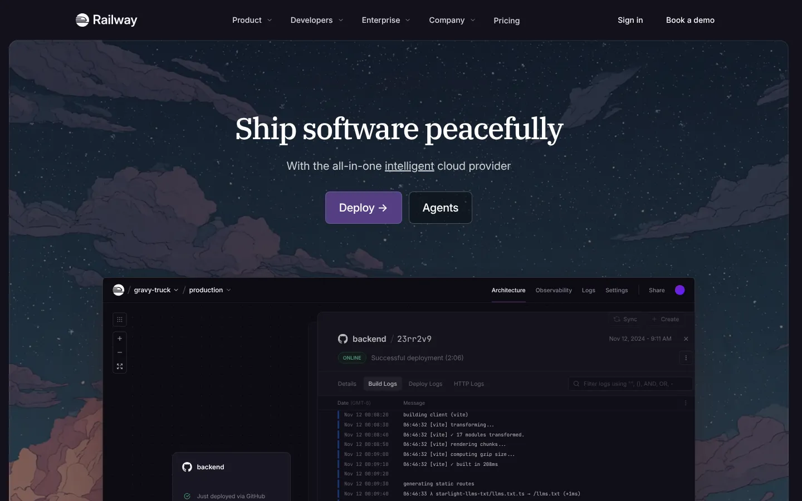
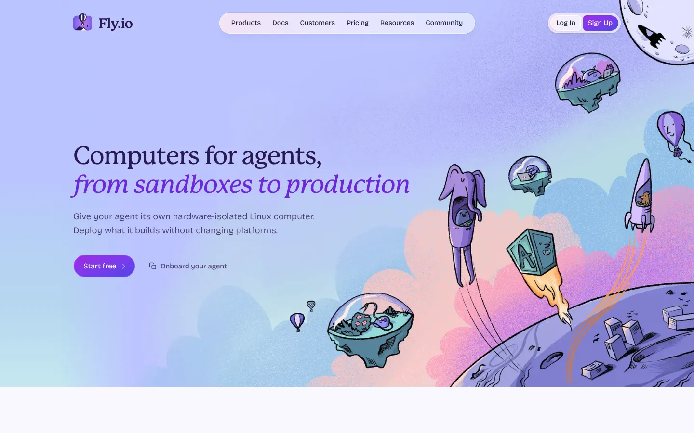

# 8 Kubernetes Alternatives to Consider in 2026, Plus What to Watch in 2027

**Search intent:** Commercial investigation and technical comparison

Kubernetes remains the default orchestration layer for many complex container platforms. It is not the default answer for every team.

AWS ECS is the clearest alternative for an AWS-centered organization. Google Cloud Run and Azure Container Apps suit stateless services that need less infrastructure management. HashiCorp Nomad fits teams that want a scheduler across containers and other workloads. Render, Railway, and Fly.io trade control for a smaller operating burden. Docker Swarm remains simple, but its smaller ecosystem narrows the long-term case.

## Key Takeaways

- **Amazon ECS, Google Cloud Run, and Azure Container Apps remove cluster management** for teams on one cloud.
- **HashiCorp Nomad runs containers, binaries, and batch jobs** with a smaller operating footprint than Kubernetes.
- **Docker Swarm covers basic orchestration** with familiar Docker concepts but sees little new development.
- **Render, Railway, and Fly.io trade control for speed** on managed application platforms.
- **Score each option on networking, state, cost, and exit path** before you migrate.

## The Short List

| Alternative | Best for | What you give up versus Kubernetes |
| --- | --- | --- |
| AWS ECS | AWS-native container workloads | Portability and the Kubernetes ecosystem |
| Google Cloud Run | Stateless HTTP services and jobs | Low-level cluster control |
| Azure Container Apps | Azure teams running services and jobs | Some Kubernetes-level customization |
| HashiCorp Nomad | Mixed workloads and a simpler scheduler | A smaller extension ecosystem |
| Docker Swarm | Small teams needing basic orchestration | Ecosystem depth and market momentum |
| Render | Product teams wanting a managed platform | Infrastructure control |
| Railway | Rapid application deployment | Enterprise governance depth |
| Fly.io | Globally distributed applications | Familiar hyperscaler operating model |

The right comparison is not a feature contest. It is a choice about who owns scheduling, networking, scaling, upgrades, observability, security policy, and incident response.

## Kubernetes Is Mature, but Maturity Has a Cost

The [CNCF Annual Cloud Native Survey](https://www.cncf.io/reports/the-cncf-annual-cloud-native-survey/) reported that 82% of container users were running Kubernetes in production, up from 66% in 2023. The 2025 end-user sample for that question was 351 respondents. This is strong evidence that Kubernetes is established within the container ecosystem. It does not show that 82% of all companies use it.

Kubernetes earns its place when an organization needs a portable control plane, complex deployment patterns, extensible policy, a large add-on ecosystem, and shared infrastructure across many teams. The same design brings API, security, networking, storage, upgrade, and reliability work. A small team running five web services may gain little from owning that platform.

Before migrating, identify the burden you want to remove. If the problem is cluster upgrades, managed Kubernetes may be enough. If the problem is the entire orchestration model, one of the alternatives below may fit better.

## 1. AWS ECS: Best for Teams Committed to AWS

Amazon Elastic Container Service schedules containers against EC2 capacity or AWS Fargate. It integrates with AWS identity, networking, load balancing, logging, and deployment services without adding the Kubernetes API.

ECS is compelling when the application already depends on AWS and portability is not a primary requirement. The team still needs to design task definitions, networking, IAM, scaling, deployment safety, and observability.

[AWS states](https://aws.amazon.com/ecs/pricing/) that ECS itself has no additional charge for the EC2 launch type. With Fargate, customers pay for requested vCPU, memory, operating system, architecture, and storage while tasks run, subject to its billing rules. Model idle capacity, data transfer, load balancers, logs, and support as well as compute.

**Choose ECS if:** AWS integration is more valuable than Kubernetes compatibility.

## 2. Google Cloud Run: Best for Stateless Services and Jobs

Cloud Run deploys containers without exposing a cluster. It suits HTTP services, event-driven applications, APIs, and jobs that can work within the platform's execution model.

Its strongest benefit is a small operational surface. Teams can ship containers and rely on the service for scheduling and autoscaling. The tradeoff is less control over the underlying environment, networking patterns, and platform behavior than a Kubernetes cluster provides.

Cloud Run pricing is resource and request based, with free allowances and regional rates. Review minimum instances and concurrency carefully. A latency-sensitive service that keeps instances warm has a different cost curve from a bursty service that scales down.

**Choose Cloud Run if:** you want a container interface without running a container platform.

## 3. Azure Container Apps: Best for Azure Application Teams

Azure Container Apps runs containerized applications and jobs on a managed environment. It supports revisions, autoscaling, service communication, and event-driven patterns while hiding most Kubernetes operations.

It is a practical alternative for teams already using Azure identity, networking, monitoring, and developer services. Confirm networking, private endpoint, region, GPU, and compliance needs before standardizing.

**Choose Azure Container Apps if:** the application belongs in Azure and the team wants application-level controls instead of cluster ownership.

## 4. HashiCorp Nomad: Best for Mixed Workloads

Nomad is a scheduler for containers, binaries, Java applications, virtual machines through integrations, and batch jobs. Its architecture is smaller than a typical Kubernetes stack. It often appears beside Consul and Vault when teams need service networking and secrets.

The simpler core is attractive, but simplicity does not remove platform work. Teams must still design networking, secrets, storage, observability, upgrades, and a deployment workflow. The community and vendor ecosystem are also smaller than Kubernetes.

**Choose Nomad if:** mixed workload scheduling and a compact control plane outweigh the value of Kubernetes APIs and operators.

## 5. Docker Swarm: Best for Basic Orchestration with Familiar Docker Concepts

Docker Swarm offers services, desired state, overlay networking, rolling updates, and secrets through concepts familiar to Docker users. It can be enough for a small, stable environment.

The concern is strategic rather than functional. Swarm has a much smaller ecosystem and mindshare than Kubernetes. Recruiting, integrations, training, and third-party guidance may become harder as the platform grows.

**Choose Docker Swarm if:** the environment is modest, the team already understands it, and the organization accepts the ecosystem tradeoff.

## 6. Render: Best for Product Teams That Want a Managed Application Platform

Render provides managed web services, background workers, cron jobs, databases, private networking, and deployment workflows. It removes much of the cluster and infrastructure work from a product team.

That makes it useful for a startup or internal product group that values delivery speed over infrastructure customization. Review region coverage, private connectivity, compliance, database requirements, and exit paths before committing a critical estate.

**Choose Render if:** a managed platform can meet the workload's constraints and your team wants to spend less time on infrastructure.

## 7. Railway: Best for Prototypes and Small Production Services

Railway emphasizes quick deployment and a simple developer experience. It can connect services, environment variables, builds, and databases with relatively little setup.

The platform works best when the application fits its opinionated model. Cost controls, networking, auditability, support, and production governance deserve close review as usage grows.

**Choose Railway if:** the first requirement is getting a small application running quickly.

## 8. Fly.io: Best for Applications Placed Near Users

Fly.io runs applications in lightweight virtual machines across regions. It appeals to teams that want to place compute close to users without assembling a Kubernetes platform.

Multi-region design still requires engineering. Data consistency, failover, volumes, secrets, observability, and traffic steering do not disappear. Fly.io changes the primitives; it does not make distributed systems simple.

**Choose Fly.io if:** geographic placement is central and the team is comfortable with its deployment and networking model.

## Alternatives That Did Not Make the Main List

Managed Kubernetes services such as EKS, GKE, and AKS reduce control-plane work but remain Kubernetes. They are useful when the problem is operating the control plane, not the API or ecosystem.

OpenShift is also Kubernetes-based. It adds an opinionated enterprise platform, security controls, operators, and developer workflows. It belongs in a Kubernetes platform comparison rather than a list of replacements.

Serverless functions solve narrower event-driven jobs. They can replace a service or task, but rarely substitute for an application platform by themselves.

## A Migration Scorecard

Score the current and proposed platforms across five areas:

1. **Workload fit:** protocols, state, jobs, GPUs, startup time, and scaling behavior.
2. **Operational load:** upgrades, on-call ownership, networking, security, and observability.
3. **Portability:** container compatibility is not the same as platform portability.
4. **Governance:** identity, policy, audit logs, secrets, and environment separation.
5. **Economics:** compute, idle capacity, data transfer, platform labor, support, and migration.

Our [cloud infrastructure coverage](/cloud-infrastructure/) provides more context for platform operations. Teams designing monitoring should also review the [network monitoring tools comparison](/cloud-infrastructure/network-monitoring-tools/) before treating built-in metrics as a complete observability plan.

Run a representative service through deployment, rollback, autoscaling, an infrastructure failure, and an on-call investigation. A ten-minute demo does not expose the operational boundary.

## What Changed in 2026

Kubernetes adoption continued to deepen among container users, while managed application platforms kept expanding their supported workloads. The decision has become less ideological. Teams can choose a control plane, a cloud-native scheduler, or a higher-level platform for each application class.

AI workloads also put new pressure on scheduling, accelerators, model serving, and data movement. Kubernetes has a broad ecosystem here, but a managed service can still win when it supplies the required hardware and runtime with less platform work.

## What to Watch in 2027

These are selection themes rather than product promises:

- GPU availability, quotas, scheduling, and price transparency
- Workload identity that works across build, deploy, and runtime stages
- OpenTelemetry support without extensive custom integration
- Scale-to-zero behavior for services and background jobs
- Exit paths for configuration, data, secrets, and deployment definitions
- The boundary between platform automation and application ownership

Avoid buying against an unconfirmed roadmap. Base a 2027 architecture on capabilities a vendor documents and supports today, then record future needs as contract and review checkpoints.

Container platforms sit inside a wider cloud plan. Stack Row's [cloud computing statistics](/cloud-infrastructure/cloud-computing-statistics/) show how deployment models are shifting, and the guide to [Docker alternatives](/cloud-infrastructure/docker-alternatives/) covers the local build and runtime layer. Teams weighing rootless containers can read [Podman vs Docker](/developer-data/podman-vs-docker/).

## Frequently Asked Questions

### What Is the Easiest Alternative to Kubernetes?

Cloud Run, Azure Container Apps, Render, and Railway remove more infrastructure work than a scheduler such as ECS or Nomad. The easiest option is the one whose limits fit the application without custom workarounds.

### Is ECS Cheaper Than Kubernetes?

There is no universal answer. Compare compute, idle capacity, load balancers, logging, support, and platform engineering time under the same workload. Kubernetes software may be open source while the operated platform still carries substantial labor and infrastructure cost.

### Should a Startup Use Kubernetes?

A startup should use Kubernetes when its workload or customer requirements justify the operational investment. For a small set of conventional services, a managed container or application platform often lets the team ship sooner with fewer components.

## Resources

- [CNCF Annual Cloud Native Survey](https://www.cncf.io/reports/the-cncf-annual-cloud-native-survey/)
- [AWS ECS pricing](https://aws.amazon.com/ecs/pricing/)
- [Google Cloud Run pricing](https://cloud.google.com/run/pricing)
- [Azure Container Apps overview](https://learn.microsoft.com/azure/container-apps/overview)
- [Nomad documentation](https://developer.hashicorp.com/nomad/docs)
