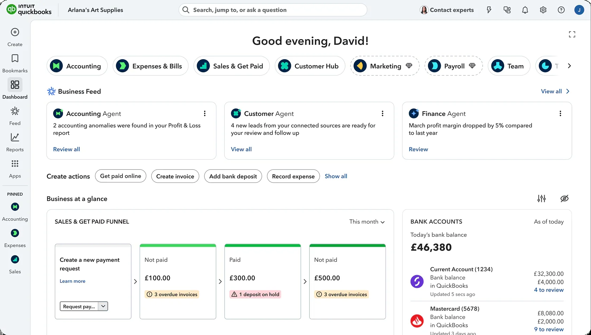
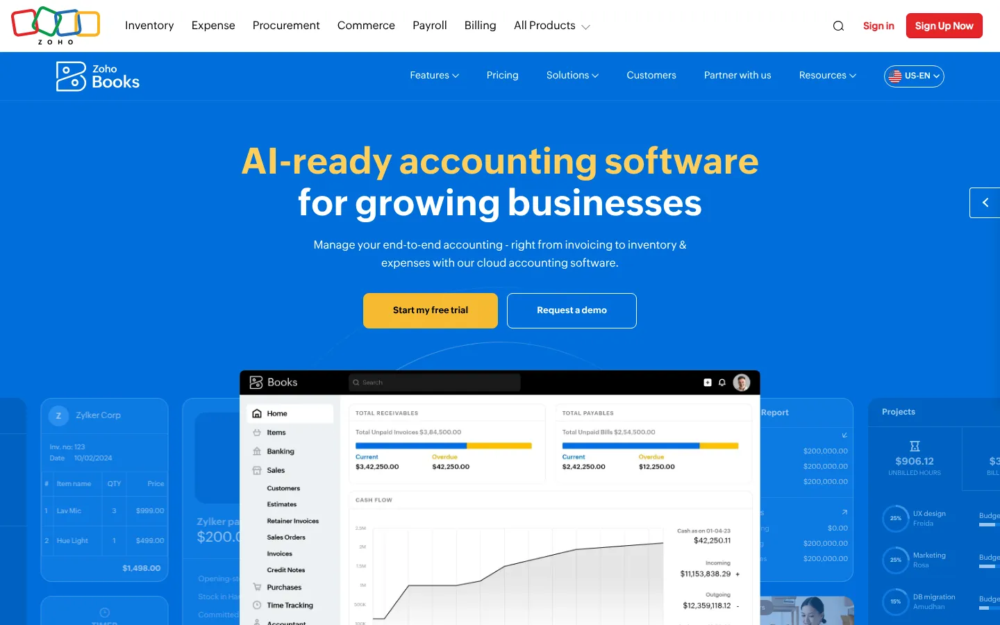
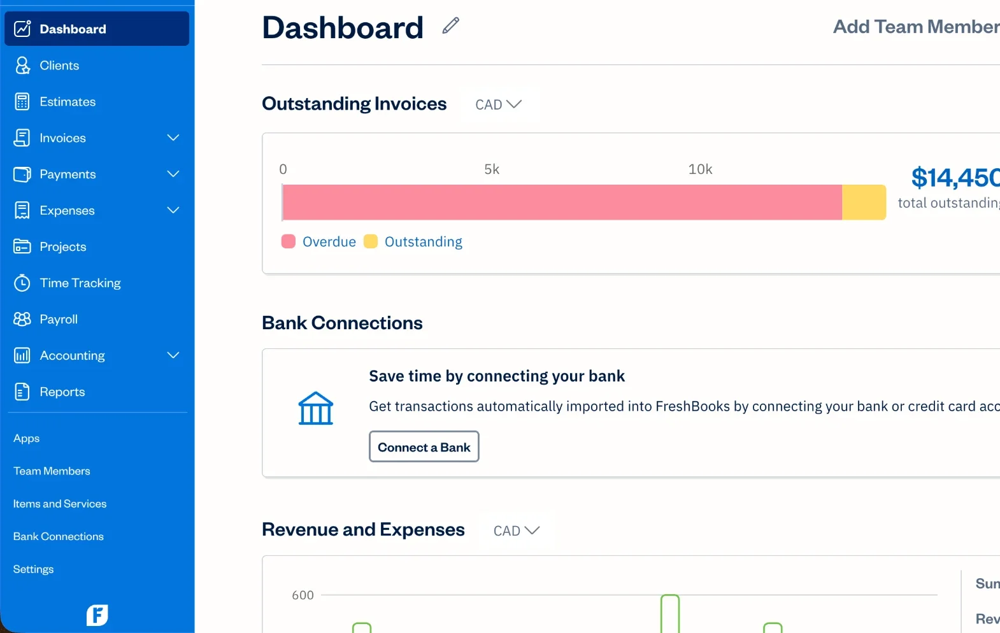
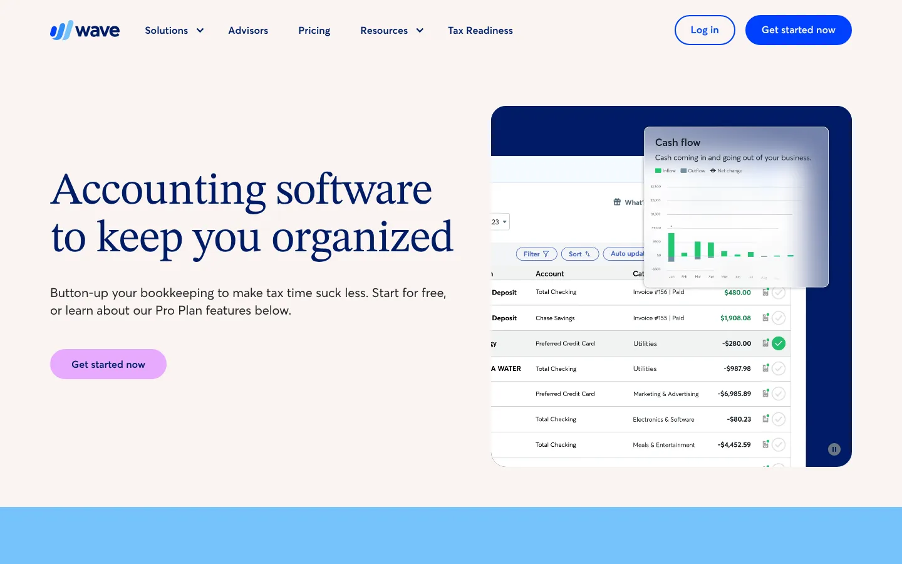
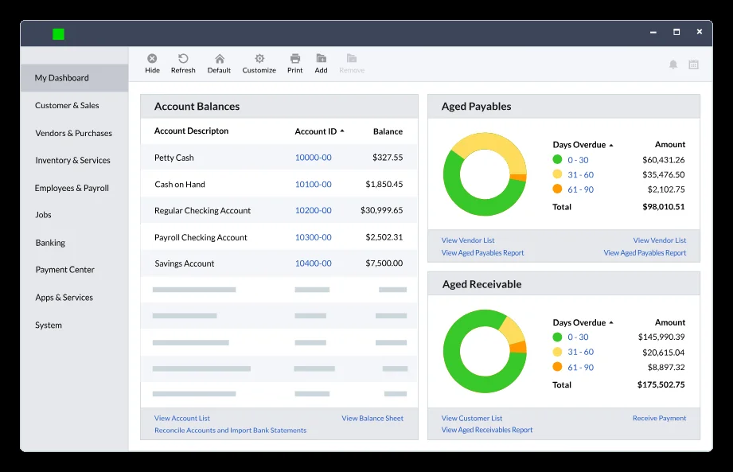
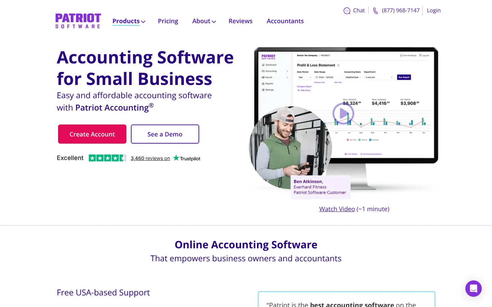
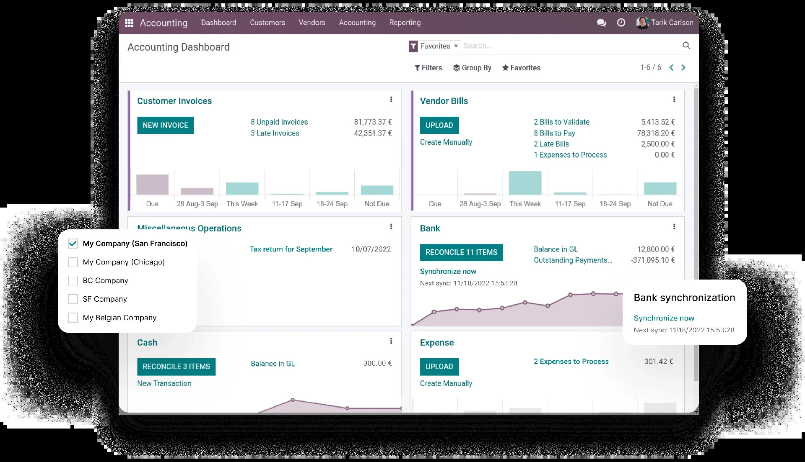
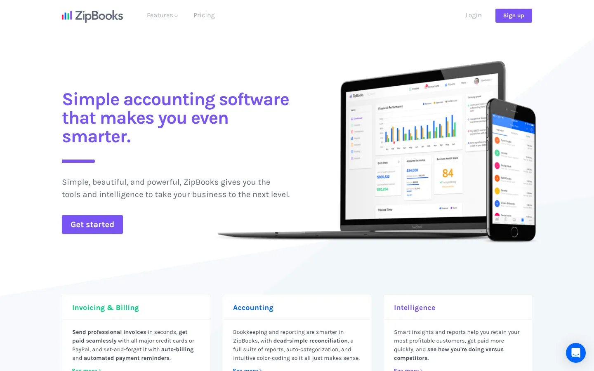
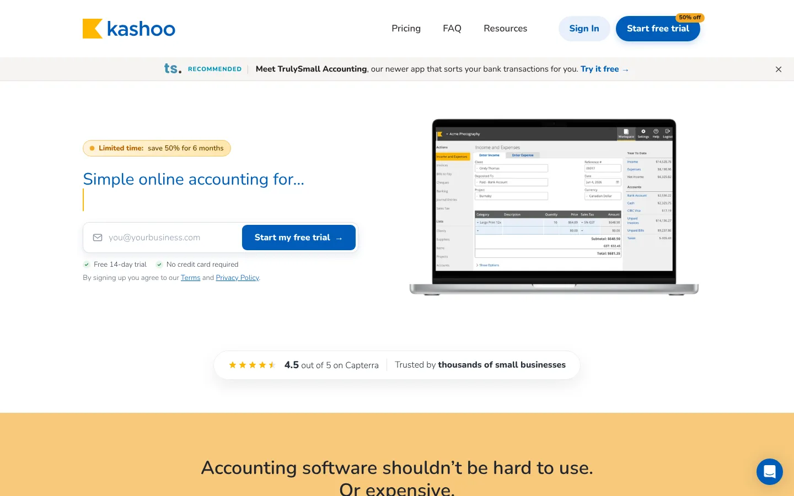

# 10 Best Accounting Software Platforms for Small Businesses in 2026

**Search intent:** Commercial investigation

QuickBooks Online is the safest general recommendation for a US small business that wants broad accountant support, payroll connections, and a large app ecosystem. Xero is stronger for unlimited-user collaboration and businesses that value a clean accounting workflow. Zoho Books offers unusually broad capability for its price. FreshBooks is easier for service businesses that lead with invoicing and time. Wave suits a very small operation with simple books.

The best product is the one that produces reliable books with the least rework. Start with tax jurisdiction, entity structure, inventory, projects, payroll, user access, and accountant preference. Price comes after those constraints.

## Key Takeaways

- **QuickBooks Online is the default for most US small businesses** because accountants and apps support it widely.
- **Xero suits teams that collaborate with an outside accountant.**
- **Zoho Books gives strong value inside the wider Zoho suite.**
- **FreshBooks fits service businesses that bill by project or hour, and Wave covers very simple books.**
- **Run a trial with your real bank feeds and a month of transactions** before you commit.

## The Short List

| Platform | Best for | Notable constraint |
| --- | --- | --- |
| QuickBooks Online | Broad US small-business use | Plan and add-on costs can rise |
| Xero | Collaboration and growing teams | Entry plan limits need review |
| Zoho Books | Value and workflow automation | Best fit improves inside the Zoho suite |
| FreshBooks | Freelancers and service firms | Client and team limits vary by plan |
| Wave | Microbusinesses with simple books | Less depth for complex operations |
| Sage Accounting | Established small businesses | Product lineup can be harder to compare |
| Patriot Accounting | US payroll-led small businesses | Narrower ecosystem |
| Odoo Accounting | Businesses wanting a modular ERP | Configuration and implementation effort |
| ZipBooks | Simple bookkeeping and invoicing | Smaller product ecosystem |
| Kashoo | Very small service businesses | Limited fit for complex inventory or groups |

## Why the Decision Is Still Difficult

Many businesses have not reached a single, dependable finance system. Intuit's July 2026 [Small Business Insights survey](https://quickbooks.intuit.com/r/small-business-data/small-business-insights/) covers about 5,000 small and midsize businesses in the US, Canada, UK, and Australia. It found that 53% used spreadsheets for financial management and 31% used pen and paper. More than a quarter used at least six digital systems, while 36% reported integration problems.

Those figures explain why a cheap subscription can become expensive. Duplicate entry, broken feeds, unreconciled transactions, and inconsistent categories consume staff and accountant time. A proper trial should follow a transaction from quote or sale through payment, bank reconciliation, tax treatment, reporting, and year-end access.

## 1. QuickBooks Online: Best Overall for US Small Businesses

QuickBooks Online covers invoicing, expenses, bank feeds, reporting, sales tax, projects, bills, and other functions depending on the plan. Its large accountant and integration ecosystem reduces the risk of choosing a system that no adviser knows.

The weaknesses are familiar. Plans, payroll, payments, users, and connected apps can raise the total. Businesses should also test inventory and project-costing depth rather than infer it from a checklist.

**Choose QuickBooks Online if:** US accountant availability and ecosystem breadth are top requirements.

## 2. Xero: Best for Collaboration

Xero supports unlimited users on its US plans, which is useful when an owner, bookkeeper, accountant, and department leads need different access. Its bank reconciliation, invoicing, bills, reporting, and app ecosystem cover common small-business workflows.

Current full US list prices are $27 for Early, $59 for Growing, and $97 for Established per month, before temporary promotions. The Early plan limits invoices and bills. [Xero's pricing page](https://www.xero.com/us/pricing-plans/) should be checked for the exact limits and add-ons at purchase.

**Choose Xero if:** several people need access and the company wants a strong accounting core without per-user license fees.

## 3. Zoho Books: Best Value for an Integrated Business Suite

Zoho Books combines invoicing, expenses, bank reconciliation, bills, reporting, and automation. Higher plans add inventory, purchase orders, approvals, custom roles, and other controls. It becomes more attractive when the business already uses Zoho CRM, Expense, Inventory, or other Zoho applications.

Zoho currently offers a free US plan for a small qualifying setup. Standard starts at $15 per organization per month when billed annually, and Professional at $40. [Zoho lists](https://www.zoho.com/us/books/pricing/) the included users, accountants, transaction functions, and support for each plan.

**Choose Zoho Books if:** value and connected sales, finance, or operations workflows outweigh the comfort of the largest accountant ecosystem.

## 4. FreshBooks: Best for Service Businesses

FreshBooks starts with the work a consultant, creative firm, or contractor sees every day: estimates, proposals, retainers, time, expenses, invoices, and client payments. The interface is easier to approach than many traditional accounting systems.

Its plans use client limits and charge for extra team members. The regular monthly prices shown in November 2026 are $23 for Lite, $43 for Plus, and $70 for Premium, although promotions may reduce the introductory price. FreshBooks publishes add-on charges separately.

**Choose FreshBooks if:** billable work and client invoicing lead the process.

## 5. Wave: Best for a Simple Microbusiness

Wave offers invoicing and accounting for very small businesses, with paid services and plans around the core product. It can work for a sole proprietor or a young service business with straightforward income and expenses.

The fit weakens when the company needs detailed inventory, entities, departments, approvals, or complex project accounting. Free software still requires disciplined reconciliation and review.

**Choose Wave if:** the books are simple and the business can confirm that its banking, payment, and support needs are covered.

## 6. Sage Accounting: Best for an Established Business That Prefers Sage

Sage has a long accounting history and a wider portfolio that reaches beyond entry-level cloud bookkeeping. Sage Accounting can suit a small business whose accountant or finance team already knows the ecosystem.

Clarify the exact Sage product under evaluation. Similar names may serve different countries and business sizes. Confirm inventory, payroll, project, reporting, user, and migration requirements against that product and region.

**Choose Sage if:** adviser experience or a path into the broader Sage portfolio carries weight.

## 7. Patriot Accounting: Best for a US Payroll-led Setup

Patriot offers accounting and payroll services for US small businesses. The appeal is a focused product and a direct path between books and payroll.

It has a narrower integration ecosystem than QuickBooks or Xero. Check banking, payments, time, benefits, tax filings, and accountant workflows as a full sequence.

**Choose Patriot if:** US payroll and basic accounting need to work together without a broad software stack.

## 8. Odoo Accounting: Best for a Modular ERP Path

Odoo links accounting with sales, inventory, purchasing, manufacturing, expenses, CRM, and other business applications. It can become a unified operating system for a company that has outgrown separate small-business apps.

That flexibility creates implementation work. Chart of accounts, taxes, products, permissions, approvals, data migration, and custom processes need ownership. Odoo is not a shortcut around process design.

**Choose Odoo if:** the business needs connected operations and can support configuration, testing, and training.

## 9. ZipBooks: Best for Basic Bookkeeping with a Clean Interface

ZipBooks provides invoicing, expense tracking, financial reporting, and bookkeeping options for small organizations. It can fit a freelancer or microbusiness that finds a larger platform excessive.

Test bank connectivity, reports, accountant access, exports, and support before moving live. A smaller ecosystem increases the importance of each required connection.

**Choose ZipBooks if:** the requirements are modest and its focused workflow covers them fully.

## 10. Kashoo: Best for a Small Service Company with Uncomplicated Books

Kashoo focuses on approachable online accounting for small businesses. It covers common income, expense, invoicing, reconciliation, and reporting work.

It is not the strongest choice for complex inventory, manufacturing, consolidated entities, or a large app stack. That narrower scope can still be an advantage for a business that wants fewer controls to learn.

**Choose Kashoo if:** ease of use ranks above ecosystem breadth.

## How to Run a Useful Accounting Software Trial

Create a test company and enter a realistic month. Include an invoice, partial payment, refund, vendor bill, owner expense, bank fee, sales tax transaction, and month-end adjustment. Reconcile the bank account. Then ask the accountant to review the audit trail and reports.

Check these points before approving a purchase:

- Cash and accrual reporting
- Chart-of-accounts control
- Bank-feed quality and reconciliation rules
- Sales tax and 1099 workflows where relevant
- Inventory, projects, classes, or departments
- User roles, approvals, and audit history
- Data exports and accountant access
- Payroll and payment costs
- Migration and year-end support

Our [business technology section](/business-technology/) covers the systems surrounding finance. A subscription business can also use the [ARR and MRR calculator](/tools/arr-mrr-calculator/) to test recurring-revenue scenarios, while keeping the accounting platform as the source of recorded results.

## What to Watch in 2027

Vendors are adding automated categorization, document capture, forecasting, and conversational reporting. Buyers should ask how a system cites the underlying transactions, records corrections, and preserves approval controls.

The most valuable automation will handle routine work while making exceptions easier to see. An answer that cannot be traced back to a ledger entry is not ready for a financial decision.

Also watch for clearer connections among accounting, payroll, banking, commerce, and tax. Integration remains a reported obstacle. A longer feature list will not fix unreliable data movement.

Accounting software is usually the first system a growing business outgrows. Stack Row's [B2B technology statistics](/business-technology/b2b-tech-statistics/) cover how small firms buy software, and the explainer on [what ERP is](/business-technology/what-is-erp/) shows when a business needs more. Industry tools can also replace parts of the ledger, as the guides to [restaurant management software](/business-technology/best-restaurant-management-software/) and [legal practice management software](/business-technology/best-legal-practice-management-software/) show.

## Frequently Asked Questions

### What Is the Easiest Accounting Software for a Small Business?

FreshBooks and Wave are approachable for simple service businesses. QuickBooks Online, Xero, and Zoho Books require more setup but support a wider range of accounting work. Ease should be tested through reconciliation and month-end, not judged from the invoice screen.

### Is Free Accounting Software Enough?

It can be enough for a microbusiness with simple transactions and reporting. Check bank connections, support, payment fees, exports, tax workflows, and future limits before committing. Migration later has a cost.

### Should My Accountant Choose the Software?

Your accountant should help define requirements and test the books, but the business also needs to assess daily workflows and integrations. The final choice should work for both operators and financial reviewers.

## Resources

- [Intuit QuickBooks Small Business Insights](https://quickbooks.intuit.com/r/small-business-data/small-business-insights/)
- [Xero US pricing](https://www.xero.com/us/pricing-plans/)
- [Zoho Books pricing](https://www.zoho.com/us/books/pricing/)
- [FreshBooks pricing](https://www.freshbooks.com/pricing)
