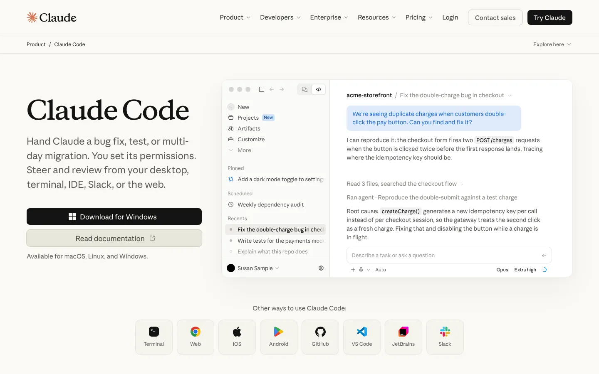
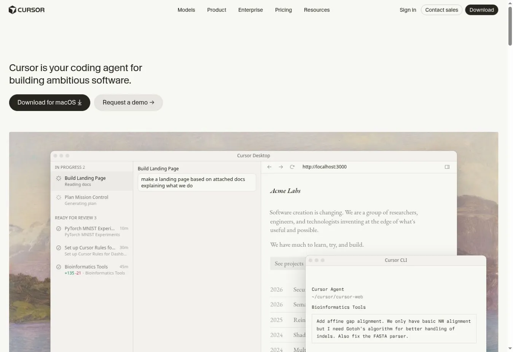
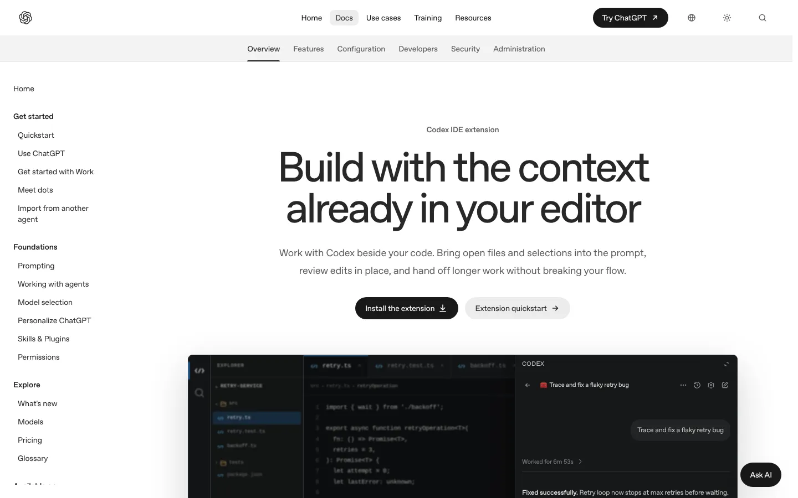
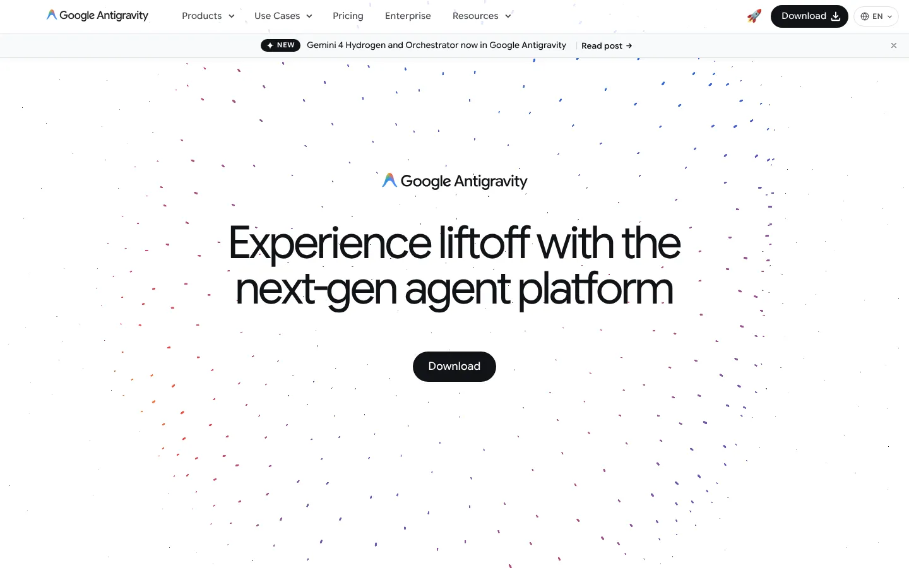
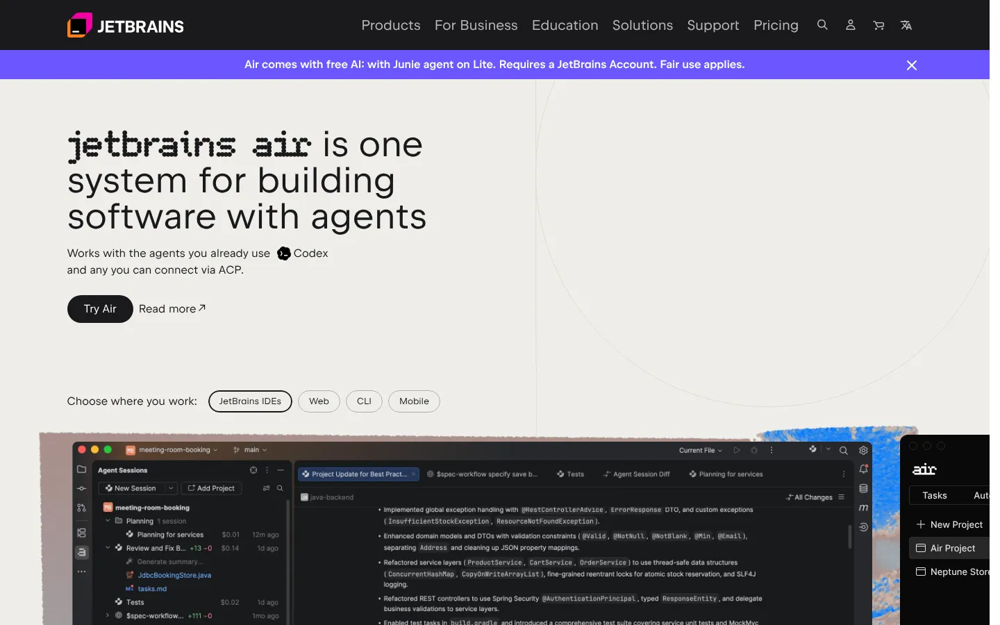
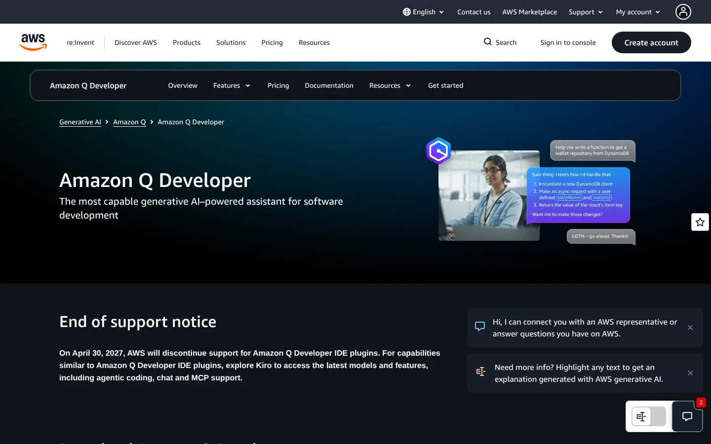
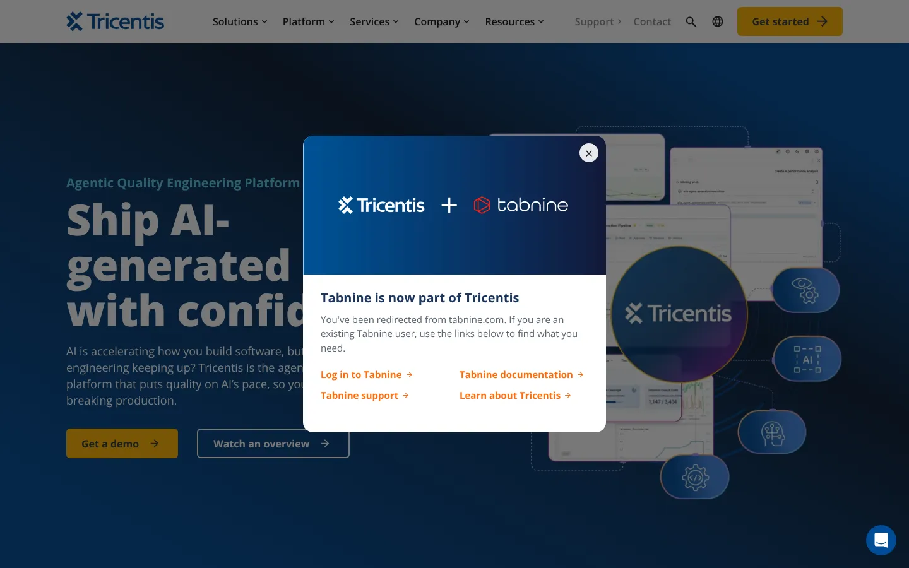
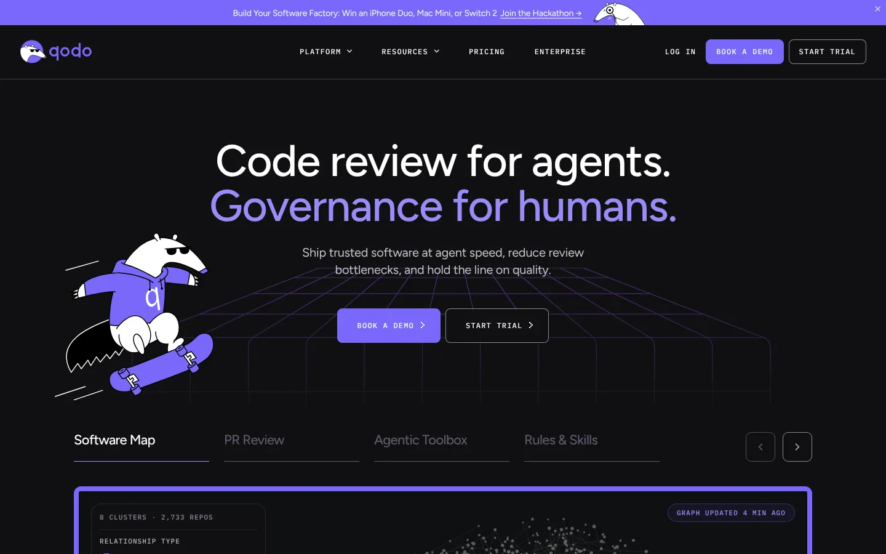

# 9 GitHub Copilot Alternatives for 2026: Coding Assistants and Agents Compared

**Search intent:** Commercial investigation

Claude Code is the strongest GitHub Copilot alternative for developers who want an agent in the terminal. Cursor is the clearest choice for an AI-first editor. OpenAI Codex suits teams that want delegated coding work across local and cloud workflows. JetBrains AI is the natural shortlist for JetBrains IDE users. Amazon Q Developer fits AWS-heavy teams, while Tabnine and Continue deserve attention when deployment or model control carries more weight.

These tools overlap, but they are not interchangeable. Some complete code in the editor. Some search a repository and propose changes. Some run commands, tests, or multi-file tasks with greater autonomy. Compare the workflow you need, not the word "AI" on the product page.

## Key Takeaways

- **Claude Code is the strongest terminal-based alternative** for developers who want an agent that runs commands and edits files.
- **Cursor is the clearest AI-first editor,** and OpenAI Codex suits delegated work across local and cloud tasks.
- **JetBrains AI keeps JetBrains users in their IDE.**
- **Three vendors changed hands or plans in 2026.** Tabnine joined Tricentis, Continue joined Cursor, and AWS ends Amazon Q Developer IDE plugin support on April 30, 2027.
- **Test assistants on your own repositories** with the same tasks and review rules.

## The Short List

| Alternative | Best for | Primary interface |
| --- | --- | --- |
| Claude Code | Terminal-based agentic work | CLI and integrations |
| Cursor | AI-first editor | VS Code-based desktop editor |
| OpenAI Codex | Delegated coding tasks | CLI, IDE, cloud, and app workflows |
| Google Antigravity | Google-centered agentic development | Agent-first development platform |
| JetBrains AI | JetBrains IDE users | IDE-native assistant and agents |
| Amazon Q Developer | AWS development | IDE, CLI, and AWS workflows |
| Tabnine | Enterprise control | IDE integrations |
| Continue | Open-source customization | IDE extension and CLI ecosystem |
| Qodo | Code review and test workflows | IDE and pull-request workflows |

## Adoption Is Broad, but the Category Is Still Moving

The [2026 Stack Overflow Developer Survey](https://survey.stackoverflow.co/2026/ai/data/ai-code-agent) provides a useful snapshot. Among 12,255 respondents answering its coding-agent question, 65.5% had used Claude Code, 58.7% GitHub Copilot, 29.5% OpenAI Codex, and 25.5% Cursor during the prior year. The percentages are multi-select and describe survey respondents, not global market share.

JetBrains' 2026 developer ecosystem research also found widespread workplace adoption and continued experimentation. Tool use varies by experience, environment, and task. This is a reason to run a controlled evaluation rather than standardize from a popularity chart.

## 1. Claude Code: Best Terminal-based Alternative

Claude Code works from the terminal and can inspect a codebase, edit files, run commands, and work through multi-step tasks. It fits developers who prefer shell and repository workflows over an AI-specific editor.

Its strength is context-rich task execution. The risk is the same: an agent with broad context and tool access can make broad changes. Teams need permission boundaries, review practices, secret hygiene, and tests.

**Choose Claude Code if:** senior developers want an agent that works close to their existing command-line workflow.

## 2. Cursor: Best AI-first Editor

Cursor packages chat, completion, repository context, multi-file editing, and agent functions in a VS Code-derived editor. It feels cohesive because AI is part of the primary interface rather than an extension added later.

Moving editors has consequences. Check extension compatibility, settings migration, remote development, security policy, model options, data controls, and administrative features. Do not assume VS Code familiarity makes every workflow identical.

**Choose Cursor if:** the team will adopt a dedicated AI editor and values an integrated experience.

## 3. OpenAI Codex: Best for Delegated Coding Work

Codex supports coding tasks across command-line, IDE, app, and cloud contexts. It can inspect repositories, change files, run tests, and handle work that extends beyond inline completion.

The useful comparison is task throughput with review, not the number of generated lines. Give the tool bounded issues with acceptance criteria. Measure successful tests, review time, regressions, and how often a developer must restart the task.

**Choose Codex if:** the team wants to delegate defined engineering work while retaining repository review and test gates.

## 4. Google Antigravity: Best for Teams Evaluating Google's Agent Platform

Google Antigravity is the strategic Google option to evaluate as the company changes its developer-assistance lineup. [Google has ended new sales](https://docs.cloud.google.com/gemini/docs/codeassist/sunset) of Gemini Code Assist Standard and Enterprise from October 9, 2026, with renewals ending on plan-specific dates in 2027. Existing buyers should review Google's transition information rather than plan around a product that is leaving commercial sale.

Antigravity should be tested for language support, IDE or workflow fit, Google Cloud integration, enterprise administration, and migration from current tools.

**Choose Antigravity if:** the team wants Google's current agent direction and can validate the new operating model.

## 5. JetBrains AI: Best for JetBrains IDE Users

JetBrains AI brings assistance into IntelliJ IDEA, PyCharm, WebStorm, and other JetBrains environments. In November 2026, JetBrains also promoted Air, a system for building software with agents that works with Junie, Codex, and other agents. Its main advantage is proximity to the code intelligence and workflows developers already use.

Evaluate it across the exact IDEs, languages, and project types in your estate. An excellent Java experience does not prove equal performance in a data, mobile, or infrastructure repository.

**Choose JetBrains AI if:** developers rely on JetBrains IDEs and want to avoid moving their primary environment.

## 6. Amazon Q Developer: Best for AWS-heavy Engineering

Amazon Q Developer combines coding assistance with AWS-oriented development and operations knowledge. It is useful when the team writes application code and also works with AWS services, infrastructure, logs, and command-line tools.

Amazon publishes a free tier and a Pro tier at $19 per user per month. Confirm included quotas and enterprise identity requirements on the current [Amazon Q Developer pricing page](https://aws.amazon.com/q/developer/pricing/).

There is a major caveat. AWS has posted an end of support notice: on April 30, 2027, it will stop supporting the Amazon Q Developer IDE plugins and points users to Kiro instead. New buyers should evaluate Kiro alongside Amazon Q, or plan for that move.

**Choose Amazon Q Developer if:** AWS context forms a large part of daily engineering work and you have a plan for the April 2027 IDE plugin change.

## 7. Tabnine: Best for Enterprise Deployment Control

Tabnine is now part of Tricentis, and tabnine.com redirects to the Tricentis site. It still emphasizes enterprise controls, code privacy, and deployment choices alongside code assistance. It belongs on the shortlist for organizations that have strict requirements around source code, model access, or infrastructure.

Security claims need precise review. Ask what data leaves the environment, what is retained, which models run where, how administrators enforce policy, and what audit evidence is available.

**Choose Tabnine if:** deployment architecture and organizational controls are stronger filters than having the newest agent interface.

## 8. Continue: Best Open-source Framework for Customization

Continue provides an open-source route to AI assistance across IDE and command-line workflows. Teams can connect models and shape prompts, context sources, rules, and internal tooling.

Continue's own site now says the company was acquired by Cursor. The open-source codebase remains available, but buyers should treat future development and support as uncertain and check the FAQ on what happens to existing data.

That flexibility transfers work to the adopter. Someone must maintain configurations, model access, evaluations, upgrades, and support. Open source does not make inference or operations free.

**Choose Continue if:** the team wants control, accepts the open-source code as it stands, and has the engineering capacity to own the integration.

## 9. Qodo: Best for Code Quality and Review Workflows

Qodo focuses on code generation, tests, review, and pull-request quality. It is a useful alternative for teams that want AI concentrated around validation and review rather than a general editor replacement.

Trial it on the repositories where review is slow or test coverage is weak. Measure useful findings and accepted suggestions. A large comment count is not a quality metric.

**Choose Qodo if:** pull-request review and test generation are the primary bottlenecks.

## How to Test Coding Assistants Without Relying on Anecdotes

Build a small evaluation set from completed work. Include a bug with a known cause, a modest feature, a refactor, a test task, and a documentation change. Remove sensitive data and preserve the expected result.

Score each tool on:

- Time to a reviewable change
- Tests passed without weakening assertions
- Reviewer corrections
- Security or dependency problems introduced
- Quality of explanation
- Repository setup effort
- Cost under realistic usage
- Administrative and data controls

Use the same starting commit and acceptance criteria. A developer should review every result. Our [AI coverage](/ai/) tracks the wider tool category, and the [AI token cost calculator](/tools/ai-token-calculator/) can help model API-based experiments when usage is billed by tokens.

## What Changed in 2026

The center of the category moved from completion toward agents that inspect repositories, call tools, run tests, and work across many files. This can shorten some tasks, but it increases the need for bounded permissions and reliable verification.

The market also became more fluid. Google's commercial transition away from Gemini Code Assist Standard and Enterprise is a concrete example. Buyers should include export paths, contract flexibility, editor independence, and model substitution in procurement.

## What to Watch in 2027

These are evaluation criteria, not claims about unreleased features:

- Evidence for each change, including commands, tests, and source context
- Policy controls for agent tool access
- Repository-level rules that travel across interfaces
- Model routing by task, sensitivity, and cost
- Useful evaluation dashboards instead of raw acceptance rates
- Support for large monorepos and mixed-language estates

Avoid a long contract based on a demo benchmark. Use your own repositories and review standards.

Coding assistants are one part of a wider AI rollout. Stack Row's [AI statistics](/ai/ai-statistics-investment-production-use/) track investment and production use, and the guide to [ChatGPT alternatives](/ai/chatgpt-alternatives/) covers general assistants. Agent output still has to land in a tracker and a deployment target, which the guides to [Jira alternatives](/developer-data/best-jira-alternatives/) and [Kubernetes alternatives](/cloud-infrastructure/kubernetes-alternatives/) cover.

## Frequently Asked Questions

### What Is the Best Free GitHub Copilot Alternative?

Continue is a strong open-source option, but model inference may still cost money. Amazon Q Developer and other commercial products offer free tiers with limits. Compare the complete workflow and usage allowance before calling an option free.

### Is Cursor Better Than GitHub Copilot?

Cursor is a better fit for developers who want an AI-first editor and broad agent workflows. Copilot may fit teams that want to stay in their current IDE and GitHub environment. A repository-based trial will give a more reliable answer than a generic benchmark.

### Can an AI Coding Agent Replace Code Review?

No. An agent can draft, test, explain, or flag code, but a responsible owner still needs to verify behavior, security, maintainability, and product intent. More autonomous tools make strong review gates more necessary.

## Resources

- [Stack Overflow Developer Survey 2026: AI coding agents](https://survey.stackoverflow.co/2026/ai/data/ai-code-agent)
- [JetBrains 2026 Developer Ecosystem: AI](https://devecosystem.jetbrains.com/artificial-intelligence)
- [Google Cloud: Gemini Code Assist Standard and Enterprise subscriptions](https://docs.cloud.google.com/gemini/docs/codeassist/sunset)
- [Amazon Q Developer pricing](https://aws.amazon.com/q/developer/pricing/)
- [Continue documentation](https://docs.continue.dev/)
