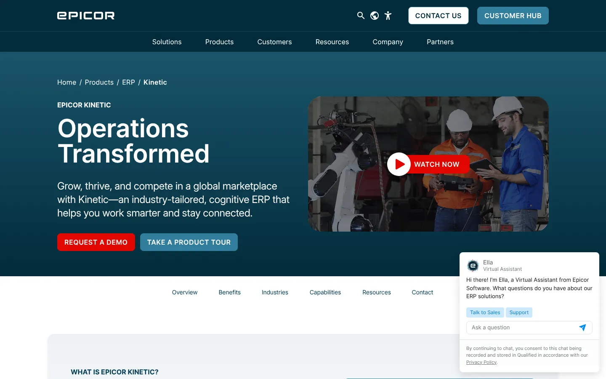
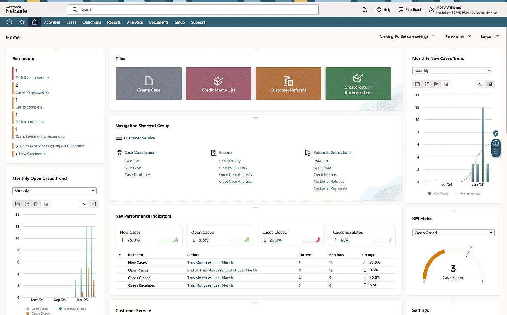
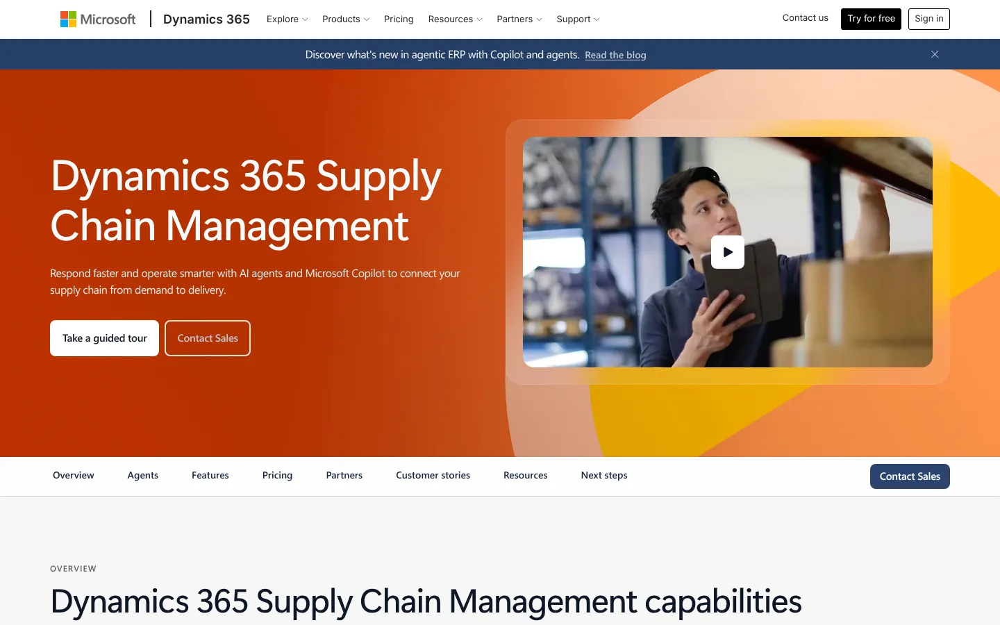
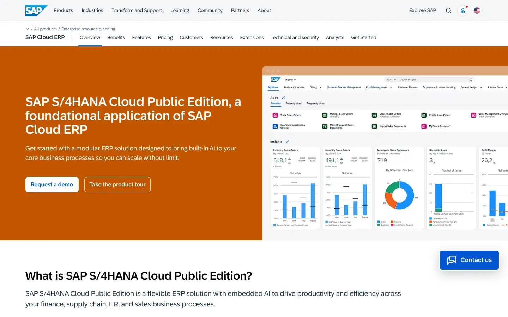
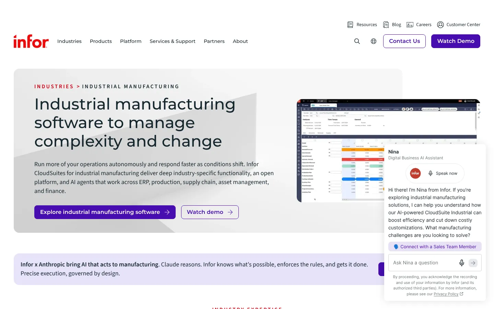
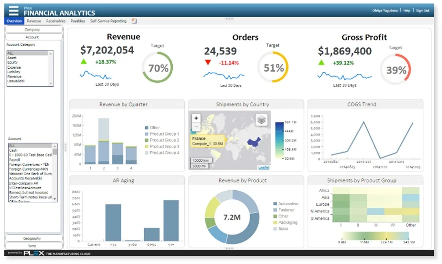
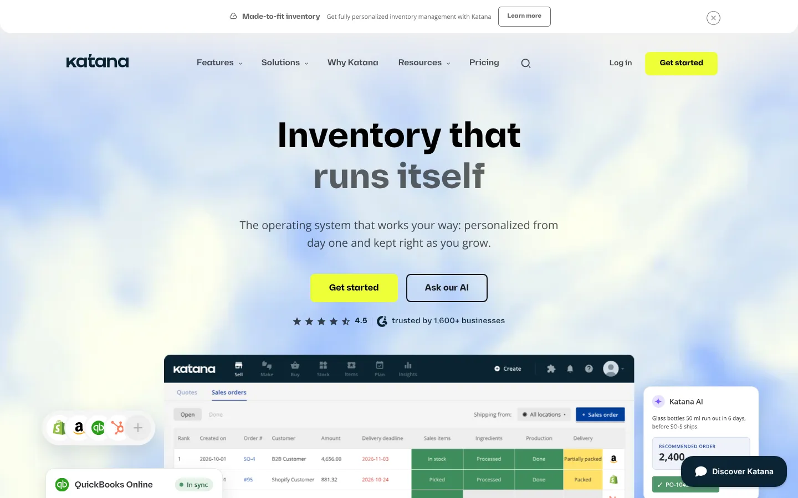
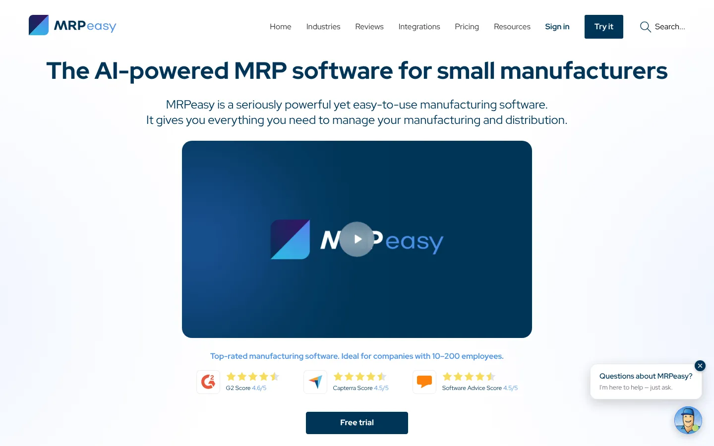

# 9 Best Manufacturing Software Platforms for 2026, Plus What to Watch in 2027

**Search intent:** Commercial investigation

Epicor Kinetic is a strong all-around ERP for midmarket manufacturers. NetSuite fits companies that want cloud financials and operations across subsidiaries. Dynamics 365 Supply Chain Management works well in a Microsoft estate. SAP S/4HANA Cloud and Infor CloudSuite Industrial suit complex enterprises. Plex stands out for cloud MES. Katana and MRPeasy are more approachable for smaller manufacturers, while Odoo offers a flexible modular path.

The category spans ERP, manufacturing resource planning, and manufacturing execution systems. Those are related layers, not synonyms. Buyers should define whether they need financial and supply-chain control, material and capacity planning, real-time production execution, or a connected combination.

## Key Takeaways

- **Epicor Kinetic is a strong all-round choice for midmarket manufacturers.**
- **NetSuite, Dynamics 365, and SAP S/4HANA Cloud suit multi-entity and global operations** at rising cost and complexity.
- **Infor CloudSuite Industrial and Plex cover complex industrial workflows and cloud MES.**
- **Katana, MRPeasy, and Odoo give small manufacturers structured planning** without a large ERP project.
- **Choose around your production mode,** whether make-to-stock, make-to-order, or engineer-to-order.

## The Short List

| Platform | Best for | Core position |
| --- | --- | --- |
| Epicor Kinetic | Midmarket discrete manufacturing | Manufacturing ERP |
| Oracle NetSuite | Multi-entity cloud operations | Cloud ERP |
| Dynamics 365 Supply Chain Management | Microsoft-centered enterprises | ERP and supply chain |
| SAP S/4HANA Cloud | Large global manufacturers | Enterprise ERP |
| Infor CloudSuite Industrial | Complex industrial operations | Manufacturing ERP |
| Plex Smart Manufacturing Platform | Plant execution and quality | Cloud MES and operations |
| Katana | Small product businesses | Inventory and production planning |
| MRPeasy | Small manufacturers | MRP and production control |
| Odoo Manufacturing | Modular, customizable operations | ERP suite with MRP |

## Integration Is the Central Buying Problem

A 2026 Rockwell Automation study, reported by the International Society of Automation, surveyed 1,560 manufacturing and industrial decision-makers in 17 countries. It found that 93% had MES in at least one facility, but only 28% had deployed it enterprise-wide and 23% reported full integration across ERP, product lifecycle, quality, and operational technology systems.

The sample leaned large: 58% worked at organizations with more than $1 billion in annual revenue. The percentages should not be treated as a census of small factories. They still reveal a useful enterprise problem. [Integration ranked as the top MES buying requirement](https://www-prod.isa.org/web/acom/article/report-93-percent-manufacturers-mes-but-only-23-percent-fully-integrated), cited by 44% of respondents, and as the largest data-integration problem for 33%.

This is why a product demonstration should follow one production order across sales demand, planning, purchasing, material issue, labor, machine activity, quality, completion, shipment, and finance.

## 1. Epicor Kinetic: Best Overall for a Midmarket Manufacturer

Epicor Kinetic is built around manufacturing ERP. It covers financials, planning, inventory, production, supply chain, service, and related industry workflows. Its manufacturing depth makes it a frequent shortlist choice for discrete and make-to-order environments.

The platform still needs careful scoping. Configurators, advanced planning, MES, quality, EDI, analytics, and other functions may affect the implementation and price. Ask references about the same industry and production mode, not merely a company of similar size.

**Choose Epicor Kinetic if:** manufacturing is the heart of the business and the company needs a full midmarket ERP.

## 2. Oracle NetSuite: Best for Multi-entity Cloud Operations

NetSuite combines financials, orders, inventory, procurement, CRM, and manufacturing capabilities in a cloud ERP. It is attractive to a manufacturer with subsidiaries, international operations, or a need to consolidate finance and operations.

Manufacturing depth depends on the products and modules licensed. Test work orders, routings, WIP, costing, planning, quality, and shop-floor collection against real scenarios. NetSuite's 2026.2 release added manufacturing and supply-chain enhancements, but release availability and account enablement should be confirmed in the official notes.

**Choose NetSuite if:** multi-entity financial control and cloud ERP breadth lead the requirements.

## 3. Dynamics 365 Supply Chain Management: Best for Microsoft Estates

Dynamics 365 Supply Chain Management covers planning, procurement, inventory, manufacturing, warehousing, asset management, and related operations. It connects naturally with Microsoft 365, Azure, Power Platform, and the broader Dynamics portfolio.

Microsoft lists the base product at $210 per user per month when paid yearly and Premium at $300. The October 2026 licensing guide also states minimum purchase quantities and capacity entitlements. [Microsoft's pricing page](https://www.microsoft.com/en-us/dynamics-365/products/supply-chain-management/pricing) is the place to verify current license and agent-credit details.

**Choose Dynamics 365 if:** the organization has Microsoft skills and needs enterprise supply-chain and manufacturing functions.

## 4. SAP S/4HANA Cloud: Best for Large Global Manufacturers

SAP S/4HANA Cloud supports finance, sourcing, manufacturing, supply chain, assets, and other enterprise processes. Its strongest fit is a large organization that needs global controls, detailed process design, and an extensive SAP ecosystem.

This is a transformation program, not an application install. Data ownership, process harmonization, localization, integrations, change management, and partner quality shape the result. Keep custom work tied to a documented business need.

**Choose SAP if:** scale, global process control, and enterprise depth justify a major implementation.

## 5. Infor CloudSuite Industrial: Best for Complex Industrial Workflows

Infor CloudSuite Industrial, built around SyteLine, serves discrete and mixed-mode manufacturers. It supports planning, scheduling, projects, service, quality, and industry processes.

Its value appears in detailed manufacturing fit. The selection team should test engineer-to-order, configure-to-order, repetitive, or project workflows as applicable. Confirm which functions are native, separately licensed, partner supplied, or customized.

**Choose Infor if:** industry-specific manufacturing requirements dominate the scorecard.

## 6. Plex Smart Manufacturing Platform: Best for Cloud MES

Plex focuses on plant-level production, quality, traceability, inventory, and manufacturing execution, with ERP and related platform capabilities. Its cloud design is relevant for manufacturers trying to standardize execution across sites.

Plex does not remove the need for an integration architecture. Define which system owns items, bills of material, orders, quality records, equipment events, inventory, and financial postings. The 2026 Rockwell study makes the cost of unclear boundaries visible.

**Choose Plex if:** real-time plant execution and multi-site standardization are the urgent requirements.

## 7. Katana: Best for Small Product Businesses

Katana offers production planning, inventory, purchasing, orders, and shop-floor workflows in a product designed for smaller manufacturers and makers. Its interface is more approachable than a large ERP.

It works best when the operating model fits its boundaries. Test variants, subcontracting, lot or serial tracking, costing, locations, ecommerce connections, and accounting integration before migrating.

**Choose Katana if:** a small product business has outgrown spreadsheets but does not need an enterprise ERP.

## 8. MRPeasy: Best for Small Manufacturers Needing Structured MRP

MRPeasy covers production planning, stock, purchasing, CRM, and shop-floor reporting for small manufacturers. It offers more manufacturing structure than a generic inventory app without the scale of an enterprise implementation.

Create a trial with actual lead times, yields, alternates, work centers, and purchase constraints. Planning results are only as reliable as master data and transaction discipline.

**Choose MRPeasy if:** the business needs practical MRP and production control at a small-company scale.

## 9. Odoo Manufacturing: Best Modular Option

Odoo connects manufacturing with inventory, purchasing, sales, quality, maintenance, accounting, and other applications. It can support a phased rollout and substantial process configuration.

The risk is uncontrolled customization. Establish an owner for the core model, approve extensions, and test upgrades. A flexible platform can reproduce a broken process as easily as a good one.

**Choose Odoo if:** the company wants a connected, modular suite and can govern implementation choices.

## Build the Selection Around Production Modes

Start by naming the operating model: make to stock, make to order, engineer to order, configure to order, process, repetitive, or a mixture. Then document the exceptions that drive daily work.

Run scripted demonstrations with your own examples:

- A demand change after material has been purchased
- A component shortage and approved substitute
- Rework, scrap, and a quality hold
- Lot or serial traceability from supplier to customer
- Outside processing
- A routing or engineering revision
- Labor and overhead capture
- Month-end WIP and cost reconciliation

Review architecture in the [business technology](/business-technology/) and [cloud infrastructure](/cloud-infrastructure/) sections. A financial case can use the [business valuation calculator](/tools/business-valuation-calculator/) for broad scenarios, but the implementation model needs plant-specific assumptions.

## What Changed in 2026

Manufacturing vendors continued adding planning, automation, and AI functions. Microsoft listed 35 features in its 2026 release wave 1 plan for Supply Chain Management. Public roadmaps change, so the current roadmap and documentation should govern any purchase decision.

The larger shift is from adoption to integration. The Rockwell survey also found that 43% of respondents said they were not using collected data effectively, even as respondents expected more processes to receive AI support. Clean item, routing, asset, quality, and transaction data must precede dependable automation.

## What to Watch in 2027

Treat these as evaluation themes:

- Traceable AI recommendations tied to production and quality data
- Edge operation during a network or cloud interruption
- Common data definitions across plants
- Cybersecurity controls between enterprise and operational technology
- Faster scenario planning for material, labor, and capacity constraints
- Upgrade paths that preserve validated processes

Do not credit a vendor for an unconfirmed roadmap item. Require a supported capability, a dated commitment in the contract, or a fallback process.

Manufacturing software is usually an ERP decision. Stack Row's explainer on [what ERP is](/business-technology/what-is-erp/) follows an order from sales to finance, and the [B2B technology statistics](/business-technology/b2b-tech-statistics/) show how buyers evaluate vendors. Smaller makers can compare the [best accounting software for small business](/business-technology/best-accounting-software-small-business/), and builders can read the guide to [construction management software](/business-technology/best-construction-management-software/).

## Frequently Asked Questions

### What Is the Best Manufacturing Software for a Small Business?

Katana and MRPeasy are strong starting points for smaller manufacturers. Odoo can fit a business that needs a broader suite and can support configuration. The choice depends on production mode, traceability, costing, ecommerce, and accounting needs.

### What Is the Difference Between ERP, MRP, and MES?

ERP coordinates enterprise transactions such as finance, orders, purchasing, and inventory. MRP calculates material and production requirements. MES controls and records execution on the shop floor, although product boundaries often overlap.

### How Long Does Manufacturing Software Implementation Take?

The answer ranges from weeks for a narrow small-business rollout to years for a global transformation. Scope, data quality, integrations, validation, customization, sites, and change management determine the schedule more than the product name.

## Resources

- [ISA summary of Rockwell Automation's 2026 MES study](https://www-prod.isa.org/web/acom/article/report-93-percent-manufacturers-mes-but-only-23-percent-fully-integrated)
- [Dynamics 365 Supply Chain Management pricing](https://www.microsoft.com/en-us/dynamics-365/products/supply-chain-management/pricing)
- [Dynamics 365 release plans](https://releaseplans.microsoft.com/en-US/?app=Supply+Chain+Management)
- [NetSuite release notes](https://docs.oracle.com/en/cloud/saas/netsuite/ns-online-help/chapter_N3944671.html)
