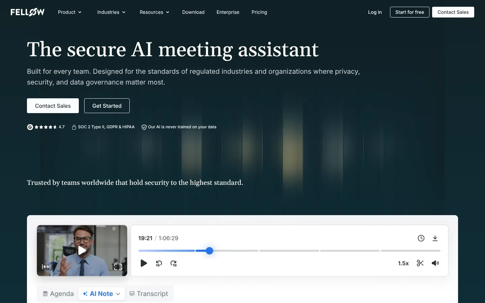
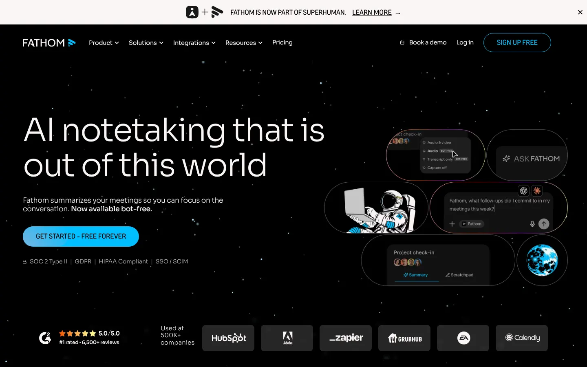
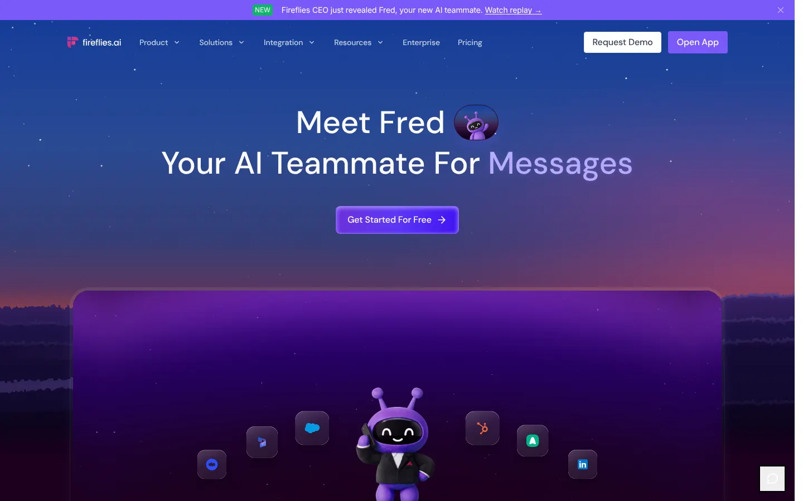
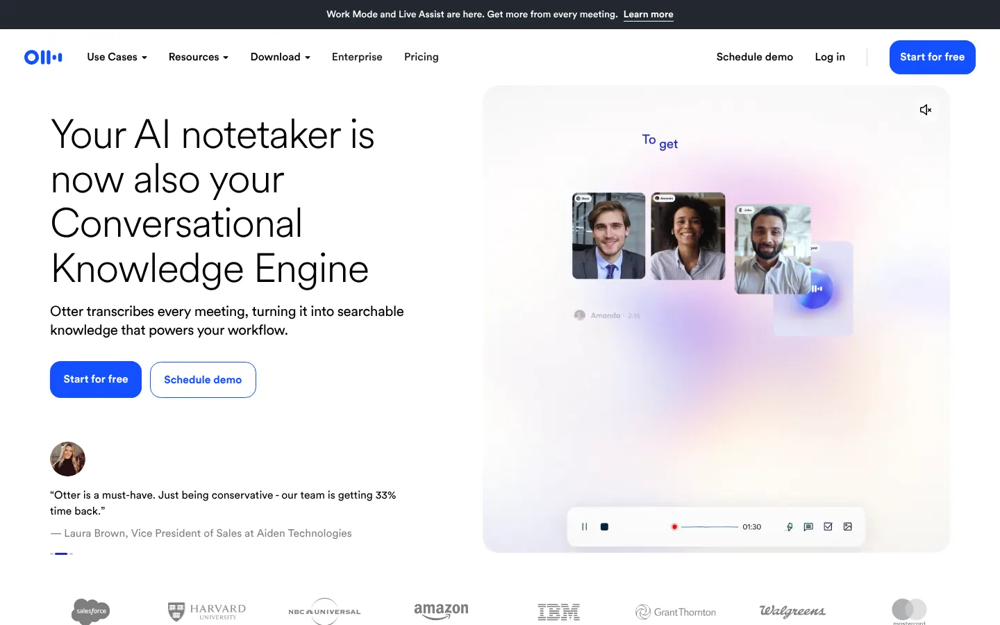
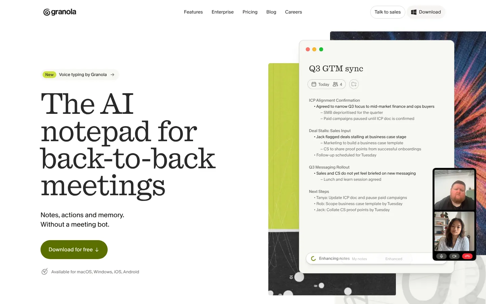
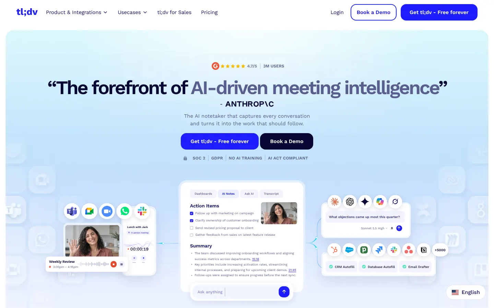
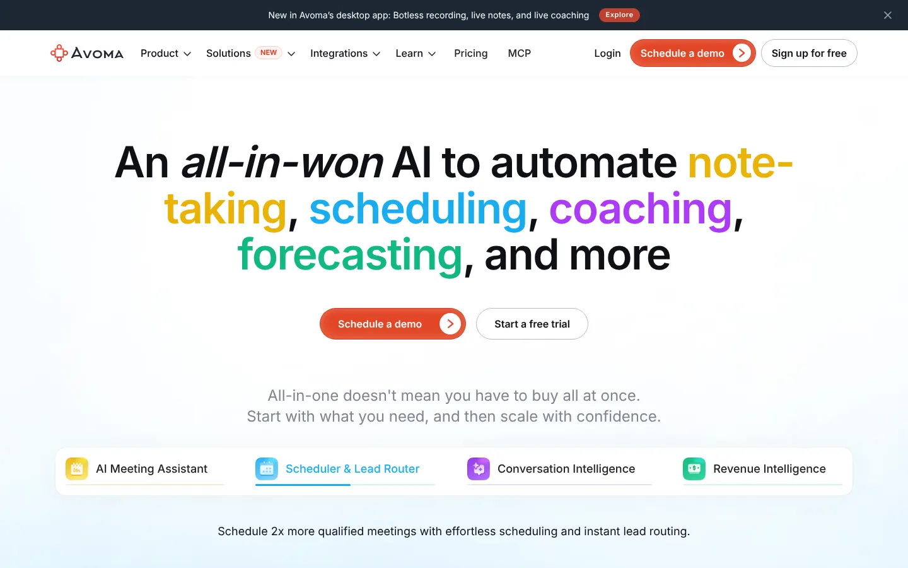
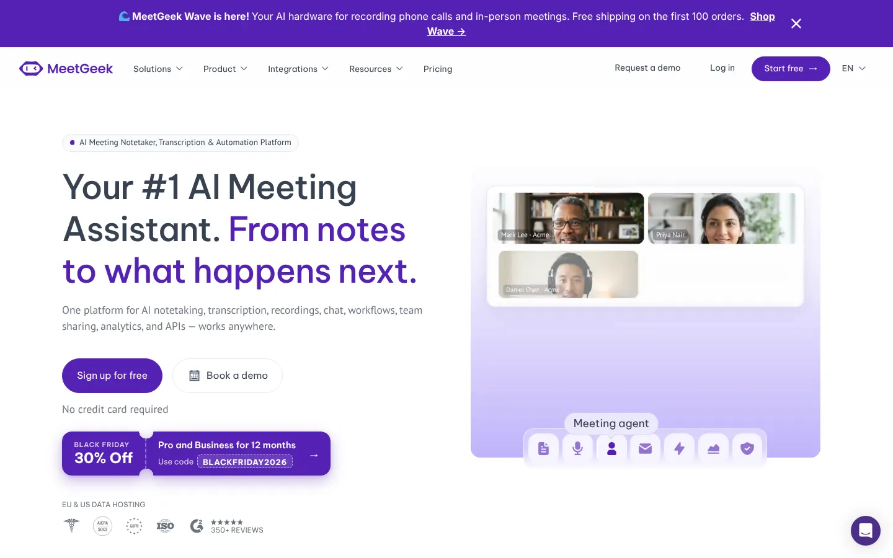
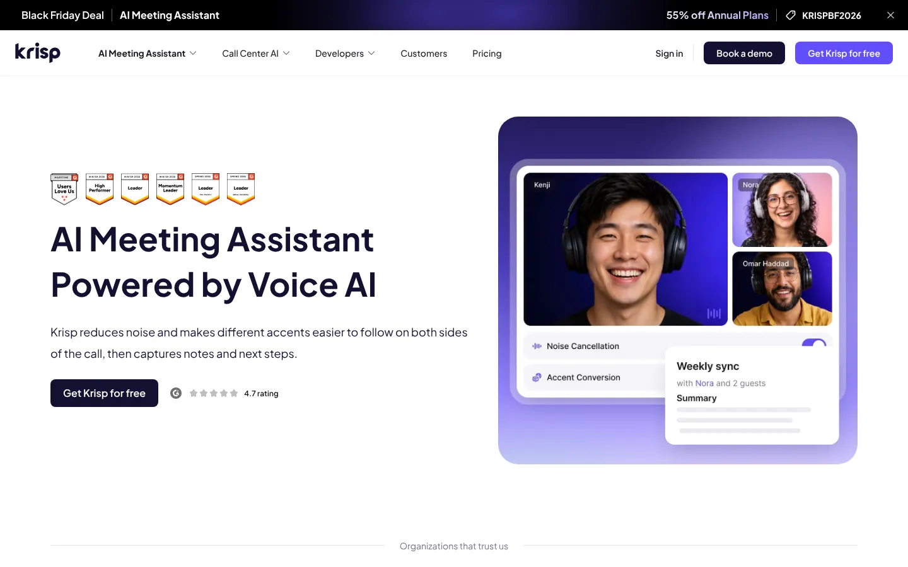
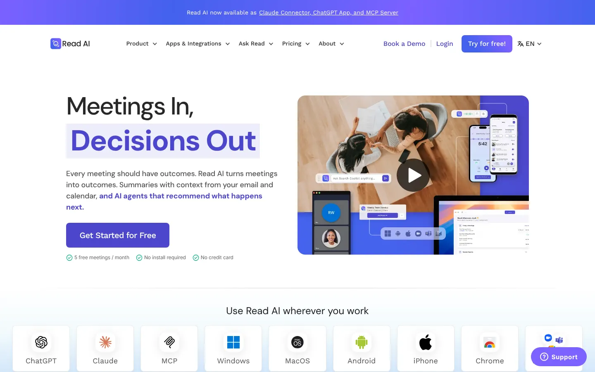

# 10 Best AI Meeting Assistants for 2026 and What to Watch in 2027

Fellow is the strongest all-round choice for managed team meetings. Fathom offers the clearest free starting point. Fireflies suits high-volume collaboration, while Granola supports bot-free capture. The right choice depends on consent, retention, platform support, and the work that follows each meeting.

An AI meeting assistant should reduce follow-up work without creating a new information risk.
The best products do more than produce a transcript. They identify decisions, assign actions, preserve context, and connect notes to existing systems.
This comparison uses official product and pricing pages reviewed on November 20, 2026. It does not claim hands-on testing.

## Key Takeaways

- **Fellow is the strongest all-round pick for managed team meetings**, with paid plans from $7 per user monthly on annual billing.
- **Fathom is the easiest free starting point** for individuals and small pilots.
- **Granola and Krisp capture notes without a meeting bot**, which suits teams that dislike visible recorders.
- **Consent, retention, and access rules matter as much as summary quality.** Settle them before a company-wide rollout.
- **Count every cost.** Recorder seats, viewers, storage, and analytics add up beyond the headline price.

## How These Products Were Selected

A useful comparison separates recording quality from the workflow built around the recording.

- **Capture method.** Check whether the tool uses a meeting bot, desktop audio, browser capture, or native platform features.
- **Meeting support.** Confirm support for Zoom, Microsoft Teams, Google Meet, phone calls, and in-person meetings.
- **Output quality.** Review speaker labels, transcript search, summaries, decisions, tasks, and custom note templates.
- **Controls.** Check consent notices, retention, deletion, exports, single sign-on, and administrator visibility.
- **Workflow fit.** Test calendar, customer relationship management, project, chat, and knowledge integrations.
- **Real cost.** Count recorder seats, viewer access, meeting limits, storage, and premium analytics.

## Best Options at a Glance

| Product | Best for | Pricing signal | Main watch point |
| --- | --- | --- | --- |
| Fellow | Governed team meeting workflows | Free option; paid from $7 per user monthly on annual billing | AI notes and advanced controls depend on plan |
| Fathom | A generous free starting point | Free option; paid individual and team plans | Confirm team administration and capture method |
| Fireflies.ai | High meeting volume and integrations | Free option; paid from $10 per user monthly on annual billing | Storage and AI features vary by tier |
| Otter.ai | Live transcription and meeting search | Free option; Pro from $8.33 per user monthly on annual billing | Meeting and import limits apply |
| Granola | Bot-free notes with human context | Free trial or plan; Business from about $14 monthly | History and collaboration limits depend on plan |
| tl;dv | Video records and cross-meeting search | Free option; Pro from $18 per user monthly on annual billing | AI note allowances and integrations vary |
| Avoma | Revenue and conversation workflows | From $19 per recorder monthly on annual billing | Advanced intelligence can raise total cost |
| MeetGeek | Flexible meeting capture and automation | Free option; paid from about $9.99 per user monthly | Usage allowances differ across plans |
| Krisp | Noise control and bot-free capture | Paid plans from about $8 per user monthly on annual billing | Recording and assistant features differ by tier |
| Read AI | Meeting analytics and engagement signals | Free option; paid from about $15 per user monthly | Interpret engagement scores carefully |

## 1. Fellow

**Best for:** Governed team meeting workflows

Fellow combines agendas, notes, decisions, and follow-up inside one meeting workspace. Its business case is strongest when teams need consistent templates and shared accountability. Security and administration deserve the same review as summary quality. Test how guest meetings, exports, and connected applications inherit access.

**Pricing signal:** Free option; paid from $7 per user monthly on annual billing. Check current terms on the [Fellow pricing page](https://fellow.ai/pricing).

**Watch point:** AI notes and advanced controls depend on plan

## 2. Fathom

**Best for:** A generous free starting point

Fathom offers a low-friction starting point for individuals and small pilots. It records supported meetings, creates summaries, and supports follow-up workflows. A company rollout needs a separate review of ownership, shared access, retention, and offboarding. Free individual value does not establish company-wide governance.

**Pricing signal:** Free option; paid individual and team plans. Check current terms on the [Fathom pricing page](https://fathom.video/pricing).

**Watch point:** Confirm team administration and capture method

## 3. Fireflies.ai

**Best for:** High meeting volume and integrations

Fireflies.ai fits teams that want broad meeting coverage and searchable conversation records. Its integrations can move notes into customer, project, and collaboration systems. That convenience expands the data path. Map every destination before granting broad calendar or workspace access.

**Pricing signal:** Free option; paid from $10 per user monthly on annual billing. Check current terms on the [Fireflies.ai pricing page](https://fireflies.ai/pricing).

**Watch point:** Storage and AI features vary by tier

## 4. Otter.ai

**Best for:** Live transcription and meeting search

Otter.ai remains a practical choice for live transcripts and searchable meeting history. It suits users who need notes during the conversation, not only afterward. Check meeting-duration limits, import allowances, vocabulary handling, and export needs. Review how administrators control recordings created by departing users.

**Pricing signal:** Free option; Pro from $8.33 per user monthly on annual billing. Check current terms on the [Otter.ai pricing page](https://otter.ai/pricing).

**Watch point:** Meeting and import limits apply

## 5. Granola

**Best for:** Bot-free notes with human context

Granola captures device audio and combines human notes with generated output. That bot-free approach can reduce meeting disruption. It does not remove consent or retention duties. Test device compatibility, audio routing, shared workspaces, and the treatment of personal notes.

**Pricing signal:** Free trial or plan; Business from about $14 monthly. Check current terms on the [Granola pricing page](https://www.granola.ai/pricing).

**Watch point:** History and collaboration limits depend on plan

## 6. TL;DV

**Best for:** Video records and cross-meeting search

tl;dv emphasizes recorded meetings, clips, search, and team knowledge. It fits research, sales, and customer teams reviewing conversations across time. The value depends on retrieval and sharing controls. Test whether a user can find only meetings they already may access.

**Pricing signal:** Free option; Pro from $18 per user monthly on annual billing. Check current terms on the [tl;dv pricing page](https://tldv.io/pricing).

**Watch point:** AI note allowances and integrations vary

## 7. Avoma

**Best for:** Revenue and conversation workflows

Avoma combines meeting assistance with conversation and revenue workflows. It suits teams that connect meetings to customer records, coaching, and pipeline activity. That creates a wider implementation than basic note-taking. Model recorder seats, viewer needs, analytics, dialers, and customer relationship management access together.

**Pricing signal:** From $19 per recorder monthly on annual billing. Check current terms on the [Avoma pricing page](https://www.avoma.com/pricing).

**Watch point:** Advanced intelligence can raise total cost

## 8. MeetGeek

**Best for:** Flexible meeting capture and automation

MeetGeek covers common meeting platforms and can distribute notes into existing work tools. It provides a useful middle ground for teams needing automation without a revenue-only focus. Test recurring templates, multilingual meetings, and workflow failures. Confirm what happens when an integration loses authorization.

**Pricing signal:** Free option; paid from about $9.99 per user monthly. Check current terms on the [MeetGeek pricing page](https://meetgeek.ai/pricing).

**Watch point:** Usage allowances differ across plans

## 9. Krisp

**Best for:** Noise control and bot-free capture

Krisp combines audio cleanup with meeting transcription and notes. It fits noisy environments and teams that prefer device-side capture. Audio improvement does not guarantee accurate decisions or names. Test the real microphones, rooms, accents, and conferencing tools used by the team.

**Pricing signal:** Paid plans from about $8 per user monthly on annual billing. Check current terms on the [Krisp pricing page](https://krisp.ai/pricing/).

**Watch point:** Recording and assistant features differ by tier

## 10. Read AI

**Best for:** Meeting analytics and engagement signals

Read AI adds summaries, search, and meeting analytics to capture workflows. The analytics may help teams review participation patterns. They should not become automatic performance evidence. Define acceptable use before exposing individual scores to managers or broad groups.

**Pricing signal:** Free option; paid from about $15 per user monthly. Check current terms on the [Read AI pricing page](https://www.read.ai/plans-pricing).

**Watch point:** Interpret engagement scores carefully

## How to Run a Useful Pilot

Use one controlled meeting script across every shortlisted product.

1. Include two speakers with different accents and one remote participant.
2. Add interruptions, acronyms, numbers, and an ambiguous action item.
3. Share a screen while discussing a decision that changes twice.
4. Ask each product to identify the final decision and responsible owner.
5. Export the transcript, notes, tasks, and recording using normal permissions.
6. Delete the meeting and verify retention behavior across connected systems.

## Common Buying Mistakes

These mistakes often appear after a promising product demonstration.

- Buying on transcript accuracy without testing action items and decisions.
- Recording every meeting without a defined purpose or retention rule.
- Giving the assistant broad calendar access before confirming meeting scope.
- Counting recorder seats while ignoring viewers, storage, and analytics.

## Final Approval Checks

Use these questions before signing a contract or approving production rollout.

- Has legal or privacy review approved the capture and consent process?
- Can administrators define retention and deletion for every meeting type?
- Do summaries link back to recordings or transcript evidence?
- Can users access only meetings they were allowed to attend?
- Does offboarding transfer ownership without exposing personal notes?
- Does the cost model include viewers, storage, analytics, and integrations?

## What to Watch in 2027

Watch for bot-free capture, stronger administrator policy, cross-meeting search, and agent actions. Treat roadmap claims as plans until the vendor ships documented controls.

AI meeting assistants are one part of a wider shift in how companies use AI at work. Stack Row's [AI statistics on investment and production use](/ai/ai-statistics-investment-production-use/) show where adoption is heading, and teams that want assistants to act on meeting follow-ups should read [what AI agents are and how they work](/ai/what-are-ai-agents/). Teams that record client calls often pair these tools with [screen recording software](/business-technology/best-screen-recording-software/) for async updates.

## Frequently Asked Questions

### Can an AI Meeting Assistant Join Every Meeting?

No. Platform support, organizer settings, and company policy can block recording or bots.

### Should a Company Record Every Meeting?

No. Define a business purpose, retention rule, and consent process before broad capture.

### Are AI Summaries Reliable?

They can miss context or assign actions incorrectly. Review important decisions against the recording or transcript.

### What Should a Pilot Measure?

Measure transcript quality, action-item accuracy, workflow fit, user effort, and accepted cost per meeting.

## Resources

Product and pricing pages were reviewed on November 20, 2026. Confirm current terms before purchase.

- [Fellow pricing and product page](https://fellow.ai/pricing)
- [Fathom pricing and product page](https://fathom.video/pricing)
- [Fireflies.ai pricing and product page](https://fireflies.ai/pricing)
- [Otter.ai pricing and product page](https://otter.ai/pricing)
- [Granola pricing and product page](https://www.granola.ai/pricing)
- [tl;dv pricing and product page](https://tldv.io/pricing)
- [Avoma pricing and product page](https://www.avoma.com/pricing)
- [MeetGeek pricing and product page](https://meetgeek.ai/pricing)
- [Krisp pricing and product page](https://krisp.ai/pricing/)
- [Read AI pricing and product page](https://www.read.ai/plans-pricing)

Stack Row provides general technology research. Test every product against your own requirements before purchase.
