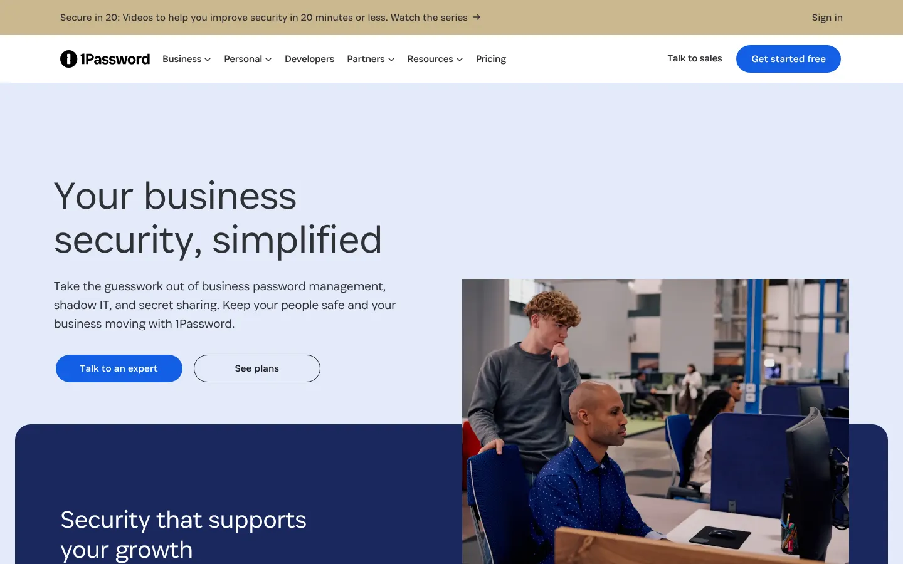
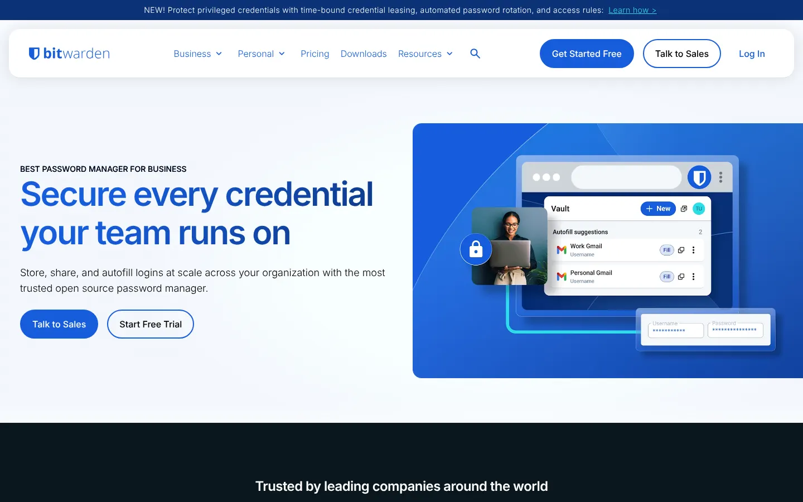
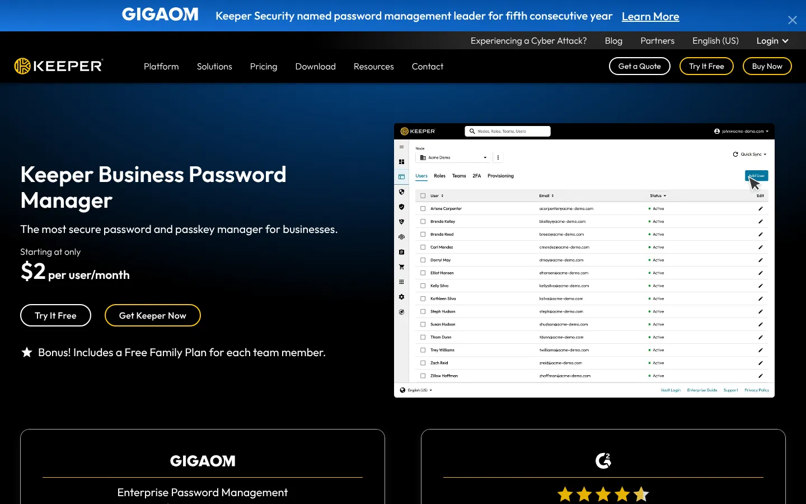
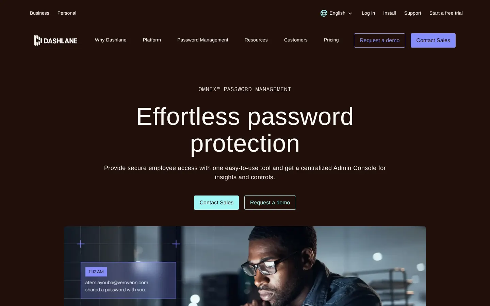
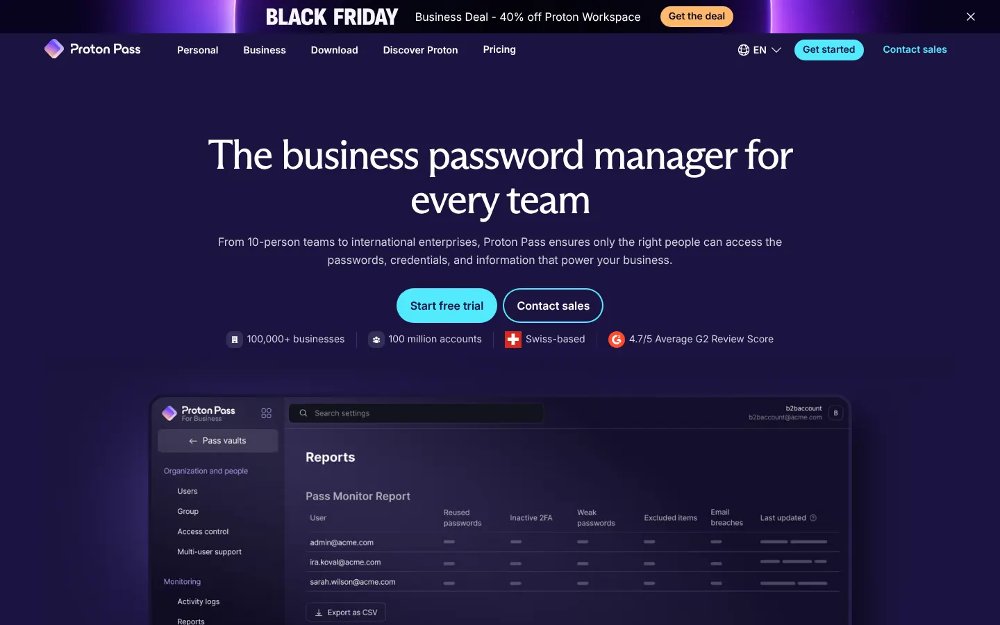
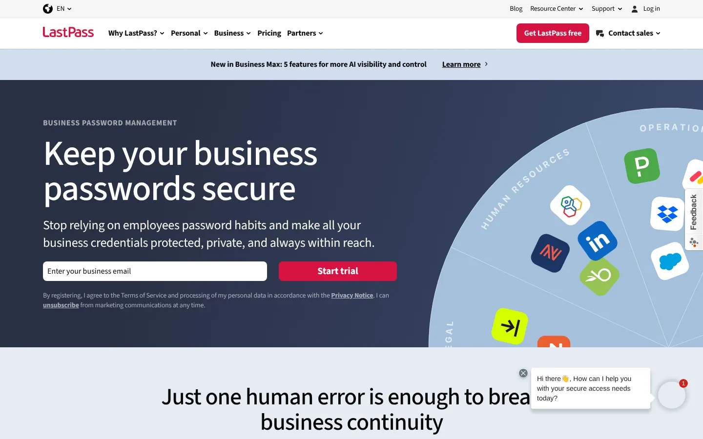
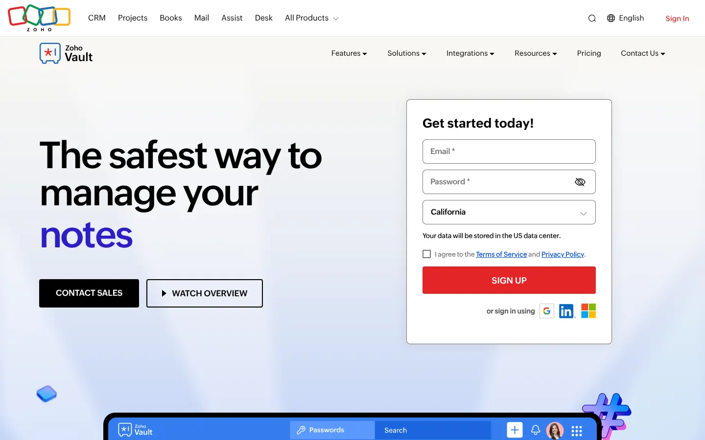
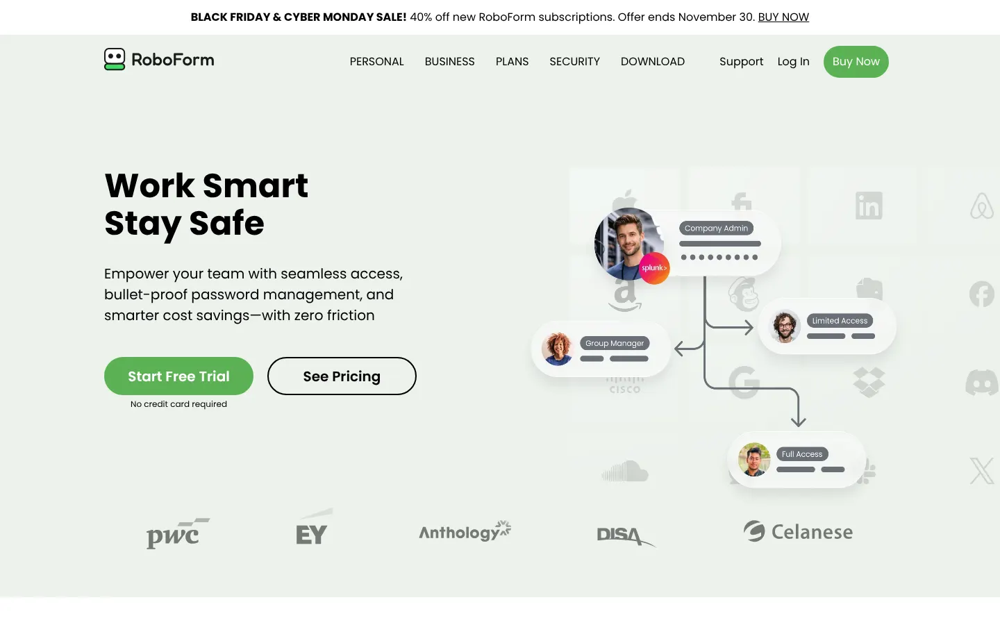
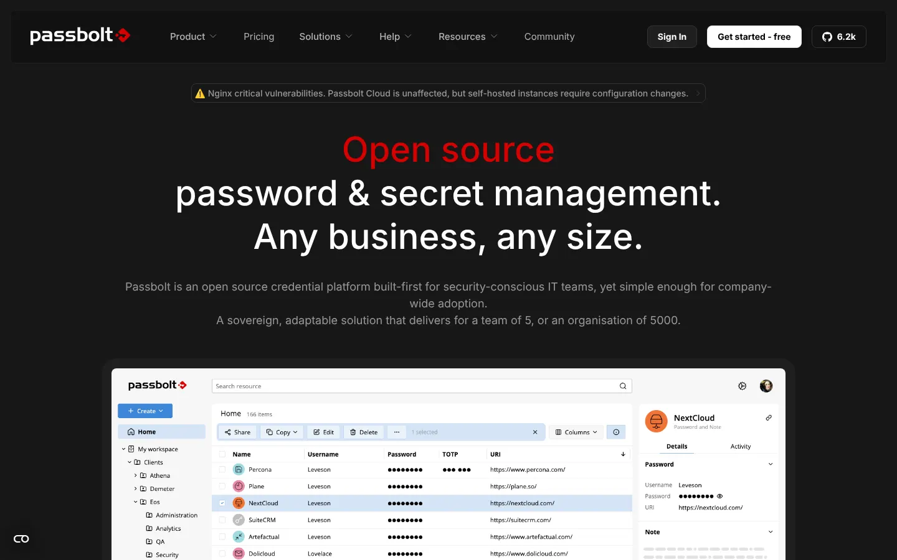

# 10 Best Password Managers for Companies in 2026

1Password, Bitwarden, and Keeper form the strongest general business shortlist. 1Password emphasizes experience and administration. Bitwarden offers value and deployment choice. Keeper provides deep policy options. Dashlane, NordPass, and Proton Pass deserve consideration for specific budgets and privacy requirements.

A company password manager must do more than save credentials. It needs controlled sharing, identity integration, recovery, audit, offboarding, and emergency access.
This page stays separate from Stack Row's general password-manager guide. It focuses on administration and company operating controls.
This article uses public product and pricing information reviewed on November 20, 2026. It does not claim hands-on testing.

## Key Takeaways

- **1Password Business is the strongest all-round company pick**, at $8.99 per user monthly on annual billing.
- **Bitwarden offers the best value**, with Teams at $4 and Enterprise at $6 per user monthly on annual billing.
- **Keeper suits companies that want low entry pricing**, with business plans from $2 per user monthly.
- **Proton Pass and Passbolt fit privacy-focused and self-hosted teams.**
- **Plan provisioning, recovery, and offboarding** before rolling out vaults to every employee.

## How These Products Were Selected

Use the buying criteria that change implementation, risk, and total cost.

- **Vault design.** Review encryption architecture, item ownership, sharing, collections, and organization boundaries.
- **Identity.** Check SSO, SCIM, directory sync, device trust, groups, and administrator roles.
- **Recovery.** Test employee recovery, administrator loss, emergency access, and account takeover response.
- **Lifecycle.** Model invitation, role change, offboarding, item transfer, revocation, and shared-secret rotation.
- **Evidence.** Review logs, reports, alerts, exports, independent audits, and incident disclosures.
- **Cost.** Include users, guests, SSO tiers, secrets, privileged access, support, and deployment.

## Best Options at a Glance

| Product | Best for | Pricing signal | Main watch point |
| --- | --- | --- | --- |
| 1Password Business | Managed teams and polished administration | Business about $8.99 per user monthly on annual billing | Advanced identity functions need configuration |
| Bitwarden Enterprise | Open-source transparency and value | Teams about $4; Enterprise about $6 per user monthly | Deployment choice changes operating responsibility |
| Keeper Enterprise | Policy and enterprise administration | Business tiers from about $2; enterprise terms vary | Add-ons and plan design affect cost |
| Dashlane Business | Straightforward company rollout | About $8 per user monthly on annual billing | Current plan scope should be verified |
| NordPass Business | Lower-cost team entry | Published per-user business plans; confirm current terms | Promotions and enterprise controls vary |
| Proton Pass for Business | Privacy-focused business plans | Essentials from $1.99 per user monthly on annual billing | Business feature maturity needs pilot testing |
| LastPass Business | Established business password management | Business plans; current public pricing varies | Review current security and operating evidence |
| Zoho Vault | Zoho-centered teams and value | Free and low-cost paid plans | Enterprise identity depth varies by plan |
| RoboForm for Business | Form filling and managed credentials | Per-user business pricing | Enterprise integrations need verification |
| Passbolt | Open-source team credential sharing | Community and paid business plans | Deployment and support model require ownership |

## 1. 1Password Business

**Best for:** Managed teams and polished administration

1Password Business combines employee vaults, shared items, policies, activity, recovery, and identity integrations. It fits companies wanting broad platform support and a polished user experience. Test SSO, SCIM, recovery, guest access, passkeys, offboarding, and emergency procedures with real administrators.

**Pricing signal:** Business about $8.99 per user monthly on annual billing. Check current terms on the [1Password Business pricing page](https://1password.com/business-pricing).

**Watch point:** Advanced identity functions need configuration

## 2. Bitwarden Enterprise

**Best for:** Open-source transparency and value

Bitwarden offers cloud and self-hosted business options with sharing, policies, SSO, SCIM, events, and recovery features. It fits technical teams valuing deployment choice. Self-hosting transfers availability, upgrades, backups, monitoring, and incident response. Test the complete model before choosing it.

**Pricing signal:** Teams about $4; Enterprise about $6 per user monthly. Check current terms on the [Bitwarden Enterprise pricing page](https://bitwarden.com/pricing/business/).

**Watch point:** Deployment choice changes operating responsibility

## 3. Keeper Enterprise

**Best for:** Policy and enterprise administration

Keeper provides managed vaults, sharing, policies, reporting, identity connections, and enterprise options. It fits organizations needing detailed administration and deployment flexibility. Buyers should map SSO, SCIM, secrets, privileged access, and add-ons separately. Test recovery and offboarding before purchase.

**Pricing signal:** Business tiers from about $2; enterprise terms vary. Check current terms on the [Keeper Enterprise pricing page](https://www.keepersecurity.com/pricing/business-and-enterprise.html).

**Watch point:** Add-ons and plan design affect cost

## 4. Dashlane Business

**Best for:** Straightforward company rollout

Dashlane offers business password management, policy, sharing, reporting, SSO options, and user administration. It fits teams prioritizing a guided employee experience. Review current plan boundaries, supported identity providers, passkeys, recovery, and device controls. Pilot browser behavior across managed platforms.

**Pricing signal:** About $8 per user monthly on annual billing. Check current terms on the [Dashlane Business pricing page](https://www.dashlane.com/pricing).

**Watch point:** Current plan scope should be verified

## 5. NordPass Business

**Best for:** Lower-cost team entry

NordPass Business offers shared folders, policies, activity, groups, and business administration. It fits smaller teams seeking a lower entry price. Promotional pricing can change the comparison. Review renewal pricing, SSO, SCIM, recovery, hosting region, passkeys, and support.

**Pricing signal:** Published per-user business plans; confirm current terms. Check current terms on the [NordPass Business pricing page](https://nordpass.com/business/pricing/).

**Watch point:** Promotions and enterprise controls vary

## 6. Proton Pass for Business

**Best for:** Privacy-focused business plans

Proton Pass provides password and passkey management within Proton's privacy-focused services. It fits teams already considering the wider Proton environment. Test administrator visibility, sharing, recovery, SSO, SCIM, exports, and offboarding. Confirm which controls sit in each plan.

**Pricing signal:** Essentials from $1.99 per user monthly on annual billing. Check current terms on the [Proton Pass for Business pricing page](https://proton.me/business/pass).

**Watch point:** Business feature maturity needs pilot testing

## 7. LastPass Business

**Best for:** Established business password management

LastPass Business supports vaults, sharing, policies, reporting, SSO connections, and administration. It remains a known enterprise option. Buyers should review current architecture, independent assessments, incident disclosures, remediation, and contract terms. Do not rely on brand familiarity alone.

**Pricing signal:** Business plans; current public pricing varies. Check current terms on the [LastPass Business pricing page](https://www.lastpass.com/pricing).

**Watch point:** Review current security and operating evidence

## 8. Zoho Vault

**Best for:** Zoho-centered teams and value

Zoho Vault supports team password sharing, roles, policies, audit, and Zoho ecosystem connections. It fits smaller organizations and existing Zoho customers. Test identity provisioning, emergency access, browser extensions, mobile use, ownership transfer, and exports. Confirm advanced controls before rollout.

**Pricing signal:** Free and low-cost paid plans. Check current terms on the [Zoho Vault pricing page](https://www.zoho.com/vault/pricing.html).

**Watch point:** Enterprise identity depth varies by plan

## 9. RoboForm for Business

**Best for:** Form filling and managed credentials

RoboForm for Business combines password management, form filling, sharing, groups, policies, and administration. It fits teams valuing mature browser form workflows. Test modern identity, passkeys, SSO, SCIM, reporting, recovery, and managed-device behavior. Confirm integration requirements against official documentation.

**Pricing signal:** Per-user business pricing. Check current terms on the [RoboForm for Business pricing page](https://www.roboform.com/business).

**Watch point:** Enterprise integrations need verification

## 10. Passbolt

**Best for:** Open-source team credential sharing

Passbolt focuses on team credential sharing with open-source and self-hosted options. It fits technical organizations wanting deployment control. That choice creates operating responsibility for availability, updates, backups, email, identity, and recovery. Pilot administrator loss and disaster restoration.

**Pricing signal:** Community and paid business plans. Check current terms on the [Passbolt pricing page](https://www.passbolt.com/pricing/business).

**Watch point:** Deployment and support model require ownership

## How to Run a Useful Pilot

A useful pilot follows a real workflow and includes a controlled failure.

1. Provision users through the selected identity source.
2. Create personal, team, and restricted shared vaults.
3. Test passkeys and passwords across main browsers and devices.
4. Recover one user without exposing unrelated vault contents.
5. Offboard a user and rotate every shared credential they used.
6. Export logs and complete one simulated breach response.

## Common Buying Mistakes

These mistakes often appear after a promising product demonstration.

- Choosing the cheapest plan before checking SSO, SCIM, and recovery.
- Moving credentials without identifying owners for shared and service accounts.
- Treating encryption claims as a substitute for incident and architecture review.
- Offboarding users without rotating shared secrets they could already know.

## Final Approval Checks

Use these questions before signing a contract or approving production rollout.

- Can identity systems provision and remove users without manual gaps?
- Does recovery preserve security when administrators lose access?
- Can shared credentials transfer cleanly during offboarding?
- Do logs support investigation without exposing protected secrets?
- Can the company export its vault data in a usable format?
- Does the chosen plan include required SSO, SCIM, and support?

## What to Watch in 2027

Watch passkey administration, device-bound credentials, secrets management, and identity convergence. Keep employee vaults separate from machine credentials and privileged access workflows.

Company password policy is one layer of identity security. Stack Row's [cybersecurity statistics](/cybersecurity/cybersecurity-statistics/) show why stolen credentials remain a leading attack path, and the guide to [what MFA is](/cybersecurity/what-is-mfa/) explains the second factor every vault should require. Individuals choosing a personal vault can compare the [best password manager](/cybersecurity/best-password-manager/) roundup.

## Frequently Asked Questions

### What Is the Best Password Manager for Companies?

1Password, Bitwarden, and Keeper offer strong business controls. The best fit depends on identity and recovery requirements.

### Do Business Password Managers Support Passkeys?

Many do, but creation, sharing, policy, and platform support differ. Test your main applications.

### What Happens When an Employee Leaves?

Revoke access, recover company vault items, rotate shared secrets, and preserve required audit evidence.

### Does Zero Knowledge Remove Every Risk?

No. Endpoint compromise, recovery design, identity settings, extensions, and administrator actions still require controls.

## Resources

Product and pricing pages were reviewed on November 20, 2026. Confirm current terms before purchase.

- [1Password Business pricing and product page](https://1password.com/business-pricing)
- [Bitwarden Enterprise pricing and product page](https://bitwarden.com/pricing/business/)
- [Keeper Enterprise pricing and product page](https://www.keepersecurity.com/pricing/business-and-enterprise.html)
- [Dashlane Business pricing and product page](https://www.dashlane.com/pricing)
- [NordPass Business pricing and product page](https://nordpass.com/business/pricing/)
- [Proton Pass for Business pricing and product page](https://proton.me/business/pass)
- [LastPass Business pricing and product page](https://www.lastpass.com/pricing)
- [Zoho Vault pricing and product page](https://www.zoho.com/vault/pricing.html)
- [RoboForm for Business pricing and product page](https://www.roboform.com/business)
- [Passbolt pricing and product page](https://www.passbolt.com/pricing/business)

Stack Row provides general technology research. Test every product against your own requirements before purchase.
