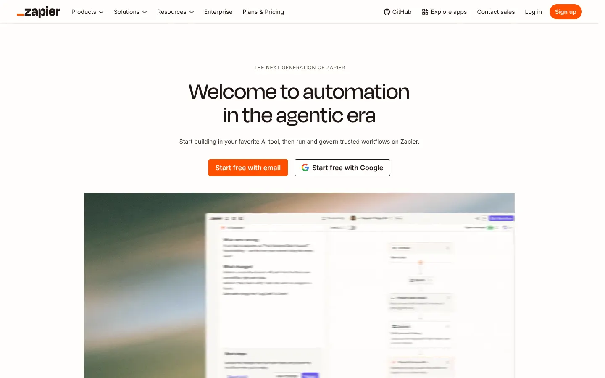
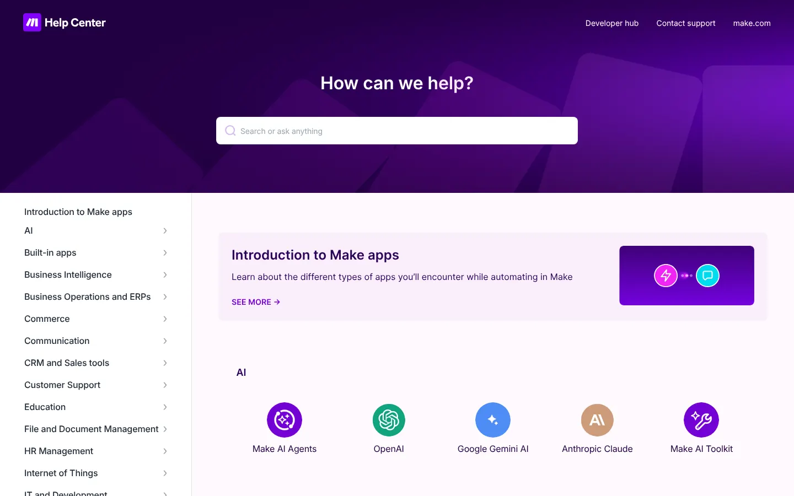
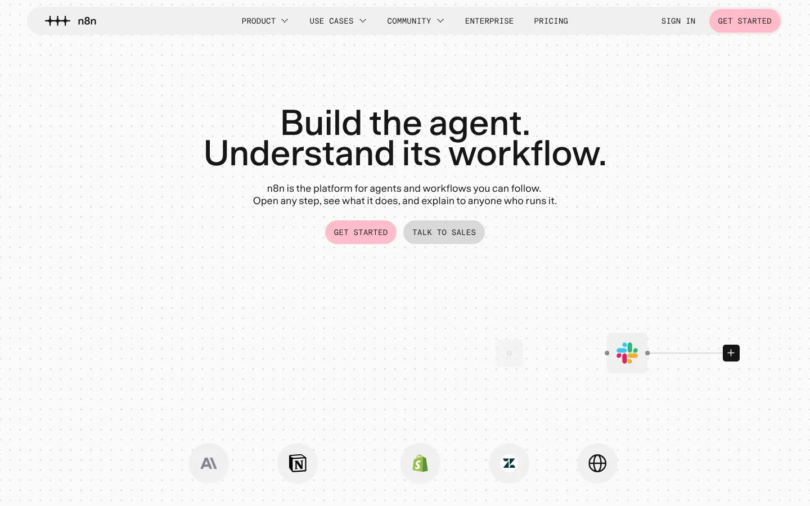
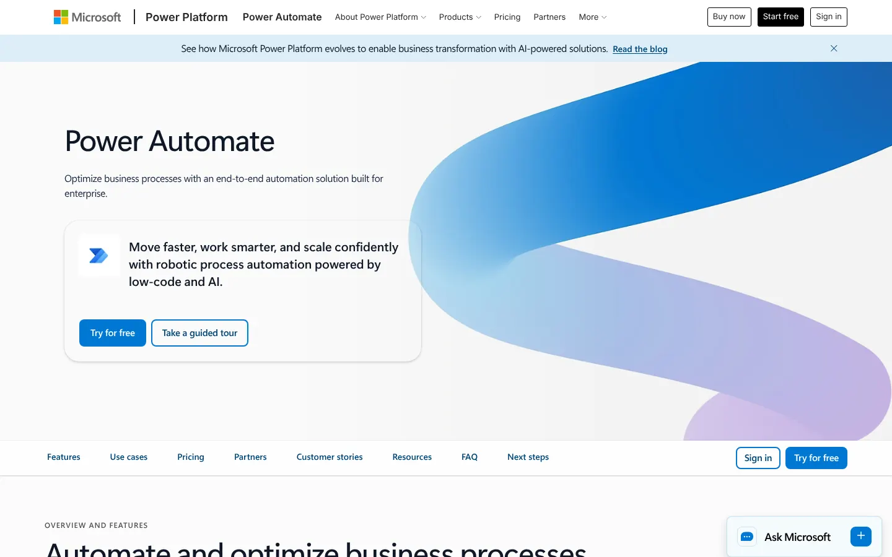
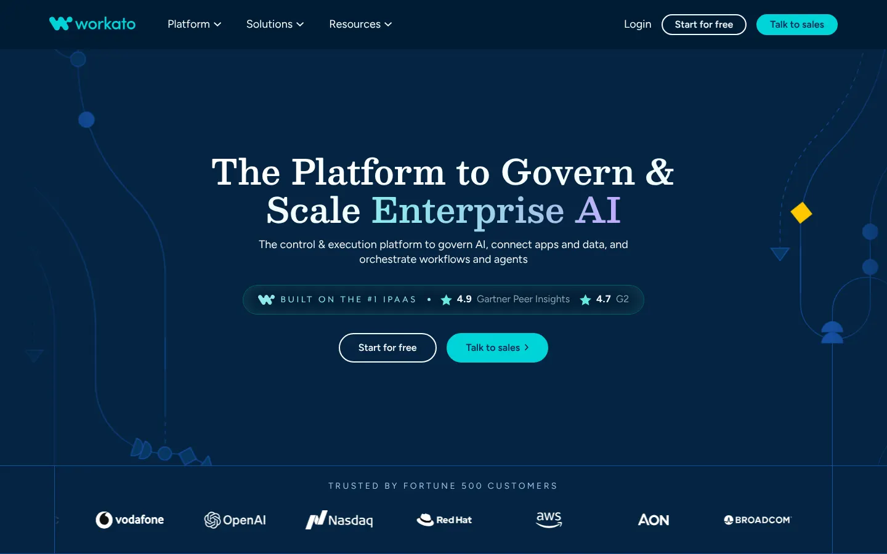
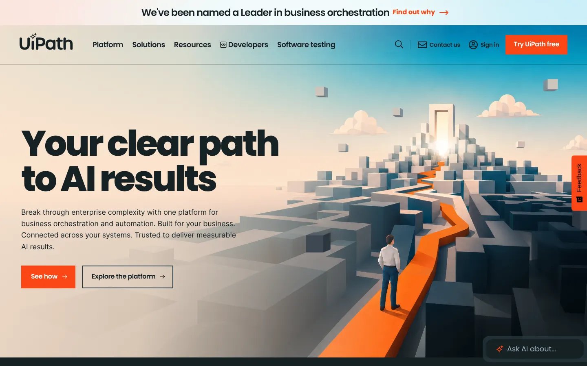
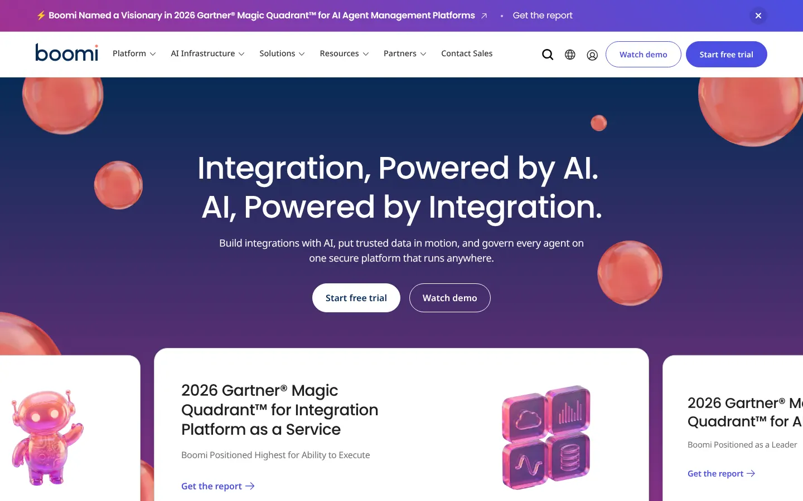
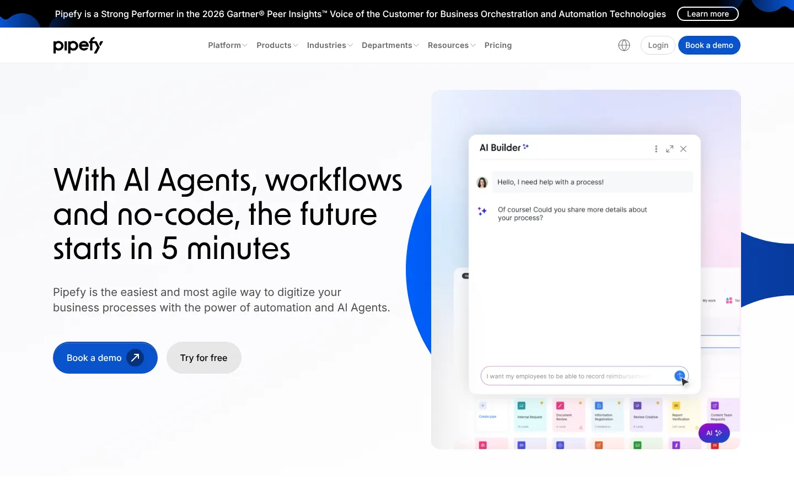
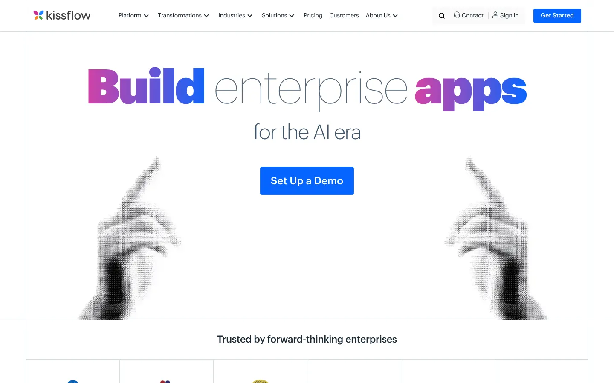
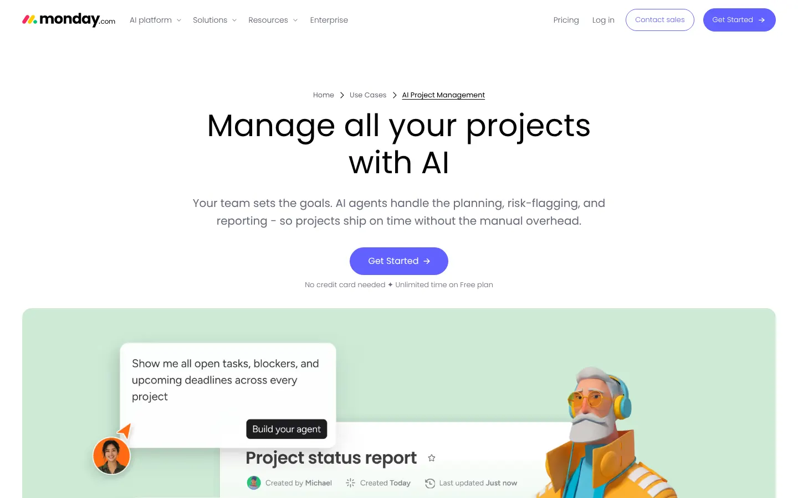

# 10 Best Workflow Automation Software Platforms for Business Teams

Zapier is the easiest broad starting point for business-led automation. Make offers stronger visual control, while n8n suits technical teams needing code or self-hosting. Power Automate fits Microsoft environments. Workato suits governed enterprise orchestration. The best platform depends on failure handling, ownership, and pricing units.

Workflow automation software can remove repetitive work across applications. It can also hide fragile dependencies from the teams relying on them.
A useful comparison must cover logic, approvals, retries, monitoring, versioning, credentials, and cost. Connector counts alone do not answer those questions.
This article uses public product and pricing information reviewed on November 20, 2026. It does not claim hands-on testing.

## Key Takeaways

- **Zapier is the simplest place for business teams to start**, with Professional from $19.99 monthly on annual billing.
- **Make and n8n suit teams that need branching logic**, and n8n can be self-hosted.
- **Power Automate fits Microsoft 365 shops**, with Premium at $15 per user monthly on annual billing.
- **Workato, Boomi, and UiPath target governed enterprise and legacy automation** and are priced through sales.
- **Model the billing unit before you buy.** Tasks, credits, executions, bots, and premium connectors all change the bill.

## How These Products Were Selected

The strongest choice matches the workflow's risk and operating model.

- **Builder model.** Compare visual steps, branching, loops, code, reusable components, and environment support.
- **Failure handling.** Check retries, replay, dead-letter handling, alerts, logs, and partial completion.
- **Human decisions.** Review approvals, forms, assignments, deadlines, and escalation paths.
- **Credential ownership.** Confirm service accounts, connection transfer, secrets, and departed-user controls.
- **Governance.** Check versioning, testing, permissions, audit history, and production promotion.
- **Billing unit.** Model tasks, credits, executions, seats, premium connectors, bots, and capacity.

## Best Options at a Glance

| Product | Best for | Pricing signal | Main watch point |
| --- | --- | --- | --- |
| Zapier | Business-led app automation | Free; Professional from $19.99 monthly on annual billing | Successful actions consume task allowances |
| Make | Visual branching and transformations | Free option; paid plans use credits | Each module can consume credits |
| n8n | Technical teams and self-hosting | Community edition; cloud from $20 monthly on annual billing | Self-hosting transfers operations to your team |
| Microsoft Power Automate | Microsoft 365 and Windows workflows | Premium $15 per user monthly; other capacity models available | Licensing varies by connector, process, and bot |
| Workato | Governed enterprise orchestration | Quote-based consumption | Capacity and capabilities require contract modeling |
| UiPath | Desktop and legacy application automation | Free options and paid plans; enterprise pricing varies | Bots need controlled machines and support |
| Boomi | Hybrid integration and application flows | Entry and enterprise plans vary by capacity | Integration scope can exceed a team automation project |
| Pipefy | Request and approval processes | Plan and enterprise pricing varies | Complex process governance needs design discipline |
| Kissflow | Low-code business process workflows | Quote-based for larger deployments | Application and workflow scope affects cost |
| monday work management | Board-centered team automation | Seat-based plans with automation allowances | Boards can become hidden systems of record |

## 1. Zapier

**Best for:** Business-led app automation

Zapier offers broad application coverage and an approachable builder. It works well for small teams connecting common cloud services. Costs can rise as multi-step workflows create many billable tasks. Model a normal month and a retry-heavy month before committing.

**Pricing signal:** Free; Professional from $19.99 monthly on annual billing. Check current terms on the [Zapier pricing page](https://zapier.com/pricing).

**Watch point:** Successful actions consume task allowances

## 2. Make

**Best for:** Visual branching and transformations

Make exposes routers, filters, transformations, and module-level flow in a visual canvas. It suits teams that need more logic than a basic trigger-action pair. Complex scenarios can become hard to own. Set naming, documentation, error, and environment rules before the library grows.

**Pricing signal:** Free option; paid plans use credits. Check current terms on the [Make pricing page](https://www.make.com/en/pricing).

**Watch point:** Each module can consume credits

## 3. N8n

**Best for:** Technical teams and self-hosting

n8n combines a visual builder with code and deployment choice. It suits engineers who want control over data paths and execution behavior. Community software removes a license line, not operating work. Include hosting, upgrades, monitoring, backups, and incident response.

**Pricing signal:** Community edition; cloud from $20 monthly on annual billing. Check current terms on the [n8n pricing page](https://n8n.io/pricing/).

**Watch point:** Self-hosting transfers operations to your team

## 4. Microsoft Power Automate

**Best for:** Microsoft 365 and Windows workflows

Power Automate fits organizations already using Microsoft 365, Dataverse, Azure, and Windows applications. Cloud flows and desktop automation cover different jobs. Licensing can involve users, processes, bots, and hosted machines. Price the exact design rather than one advertised plan.

**Pricing signal:** Premium $15 per user monthly; other capacity models available. Check current terms on the [Microsoft Power Automate pricing page](https://www.microsoft.com/en-us/power-platform/products/power-automate/pricing).

**Watch point:** Licensing varies by connector, process, and bot

## 5. Workato

**Best for:** Governed enterprise orchestration

Workato targets enterprise integration and automation with centralized governance. It suits organizations managing many shared workflows and systems. The evaluation should include environments, reusable components, operations, APIs, and event streams. Ask for a cost model tied to real recipes and volumes.

**Pricing signal:** Quote-based consumption. Check current terms on the [Workato pricing page](https://www.workato.com/pricing).

**Watch point:** Capacity and capabilities require contract modeling

## 6. UiPath

**Best for:** Desktop and legacy application automation

UiPath is strongest when work crosses desktop interfaces or systems without suitable APIs. It adds process and robotic automation beyond simple cloud connectors. Interface changes can break automations. Test patching, virtual desktops, screen resolution, credentials, queues, and attended versus unattended operation.

**Pricing signal:** Free options and paid plans; enterprise pricing varies. Check current terms on the [UiPath pricing page](https://www.uipath.com/pricing).

**Watch point:** Bots need controlled machines and support

## 7. Boomi

**Best for:** Hybrid integration and application flows

Boomi supports cloud and hybrid integration, APIs, data, and workflow patterns. It fits organizations connecting older systems with cloud services. Buyers should separate simple automation from wider integration architecture. Include runtime placement, connector entitlements, environments, and support in the model.

**Pricing signal:** Entry and enterprise plans vary by capacity. Check current terms on the [Boomi pricing page](https://boomi.com/products/integration/).

**Watch point:** Integration scope can exceed a team automation project

## 8. Pipefy

**Best for:** Request and approval processes

Pipefy centers work around forms, requests, stages, rules, and approvals. It suits business processes requiring visible ownership and handoffs. It may fit better than an app connector for long-running work. Test permissions, exceptions, deadlines, reporting, and process changes after launch.

**Pricing signal:** Plan and enterprise pricing varies. Check current terms on the [Pipefy pricing page](https://www.pipefy.com/pricing/).

**Watch point:** Complex process governance needs design discipline

## 9. Kissflow

**Best for:** Low-code business process workflows

Kissflow supports forms, workflows, cases, and low-code applications. It suits teams formalizing repeatable business processes beyond single-step automation. The platform choice should follow process ownership and change control. Pilot a workflow with exceptions, reassignment, and audit needs.

**Pricing signal:** Quote-based for larger deployments. Check current terms on the [Kissflow pricing page](https://kissflow.com/pricing/).

**Watch point:** Application and workflow scope affects cost

## 10. Monday Work Management

**Best for:** Board-centered team automation

monday.com adds rules and integrations to collaborative boards. It fits teams already managing work inside the platform. The convenience can create many local automations with unclear ownership. Define board standards, service accounts, limits, and an exit path for important processes.

**Pricing signal:** Seat-based plans with automation allowances. Check current terms on the [monday work management pricing page](https://monday.com/pricing).

**Watch point:** Boards can become hidden systems of record

## How to Run a Useful Pilot

Pilot one workflow that includes both success and failure paths.

1. Trigger the workflow from a real application event.
2. Add a branch, approval, transformation, and write action.
3. Expire one credential and inspect the alert and recovery path.
4. Change a source field and observe schema handling.
5. Replay a failed run without duplicating completed work.
6. Transfer ownership and disable the original builder's account.

## Common Buying Mistakes

These mistakes often appear after a promising product demonstration.

- Choosing the largest connector catalog without testing the required actions.
- Letting automations depend on one employee's personal credentials.
- Ignoring retries, duplicate writes, and partially completed workflows.
- Comparing monthly prices without converting tasks, credits, and executions.

## Final Approval Checks

Use these questions before signing a contract or approving production rollout.

- Does every production workflow have a named business and technical owner?
- Can operators inspect inputs, actions, errors, and retries?
- Are service credentials independent from individual employee accounts?
- Can failed runs replay without creating duplicate business effects?
- Is there a tested path for changing schemas and connectors?
- Does the budget include peak execution and retry volume?

## What to Watch in 2027

Watch agent builders carefully. An AI interface does not replace permissions, validation, approval, or replay controls. Evaluate what the agent may change and how operators inspect every action.

Automation choices sit inside a larger software budget. Stack Row's [B2B technology statistics](/business-technology/b2b-tech-statistics/) show how buyers now evaluate software purchases. Teams automating support queues should compare [help desk software](/saas/best-help-desk-software/), and teams routing approvals through files can compare [document management software](/business-technology/best-document-management-software/).

## Frequently Asked Questions

### Which Workflow Automation Software Is Easiest to Start With?

Zapier and Make offer approachable builders. The better choice depends on workflow complexity and billing units.

### Is Self-hosted Automation Cheaper?

It can reduce license costs. Hosting, upgrades, monitoring, backups, and support still require an owner.

### How Should Teams Compare Automation Pricing?

Model one real workflow. Count tasks, credits, executions, seats, retries, and premium connectors.

### What Causes Automation Failures?

Credentials expire, schemas change, limits tighten, and APIs return errors. Design monitoring and ownership before launch.

## Resources

Product and pricing pages were reviewed on November 20, 2026. Confirm current terms before purchase.

- [Zapier pricing and product page](https://zapier.com/pricing)
- [Make pricing and product page](https://www.make.com/en/pricing)
- [n8n pricing and product page](https://n8n.io/pricing/)
- [Microsoft Power Automate pricing and product page](https://www.microsoft.com/en-us/power-platform/products/power-automate/pricing)
- [Workato pricing and product page](https://www.workato.com/pricing)
- [UiPath pricing and product page](https://www.uipath.com/pricing)
- [Boomi pricing and product page](https://boomi.com/products/integration/)
- [Pipefy pricing and product page](https://www.pipefy.com/pricing/)
- [Kissflow pricing and product page](https://kissflow.com/pricing/)
- [monday work management pricing and product page](https://monday.com/pricing)

Stack Row provides general technology research. Test every product against your own requirements before purchase.
