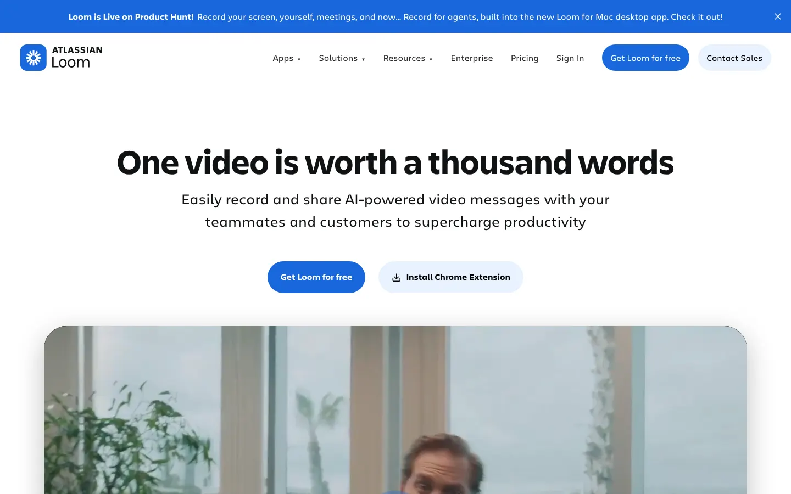
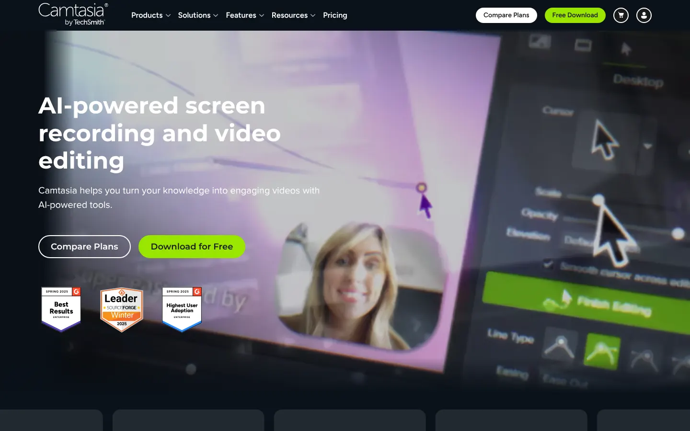
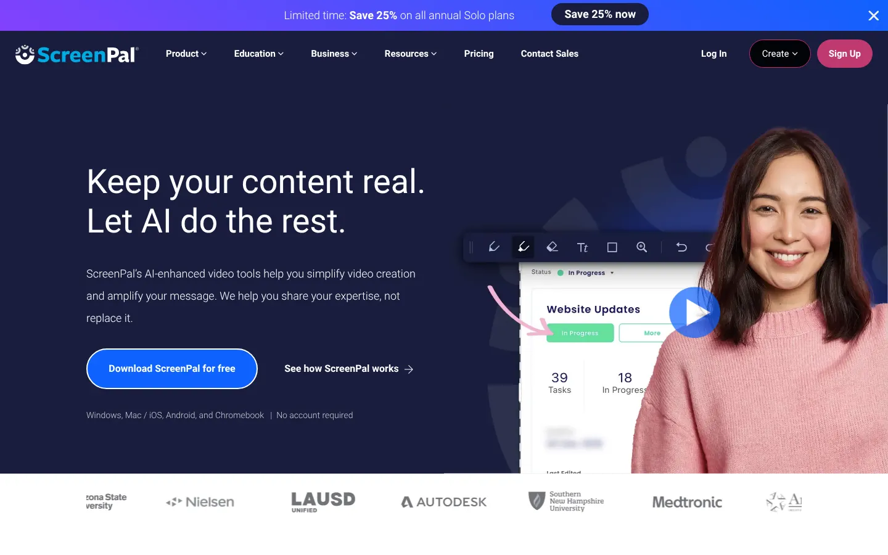
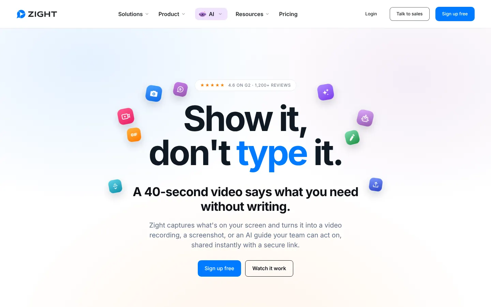
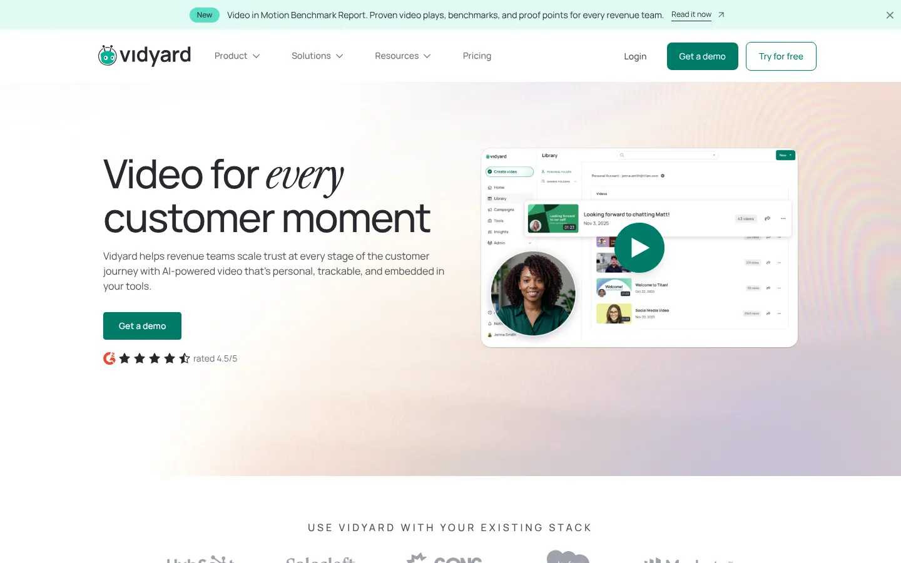
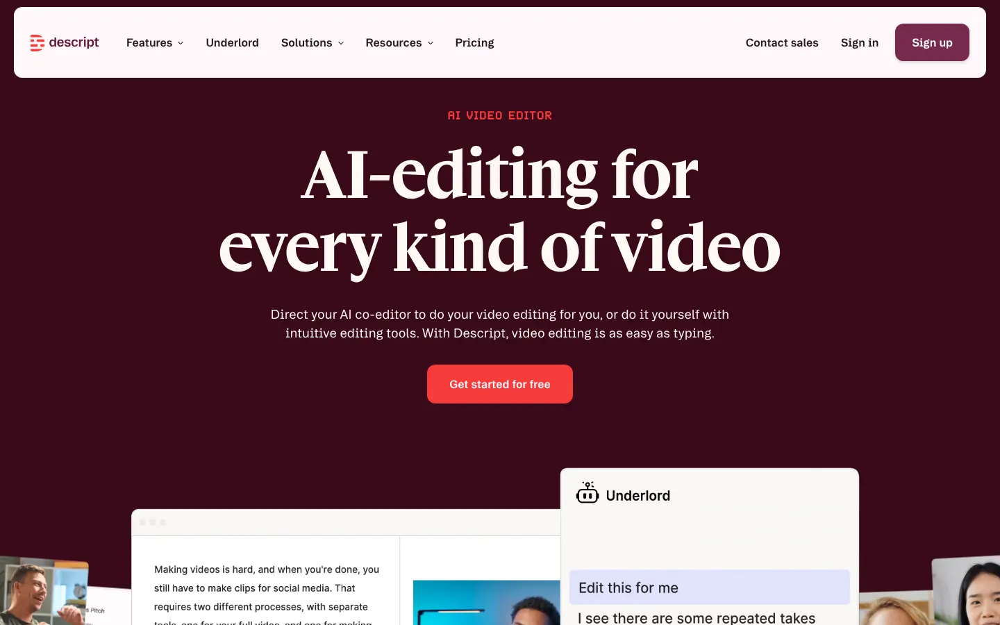
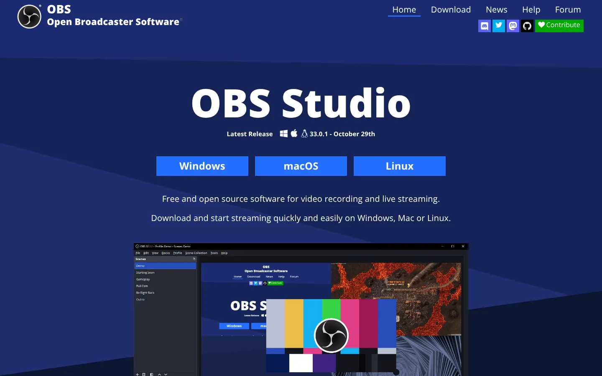
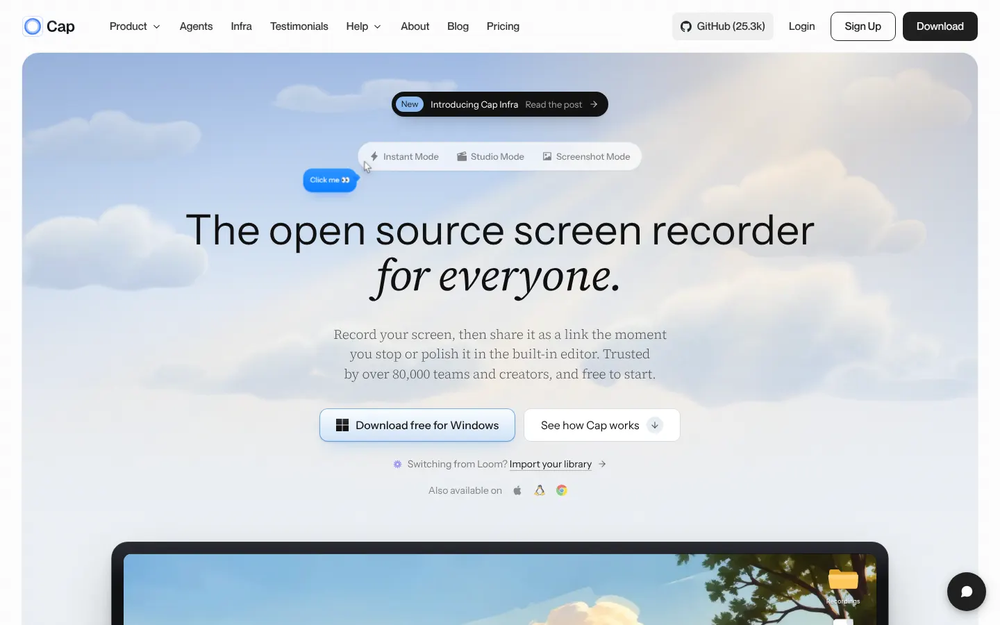
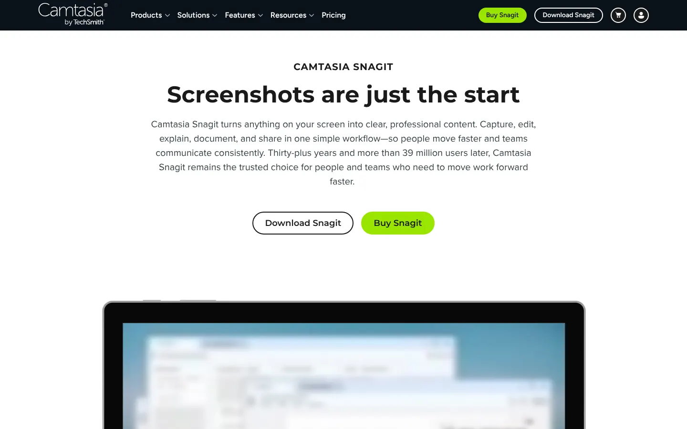
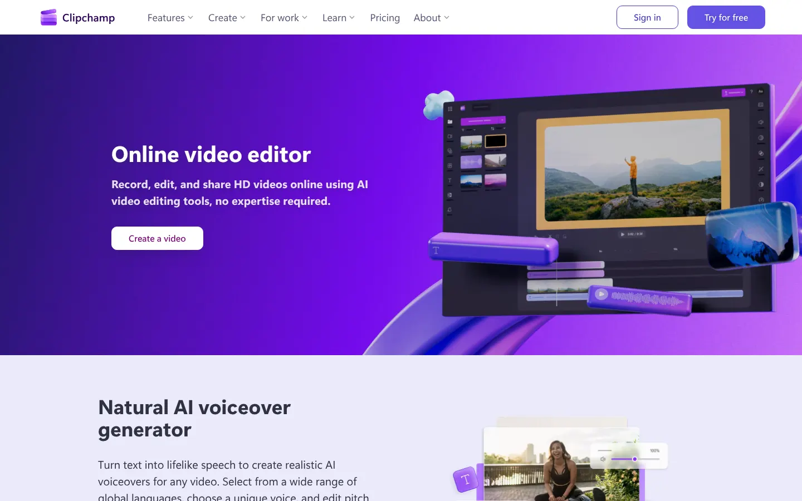

# 10 Best Screen Recording Software Tools for Teams in 2026

Loom is the clearest choice for fast asynchronous team updates. Camtasia suits polished tutorials and training. ScreenPal offers lower-cost managed recording, while OBS Studio provides flexible local capture. Choose by recording job, editing depth, hosting controls, administration, and sensitive-data requirements.

Screen recording software serves several different jobs. A quick update needs different controls from a training library.
Teams should separate capture, editing, hosting, search, sharing, and administration before comparing plans.
This comparison uses public product and pricing information reviewed on November 20, 2026. It does not claim hands-on testing.

## Key Takeaways

- **Loom is the default for async team updates**, with Business at $18 per user monthly on annual billing.
- **Camtasia and Descript suit polished training and edited video.**
- **Zight and Snagit combine screenshots and short recordings** for support and documentation work.
- **OBS Studio and Cap offer free or open-source options** for teams with technical users.
- **Check sharing, retention, and admin controls** before recordings spread across the company.

## How These Products Were Selected

Use the buying criteria that change implementation, risk, and total cost.

- **Capture.** Check desktop, browser, webcam, system audio, microphone, region, window, and multiple-screen support.
- **Editing.** Compare trimming, annotations, zoom, captions, transcript editing, templates, and reusable assets.
- **Delivery.** Review exports, hosted links, embeds, comments, viewer analytics, and content libraries.
- **Controls.** Check private links, guest access, expiry, retention, SSO, administration, and audit history.
- **Quality.** Confirm resolution, frame rate, codec, watermark, length, and storage limits.
- **Cost.** Count creator seats, viewers, storage, AI features, hosting, and editing licenses.

## Best Options at a Glance

| Product | Best for | Pricing signal | Main watch point |
| --- | --- | --- | --- |
| Loom | Quick async team messages | Free; Business from $18 per user monthly on annual billing | Free recordings have length and library limits |
| Camtasia | Edited training and tutorials | Subscription pricing through TechSmith | Deeper editing requires more production time |
| ScreenPal | Low-cost managed recording | Free; paid individual and team plans | Plan limits affect hosting and administration |
| Zight | Capture, requests, and visual collaboration | Paid team plans from about $12 per user monthly on annual billing | AI and collaboration features vary by plan |
| Vidyard | Sales and customer video messaging | Free option; paid pricing varies by plan | Revenue features can exceed general recording needs |
| Descript | Transcript-based editing | Free; paid from about $16 monthly on annual billing | AI allowances and export quality vary |
| OBS Studio | Flexible local capture and streaming | Free and open source | No managed hosting or simple team administration |
| Cap | Open-source Loom-style recording | Free personal options; paid hosting and team plans | Review hosting model and enterprise controls |
| Snagit | Screenshots and short procedural clips | Subscription pricing through TechSmith | It is not a full video production suite |
| Clipchamp | Browser recording and simple editing | Free features; premium access through Microsoft plans | Administration follows Microsoft account design |

## 1. Loom

**Best for:** Quick async team messages

Loom is built for fast screen, camera, and voice messages with hosted sharing. It fits status updates, walkthroughs, and lightweight support. The pilot should test link permissions, guest access, retention, and workspace ownership. Free individual recording limits can hide the cost of team administration.

**Pricing signal:** Free; Business from $18 per user monthly on annual billing. Check current terms on the [Loom pricing page](https://www.loom.com/pricing).

**Watch point:** Free recordings have length and library limits

## 2. Camtasia

**Best for:** Edited training and tutorials

Camtasia combines screen capture with a timeline editor, annotations, effects, and reusable assets. It suits structured training and product education. The software offers more control than a quick message recorder. Teams should budget production time, review steps, asset storage, and hosting separately.

**Pricing signal:** Subscription pricing through TechSmith. Check current terms on the [Camtasia pricing page](https://www.techsmith.com/camtasia/pricing/).

**Watch point:** Deeper editing requires more production time

## 3. ScreenPal

**Best for:** Low-cost managed recording

ScreenPal covers capture, editing, hosting, and team features at accessible entry prices. It fits education, support, and internal content teams. Compare individual creator plans with managed team plans. SSO, analytics, privacy, and administration may sit above the lowest tier.

**Pricing signal:** Free; paid individual and team plans. Check current terms on the [ScreenPal pricing page](https://screenpal.com/plans).

**Watch point:** Plan limits affect hosting and administration

## 4. Zight

**Best for:** Capture, requests, and visual collaboration

Zight combines screenshots, recordings, guides, requests, and hosted collaboration. It suits teams collecting visual context from customers or colleagues. Test upload ownership and guest workflows. Review how public links, comments, and recordings remain controlled after staff changes.

**Pricing signal:** Paid team plans from about $12 per user monthly on annual billing. Check current terms on the [Zight pricing page](https://zight.com/pricing/).

**Watch point:** AI and collaboration features vary by plan

## 5. Vidyard

**Best for:** Sales and customer video messaging

Vidyard focuses on video messaging, hosting, engagement, and revenue workflows. It fits sales and customer teams needing viewer context and integrations. Those features may add little for internal tutorials. Separate creator needs from analytics, customer relationship management, and governance requirements.

**Pricing signal:** Free option; paid pricing varies by plan. Check current terms on the [Vidyard pricing page](https://www.vidyard.com/pricing/).

**Watch point:** Revenue features can exceed general recording needs

## 6. Descript

**Best for:** Transcript-based editing

Descript lets editors change video and audio through a transcript. It suits interviews, demos, and content requiring quick narrative edits. Test speaker detection, captions, screen capture, exports, and project collaboration. Review generated voice features under company consent and identity policies.

**Pricing signal:** Free; paid from about $16 monthly on annual billing. Check current terms on the [Descript pricing page](https://www.descript.com/pricing).

**Watch point:** AI allowances and export quality vary

## 7. OBS Studio

**Best for:** Flexible local capture and streaming

OBS Studio provides powerful local recording, scenes, sources, and streaming without license cost. It fits technical users who need capture control. It is not a managed team library. Teams must design storage, sharing, updates, templates, and support around it.

**Pricing signal:** Free and open source. Check current terms on the [OBS Studio pricing page](https://obsproject.com/).

**Watch point:** No managed hosting or simple team administration

## 8. Cap

**Best for:** Open-source Loom-style recording

Cap offers a lighter recording workflow with open-source options and hosted sharing. It can fit technical teams wanting more deployment choice. Review the difference between local software, hosted services, and team features. Confirm support, retention, updates, and authentication before wider use.

**Pricing signal:** Free personal options; paid hosting and team plans. Check current terms on the [Cap pricing page](https://cap.so/pricing).

**Watch point:** Review hosting model and enterprise controls

## 9. Snagit

**Best for:** Screenshots and short procedural clips

Snagit combines screenshots, short recordings, annotations, and procedural assets. It suits documentation and support teams creating quick visual instructions. It does not replace Camtasia for complex timelines. Test capture workflows, asset reuse, export formats, and team licensing.

**Pricing signal:** Subscription pricing through TechSmith. Check current terms on the [Snagit pricing page](https://www.techsmith.com/snagit/pricing/).

**Watch point:** It is not a full video production suite

## 10. Clipchamp

**Best for:** Browser recording and simple editing

Microsoft Clipchamp combines browser-based capture with simple editing and export. It fits Microsoft users creating lightweight internal videos. Check workspace type, storage location, brand assets, and sharing. Consumer and work account experiences should not be treated as identical.

**Pricing signal:** Free features; premium access through Microsoft plans. Check current terms on the [Clipchamp pricing page](https://clipchamp.com/en/pricing/).

**Watch point:** Administration follows Microsoft account design

## How to Run a Useful Pilot

A useful pilot follows a real workflow and includes a controlled failure.

1. Record a five-minute support explanation with webcam and system audio.
2. Capture a two-monitor product demonstration at the required resolution.
3. Remove a sensitive section and verify the hosted version updates.
4. Share the result with an internal viewer and an approved guest.
5. Export captions, transcript, source media, and final video.
6. Disable the creator account and confirm ownership and retention.

## Common Buying Mistakes

These mistakes often appear after a promising product demonstration.

- Treating quick messages, training videos, and product demos as one job.
- Publishing public links without expiry or audience controls.
- Ignoring ownership transfer when a creator leaves the company.
- Paying for advanced editing on seats that only record short updates.

## Final Approval Checks

Use these questions before signing a contract or approving production rollout.

- Does each content type have an approved retention and sharing rule?
- Can creators remove sensitive material from every stored version?
- Can administrators transfer libraries when an employee leaves?
- Do guest links expire and support rapid revocation?
- Can the team export recordings, captions, and source files?
- Does each creator need editing, hosting, and analytics features?

## What to Watch in 2027

Watch AI editing, synthetic narration, and auto-generated guides. Confirm whether generated media, training data, and source recordings follow company policy.

Recorded walkthroughs often replace live meetings, so it helps to compare them with [AI meeting assistants](/ai/best-ai-meeting-assistants/) that summarize calls. Stack Row's [B2B technology statistics](/business-technology/b2b-tech-statistics/) give context on how teams buy collaboration software, and IT teams can pair recordings with [remote desktop software](/cloud-infrastructure/best-remote-desktop-software/) for live support.

## Frequently Asked Questions

### What Is the Best Screen Recording Software for Teams?

Loom suits quick async updates. Camtasia suits edited training, while ScreenPal offers lower-cost managed recording.

### Can Free Screen Recorders Support Business Use?

Yes, for small pilots. Check recording limits, resolution, storage, sharing controls, and administration first.

### Should Teams Choose Desktop or Browser Recording?

Browser tools start faster. Desktop applications usually provide deeper capture, editing, and local export controls.

### What Should a Security Review Cover?

Review retention, public links, guest access, sensitive-data controls, deletion, SSO, and audit records.

## Resources

Product and pricing pages were reviewed on November 20, 2026. Confirm current terms before purchase.

- [Loom pricing and product page](https://www.loom.com/pricing)
- [Camtasia pricing and product page](https://www.techsmith.com/camtasia/pricing/)
- [ScreenPal pricing and product page](https://screenpal.com/plans)
- [Zight pricing and product page](https://zight.com/pricing/)
- [Vidyard pricing and product page](https://www.vidyard.com/pricing/)
- [Descript pricing and product page](https://www.descript.com/pricing)
- [OBS Studio pricing and product page](https://obsproject.com/)
- [Cap pricing and product page](https://cap.so/pricing)
- [Snagit pricing and product page](https://www.techsmith.com/snagit/pricing/)
- [Clipchamp pricing and product page](https://clipchamp.com/en/pricing/)

Stack Row provides general technology research. Test every product against your own requirements before purchase.
