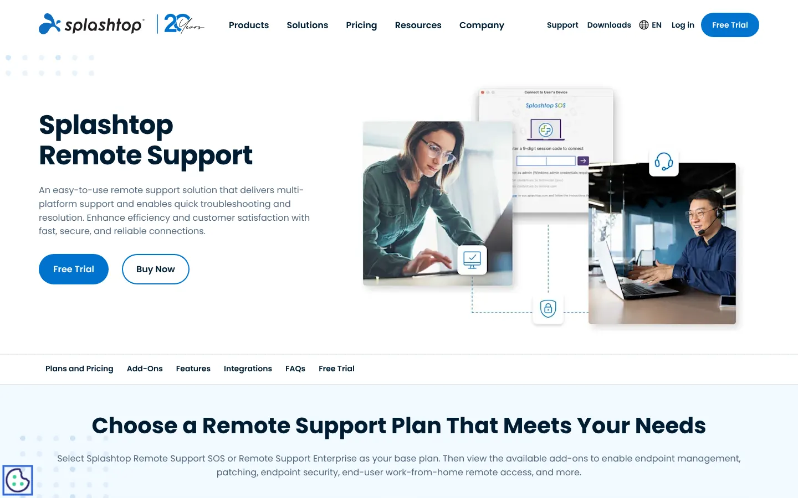
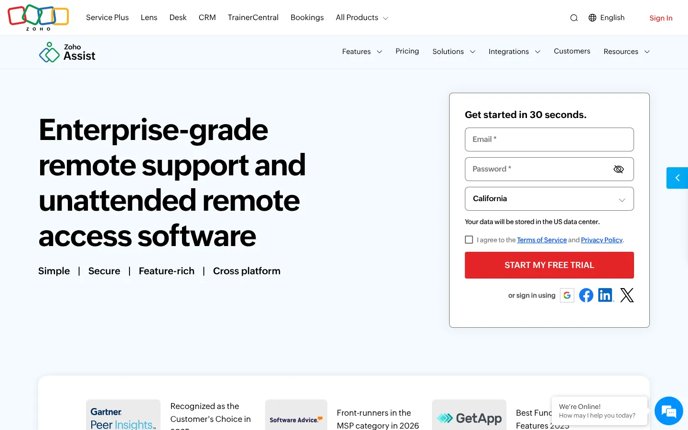
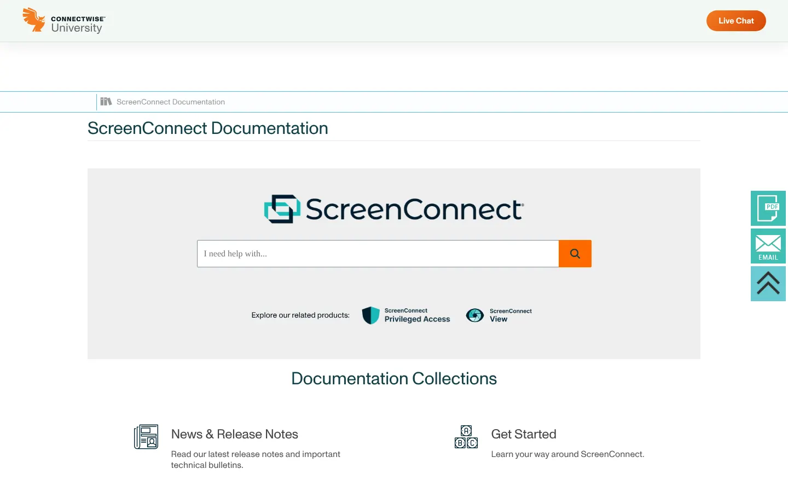
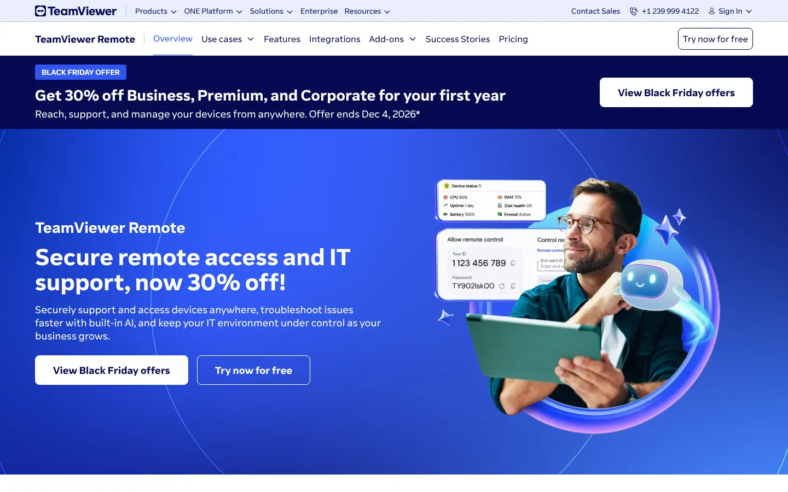
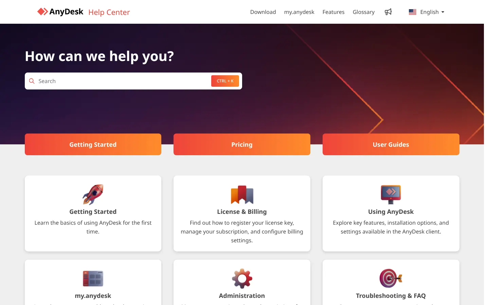
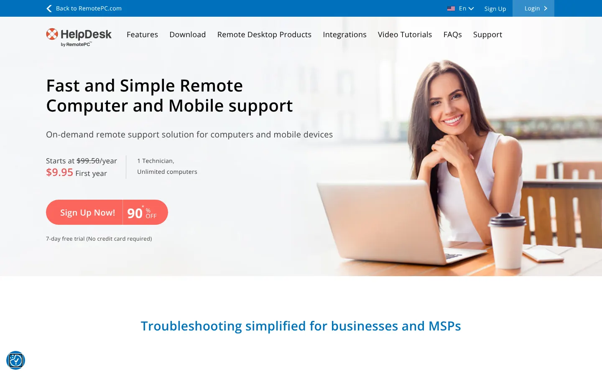
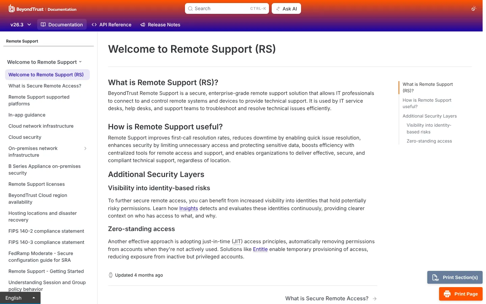
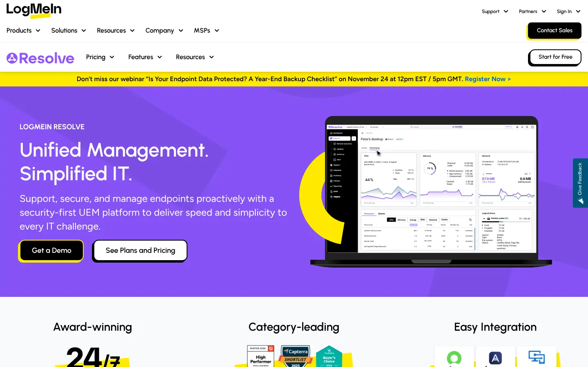
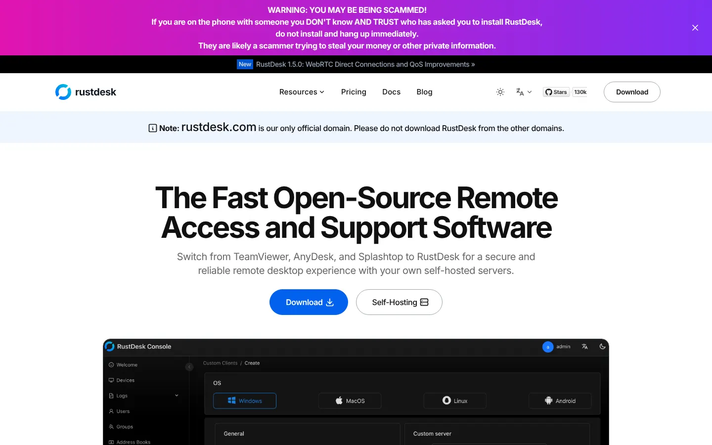
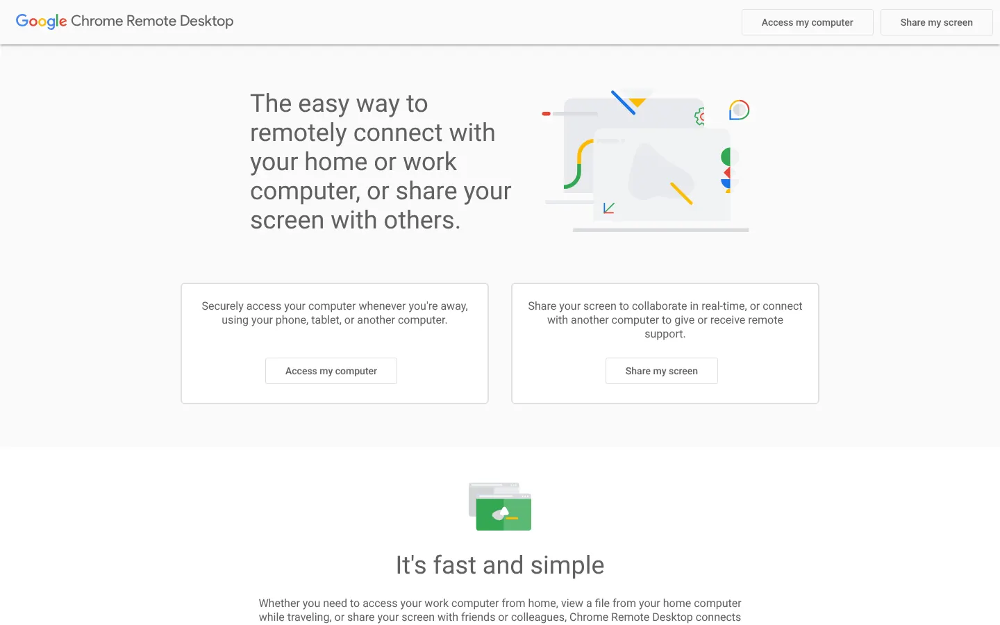

# 10 Best Remote Desktop Software Platforms for IT Support in 2026

Splashtop offers strong value for many IT teams. Zoho Assist provides an accessible entry point, while ScreenConnect suits concurrent support operations. TeamViewer brings broad coverage, and BeyondTrust targets controlled privileged support. The right choice depends on access mode, identity, logging, endpoints, and session capacity.

Remote desktop software creates a direct path into business devices. Convenience must sit behind clear identity, approval, and logging controls.
IT teams should separate attended support, unattended administration, personal access, and privileged support before comparing products.
This article uses public product and pricing information reviewed on November 20, 2026. It does not claim hands-on testing.

## Key Takeaways

- **Splashtop and Zoho Assist offer strong value for growing IT teams**, with Zoho Assist Standard at $10 per technician monthly on annual billing.
- **BeyondTrust and ConnectWise ScreenConnect suit security-focused and managed service teams.**
- **TeamViewer and AnyDesk remain familiar choices** for mixed-device support.
- **RustDesk and Chrome Remote Desktop cover self-hosted and free use cases**, with fewer administrative controls.
- **Remote access tools are a common attack path.** Enforce MFA, session logging, and unattended-access rules.

## How These Products Were Selected

Use the buying criteria that change implementation, risk, and total cost.

- **Access mode.** Separate user-approved sessions from persistent unattended access.
- **Identity.** Check multifactor authentication, SSO, roles, technician groups, and service accounts.
- **Session controls.** Review approval, recording, transfer, file movement, clipboard, scripts, and elevation.
- **Platforms.** Test Windows, macOS, Linux, mobile, browsers, multiple monitors, and restricted networks.
- **Audit.** Confirm searchable logs, export, retention, alerting, and administrator changes.
- **Pricing.** Model technicians, endpoints, concurrent sessions, add-ons, storage, and managed devices.

## Best Options at a Glance

| Product | Best for | Pricing signal | Main watch point |
| --- | --- | --- | --- |
| Splashtop | Cost-conscious IT support | Public plans vary by technician and endpoint | Separate attended and unattended licensing |
| Zoho Assist | Affordable attended and unattended support | Free option; remote support from about $10 per technician monthly | Some capabilities require higher editions |
| ConnectWise ScreenConnect | Concurrent technician support | Published per-technician plans; confirm current terms | Plan limits affect sessions and advanced tools |
| TeamViewer Remote | Broad platform and enterprise support | Public entry plans and quote-based enterprise tiers | Licensing and commercial-use controls need review |
| AnyDesk | Remote access with endpoint management options | Published paid plans; confirm current terms | Advanced administration depends on tier |
| RemotePC HelpDesk | Simple remote support pricing | Public per-technician plans | Enterprise controls require plan comparison |
| BeyondTrust Remote Support | Privileged enterprise support | Quote-based | Implementation and integration scope can be substantial |
| GoTo Resolve | Support plus endpoint operations | Public and quote-based plans | Bundled functions may exceed simple remote access |
| RustDesk | Self-hosted deployment control | Open-source and paid options | Self-hosting creates operating responsibility |
| Chrome Remote Desktop | Simple personal or limited access | Free | Limited business administration and support workflow |

## 1. Splashtop

**Best for:** Cost-conscious IT support

Splashtop covers remote support, unattended access, file transfer, and administration across common platforms. It fits teams needing broad capability at a controlled price. Buyers should map technician counts, managed endpoints, concurrent sessions, and support features. Test macOS permissions and mobile support in the real environment.

**Pricing signal:** Public plans vary by technician and endpoint. Check current terms on the [Splashtop pricing page](https://www.splashtop.com/pricing).

**Watch point:** Separate attended and unattended licensing

## 2. Zoho Assist

**Best for:** Affordable attended and unattended support

Zoho Assist offers browser-based support, unattended access, integrations, and plan choices for smaller teams. It fits organizations wanting a clear entry path. Remote support and unattended access can use different licensing. Model both if technicians handle user incidents and managed devices.

**Pricing signal:** Free option; remote support from about $10 per technician monthly. Check current terms on the [Zoho Assist pricing page](https://www.zoho.com/assist/pricing.html).

**Watch point:** Some capabilities require higher editions

## 3. ConnectWise ScreenConnect

**Best for:** Concurrent technician support

ScreenConnect fits IT providers and support teams needing attended and unattended access with technician controls. Concurrent-session allowances influence capacity. Test queue handoffs, session approval, recording, scripts, and audit records. Buyers should also review deployment and update responsibilities.

**Pricing signal:** Published per-technician plans; confirm current terms. Check current terms on the [ConnectWise ScreenConnect pricing page](https://screenconnect.connectwise.com/pricing).

**Watch point:** Plan limits affect sessions and advanced tools

## 4. TeamViewer Remote

**Best for:** Broad platform and enterprise support

TeamViewer Remote offers mature cross-platform access, support, integrations, and enterprise options. It fits organizations needing broad device coverage. The evaluation should separate personal access from commercial support licensing. Model technicians, endpoints, concurrent sessions, and required integrations.

**Pricing signal:** Public entry plans and quote-based enterprise tiers. Check current terms on the [TeamViewer Remote pricing page](https://www.teamviewer.com/en-us/pricing/).

**Watch point:** Licensing and commercial-use controls need review

## 5. AnyDesk

**Best for:** Remote access with endpoint management options

AnyDesk supports attended support, unattended access, mobile use, and endpoint features. It fits teams wanting a lightweight remote client. Review plan limits, address books, permissions, session recording, and deployment controls. Test performance across the team's slowest normal network.

**Pricing signal:** Published paid plans; confirm current terms. Check current terms on the [AnyDesk pricing page](https://anydesk.com/en/pricing).

**Watch point:** Advanced administration depends on tier

## 6. RemotePC HelpDesk

**Best for:** Simple remote support pricing

RemotePC HelpDesk targets browser-led support and technician sessions. It fits smaller teams that need straightforward remote assistance. Test customer join steps, queue management, transfers, multi-monitor use, and reporting. Confirm whether unattended administration needs a separate product or plan.

**Pricing signal:** Public per-technician plans. Check current terms on the [RemotePC HelpDesk pricing page](https://www.remotepc.com/helpdesk-pricing).

**Watch point:** Enterprise controls require plan comparison

## 7. BeyondTrust Remote Support

**Best for:** Privileged enterprise support

BeyondTrust Remote Support focuses on controlled privileged support across enterprise environments. It fits regulated or complex organizations prioritizing access policy and auditability. The platform requires design work around identity, approvals, session records, and integrations. Include implementation and administrator effort in total cost.

**Pricing signal:** Quote-based. Check current terms on the [BeyondTrust Remote Support pricing page](https://www.beyondtrust.com/products/remote-support).

**Watch point:** Implementation and integration scope can be substantial

## 8. GoTo Resolve

**Best for:** Support plus endpoint operations

GoTo Resolve combines remote support with ticketing and endpoint management functions. It fits teams seeking fewer separate tools. A bundle only saves money when the team retires overlapping products. Test patching, support, unattended access, alerts, and reporting as separate workflows.

**Pricing signal:** Public and quote-based plans. Check current terms on the [GoTo Resolve pricing page](https://www.goto.com/it-management/resolve/pricing).

**Watch point:** Bundled functions may exceed simple remote access

## 9. RustDesk

**Best for:** Self-hosted deployment control

RustDesk offers open-source remote desktop software and self-hosted server options. It fits technical teams wanting infrastructure control. That choice transfers updates, availability, certificates, access policy, backups, and incident response to the operator. Test the full operating model, not only the connection.

**Pricing signal:** Open-source and paid options. Check current terms on the [RustDesk pricing page](https://rustdesk.com/pricing/).

**Watch point:** Self-hosting creates operating responsibility

## 10. Chrome Remote Desktop

**Best for:** Simple personal or limited access

Chrome Remote Desktop offers basic remote access through Google accounts and supported devices. It can suit limited internal use or personal access. It lacks the deeper queues, audit, policy, and service controls expected by larger IT teams. Do not stretch a simple tool into a managed support platform.

**Pricing signal:** Free. Check current terms on the [Chrome Remote Desktop pricing page](https://remotedesktop.google.com/).

**Watch point:** Limited business administration and support workflow

## How to Run a Useful Pilot

A useful pilot follows a real workflow and includes a controlled failure.

1. Run one attended session with an explicit user approval.
2. Deploy unattended access through the approved software channel.
3. Block file transfer and clipboard, then verify enforcement.
4. Record one session and test access to the evidence.
5. Remove a technician during an active incident simulation.
6. Export logs and connect them to the incident record.

## Common Buying Mistakes

These mistakes often appear after a promising product demonstration.

- Using unattended access when user-approved support would meet the need.
- Allowing shared technician accounts that weaken audit evidence.
- Enabling file transfer, clipboard, or scripts without job-based controls.
- Comparing license prices without modeling endpoints and concurrent sessions.

## Final Approval Checks

Use these questions before signing a contract or approving production rollout.

- Is unattended access limited to devices that require persistent administration?
- Does every technician use a named identity with multifactor authentication?
- Can administrators block file transfer, clipboard use, and scripts?
- Do session records reach the incident or service record?
- Can access be revoked quickly across every deployed endpoint?
- Does licensing cover expected concurrent sessions during major incidents?

## What to Watch in 2027

Watch AI-generated session summaries and automated remediation. Require exact action records and human approval for consequential changes.

Remote support decisions overlap with cloud and security planning. Stack Row's [cloud computing statistics](/cloud-infrastructure/cloud-computing-statistics/) explain how infrastructure is shifting, and support teams should review [help desk software](/saas/best-help-desk-software/) for ticketing. Because remote access accounts are high-value targets, pair any rollout with [password managers for companies](/cybersecurity/password-managers-for-companies/) and MFA.

## Frequently Asked Questions

### What Is the Safest Remote Desktop Software?

Safety depends on deployment and controls. Require multifactor authentication, approval, logging, least privilege, and rapid revocation.

### What Is Unattended Remote Access?

It lets an authorized technician connect without a person approving each session at the endpoint.

### How Do Concurrent Sessions Affect Cost?

Some vendors charge per technician or endpoint. Others limit simultaneous sessions, which changes staffing capacity.

### Should Remote Sessions Be Recorded?

Recordings can support review and compliance. They also create sensitive data that needs controlled retention.

## Resources

Product and pricing pages were reviewed on November 20, 2026. Confirm current terms before purchase.

- [Splashtop pricing and product page](https://www.splashtop.com/pricing)
- [Zoho Assist pricing and product page](https://www.zoho.com/assist/pricing.html)
- [ConnectWise ScreenConnect pricing and product page](https://screenconnect.connectwise.com/pricing)
- [TeamViewer Remote pricing and product page](https://www.teamviewer.com/en-us/pricing/)
- [AnyDesk pricing and product page](https://anydesk.com/en/pricing)
- [RemotePC HelpDesk pricing and product page](https://www.remotepc.com/helpdesk-pricing)
- [BeyondTrust Remote Support pricing and product page](https://www.beyondtrust.com/products/remote-support)
- [GoTo Resolve pricing and product page](https://www.goto.com/it-management/resolve/pricing)
- [RustDesk pricing and product page](https://rustdesk.com/pricing/)
- [Chrome Remote Desktop pricing and product page](https://remotedesktop.google.com/)

Stack Row provides general technology research. Test every product against your own requirements before purchase.
