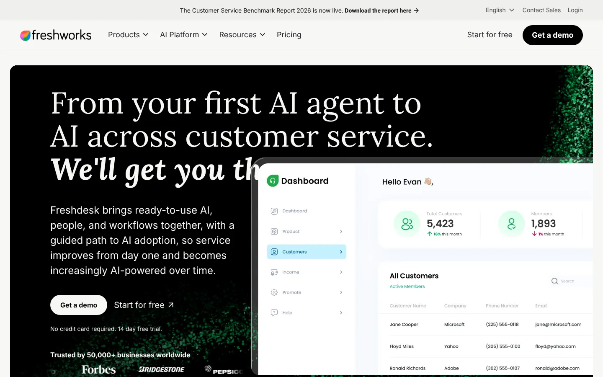
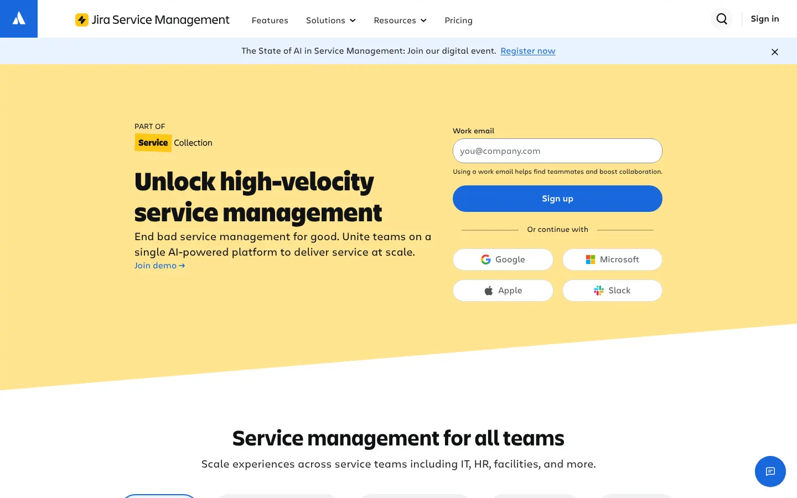
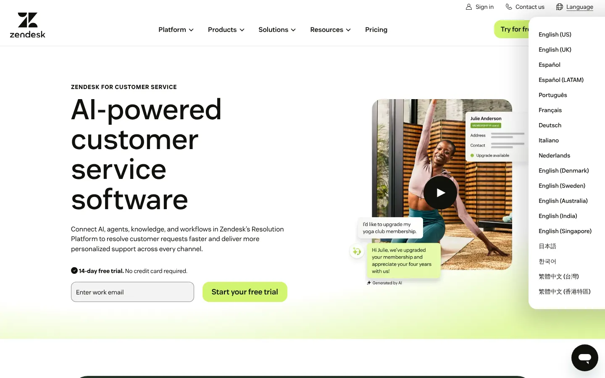
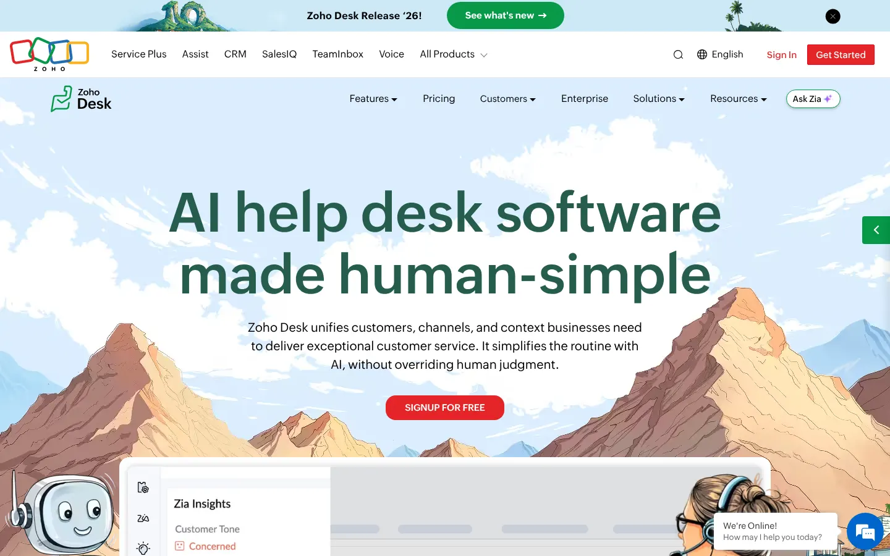
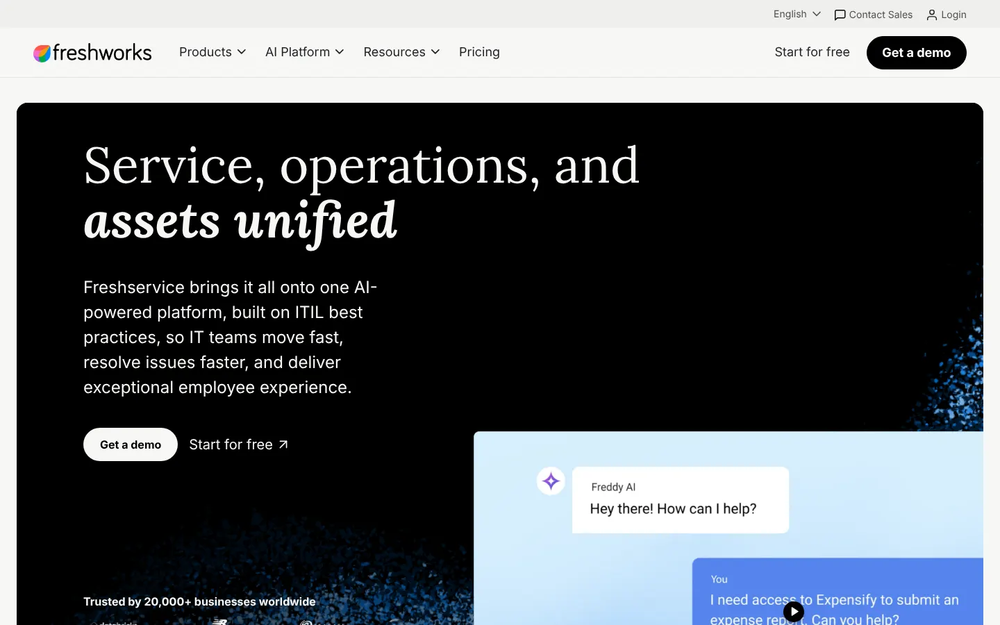
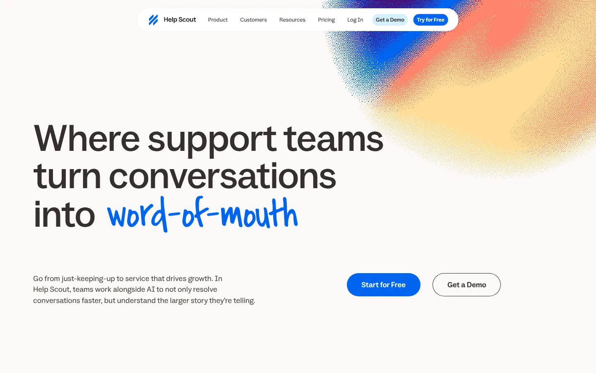
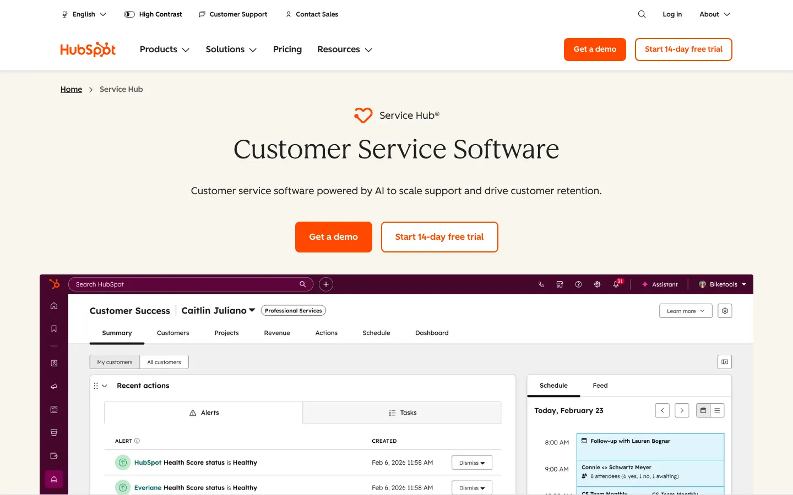
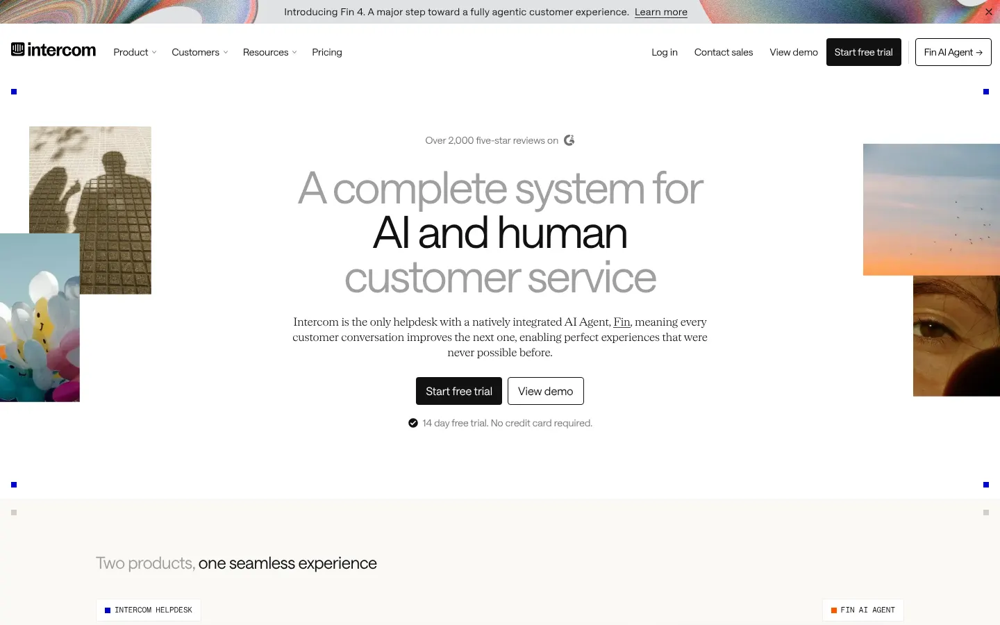
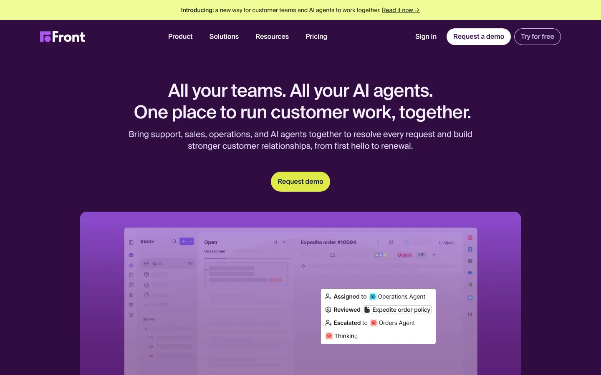
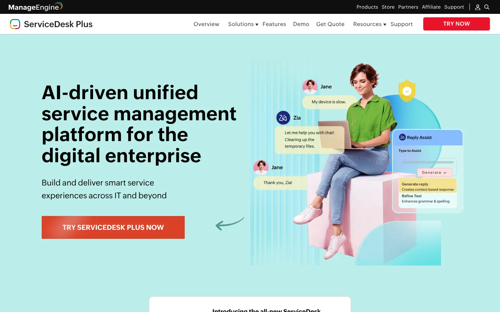

# 10 Best Help Desk Software Platforms for Growing IT Teams

Freshdesk offers a balanced starting point for growing customer support teams. Jira Service Management and Freshservice fit internal IT. Zendesk suits complex customer operations, while Zoho Desk offers lower entry pricing. The best choice depends on the service model, channels, assets, approvals, and migration needs.

Help desk software can serve customers, employees, or both. Those service models need different workflows and controls.
A useful comparison covers queues, service levels, knowledge, assets, approvals, automation, AI, reporting, and migration.
This article uses public product and pricing information reviewed on November 20, 2026. It does not claim hands-on testing.

## Key Takeaways

- **Freshdesk and Zoho Desk are strong value picks**, with paid plans from $19 per agent and $7 per user monthly on annual billing.
- **Jira Service Management and Freshservice fit IT teams** that need ITIL-style service management.
- **Zendesk and Intercom suit larger customer service teams** that want mature AI and automation.
- **Help Scout and Front keep support close to email** for smaller teams.
- **Budget for AI add-ons.** Per-resolution and copilot charges can exceed the base seat price.

## How These Products Were Selected

Use the buying criteria that change implementation, risk, and total cost.

- **Service model.** Define customer support, internal IT, enterprise service, or a mixed operation.
- **Intake.** Compare email, portals, chat, messaging, phone, forms, and application events.
- **Work control.** Review queues, assignment, SLAs, approvals, escalation, dependencies, and major incidents.
- **Knowledge.** Check authoring, review, permissions, search, feedback, and AI retrieval.
- **Operations.** Confirm assets, changes, releases, service catalogs, reporting, and audit history.
- **Cost.** Model agents, light users, AI units, channels, assets, onboarding, and add-ons.

## Best Options at a Glance

| Product | Best for | Pricing signal | Main watch point |
| --- | --- | --- | --- |
| Freshdesk | Growing customer support teams | Free option; paid from about $19 per agent monthly | AI and omnichannel functions add cost |
| Jira Service Management | IT and development workflows | Free option; paid agent tiers | Configuration can grow complex |
| Zendesk | Scaled omnichannel support | Suite plans from about $55 per agent monthly | Advanced features and AI can raise cost |
| Zoho Desk | Value-focused multichannel support | Free option; paid from $7 per user monthly on annual billing | Plan differences affect channels and automation |
| Freshservice | Internal IT service management | Paid from about $19 per agent monthly | Assets and advanced ITSM require higher plans |
| Help Scout | Email-first customer support | Free and paid options; paid from about $25 per user monthly | Complex ITSM needs another platform |
| HubSpot Service Hub | CRM-connected customer service | Free tools and paid seat-based tiers | Total cost follows the wider HubSpot setup |
| Intercom | Messaging-led support with AI | Seat and usage-based pricing | AI resolutions create a separate variable |
| Front | Collaborative customer operations | Paid from about $25 per seat monthly | It is broader than a traditional ticket queue |
| ManageEngine ServiceDesk Plus | ITSM with deployment choice | Public and quote-based editions | Administration and modules require planning |

## 1. Freshdesk

**Best for:** Growing customer support teams

Freshdesk provides email ticketing, portals, knowledge, automation, and broader service channels. It fits growing customer support operations. Teams should model agent tiers, channels, AI use, and onboarding together. Test SLA clocks, assignment, escalation, and reporting with real queue rules.

**Pricing signal:** Free option; paid from about $19 per agent monthly. Check current terms on the [Freshdesk pricing page](https://www.freshworks.com/freshdesk/pricing/).

**Watch point:** AI and omnichannel functions add cost

## 2. Jira Service Management

**Best for:** IT and development workflows

Jira Service Management connects requests, incidents, changes, assets, and development work. It fits internal IT and product-linked service operations. The strongest value appears when Jira already supports engineering. Test portal design, approvals, queues, automation, and cross-project permissions.

**Pricing signal:** Free option; paid agent tiers. Check current terms on the [Jira Service Management pricing page](https://www.atlassian.com/software/jira/service-management/pricing).

**Watch point:** Configuration can grow complex

## 3. Zendesk

**Best for:** Scaled omnichannel support

Zendesk supports mature customer service operations across channels, routing, knowledge, and reporting. It fits organizations with complex support structures. The implementation can involve substantial configuration and integrations. Model agent roles, channels, AI, workforce functions, and professional services.

**Pricing signal:** Suite plans from about $55 per agent monthly. Check current terms on the [Zendesk pricing page](https://www.zendesk.com/pricing/).

**Watch point:** Advanced features and AI can raise cost

## 4. Zoho Desk

**Best for:** Value-focused multichannel support

Zoho Desk provides tickets, SLAs, knowledge, automation, and broader Zoho connections. It fits smaller teams and existing Zoho customers. Test email threading, account structure, portal permissions, and reporting. Low entry pricing should not replace a workflow check.

**Pricing signal:** Free option; paid from $7 per user monthly on annual billing. Check current terms on the [Zoho Desk pricing page](https://www.zoho.com/desk/pricing.html).

**Watch point:** Plan differences affect channels and automation

## 5. Freshservice

**Best for:** Internal IT service management

Freshservice targets internal IT with incidents, requests, changes, knowledge, and service management. It fits teams moving beyond a basic shared inbox. Review asset, discovery, orchestration, and project needs separately. Test approvals, service catalog forms, and change records.

**Pricing signal:** Paid from about $19 per agent monthly. Check current terms on the [Freshservice pricing page](https://www.freshworks.com/freshservice/pricing/).

**Watch point:** Assets and advanced ITSM require higher plans

## 6. Help Scout

**Best for:** Email-first customer support

Help Scout emphasizes shared inboxes, knowledge, and customer communication. It suits support teams wanting a simpler operating model. It is not designed as a full IT service platform. Test collision handling, customer context, permissions, saved replies, and reporting.

**Pricing signal:** Free and paid options; paid from about $25 per user monthly. Check current terms on the [Help Scout pricing page](https://www.helpscout.com/pricing/).

**Watch point:** Complex ITSM needs another platform

## 7. HubSpot Service Hub

**Best for:** CRM-connected customer service

HubSpot Service Hub connects tickets, customer records, knowledge, feedback, and sales context. It fits organizations already running HubSpot CRM. The value depends on shared data and process alignment. Model required hubs, seats, onboarding, and tier limits together.

**Pricing signal:** Free tools and paid seat-based tiers. Check current terms on the [HubSpot Service Hub pricing page](https://www.hubspot.com/pricing/service).

**Watch point:** Total cost follows the wider HubSpot setup

## 8. Intercom

**Best for:** Messaging-led support with AI

Intercom centers support around messaging, automation, customer context, and AI assistance. It fits digital products with high in-app service demand. Costs can combine seats and outcome-based units. Test handoff, unresolved cases, identity, knowledge quality, and billing under real volumes.

**Pricing signal:** Seat and usage-based pricing. Check current terms on the [Intercom pricing page](https://www.intercom.com/pricing).

**Watch point:** AI resolutions create a separate variable

## 9. Front

**Best for:** Collaborative customer operations

Front combines shared communication with assignment, collaboration, rules, and customer context. It fits teams managing customer operations across email and other channels. Test internal comments, ownership, SLA reporting, routing, and shared-address behavior. Clarify when a message becomes a formal ticket.

**Pricing signal:** Paid from about $25 per seat monthly. Check current terms on the [Front pricing page](https://front.com/pricing).

**Watch point:** It is broader than a traditional ticket queue

## 10. ManageEngine ServiceDesk Plus

**Best for:** ITSM with deployment choice

ServiceDesk Plus supports incidents, assets, changes, service catalogs, and IT operations. It fits internal IT teams wanting cloud or on-premises options. The product can expand across several modules. Start with required processes and avoid enabling features without owners.

**Pricing signal:** Public and quote-based editions. Check current terms on the [ManageEngine ServiceDesk Plus pricing page](https://www.manageengine.com/products/service-desk/pricing.html).

**Watch point:** Administration and modules require planning

## How to Run a Useful Pilot

A useful pilot follows a real workflow and includes a controlled failure.

1. Import a controlled set of tickets with users and organizations.
2. Run email, portal, and escalation paths with real SLA rules.
3. Test one approval and one cross-team handoff.
4. Create, review, publish, and retire one knowledge article.
5. Break an integration and observe alerting and queue impact.
6. Export tickets, comments, attachments, users, and audit data.

## Common Buying Mistakes

These mistakes often appear after a promising product demonstration.

- Mixing customer support and internal IT requirements without prioritizing either.
- Recreating every old queue before checking whether it still serves users.
- Migrating historical tickets without retention, privacy, or search rules.
- Buying AI capacity before the knowledge base and handoff process work.

## Final Approval Checks

Use these questions before signing a contract or approving production rollout.

- Does the selected platform fit customer support or internal IT first?
- Can service owners explain every queue, priority, and escalation rule?
- Does the migration preserve required history without moving unnecessary data?
- Can knowledge articles follow review, approval, and retirement workflows?
- Are AI actions visible, bounded, and handed to people correctly?
- Does the budget include agents, AI units, channels, and onboarding?

## What to Watch in 2027

Watch AI agents that resolve tickets or change records. Require permission boundaries, source evidence, handoff rules, and a complete action record.

Help desk software is a core SaaS purchase, and Stack Row's [SaaS statistics on revenue and adoption](/saas/saas-statistics-revenue-adoption/) show how these subscriptions grow. IT teams that support users directly should also compare [remote desktop software](/cloud-infrastructure/best-remote-desktop-software/), and teams routing tickets automatically can review [workflow automation software](/business-technology/best-workflow-automation-software/).

## Frequently Asked Questions

### What Is the Difference Between Help Desk and ITSM Software?

A help desk manages requests and tickets. IT service management adds services, changes, assets, and processes.

### How Many Agents Should a Pilot Include?

Use one complete queue with enough agents to cover normal shifts, escalations, and reporting needs.

### What Data Should Move During Migration?

Move active tickets, users, organizations, tags, SLAs, macros, knowledge, and required history.

### How Should Teams Compare AI Pricing?

Separate seat costs from AI resolutions, credits, bots, and usage-based add-ons.

## Resources

Product and pricing pages were reviewed on November 20, 2026. Confirm current terms before purchase.

- [Freshdesk pricing and product page](https://www.freshworks.com/freshdesk/pricing/)
- [Jira Service Management pricing and product page](https://www.atlassian.com/software/jira/service-management/pricing)
- [Zendesk pricing and product page](https://www.zendesk.com/pricing/)
- [Zoho Desk pricing and product page](https://www.zoho.com/desk/pricing.html)
- [Freshservice pricing and product page](https://www.freshworks.com/freshservice/pricing/)
- [Help Scout pricing and product page](https://www.helpscout.com/pricing/)
- [HubSpot Service Hub pricing and product page](https://www.hubspot.com/pricing/service)
- [Intercom pricing and product page](https://www.intercom.com/pricing)
- [Front pricing and product page](https://front.com/pricing)
- [ManageEngine ServiceDesk Plus pricing and product page](https://www.manageengine.com/products/service-desk/pricing.html)

Stack Row provides general technology research. Test every product against your own requirements before purchase.
