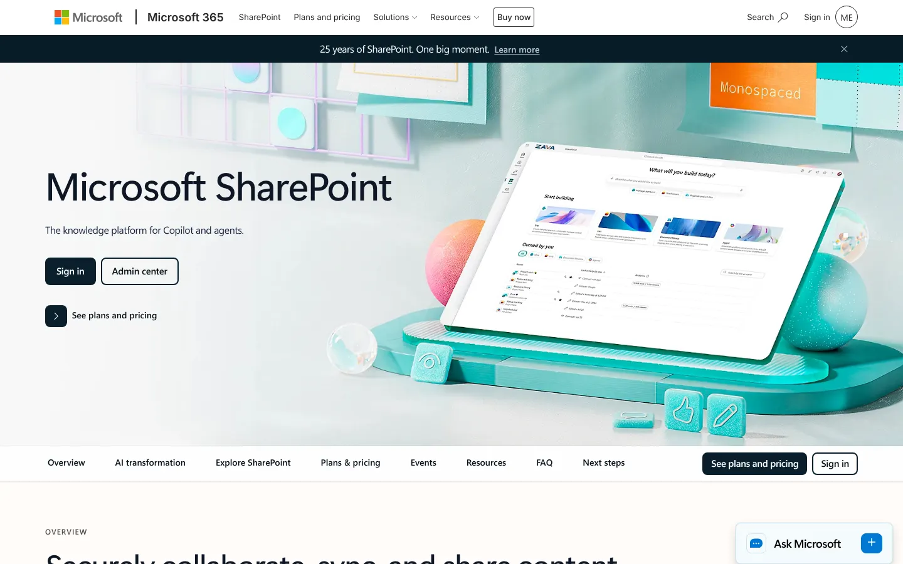
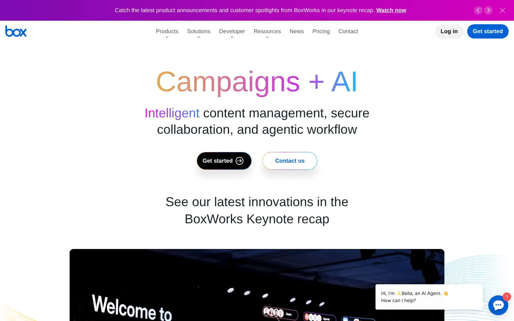
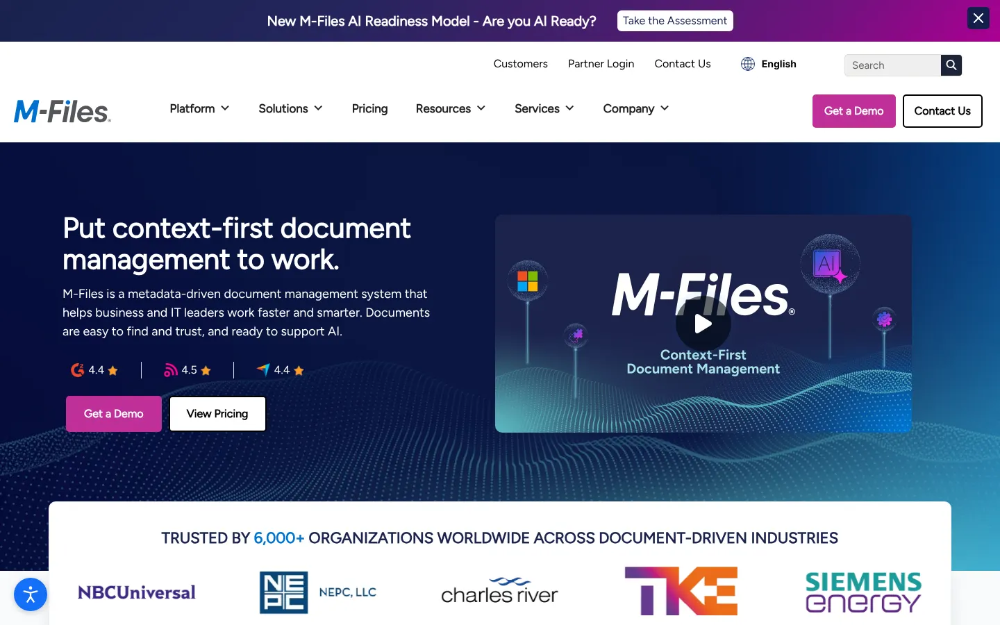
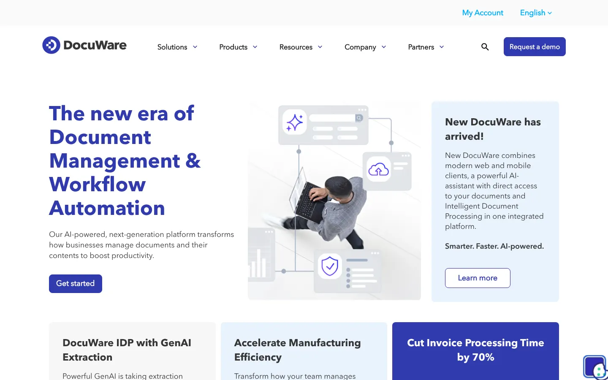
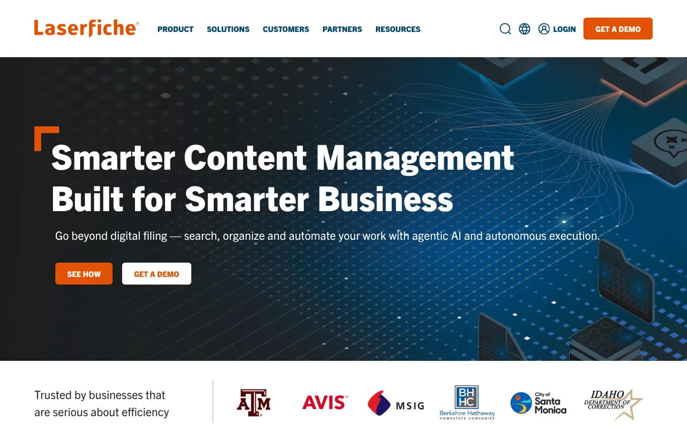
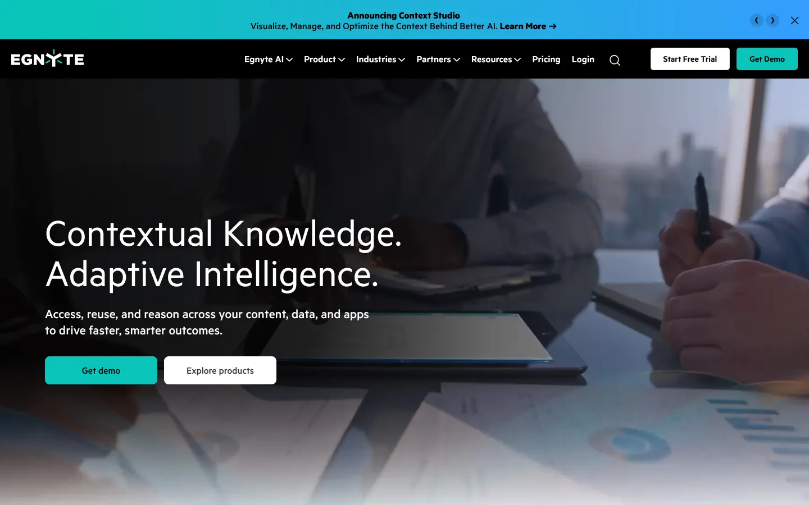
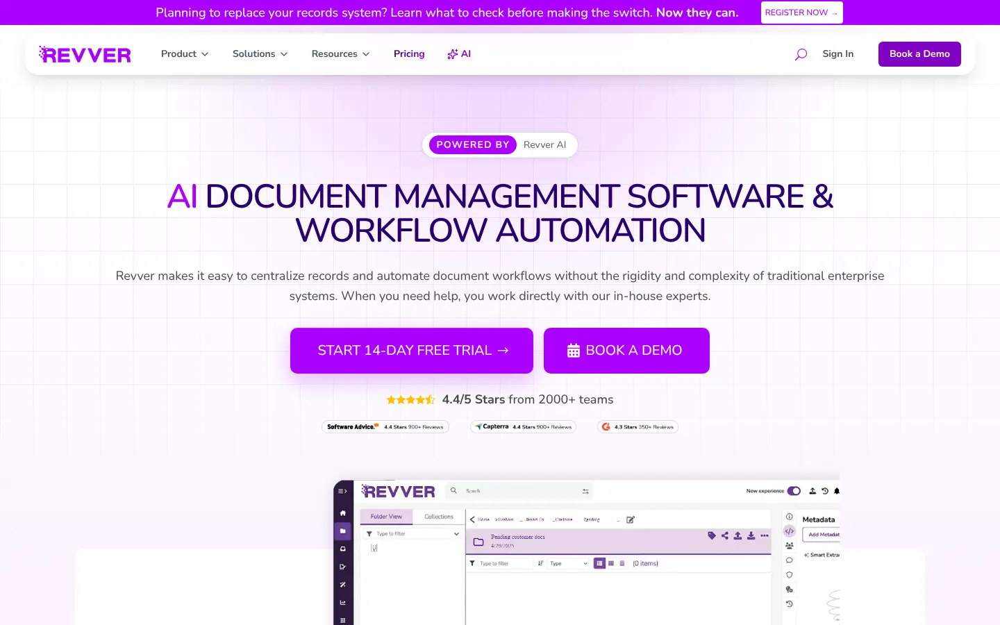
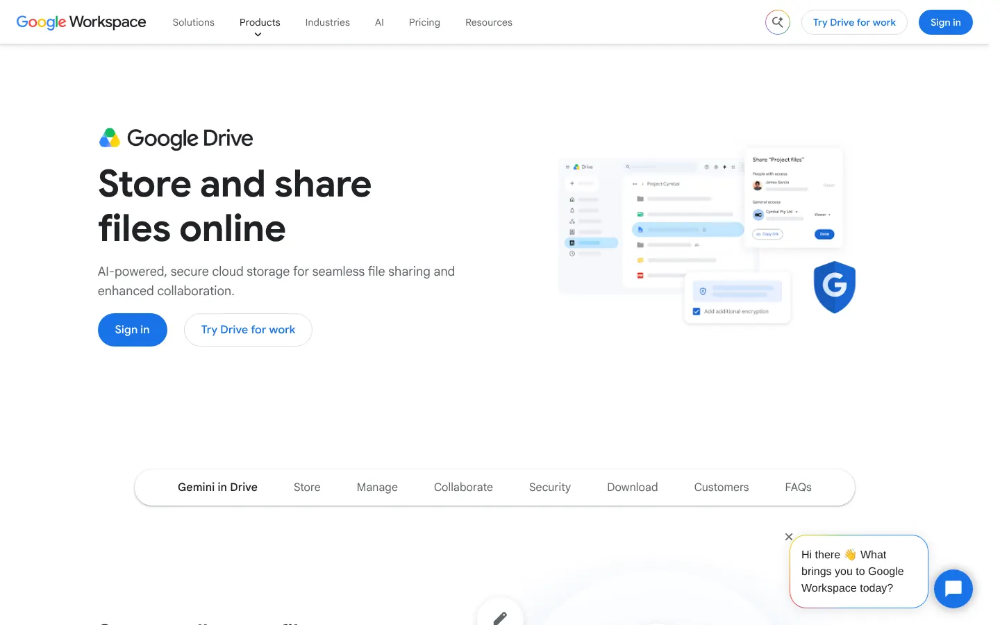
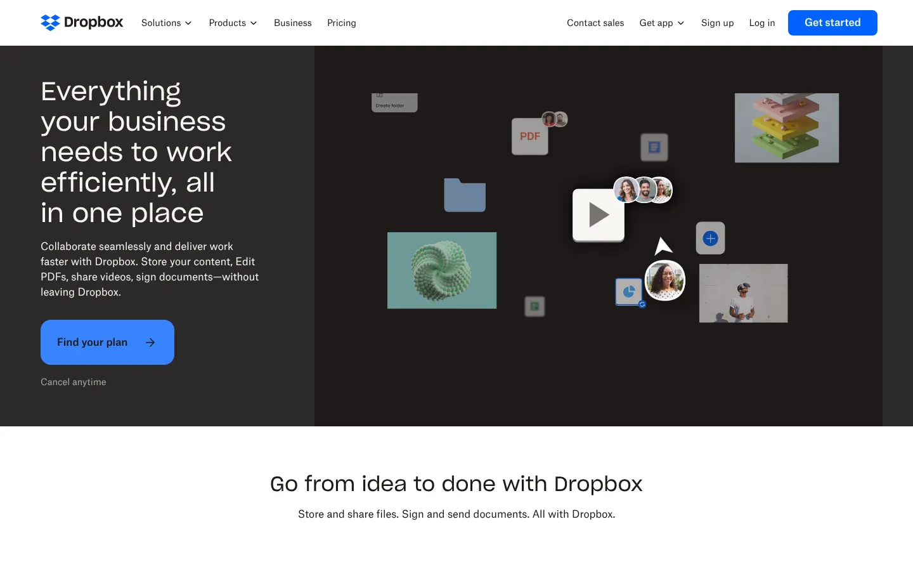
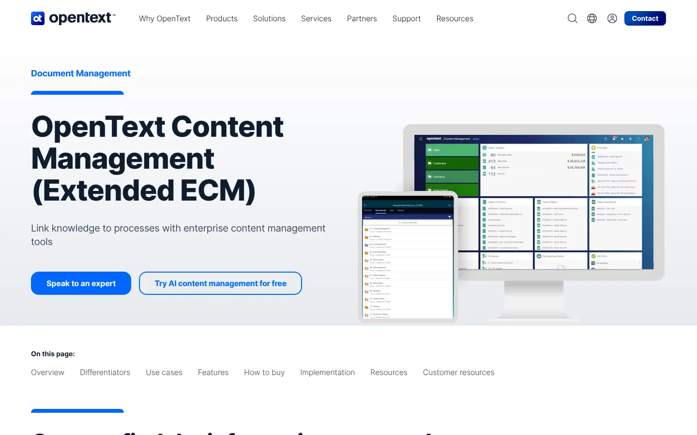

# 10 Best Document Management Software Platforms for Secure Workflows

Microsoft SharePoint fits Microsoft 365 organizations willing to govern configuration. Box suits secure external collaboration. M-Files emphasizes metadata, while DocuWare supports capture-led processes. The best platform depends on record types, permissions, retention, workflow, and migration. It must also fit each document source.

Document storage keeps files available. Document management adds governed metadata, versions, permissions, workflows, retention, and audit evidence.
Buyers should test the complete document lifecycle, not only upload and search.
This article uses public product and pricing information reviewed on November 20, 2026. It does not claim hands-on testing.

## Key Takeaways

- **SharePoint is the natural choice for Microsoft 365 organizations** that need permissions and records in one place.
- **Box and Egnyte suit secure external sharing and governed content.**
- **M-Files, DocuWare, and Laserfiche fit process-heavy and regulated workflows**, and are priced through sales.
- **Revver publishes simple per-user pricing**, starting at $25 per user monthly for its Basic tier.
- **Test permissions, retention, and migration first.** These matter more than storage size.

## How These Products Were Selected

Use the buying criteria that change implementation, risk, and total cost.

- **Information model.** Define document types, metadata, ownership, versions, and record status.
- **Access.** Test inheritance, exceptions, external sharing, named links, groups, and administrator roles.
- **Lifecycle.** Review drafts, approvals, signatures, publication, retention, legal holds, and disposal.
- **Capture.** Test OCR, scanning, email intake, templates, classification, and duplicate handling.
- **Migration.** Preserve versions, metadata, links, permissions, audit history, and required timestamps.
- **Cost.** Include seats, storage, workflow, OCR, migration, integrations, support, and administration.

## Best Options at a Glance

| Product | Best for | Pricing signal | Main watch point |
| --- | --- | --- | --- |
| Microsoft SharePoint | Microsoft 365 document governance | Standalone and Microsoft 365 plans; confirm current terms | Configuration and permission design require ownership |
| Box | Secure external collaboration | Per-user business plans; confirm current terms | Advanced governance can require higher plans |
| M-Files | Metadata-led document management | Quote-based | Design and migration effort can be substantial |
| DocuWare | Capture and document workflows | Quote-based | Scope depends on capture and process modules |
| Laserfiche | Governed content and process automation | Quote-based | Implementation requires information architecture |
| Egnyte | Content governance and controlled sharing | Public and quote-based plans | Security and governance features vary by edition |
| Revver | Small-team document workflows | Basics from about $25 per user monthly | Check scale and integration needs |
| Google Drive and Workspace | Simple collaboration and shared drives | Per-user Workspace plans; confirm current terms | Storage alone is not complete document governance |
| Dropbox Business | Familiar file synchronization and sharing | Seat-based business plans | Governance depth varies by plan |
| OpenText Content Management | Enterprise content and records | Quote-based | Complexity and implementation scope are high |

## 1. Microsoft SharePoint

**Best for:** Microsoft 365 document governance

SharePoint supports document libraries, metadata, versions, permissions, search, workflows, and retention within Microsoft 365. It fits organizations already using Microsoft identity and collaboration. Its flexibility can produce inconsistent sites. Define library, metadata, permission, retention, and ownership standards before migration.

**Pricing signal:** Standalone and Microsoft 365 plans; confirm current terms. Check current terms on the [Microsoft SharePoint pricing page](https://www.microsoft.com/en-us/microsoft-365/sharepoint/compare-sharepoint-plans).

**Watch point:** Configuration and permission design require ownership

## 2. Box

**Best for:** Secure external collaboration

Box combines managed content, external sharing, integrations, workflow, and governance. It fits organizations exchanging documents with partners and customers. Test folder inheritance, external accounts, link policies, classification, and retention. Model enterprise security features above the entry tier.

**Pricing signal:** Per-user business plans; confirm current terms. Check current terms on the [Box pricing page](https://www.box.com/pricing).

**Watch point:** Advanced governance can require higher plans

## 3. M-Files

**Best for:** Metadata-led document management

M-Files organizes documents through metadata and business context rather than folder paths alone. It fits regulated or complex information environments. The model can improve retrieval when teams govern metadata well. Pilot classification, search, version history, permissions, and existing repositories with real records.

**Pricing signal:** Quote-based. Check current terms on the [M-Files pricing page](https://www.m-files.com/pricing/).

**Watch point:** Design and migration effort can be substantial

## 4. DocuWare

**Best for:** Capture and document workflows

DocuWare focuses on document capture, indexing, storage, search, and business workflows. It fits paper-heavy or invoice-led operations. Test OCR against real document quality and exceptions. Include scanning, integration, workflow, storage, and support in the implementation model.

**Pricing signal:** Quote-based. Check current terms on the [DocuWare pricing page](https://start.docuware.com/pricing).

**Watch point:** Scope depends on capture and process modules

## 5. Laserfiche

**Best for:** Governed content and process automation

Laserfiche combines records, documents, forms, workflows, and process automation. It fits organizations needing formal content control and business processes. The platform's value depends on design quality. Test retention, metadata, permissions, search, forms, and disposition with accountable owners.

**Pricing signal:** Quote-based. Check current terms on the [Laserfiche pricing page](https://www.laserfiche.com/products/).

**Watch point:** Implementation requires information architecture

## 6. Egnyte

**Best for:** Content governance and controlled sharing

Egnyte combines file collaboration with governance, classification, and security controls. It fits teams handling large files or external collaboration. Test permission inheritance, links, desktop access, content classification, and ransomware recovery workflows. Confirm feature placement across plans.

**Pricing signal:** Public and quote-based plans. Check current terms on the [Egnyte pricing page](https://www.egnyte.com/plans-pricing).

**Watch point:** Security and governance features vary by edition

## 7. Revver

**Best for:** Small-team document workflows

Revver targets document organization, search, workflow, and team processes. It fits smaller organizations moving beyond shared folders. Test templates, metadata, permissions, workflow exceptions, and export. Confirm storage, integrations, support, and user minimums before selection.

**Pricing signal:** Basics from about $25 per user monthly. Check current terms on the [Revver pricing page](https://www.revverdocs.com/pricing).

**Watch point:** Check scale and integration needs

## 8. Google Drive and Workspace

**Best for:** Simple collaboration and shared drives

Google Drive provides collaborative files, shared drives, search, and Workspace administration. It fits teams centered on Google tools. A governed document system needs more than storage. Define shared-drive ownership, labels, retention, external sharing, and offboarding.

**Pricing signal:** Per-user Workspace plans; confirm current terms. Check current terms on the [Google Drive and Workspace pricing page](https://workspace.google.com/pricing.html).

**Watch point:** Storage alone is not complete document governance

## 9. Dropbox Business

**Best for:** Familiar file synchronization and sharing

Dropbox Business combines synchronization, team folders, sharing, recovery, and administration. It fits teams wanting familiar desktop and cloud file workflows. Test external links, team ownership, recovery windows, retention, and content transfer. Confirm which controls need higher plans.

**Pricing signal:** Seat-based business plans. Check current terms on the [Dropbox Business pricing page](https://www.dropbox.com/business/plans-comparison).

**Watch point:** Governance depth varies by plan

## 10. OpenText Content Management

**Best for:** Enterprise content and records

OpenText targets large enterprises with content services, records, workflows, and integrations. It fits organizations with complex regulatory and repository needs. A selection should start with defined record classes and processes. Include migration, customization, infrastructure, support, and administrator capacity.

**Pricing signal:** Quote-based. Check current terms on the [OpenText Content Management pricing page](https://www.opentext.com/products/content-management).

**Watch point:** Complexity and implementation scope are high

## How to Run a Useful Pilot

A useful pilot follows a real workflow and includes a controlled failure.

1. Select twenty documents across five real document types.
2. Import metadata, multiple versions, and inherited permissions.
3. Run one approval with rejection, correction, and resubmission.
4. Search by content, metadata, date, owner, and record status.
5. Share one document externally with an expiry and revocation.
6. Export the documents with metadata, versions, and audit history.

## Common Buying Mistakes

These mistakes often appear after a promising product demonstration.

- Moving shared folders without defining document types and ownership.
- Breaking inherited permissions with many undocumented exceptions.
- Migrating final files while losing versions, links, and audit history.
- Treating OCR accuracy as proven after testing only clean sample documents.

## Final Approval Checks

Use these questions before signing a contract or approving production rollout.

- Has each document type received an owner and retention rule?
- Can users explain inherited permissions and every approved exception?
- Does migration preserve metadata, versions, links, and audit history?
- Can external access expire without breaking internal document references?
- Does search respect the same permissions as direct navigation?
- Can records export with their metadata and disposition evidence?

## What to Watch in 2027

Watch AI classification, search, and drafting features. Test permission trimming, source citations, retention, and generated content ownership before broader use.

Document management rarely stands alone. Stack Row's [B2B technology statistics](/business-technology/b2b-tech-statistics/) show how buyers weigh software investments, and teams that route approvals through documents should compare [workflow automation software](/business-technology/best-workflow-automation-software/). Shared drives also hold credentials and keys, so review the [best password manager](/cybersecurity/best-password-manager/) options as part of the same access plan.

## Frequently Asked Questions

### What Makes Software a Document Management System?

It adds governed metadata, versions, permissions, workflows, retention, and audit history to document storage.

### Is SharePoint a Document Management System?

Yes, when teams configure libraries, metadata, permissions, retention, search, and governance for defined records.

### What Should a Migration Pilot Test?

Test metadata, versions, permissions, links, OCR, search, audit history, and rollback.

### How Should External Sharing Work?

Use named access, expiry, least privilege, and auditability. Avoid permanent public links for controlled documents.

## Resources

Product and pricing pages were reviewed on November 20, 2026. Confirm current terms before purchase.

- [Microsoft SharePoint pricing and product page](https://www.microsoft.com/en-us/microsoft-365/sharepoint/compare-sharepoint-plans)
- [Box pricing and product page](https://www.box.com/pricing)
- [M-Files pricing and product page](https://www.m-files.com/pricing/)
- [DocuWare pricing and product page](https://start.docuware.com/pricing)
- [Laserfiche pricing and product page](https://www.laserfiche.com/products/)
- [Egnyte pricing and product page](https://www.egnyte.com/plans-pricing)
- [Revver pricing and product page](https://www.revverdocs.com/pricing)
- [Google Drive and Workspace pricing and product page](https://workspace.google.com/pricing.html)
- [Dropbox Business pricing and product page](https://www.dropbox.com/business/plans-comparison)
- [OpenText Content Management pricing and product page](https://www.opentext.com/products/content-management)

Stack Row provides general technology research. Test every product against your own requirements before purchase.
