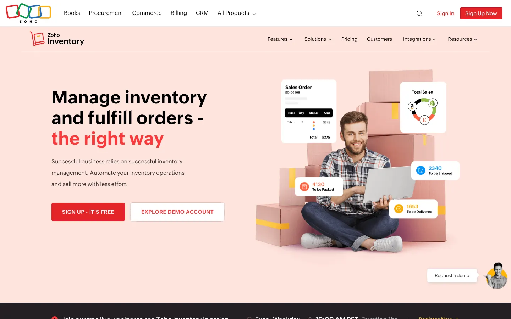
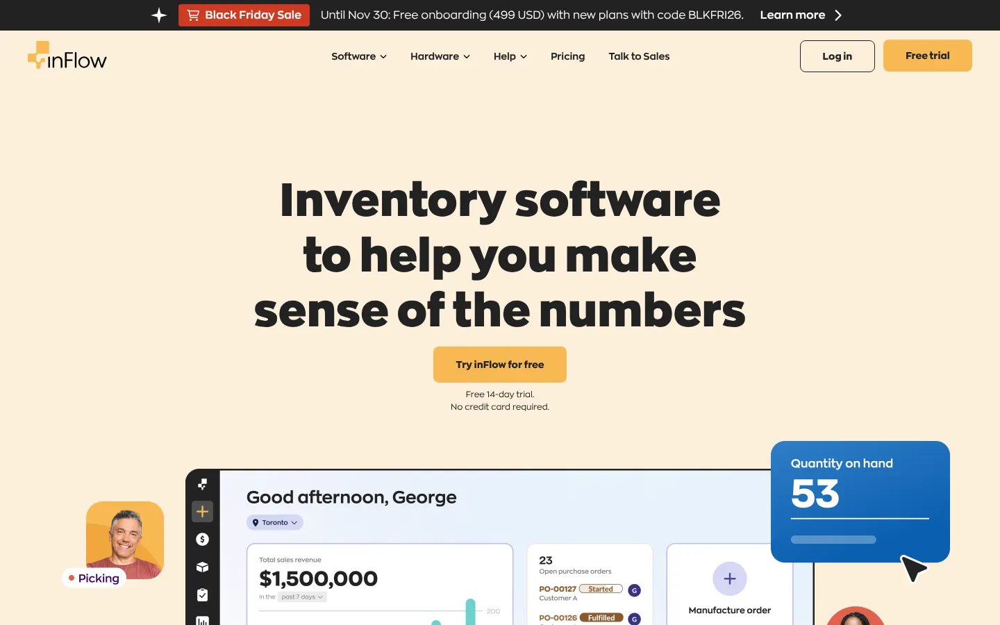
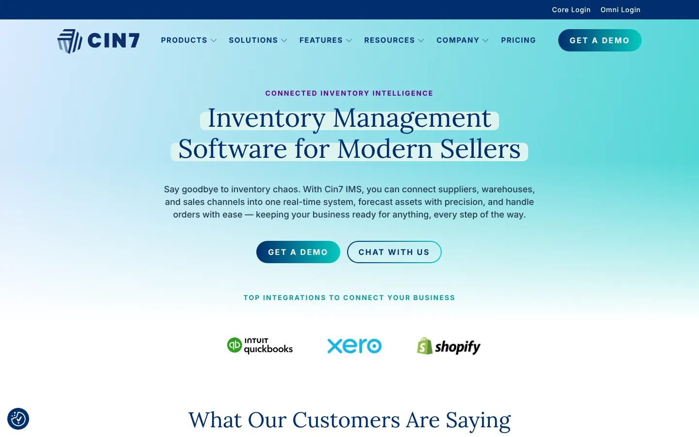
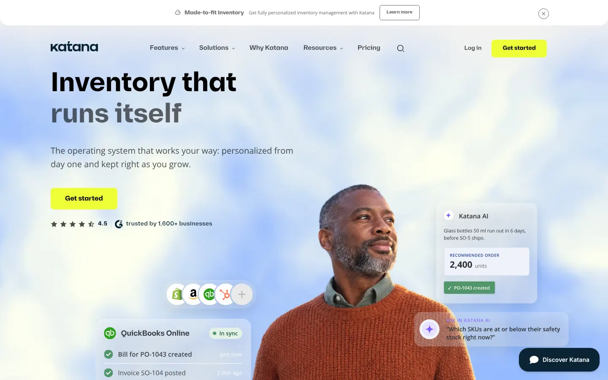
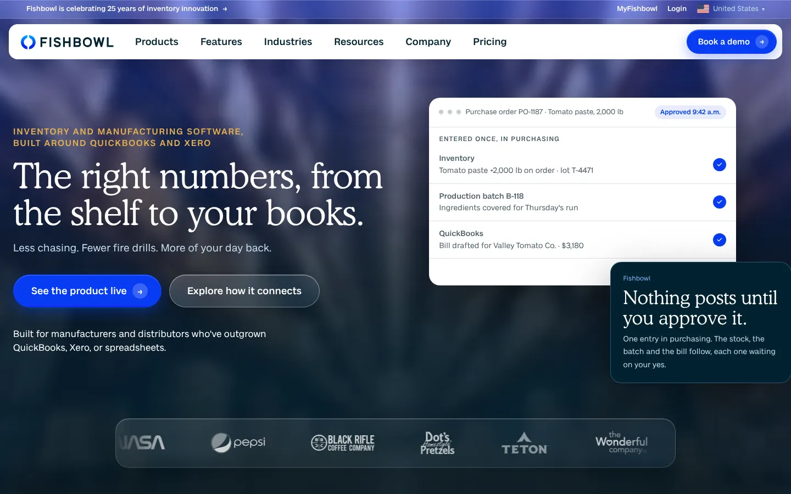
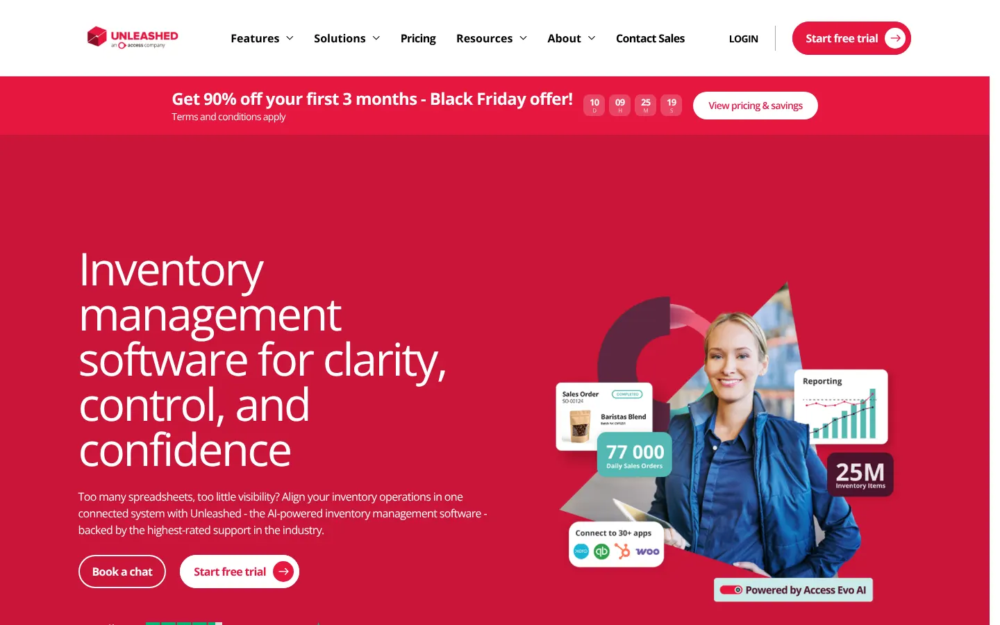
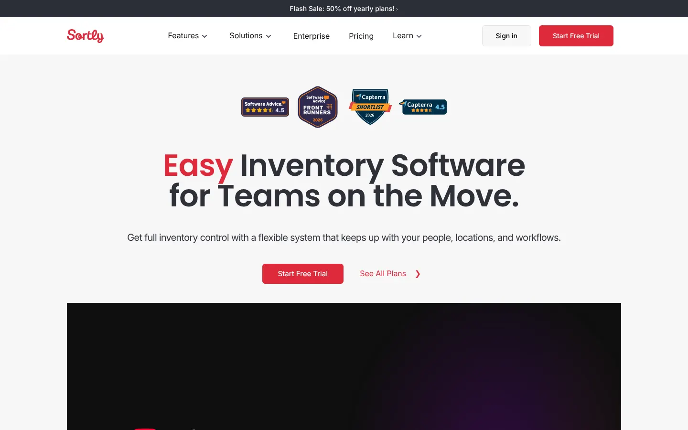
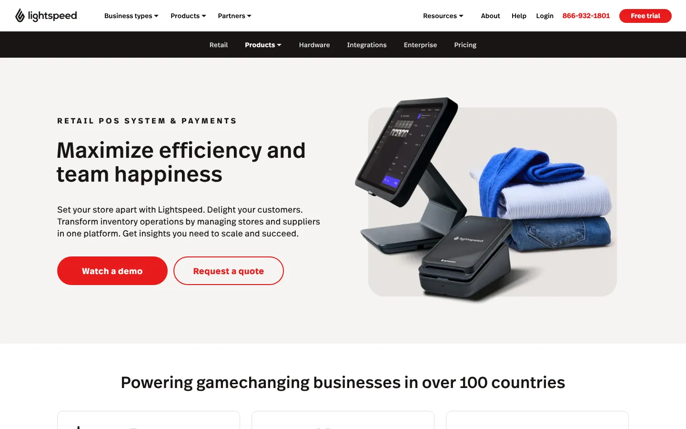
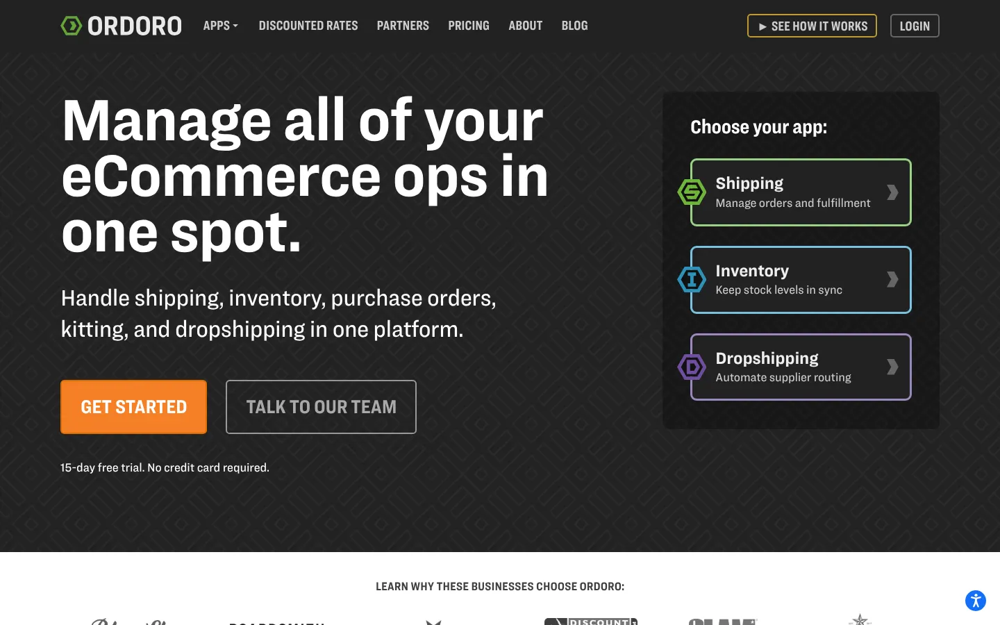

# 10 Best Inventory Management Software Platforms for Small Businesses

Zoho Inventory offers a strong budget entry for multichannel sellers. inFlow fits wholesale operations, while Katana serves small manufacturers. Cin7 Core suits more complex multichannel growth. Retailers should also consider Square or Lightspeed when point of sale drives the inventory record.

Small-business inventory software should match how products move through the company. Retail, ecommerce, wholesale, and manufacturing require different controls.
A useful pilot follows transactions across purchasing, stock, sales, returns, accounting, and every connected channel.
This article uses public product and pricing information reviewed on November 20, 2026. It does not claim hands-on testing.

## Key Takeaways

- **Zoho Inventory is the best low-cost starting point**, with Standard at $29 per organization monthly.
- **Sortly suits simple item tracking**, with paid plans from $24 monthly on annual billing.
- **Katana and Fishbowl fit manufacturers** that need production and bill-of-materials control.
- **Square for Retail and Lightspeed Retail combine inventory with point of sale.**
- **Cin7 Core suits multichannel sellers**, with Standard at $349 monthly.

## How These Products Were Selected

Use the buying criteria that change implementation, risk, and total cost.

- **Business model.** Define retail, ecommerce, wholesale, manufacturing, field stock, or a mixed operation.
- **Item complexity.** Check variants, bundles, kits, lots, serials, expiry, units, and bills of materials.
- **Operations.** Review purchasing, receiving, transfers, counts, picking, shipping, returns, and adjustments.
- **Connections.** Test ecommerce, marketplaces, accounting, shipping, point of sale, and electronic data interchange.
- **Control.** Confirm locations, permissions, approvals, audit trails, costing, and negative-stock behavior.
- **Cost.** Include users, locations, orders, scanners, labels, integrations, setup, and support.

## Best Options at a Glance

| Product | Best for | Pricing signal | Main watch point |
| --- | --- | --- | --- |
| Zoho Inventory | Budget-conscious multichannel sellers | Free option; paid from about $29 per organization monthly | Order and integration limits vary |
| inFlow Inventory | B2B and wholesale operations | Subscription plans after a free trial | Plan limits affect orders, users, and integrations |
| Cin7 Core | Multichannel growth | Standard from about $349 monthly | Implementation and connector scope raise cost |
| Katana | Small manufacturers | Free and paid plans | Production depth and integrations vary by plan |
| Fishbowl | Warehouse and manufacturing around accounting | Quote-based or packaged pricing | Deployment and support need close review |
| Unleashed | Wholesale and product businesses | Subscription plans by users and features | Manufacturing and channel needs affect fit |
| Sortly | Visual mobile inventory | Free option; paid from $24 monthly on annual billing | Complex order processing remains limited |
| Square for Retail | Small retail with integrated POS | Free; Plus from about $49 per location monthly | Wholesale and manufacturing depth is limited |
| Lightspeed Retail | Multi-location retail | Public plans by location and features | Payments and add-ons affect total cost |
| Ordoro | Ecommerce shipping and inventory | Plan-based pricing | Advanced inventory sits above basic shipping |

## 1. Zoho Inventory

**Best for:** Budget-conscious multichannel sellers

Zoho Inventory connects orders, stock, warehouses, shipping, and common ecommerce channels. It fits smaller multichannel sellers and existing Zoho customers. Test transaction synchronization with accounting and storefronts. Review monthly order, warehouse, user, automation, and integration limits.

**Pricing signal:** Free option; paid from about $29 per organization monthly. Check current terms on the [Zoho Inventory pricing page](https://www.zoho.com/inventory/pricing/).

**Watch point:** Order and integration limits vary

## 2. InFlow Inventory

**Best for:** B2B and wholesale operations

inFlow supports purchasing, sales, barcodes, products, locations, and B2B workflows. It fits wholesalers and product businesses needing operational depth without a large ERP. Test quotes, sales orders, picking, shipping, returns, and accounting synchronization. Include scanners and labels in total cost.

**Pricing signal:** Subscription plans after a free trial. Check current terms on the [inFlow Inventory pricing page](https://www.inflowinventory.com/pricing).

**Watch point:** Plan limits affect orders, users, and integrations

## 3. Cin7 Core

**Best for:** Multichannel growth

Cin7 Core supports inventory, purchasing, sales, manufacturing, warehouse, and multichannel connections. It fits growing sellers with operational complexity. The platform needs careful mapping across products, channels, and accounting. Test bundles, variants, landed cost, returns, and synchronization failures.

**Pricing signal:** Standard from about $349 monthly. Check current terms on the [Cin7 Core pricing page](https://www.cin7.com/pricing/).

**Watch point:** Implementation and connector scope raise cost

## 4. Katana

**Best for:** Small manufacturers

Katana connects materials, production, sales, purchasing, and inventory for manufacturers. It fits businesses moving from spreadsheets into production planning. Test bills of materials, substitutions, partial completion, scrap, outsourced work, and shop-floor updates. Confirm accounting and ecommerce transaction behavior.

**Pricing signal:** Free and paid plans. Check current terms on the [Katana pricing page](https://katanamrp.com/pricing/).

**Watch point:** Production depth and integrations vary by plan

## 5. Fishbowl

**Best for:** Warehouse and manufacturing around accounting

Fishbowl supports inventory, warehouse, manufacturing, barcodes, and accounting connections. It fits businesses needing deeper operations around QuickBooks or related systems. Test synchronization at transaction level. Include implementation, training, updates, hosting choice, hardware, and support.

**Pricing signal:** Quote-based or packaged pricing. Check current terms on the [Fishbowl pricing page](https://www.fishbowlinventory.com/pricing/).

**Watch point:** Deployment and support need close review

## 6. Unleashed

**Best for:** Wholesale and product businesses

Unleashed focuses on purchasing, stock, sales, product costing, and business reporting. It fits wholesalers and product companies needing cloud inventory control. Test landed costs, batches, serials, assemblies, returns, and accounting. Confirm regional integrations and support coverage.

**Pricing signal:** Subscription plans by users and features. Check current terms on the [Unleashed pricing page](https://www.unleashedsoftware.com/pricing).

**Watch point:** Manufacturing and channel needs affect fit

## 7. Sortly

**Best for:** Visual mobile inventory

Sortly uses visual items, folders, barcodes, and mobile workflows. It fits equipment, supplies, field inventory, and simpler stock tracking. It is easier to start than a full order system. Test location transfers, permissions, offline work, audit trails, and exports.

**Pricing signal:** Free option; paid from $24 monthly on annual billing. Check current terms on the [Sortly pricing page](https://www.sortly.com/pricing/).

**Watch point:** Complex order processing remains limited

## 8. Square for Retail

**Best for:** Small retail with integrated POS

Square for Retail links point of sale, items, stock, purchase orders, vendors, and locations. It fits small retailers already using Square payments. Test returns, transfers, counts, online orders, and location permissions. Confirm which reporting and inventory functions require Plus.

**Pricing signal:** Free; Plus from about $49 per location monthly. Check current terms on the [Square for Retail pricing page](https://squareup.com/us/en/point-of-sale/retail/pricing).

**Watch point:** Wholesale and manufacturing depth is limited

## 9. Lightspeed Retail

**Best for:** Multi-location retail

Lightspeed Retail combines point of sale, inventory, purchasing, reporting, ecommerce, and multi-location functions. It fits established retailers with more complex catalogs. Test variants, matrices, transfers, counts, returns, and purchase orders. Model locations, registers, payments, ecommerce, and support.

**Pricing signal:** Public plans by location and features. Check current terms on the [Lightspeed Retail pricing page](https://www.lightspeedhq.com/pos/retail/pricing/).

**Watch point:** Payments and add-ons affect total cost

## 10. Ordoro

**Best for:** Ecommerce shipping and inventory

Ordoro combines order management, shipping, inventory, dropshipping, and marketplace connections. It fits ecommerce teams coordinating fulfillment across channels. Test order imports, routing, kits, supplier feeds, returns, and inventory updates. Confirm which functions belong to each plan.

**Pricing signal:** Plan-based pricing. Check current terms on the [Ordoro pricing page](https://www.ordoro.com/pricing).

**Watch point:** Advanced inventory sits above basic shipping

## How to Run a Useful Pilot

A useful pilot follows a real workflow and includes a controlled failure.

1. Create items with variants, a bundle, and one tracked lot.
2. Purchase, partially receive, and allocate stock across two locations.
3. Sell through a connected channel and process a return.
4. Change a product and inspect synchronization across systems.
5. Run a count, adjustment, and month-end reconciliation.
6. Export items, transactions, suppliers, customers, and audit records.

## Common Buying Mistakes

These mistakes often appear after a promising product demonstration.

- Choosing by feature count before defining the physical product flow.
- Testing stock counts without testing returns, transfers, and adjustments.
- Assuming ecommerce and accounting synchronization works in both directions.
- Ignoring scanners, labels, implementation, and cleanup in total cost.

## Final Approval Checks

Use these questions before signing a contract or approving production rollout.

- Does the system support every item type used by the business?
- Do connected systems agree after sales, returns, and adjustments?
- Can staff complete counts and corrections without weakening audit history?
- Does the costing method match finance and accounting requirements?
- Can the business export products, transactions, and supplier records?
- Does the budget include hardware, integrations, setup, and cleanup?

## What to Watch in 2027

Watch AI forecasting and purchasing recommendations. Confirm the input data, exception handling, review owner, and measurable forecast error before automation.

Inventory software usually connects to accounting, so compare it with the [best accounting software for small business](/business-technology/best-accounting-software-small-business/). Stack Row's [B2B technology statistics](/business-technology/b2b-tech-statistics/) show how small companies approach software buying, and growing teams can use [workflow automation software](/business-technology/best-workflow-automation-software/) to connect orders, stock, and fulfillment.

## Frequently Asked Questions

### What Inventory Software Is Best for a Small Business?

The best fit follows the operating model. Retail, ecommerce, wholesale, and manufacturing need different controls.

### Can Accounting Software Replace Inventory Software?

Basic stock counts may be enough for simple businesses. Complex locations, lots, bundles, or production need deeper tools.

### What Should an Inventory Pilot Include?

Run a purchase, receipt, transfer, sale, return, adjustment, and month-end reconciliation.

### How Should Teams Compare Total Cost?

Include users, locations, orders, integrations, scanners, implementation, support, and accounting cleanup.

## Resources

Product and pricing pages were reviewed on November 20, 2026. Confirm current terms before purchase.

- [Zoho Inventory pricing and product page](https://www.zoho.com/inventory/pricing/)
- [inFlow Inventory pricing and product page](https://www.inflowinventory.com/pricing)
- [Cin7 Core pricing and product page](https://www.cin7.com/pricing/)
- [Katana pricing and product page](https://katanamrp.com/pricing/)
- [Fishbowl pricing and product page](https://www.fishbowlinventory.com/pricing/)
- [Unleashed pricing and product page](https://www.unleashedsoftware.com/pricing)
- [Sortly pricing and product page](https://www.sortly.com/pricing/)
- [Square for Retail pricing and product page](https://squareup.com/us/en/point-of-sale/retail/pricing)
- [Lightspeed Retail pricing and product page](https://www.lightspeedhq.com/pos/retail/pricing/)
- [Ordoro pricing and product page](https://www.ordoro.com/pricing)

Stack Row provides general technology research. Test every product against your own requirements before purchase.
