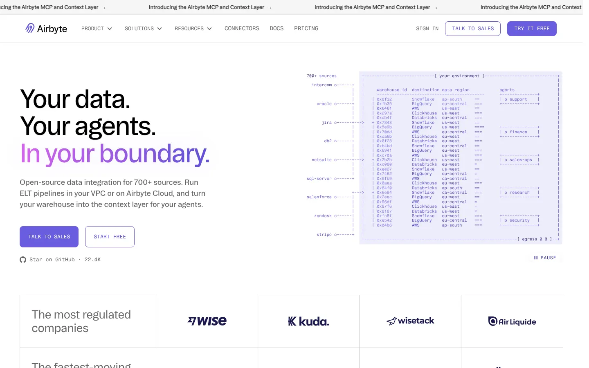
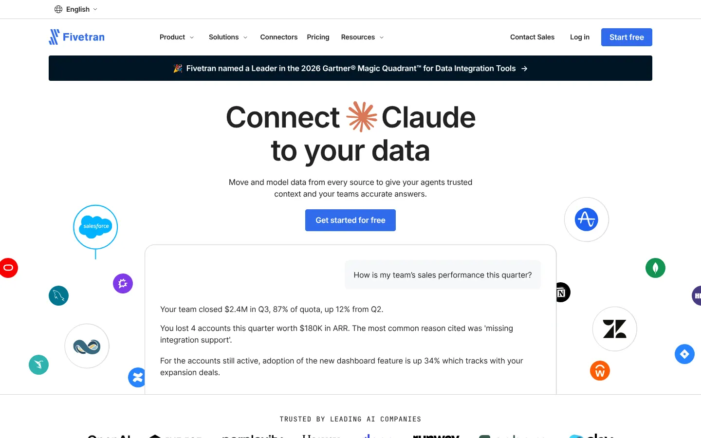
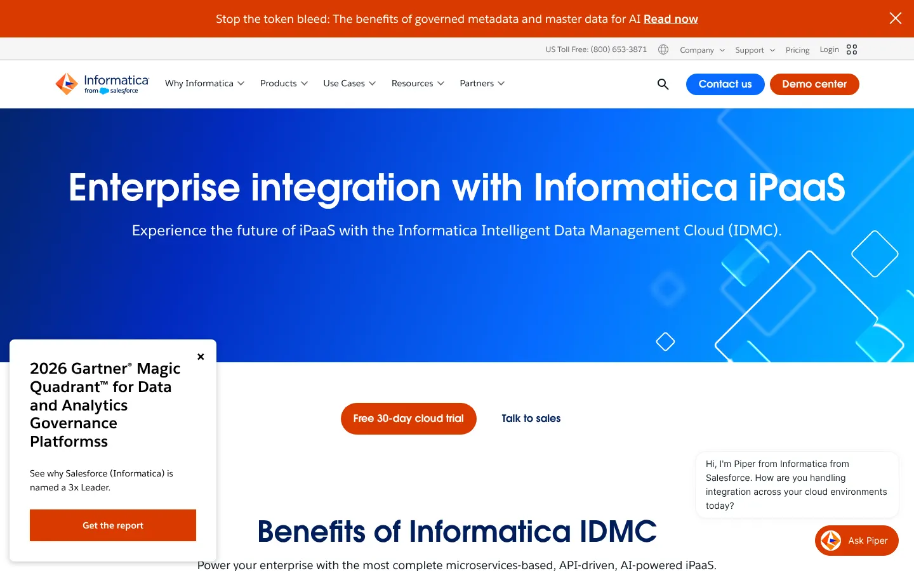
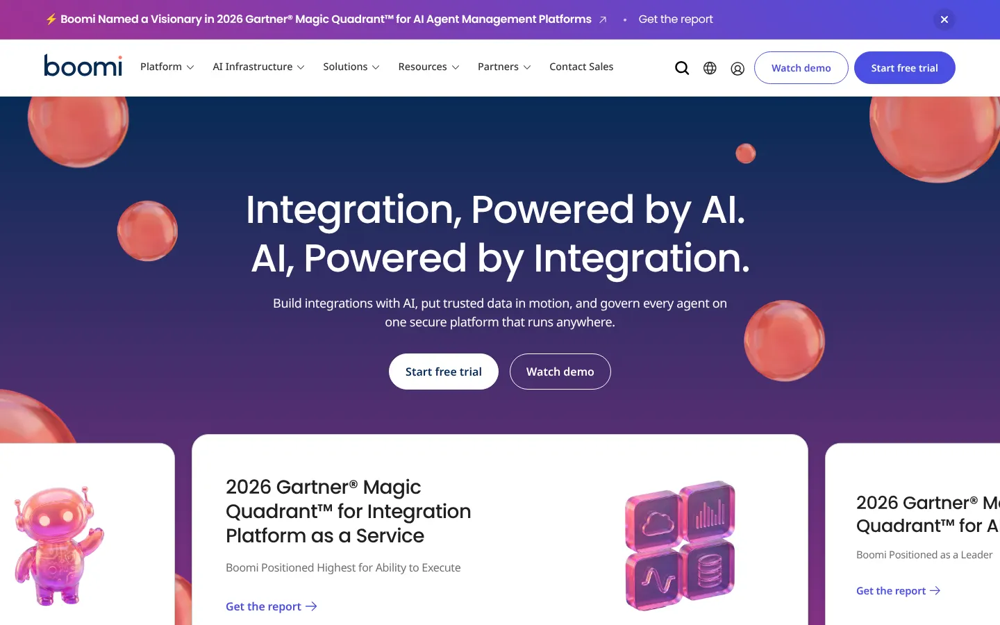
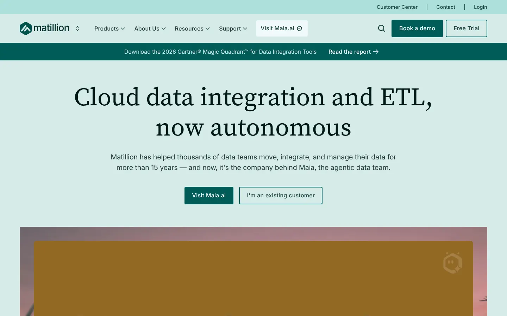
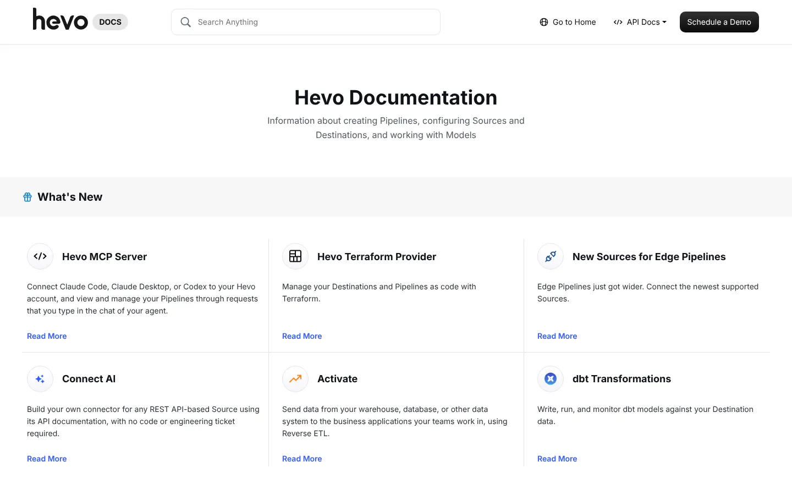
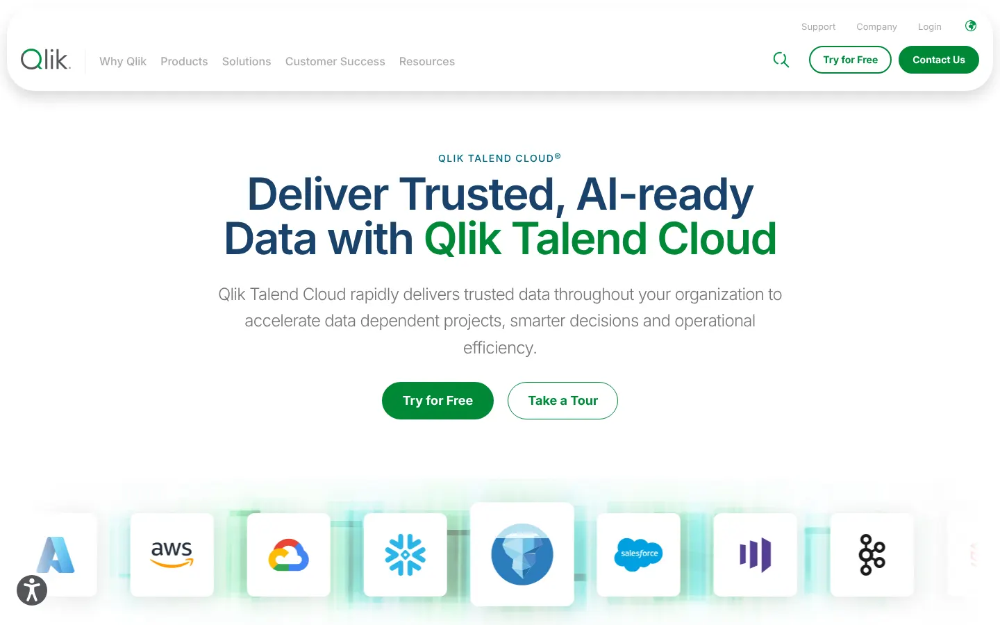
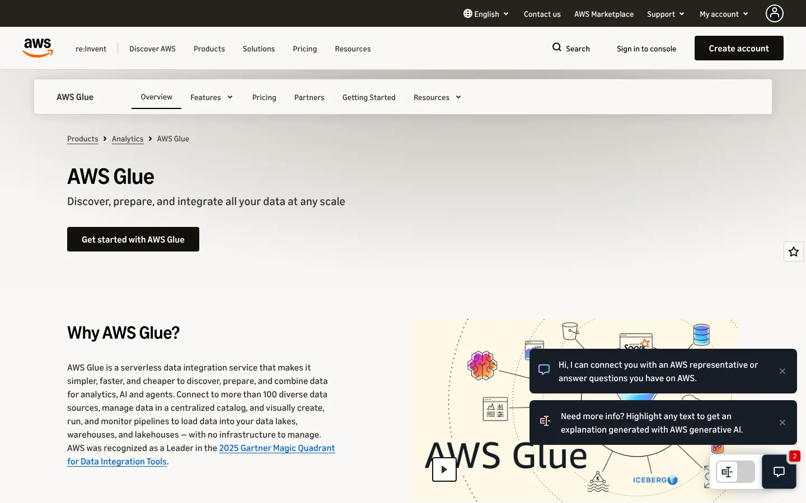
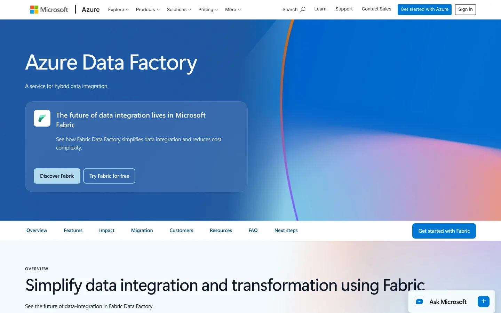

# 10 Best Data Integration Tools for Modern Data Teams

Airbyte fits teams needing connector breadth and deployment control. Fivetran suits low-maintenance managed ELT. Informatica and MuleSoft serve broader enterprise programs. Matillion fits warehouse-centered transformation. The right choice depends on latency, data volume, connector behavior, governance, recovery, and who operates each pipeline.

Data integration tools move and synchronize information across applications, databases, warehouses, and services. The category includes several different technical patterns.
Define ETL, ELT, change data capture, integration platform as a service, and reverse ETL before comparing vendors.
This article uses public product and pricing information reviewed on November 20, 2026. It does not claim hands-on testing.

## Key Takeaways

- **Airbyte and Fivetran lead for managed ELT**, and Airbyte also offers a free self-managed Core.
- **Informatica, MuleSoft, and Boomi suit enterprise integration** across applications and APIs.
- **Matillion and Hevo Data serve analytics teams** loading cloud warehouses, with Hevo Starter from $299 monthly.
- **AWS Glue and Azure Data Factory fit teams committed to one cloud.**
- **Usage-based pricing needs a volume forecast.** Rows, credits, and compute hours drive the bill.

## How These Products Were Selected

Use the buying criteria that change implementation, risk, and total cost.

- **Pattern.** Define batch ETL, warehouse ELT, CDC, application integration, API integration, or reverse ETL.
- **Connector behavior.** Check supported objects, incremental keys, deletes, history, limits, and authentication.
- **Reliability.** Review retries, replay, checkpoints, duplicate handling, dead letters, and service levels.
- **Change control.** Test schema drift, type changes, deployment promotion, versioning, and rollback.
- **Observability.** Confirm lineage, logs, metrics, alerts, row counts, freshness, and cost attribution.
- **Cost.** Model rows, events, credits, compute, runtime, connectors, environments, and support.

## Best Options at a Glance

| Product | Best for | Pricing signal | Main watch point |
| --- | --- | --- | --- |
| Airbyte | Connector breadth and deployment control | Free Core; cloud plans from about $20 monthly | Connector quality and operations vary |
| Fivetran | Low-maintenance managed ELT | Free allowance; usage based on monthly active rows | Cost follows changed data and connection behavior |
| Informatica | Enterprise integration and governance | Consumption-based and quote-based | Platform breadth requires clear scope |
| Boomi | Hybrid iPaaS and application integration | Public entry signals and quote-based enterprise plans | Runtime and connector scope affect cost |
| MuleSoft Anypoint Platform | API-led enterprise integration | Quote-based | Architecture and delivery skills are substantial |
| Matillion | Warehouse-centered ELT | Credit-based with trial options | Warehouse compute remains a separate cost |
| Hevo Data | No-code managed data pipelines | Free option; Starter from about $299 monthly | Event volume can drive cost |
| Qlik Talend Cloud | Integration with quality and governance | Quote-based | Edition and capacity design need review |
| AWS Glue | AWS-native serverless integration | Usage-based by compute and related services | Cloud service costs span several components |
| Azure Data Factory | Azure-native pipelines and orchestration | Usage-based by activity and runtime | Pricing includes several meters |

## 1. Airbyte

**Best for:** Connector breadth and deployment control

Airbyte provides open-source and managed data movement with a large connector catalog. It fits teams needing long-tail sources or deployment choice. Connector availability does not guarantee equal reliability. Test schema changes, incremental state, deletes, replay, and ownership for every critical connector.

**Pricing signal:** Free Core; cloud plans from about $20 monthly. Check current terms on the [Airbyte pricing page](https://airbyte.com/pricing).

**Watch point:** Connector quality and operations vary

## 2. Fivetran

**Best for:** Low-maintenance managed ELT

Fivetran emphasizes vendor-maintained connectors and managed pipelines. It fits teams prioritizing lower connector upkeep. Pricing depends on monthly active rows by connection. Model high-change tables, resyncs, history modes, and destination compute before selection.

**Pricing signal:** Free allowance; usage based on monthly active rows. Check current terms on the [Fivetran pricing page](https://www.fivetran.com/pricing).

**Watch point:** Cost follows changed data and connection behavior

## 3. Informatica

**Best for:** Enterprise integration and governance

Informatica combines data integration, quality, governance, catalog, and related enterprise services. It fits complex hybrid estates with formal control needs. Start with defined use cases and volumes. Avoid buying a broad platform without named owners and measurable operating requirements.

**Pricing signal:** Consumption-based and quote-based. Check current terms on the [Informatica pricing page](https://www.informatica.com/products/cloud-integration.html).

**Watch point:** Platform breadth requires clear scope

## 4. Boomi

**Best for:** Hybrid iPaaS and application integration

Boomi supports application integration, APIs, data, and hybrid runtimes. It fits organizations connecting cloud and on-premises systems. Test runtime placement, network dependencies, connector entitlements, retries, monitoring, and deployment promotion. Separate application workflows from analytics pipelines.

**Pricing signal:** Public entry signals and quote-based enterprise plans. Check current terms on the [Boomi pricing page](https://boomi.com/products/integration/).

**Watch point:** Runtime and connector scope affect cost

## 5. MuleSoft Anypoint Platform

**Best for:** API-led enterprise integration

MuleSoft combines API design, integration, governance, management, and reusable assets. It fits enterprises treating APIs as managed products. The value depends on operating discipline and delivery capacity. Include platform teams, environments, runtime, support, and application changes in total cost.

**Pricing signal:** Quote-based. Check current terms on the [MuleSoft Anypoint Platform pricing page](https://www.mulesoft.com/platform/enterprise-integration).

**Watch point:** Architecture and delivery skills are substantial

## 6. Matillion

**Best for:** Warehouse-centered ELT

Matillion focuses on loading and transforming data with cloud data platforms. It fits teams using pushdown processing inside a warehouse. Credit consumption covers only part of the bill. Model platform credits, warehouse compute, development, orchestration, and failed retries together.

**Pricing signal:** Credit-based with trial options. Check current terms on the [Matillion pricing page](https://www.matillion.com/pricing).

**Watch point:** Warehouse compute remains a separate cost

## 7. Hevo Data

**Best for:** No-code managed data pipelines

Hevo targets managed data movement with no-code setup and near-real-time options. It fits smaller data teams prioritizing ease of use. Event-based pricing requires a realistic volume model. Test updates, deletes, schema drift, replay, and historical loads before estimating cost.

**Pricing signal:** Free option; Starter from about $299 monthly. Check current terms on the [Hevo Data pricing page](https://hevodata.com/pricing/).

**Watch point:** Event volume can drive cost

## 8. Qlik Talend Cloud

**Best for:** Integration with quality and governance

Qlik Talend Cloud combines integration, quality, transformation, and governance capabilities. It fits organizations needing more than connector replication. The selection should define cloud, hybrid, batch, real-time, and quality requirements. Test lineage, schema change, errors, and support across one full data product.

**Pricing signal:** Quote-based. Check current terms on the [Qlik Talend Cloud pricing page](https://www.qlik.com/us/products/qlik-talend-cloud).

**Watch point:** Edition and capacity design need review

## 9. AWS Glue

**Best for:** AWS-native serverless integration

AWS Glue offers serverless data integration, cataloging, jobs, and connectors inside AWS. It fits teams operating data platforms on Amazon Web Services. Jobs can also consume storage, networking, queries, logs, and related services. Build a full workload estimate from measured runs.

**Pricing signal:** Usage-based by compute and related services. Check current terms on the [AWS Glue pricing page](https://aws.amazon.com/glue/pricing/).

**Watch point:** Cloud service costs span several components

## 10. Azure Data Factory

**Best for:** Azure-native pipelines and orchestration

Azure Data Factory connects sources, moves data, and orchestrates transformations across Azure and other systems. It fits Microsoft cloud environments. Costs can involve activities, integration runtime, data movement, and external compute. Price the real pipeline rather than a connector count.

**Pricing signal:** Usage-based by activity and runtime. Check current terms on the [Azure Data Factory pricing page](https://azure.microsoft.com/en-us/pricing/details/data-factory/).

**Watch point:** Pricing includes several meters

## How to Run a Useful Pilot

A useful pilot follows a real workflow and includes a controlled failure.

1. Load a full historical dataset into a clean destination.
2. Run an incremental load containing inserts, updates, and deletes.
3. Change a source column and inspect schema handling.
4. Break the destination, repair it, and replay the failed window.
5. Confirm row counts, duplicates, ordering, and downstream freshness.
6. Export logs, lineage, configuration, and cost data.

## Common Buying Mistakes

These mistakes often appear after a promising product demonstration.

- Counting connectors without checking supported objects and incremental behavior.
- Testing successful loads while ignoring replay and duplicate prevention.
- Treating platform charges as the complete cost of destination compute.
- Building pipelines without named owners for sources, failures, and schemas.

## Final Approval Checks

Use these questions before signing a contract or approving production rollout.

- Does each connector support required objects, deletes, and incremental fields?
- Can operators replay a precise window without duplicating records?
- Are lineage, freshness, row counts, and failures visible together?
- Can schemas change through tested promotion and rollback steps?
- Does every pipeline have source and destination owners?
- Does the cost model include destination compute and historical reloads?

## What to Watch in 2027

Watch AI-generated mappings and pipeline code. Review generated logic, permissions, data exposure, deployment, and recovery like any other production change.

Data integration feeds reporting and AI work. Stack Row's guide to [business intelligence tools](/business-technology/business-intelligence-tools/) covers where integrated data ends up, and teams building API-led pipelines should compare [API gateways](/developer-data/api-gateways/). Simpler app-to-app jobs may fit [workflow automation software](/business-technology/best-workflow-automation-software/) instead.

## Frequently Asked Questions

### What Is the Difference Between ETL and ELT?

ETL transforms data before loading. ELT loads first and transforms inside the destination platform.

### What Is Change Data Capture?

Change data capture moves inserts, updates, and deletes from source systems with lower latency.

### Which Data Integration Tool Is Easiest to Manage?

Managed connectors reduce upkeep. The tradeoff usually involves cost, control, and connector behavior.

### How Should Teams Test Recovery?

Break a load, repair the cause, replay safely, and confirm duplicate handling and downstream consistency.

## Resources

Product and pricing pages were reviewed on November 20, 2026. Confirm current terms before purchase.

- [Airbyte pricing and product page](https://airbyte.com/pricing)
- [Fivetran pricing and product page](https://www.fivetran.com/pricing)
- [Informatica pricing and product page](https://www.informatica.com/products/cloud-integration.html)
- [Boomi pricing and product page](https://boomi.com/products/integration/)
- [MuleSoft Anypoint Platform pricing and product page](https://www.mulesoft.com/platform/enterprise-integration)
- [Matillion pricing and product page](https://www.matillion.com/pricing)
- [Hevo Data pricing and product page](https://hevodata.com/pricing/)
- [Qlik Talend Cloud pricing and product page](https://www.qlik.com/us/products/qlik-talend-cloud)
- [AWS Glue pricing and product page](https://aws.amazon.com/glue/pricing/)
- [Azure Data Factory pricing and product page](https://azure.microsoft.com/en-us/pricing/details/data-factory/)

Stack Row provides general technology research. Test every product against your own requirements before purchase.
